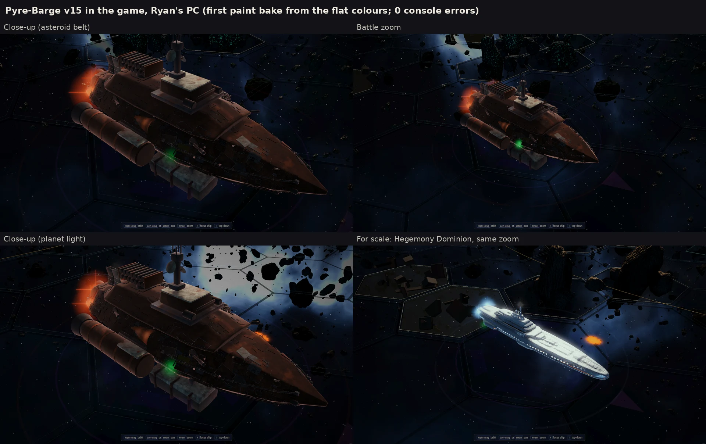

# Embers of the Hollow Sun

Embers of the Hollow Sun (repo name voidsworn) is a hex fleet-tactics roguelite.

The product is the Godot 4 game under `godot/`. The browser rules files at the repo root are retired, frozen history; Godot is the only rules source.

How work runs here: read `AGENTS.md` first, then `docs/RULEBOOK.md`, which wins over every other document.
