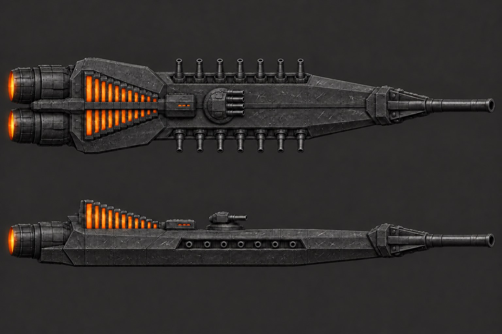
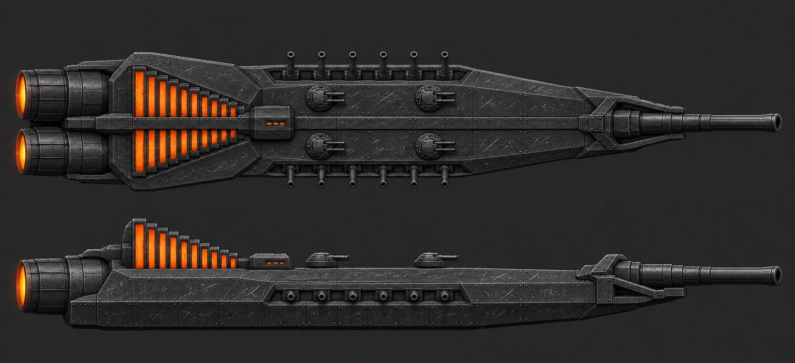
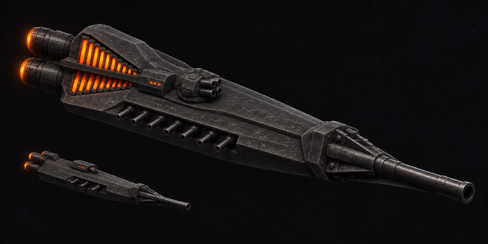
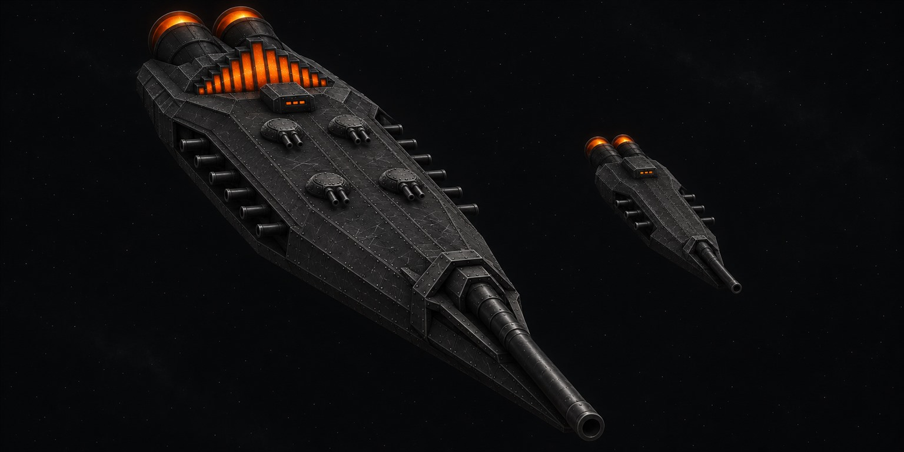

# Issue 440: S1 with visible weapons

Ryan picked S1 with fixes (FINDINGS R176). These two takes preserve its rear radiator signature and replace the lit gun ports and dome with plainly armed installations.
**My pick is S1b:** the two mirrored flak pairs reinforce the ordered broadside layout and keep the centreline clear. S1a gives a stronger single turret silhouette.
Both top views read as armed in inspected 384-pixel-wide thumbnails. Ryan and the Board still choose the take.

| S1a: one quad flak turret | S1b: four twin flak turrets |
|---|---|
|  |  |
|  |  |

## Tries and visible checks

| Picture | Tries | Result |
|---|---:|---|
| S1a sheet | 3 | Seven heavy barrels per flank, one round four-barrel flak turret, one enlarged braced lance |
| S1a beauty | 2 | Corrected extra engine, extra gallery barrel and six-barrel flak; final has two engines, seven near-side guns and four flak muzzles |
| S1b sheet | 2 | Six heavy barrels per flank, four matching twin flak turrets in two mirrored pairs; corrected side flak overlap and proportions |
| S1b beauty | 2 | Corrected five gallery guns to six per flank and shifted camera to an oblique front view; four twin flak turrets retained |

S1a sheet try 1 showed six plan barrels but seven side muzzles, and three flak barrels. Try 2 fixed the galleries but drew five flak barrels. Try 3 removed the fifth.
S1b uses six gallery barrels, within the brief's six-to-eight allowance, even though the first prompt asked for seven.
The top and side now agree on each take's gallery count and flak positions. The horizontal engine pair correctly overlaps in side view.
All weapons are dark, with the lance forward and gallery guns outward. No dome, extra gun rows, backwards guns, naval masts, funnels or stepped decks were observed.
The ember organ-pipe rear radiator bank, two big engines, low command block, riveted black iron and frost-white scratches remain.
Each beauty is derived from its final sheet and includes one simpler escort with a bow lance and three near-side gallery barrels.
Far-side beauty guns can be occluded; the design sheet establishes their count.

### Measured proportions

Approximate manual extents on the final JPGs, uncertainty about 4 pixels per edge.
Length includes lance and engine housings, excludes glow; beam includes projecting guns; height includes radiators.
These are concept measurements, not a traced engineering plan.

| Sheet | Plan x bounds | Plan y bounds | Side y bounds | L / B / H pixels | L:B:H |
|---|---|---|---|---|---|
| S1a | 27 to 1514 | 178 to 472 | 616 to 817 | 1487 / 294 / 201 | 5.06:1:0.68 |
| S1b | 30 to 1510 | 100 to 370 | 422 to 639 | 1480 / 270 / 217 | 5.48:1:0.80 |

S1a is closest to 5:1:0.7. S1b is about 10 percent more slender and its height-to-beam ratio is higher; do not treat it as an exact dimensional reference.
Both retain the rear-wide dagger plan. The exaggerated lance is deliberately the largest bow object.

## Tool and source lineage

Built-in `image_gen__imagegen` through the signed-in session, local reference PNGs accepted. No API/CLI fallback or local GPU tools.
System.Drawing only resized and converted the generated art to JPG; thumbnail checks were simple resizes.
The four new JPGs have longest side 1536 and are below 700,000 bytes.
Existing S1, S2 and S3 trial pictures and text are retained below as history; the old trial recommendation is superseded by Ryan's S1 pick.
Exact prompts, including failed tries, are in [prompts.md](prompts.md).

Original sources are preserved under `C:/Users/rcbai/.codex/generated_images/01a1c936-d3df-7c51-a31e-eadf827f5424/`.

| Picture or earlier try | Original PNG basename |
|---|---|
| S1a sheet try 1 | exec-72c6bd06-9763-42a7-b977-559d8d18f704.png |
| S1a sheet try 2 | exec-9c3e60a2-e2ca-4f69-9b46-9491a6b5044d.png |
| S1a final sheet | exec-a91171e2-4daa-4393-bd53-9c551d0921f7.png |
| S1a beauty try 1 | exec-cb0ab65b-c88b-46b1-b611-41b1785028bf.png |
| S1a final beauty | exec-502d2d2b-3dfc-4277-a967-87c1c8684a02.png |
| S1b sheet try 1 | exec-5b6e1061-a503-48b7-b65b-be7aff21987a.png |
| S1b final sheet | exec-0d292542-48d8-4384-b3b9-0afddd000e75.png |
| S1b beauty try 1 | exec-fce1cc68-3066-40ec-9224-6fdc4031182f.png |
| S1b final beauty | exec-1e50ce20-2356-4031-bc2e-3fa475291428.png |

Each sheet's first call referenced the original S1 PNG from issue 431, `exec-fc1002ba-9517-4a40-9715-80785b13d692.png`, in the older source folder recorded below.
Later sheet corrections reference the previous try. Each beauty starts from its final sheet; the S1a correction used both its beauty and its sheet.

## Issue 440 validation and Board copies

- Standing checks: `node contrib/opus/tools/run_all_checks.js`, exit 0; 41 PASS, 2 KNOWN, no FAIL or SKIP.
- Known findings: KIT-1, KIT-3, ROS-9, MOD-2, EVT-1, NEM-6, UI-5. Oracle drift: 12 baseline constant differences.
- Log: `%TEMP%/voidsworn-issue-440-standing-checks.log`.
- Separate GPU renders, game captures and parity suites skipped because this changes concept art and its notes only.
- All four JPGs decoded successfully, longest side 1536, sizes 131,313 to 195,575 bytes. Board copies match by SHA256.
- Markdown em dash scan and `git diff --check` passed. Only the four new JPGs, README.md and prompts.md changed for this task.
- Nine built-in image calls completed: S1a sheet 3, S1a beauty 2, S1b sheet 2, S1b beauty 2. No picture exceeded three tries.
- No commit, push or deletion.

Board copies:
[S1a sheet](C:/Users/rcbai/Downloads/voidsworn_test/board/issue-440/shots/voidsworn_S1a_sheet.jpg),
[S1a beauty](C:/Users/rcbai/Downloads/voidsworn_test/board/issue-440/shots/voidsworn_S1a_beauty.jpg),
[S1b sheet](C:/Users/rcbai/Downloads/voidsworn_test/board/issue-440/shots/voidsworn_S1b_sheet.jpg),
[S1b beauty](C:/Users/rcbai/Downloads/voidsworn_test/board/issue-440/shots/voidsworn_S1b_beauty.jpg).

---

# Sunward flagship image trial, issue #431

Six pictures made with Codex's built-in image tool: three design sheets and their reference-based beauty views.
My pick for the Board's next review is S3 Forge Blade: its lower radiator bank leaves the dagger plan clear.
These are trial concepts, not approved build references. The failures below need the Board's review.

## Tool, model and limits

- Tool: built-in `image_gen.imagegen` (callable as `image_gen__imagegen`), through the signed-in session. No API key or CLI image fallback.
- Model: the built-in image generation model. The tool exposes no model name, version, selector or model metadata, so an exact model ID cannot be verified.
- Codex CLI: `codex-cli 0.166.0`.
- All three beauty calls accepted a local design-sheet PNG through `referenced_image_paths` and returned images. The final beauty views use the final delivered sheets' original PNGs.
- Eleven image calls completed, producing eleven pictures, six selected for delivery. No generation limit or quota error occurred. The run stopped after the requested set, so maximum capacity is unknown.
- No local GPU render, ComfyUI, Blender or game capture was used. System.Drawing only resized and converted generated pictures to JPG; it did not create the art.
- Original PNGs remain untouched in `C:/Users/rcbai/.codex/generated_images/01a1c888-84b6-7620-935c-d98f21dfb4f7/`.

## Delivered pictures and tries

Every JPG has a 1536 pixel longest side, with JPEG quality 92 and size below 700,000 bytes.

| Variation | Design sheet | Tries | Beauty view | Tries |
|---|---|---:|---|---:|
| S1 Oath Blade | [Sheet](voidsworn_S1_sheet.jpg) | 1 | [Beauty](voidsworn_S1_beauty.jpg) | 1 |
| S2 Blade and Hilt | [Sheet](voidsworn_S2_sheet.jpg) | 3 | [Beauty](voidsworn_S2_beauty.jpg) | 1 |
| S3 Forge Blade | [Sheet](voidsworn_S3_sheet.jpg) | 3 | [Beauty](voidsworn_S3_beauty.jpg) | 2 |

S2 try 1 was too wide, about 3:1. Try 2 was still too wide, about 3.9:1. Try 3 overshot toward narrow.
S3 try 1 was about 4.4:1. Try 2 overshot toward narrow, about 5.8:1. Try 3 brought it close to the target.
S3's first beauty matched its first sheet, then was replaced after the sheet's proportion revisions.
No picture exceeded three tries. All final originals and exported sheets were inspected by eye.

## Twelve gate lines

PASS means the visible sheet supports the line. FAIL also covers a feature that cannot be confirmed by eye.
These scores are candid trial notes for the Board, not a claim that all sheets cleared the gate.

| # | Gate | S1 | S2 | S3 |
|---:|---|---|---|---|
| 1 | Exactly four deliberate weapon installations | FAIL: lance and galleries present, but dorsal flak reads as a lit sensor dome and gallery ports resemble windows | PASS: two dark galleries, one axial lance, one compact short-barrel flak mount | PASS: two recessed dark galleries, one axial lance, one compact short-barrel flak mount |
| 2 | Guns clear; none backward or into hull | FAIL: flak muzzles and firing directions are not resolved | FAIL: gallery mouths read partly upward in the plan; outward firing is not unambiguous | PASS: clear forward lance/flak and open lateral gallery recesses |
| 3 | One thrust axis, engines only at stern | PASS: two stern bells; radiator light is visibly solid fins | PASS: stern bells only; solid radiator bank separate | PASS: stern bells only; lower grates read as heat exchangers |
| 4 | Continuous spine from bow to engines | PASS | PASS | PASS |
| 5 | One low command block and one low sensor cluster | FAIL: command block clear, separate/integrated sensor cluster not legible apart from ambiguous flak | PASS: low command block with one flat cap sensor | PASS: one low command block and one small low sensor cluster |
| 6 | No hangar on this ship | PASS: no bay mouth | PASS: no bay mouth | PASS: no bay mouth |
| 7 | Left/right symmetry | PASS in plan | PASS in plan | PASS in plan |
| 8 | Identity reads in top view | PASS: rear-wide dagger and orderly radiator bank | PASS: blade, squared guard and short engine grip | PASS: bare dagger with lower-edge heat slivers |
| 9 | Near 5:1:0.7 proportions | PASS: about 5.08:1:0.68 | FAIL: about 5.93:1:0.82 | PASS: about 5.35:1:0.75 |
| 10 | One small-detail scale, capital reads very large | PASS: consistent fine rivets, seams and scratches | PASS: consistent rivets and seams | PASS: fine rivets, seams and many grate divisions |
| 11 | Space ship, not sea ship or aircraft | PASS: armoured blade, no naval/aircraft tells | PASS: thick squared machinery guard, no aerodynamic wings or naval hull | PASS: thick armoured blade and lower heat bank, no keel |
| 12 | Black iron, frost white, ember; faction never list | PASS: no blue, rust, crosses, statues or literal cathedral windows | PASS | PASS |

S1: 9 PASS, 3 FAIL. S2: 10 PASS, 2 FAIL. S3: 12 PASS on these visible concept gates.
A pass is an image judgement, not proof of mechanical internals or final build readiness.

### Proportion measurements

Approximate manual pixel extents on the final 1536 x 1024 sheets, uncertainty about 4 pixels per edge.
Length includes engine housings and lance, excludes exhaust and bloom. Beam is maximum plan width.
Height is maximum side silhouette, including radiators. Both views have matching bow/stern endpoints.

| Sheet | Plan x bounds | Plan y bounds | Side y bounds | L / B / H pixels | Normalised L:B:H |
|---|---|---|---|---|---|
| S1 | 27 to 1510 | 178 to 470 | 616 to 815 | 1483 / 292 / 199 | 5.08:1:0.68 |
| S2 | 94 to 1518 | 269 to 509 | 620 to 816 | 1424 / 240 / 196 | 5.93:1:0.82 |
| S3 | 75 to 1510 | 194 to 462 | 621 to 822 | 1435 / 268 / 201 | 5.35:1:0.75 |

## What the tool got wrong or left unresolved

- Numerical plan width was the repeated weakness: both correction chains overshot even with pixel dimensions in the prompt.
- S1 rendered the flak as a dome, and its gun ports look like orange windows. These are marked failures, not silently treated as resolved.
- S1 and S2 show multiple engine bells vertically in side view although their plans place the bells side by side. These side projections are not mechanically exact. S3 correctly occludes the far bell.
- S2 broadside gallery orientation is ambiguous. The top and side agree on location, but the top mouths should be more clearly cut into outward-facing walls.
- The S1 beauty changes the lance tip into two apertures within one axial weapon. The broad layout is retained, but the tip is not an exact tracing of the sheet.
- All three beauties include exactly one separate escort with a shorter, simpler hull. Rivet/window scale is broadly related, but exact shared physical dimensions cannot be proved from a perspective painting.
- Abstract frost-white scratches stay nonverbal. No readable text, extra ships, exposed broadside deck barrels, backward guns or exhaust away from the stern were observed.
- References preserved the main layouts and palettes well, but did not enforce orthographic engineering precision.

## Source provenance

All names below are PNG basenames under the original generated_images folder above.
The matching final JPG is a resized copy, never a moved source.

| Delivered JPG | Original PNG |
|---|---|
| voidsworn_S1_sheet.jpg | exec-fc1002ba-9517-4a40-9715-80785b13d692.png |
| voidsworn_S1_beauty.jpg | exec-1a151df8-2bba-4e94-a4e2-80df5b5b5474.png |
| voidsworn_S2_sheet.jpg | exec-4f8cce79-bc0d-484a-be94-1a5df00589c3.png |
| voidsworn_S2_beauty.jpg | exec-25b3ffa6-ba24-4b11-aa82-4a2f049e0fb5.png |
| voidsworn_S3_sheet.jpg | exec-2db7dffb-b15f-4cd2-84bd-e5d29bc4f680.png |
| voidsworn_S3_beauty.jpg | exec-44fb9104-6072-4659-87ff-b155eee3889f.png |

S2 sheet lineage: try 1 `exec-99d1f0d7-64d4-4b5e-b216-6547e19f4cda.png`, try 2
`exec-472b2180-07cc-409d-84a8-0c8f593aaaba.png`, try 3 delivered.
S3 sheet lineage: try 1 `exec-e2382ed8-8571-42d0-97bb-83fe564dd91a.png`, try 2
`exec-3cf2d0b4-44e1-48a0-8229-f4ba0c17a1b7.png`, try 3 delivered.
S3 beauty try 1: `exec-1df58ddd-7ff0-4e30-9e54-77d93f6ad229.png`.
Each sheet correction referenced the preceding try. Each beauty referenced its corresponding sheet.
[Exact prompts](prompts.md) includes the six selected calls and all five earlier calls.

## Board review copies

The six final JPGs are also copied to the task's required Board shots folder:

- [S1 sheet](C:/Users/rcbai/Downloads/voidsworn_test/board/issue-431/shots/voidsworn_S1_sheet.jpg)
- [S1 beauty](C:/Users/rcbai/Downloads/voidsworn_test/board/issue-431/shots/voidsworn_S1_beauty.jpg)
- [S2 sheet](C:/Users/rcbai/Downloads/voidsworn_test/board/issue-431/shots/voidsworn_S2_sheet.jpg)
- [S2 beauty](C:/Users/rcbai/Downloads/voidsworn_test/board/issue-431/shots/voidsworn_S2_beauty.jpg)
- [S3 sheet](C:/Users/rcbai/Downloads/voidsworn_test/board/issue-431/shots/voidsworn_S3_sheet.jpg)
- [S3 beauty](C:/Users/rcbai/Downloads/voidsworn_test/board/issue-431/shots/voidsworn_S3_beauty.jpg)

## Validation

- Six final JPGs exist, are readable landscape images, have longest side 1536, and each is below 700,000 bytes.
- Exact prompt and source lineage recorded; all three beauty references were accepted.
- `node contrib/opus/tools/run_all_checks.js`: exit 0, 41 PASS rows and 2 KNOWN rows, no FAIL or SKIP. The known rows are findings_tests (12 baseline failures) and oracle_drift_guard (12 baseline constant differences).
- Standing-check log: `%TEMP%/voidsworn-issue-431-standing-checks.log`. The pack includes its own headless Godot tests; no separate game render or visual capture was run.
- All six Board shots copies match the delivered JPGs by SHA256. JPG format, dimensions, file sizes and Markdown without em dashes were checked. `git diff --check` passed.
- No game or tool source changed. No GPU captures or separate Godot parity/game suites were run for this art-only trial.
- No commit and no push.

