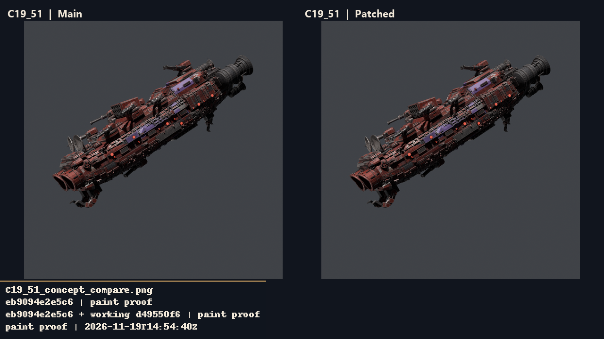

# C19_51 ship pipeline timings

C19_51 (the `corsair_A16` build sheet) passed stages 4 to 7 on main `eb9094e2` and the patched working tree. The bake took 241.1 s, down from 342.5 s. The concept-camera renders look the same. Across the original 1024 by 1024 images, mean absolute difference was 0.0004 on a 255-point scale.

## Stage wall times

| Stage | Main (s) | Patched (s) |
| --- | ---: | ---: |
| 4. Parts and audit | 105.8 | 53.3 |
| 5. Paint and renders | 733.4 | 625.6 |
| 6. LOD export and Godot frame bench | 90.0 | 235.8 |
| 7. Game export and self-test | 180.0 | 366.1 |

One sequential run per revision on the same Windows PC with Blender 4.5.14 and Godot 4.7.2. Both runs used copies of the same fitted camera, concept and outline data. The patched run used an absent B0 GLB and kept the existing second-camera `b0.npz` outline data. Both stage 7 runs wrote to scratch.

The table includes waiting. Main stage 5 had 201 s in the watchdog game-open pause while the headless Godot checks ran. The patched run logged a shared GPU wait during the concept-camera render and a solo GPU wait during the stage 6 frame bench. Other checks also ran on the PC during the measurements. The stage 7 exporter itself took 14.4 s on main and 36.8 s on the patched branch. The stage wall times include the export self-test.

## Cycles and bake passes

Main device probe using the original paint-stack selector

> Cycles device: OPTIX (NVIDIA GeForce RTX 5080 [CUDA], AMD Ryzen 7 5800X 8-Core Processor [CPU], NVIDIA GeForce RTX 5080 [OPTIX])

Patched stage 5 bake log

> Cycles device: OPTIX (NVIDIA GeForce RTX 5080)

The main probe lists enabled preferences. CUDA and OptiX are entries for the same card. Both bakes reported OptiX as the active backend. The atlases were 4096 at 64 samples. The timings below come from the two `A16.json` bake reports.

| Bake pass | Main (s) | Patched (s) |
| --- | ---: | ---: |
| Hull masks | 18.9 | 10.7 |
| Hull albedo | 32.7 | 26.3 |
| Hull ORM | 30.2 | 17.7 |
| Hull normal | 123.9 | 89.2 |
| Parts masks | 14.9 | 11.5 |
| Parts albedo | 14.4 | 9.6 |
| Parts ORM | 17.1 | 9.0 |
| Parts normal | 28.4 | 15.4 |
| Engine glow | 3.3 | 0.9 |
| Whole paint stack | 338.4 | 238.3 |

The following height bakes are included in the hull normal row.

| Hull normal height pass | Main (s) | Patched (s) |
| --- | ---: | ---: |
| `ps_blood_H` | 9.1 | 4.8 |
| `ps_iron_H` | 11.8 | 7.6 |
| `ps_rust_H` | 10.3 | 6.0 |
| `ps_soot2_H` | 10.9 | 13.1 |
| `ps_soot_H` | 15.0 | 8.1 |

## Checks

- The stage 4 build, sheet contract, audit, audit self-test and silhouette dump, stage 6 LOD export and stage 7 game export each show an acquired GPU claim on main and zero GPU claim lines on the patched run. The patched Godot frame bench kept its solo claim. The patched stage 4 and 5 close-up logs record the sheet-ship skip.
- Both stage 7 exports passed the hardpoint checker and its self-test. The patched package has JPEG albedo and emission maps and 2048 px PNG normal and ORM maps. The largest unit-length error in either decoded normal map was 0.0048. The GLB image references and manifest match the exported files.
- The 76-row standing suite completed all rows. Four Windows-environment failures from the restricted run passed when rerun individually with native permissions and a shorter temp path. The other 70 rows passed and two reported their expected KNOWN baselines. The full native rerun had 73 PASS, two KNOWN and one failure in the PC runner self-test. Its standalone native run passed all 134 cases.
- Godot loaded 239 scripts and 16 scenes. The seed 360 bot battle and all 84 listed headless game checks passed, including three Windows profile retries. The separate A16 fixture-freshness check fails on the patched tree because its fingerprint covers `export7.py`. The main and patched unbaked GLBs matched the tracked fixture byte for byte.
- The optional stage 7 installer rejects PNG paths in `tools/recipe/manifest_merge.py`. The installer and fixture record sit outside the brief’s file list.
