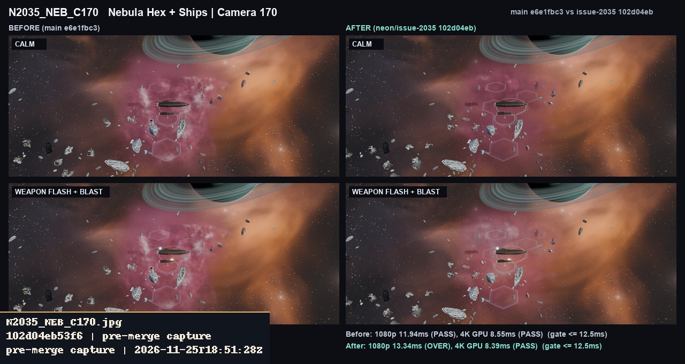

# Summary for Ryan

1. **Hold the new nebula.** Its camera-170 sheet shows the softer rose gas. The same run went from 11.939 to 13.343 ms at 1080p, over the 12.5 ms limit. The PC job and the PR both showed green.
2. **A wreck can lose holes that were visible on the ship.** If it dies while a new hole is being cut, its wreck can use the original skin or a cut the player has yet to see. There is a small, targeted fix in PR #2213.
3. **The Nova and an energy muzzle both ask for picture 34.** Combining PR #2069 as written would leave one of them drawing the other's effect.
4. **Sable gets rear-attack damage for shooting an enemy in the front.** The first actual rear shot still gets to spend the same bonus. This changes which attack is worth taking.
5. **An Acid Thorn stays in the victim after contact.** The new bone model shipped. The change that makes it burst on contact and ends torpedoes nose-first is still outside main.
6. **A battlefield full of cold wrecks still costs work every frame.** The game keeps walking their pieces and writing fire values after the metal has cooled. That can make the end of a battle feel slower than the start.
7. **The round-two hitch fix still misses a pipeline.** On the 5080 it compiled after the loading cover. That particular frame took 9.465 ms. The proof failed its zero-compiles test.
8. **Getting back to the title is much faster. Starting it cold can still stick.** The first title frame on return measured 119 and 78.7 ms. The cold backdrop frame in the loading comparison took 502 ms.
9. **The bigger kills are in, but their names disappear.** During the close-up the game fades even the attacker and victim plates that Ryan asked to keep.
10. **Two green reviews cannot both land intact as filed.** The teaching and sky reviews use the same five filenames for different evidence. Move those five files under their respective topics before combining the reviews.

Astra (audit): reviewed runner main `9ae594c897fa5b6eb5d9ac9a0932bc57c60faab4` and the two additional main merges through `d602b4e9bacb101f39bbfdeca018ae93050cd98a` (Nov 25, 23:42 UTC). Findings cite runner-main lines unless a PR or PC relay revision is shown. The open-PR inventory below uses the 23:43 UTC snapshot. Refs #2160.

## Blocking

| # | Finding | Evidence | File and line | Exact quote | Why it matters | Smallest fix | Confidence |
|---|---|---|---|---|---|---|---|
| 1 | #2050 misses the 1080p gate despite a successful capture job | OBSERVED | GAS4 relay `4c2ee47c8`, `out_sheets/summary_2035.json:54`. PR #2050, `make_sheets_2035.py:359` | `"f1080_pass": false` | All three sessions were present. The after result was 0.843 ms over budget while 4K GPU improved from 8.551 to 8.392 ms. The sheet builder prints the numbers and returns success. The storm passed both modes. | Keep #2050 held. Have the job surface the failed after metric in its verdict, profile the 1080p frame, then repeat the same three sessions. | High |
| 2 | A death cut can read a damage worker's unfinished result | INFERRED | `godot/fx/fx_ship.gd:2327,2527-2533`, `godot/fx/fx_death.gd:1571`. #2199 / PR #2213 | `return surfs[k]["arrays"]` | The worker fills `job["out"]` while the death path reads it. During a second rebuild, empty output selects the original surface even when an earlier cut is already visible. Completed but unapplied output can also get ahead of the picture. | Publish one completed surface snapshot when the main thread applies it. Have death use that snapshot. Carry #2213's worker test through the combined check list. | High |
| 3 | Build D reuses an occupied sprite number | OBSERVED | `godot/fx/fx_weapons.gd:71`, `godot/fx/fx_shaders.gd:490-492`. PR #2069 at `5fe1b4c90`, `godot/fx/fx_special.gd:40`, `godot/fx/fx_shaders.gd:399-401` | `const MUZZLE_ENERGY := 34` | The branch sends 34 for the legacy Nova ball. Main shades 33 through 36 as muzzle sheaths. Either shader branch can mask the other even after the textual conflict is fixed. | Give the Nova a free ID on the combined head and change its emitter and shader together. Exercise both the default Nova and an energy muzzle. | High |



The camera-170 sheet is stamped `102d04eb53f6` (`pre-merge capture`). The left panels were captured on main `e6e1fbc3df43` with two bench scripts overlaid. The right panels were captured at the same distance on the clean #2050 pin `102d04eb53f6`. The later commit `c8b8f5062` added the launcher and is not the capture revision. [Nebula PR #2050](https://github.com/rcbailey12/voidsworn/pull/2050)

## High

| # | Finding | Evidence | File and line | Exact quote | Why it matters | Smallest fix | Confidence |
|---|---|---|---|---|---|---|---|
| 4 | Sable's rear-shot skill also boosts frontal fire | OBSERVED | `godot/rules/rules.gd:3125,3954-3956,6396-6398`. #2204 / PR #2219 | `add += float(u["treeHuntRearNext"]["n"])` | The damage calculation checks the round but omits attack direction. Only the rear-shot path spends the bonus, so earlier frontal shots get it for free. | Apply the same rear-hit predicate when granting and consuming the bonus. Keep #2219's front-then-rear regression case when updating the saved results. | High |
| 5 | Acid Thorns lodge on hull hits and their flight light stays halfway to the target | OBSERVED | `godot/fx/fx_acid_thorn.gd:84-92,195-221`, `godot/fx/fx.gd:1196`. #1904, #2142 / PR #2166 | `var stuck := not miss and not shield` | Main gives a landed thorn 1.15 s embedded before it crumbles. It lights a fixed world point during flight. A miss already travels on and a shield hit already shatters. #2166 also fixes the casing nose and shared contact point for ordnance. | Reconcile #2166's contact and moving-light changes with the newer bolt and shield effects. Preserve the miss, interception and shield-break paths. | High |
| 6 | Cold wrecks keep entering the frame update | INFERRED | `godot/fx/fx_death.gd:4795-4805,4819-4837`, `godot/fx/fx.gd:556-562`. #2198 / PR #2215 | `for w in fx.dstate["wrecks"]:` | Main keeps at most 24 wrecks. The cold flag stops seam-colour writes. The outer scan, piece traversal and fire-material writes still run. Cost can grow as wrecks accumulate. The fleet damage benchmark holds ships at fixed damage and cannot quantify this late-battle cost. | Move settled pieces off the active update list. Keep hex blocking, wake-up, thinning smoke and Eclipse revival. Compare the same opening and late-round replay after combining #2215. | High |
| 7 | Round two still compiles after warm-up | OBSERVED | #1843 / PR #1852. PC relay `cf0070b60`, `out_new/replay_1.txt:98` and `out_new/frames_1.json:3570-3593` | `ERROR: KILL_FRAME round 2 compiled pipelines after the load cover` | Corsair seed 7 recorded one draw/specialization compile at frame 6578 out of 2,759 round-two frames. The frame was 9.465 ms. The old 150 to 190 ms stall was not reproduced at that frame. | Identify and warm the remaining draw variant from this replay, combine current battle setup, then repeat the seed before releasing the hold. | High |

## Medium

| # | Finding | Evidence | File and line | Exact quote | Why it matters | Smallest fix | Confidence |
|---|---|---|---|---|---|---|---|
| 8 | Cold title work can still exceed 500 ms | OBSERVED | #2099, #2134. ARMS4 relay `7bf8ce220`, `out_all/load10/load_cold/load_result.txt:11` and warm counterpart. `godot/fx/fx_ship.gd:249` | `frame FAIL (502 ms)` | The combined arm improved the older main's cold/warm 1890/1379 ms to 502/454 ms. The cover remained up. #2134 records 257 ms in first-hull analysis, one component of the frame. | Complete #2134's seed-independent hull analysis on a worker, then join at the sliced build boundary. Repeat both profiles and the windowed quick battle. | High |
| 9 | Kill cut-ins hide both participants' name plates | OBSERVED | `godot/scenes/battle/battle.gd:3069-3081`. PR #2128, R458, #2194 | `hud.plates_root.modulate.a = alpha` | Fading their parent makes the two ships anonymous even if their own labels are visible. R458 explicitly keeps the attacker and victim named. | Exempt those two plates from the fading parent for the cut. Keep fading unrelated markers and restore normal visibility on skip. | High |

## Low

| # | Finding | Evidence | File and line | Exact quote | Why it matters | Smallest fix | Confidence |
|---|---|---|---|---|---|---|---|
| 10 | The sky and teaching reviews add different text at the same five paths | OBSERVED | PR #2177 at `021199878` and #2173 at `f02c5ca63`, both `contrib/muse/reviews/legs/leg_rey.md:1` | `# Leg: Rey (blind), issue 2156` | Each combines cleanly with main alone. Combining the two heads produces five add/add conflicts. Taking one side discards the other review's source material. | Put each set of five legs under its own issue directory and update the chair's links. Include #2164 when checking the destination names. | High |

## Nov 24 AAA scorecard

**One of ten fixes is on main, eight are in flight and one is deliberately deferred.** Status refers to the player-facing change. The Nov 24 baseline is the Neon and Astra reports in #2026 and #2028 and Fable's #2019. Ryan's approved combined ranking is R450 in `contrib/opus/FINDINGS.md:478`. [R450](https://github.com/rcbailey12/voidsworn/blob/9ae594c897fa5b6eb5d9ac9a0932bc57c60faab4/contrib/opus/FINDINGS.md#L478)

| Nov 24 gap | Status | Evidence and what Ryan can see |
|---|---|---|
| 1. Shipyard shows no ships | IN FLIGHT | #2078 / PR #2105 supplies preview data and #2102 improves repair and purchase. Main builds the old yard at `godot/ui/campaign/campaign_ui.gd:1912`. The lit Gantry and its selected ship are in #2080 / PR #2119. Its head conflicts with the live check list. |
| 2. Ship state is hard to read on the board | IN FLIGHT | #2079 / PR #2104 supplies the stacked plates and section-state view. Its battle integration conflicts with main. Ryan approved one shield pool plus damaged hull sections. Four shield facings were explicitly excluded in R450. |
| 3. Big moments look small at camera 170 | DONE on main | #2032 / PR #2128 added shot-specific camera poses and 1080-line core diameter floors of 112/135/178/330 pixels from small hull to capital. #2137 preserves the floors. The cut-in label regression is finding 9. `godot/fx/fx_death.gd:123-126`. |
| 4. Silent captains and admirals | IN FLIGHT | #2105 creates persistent captain identity, callsign and portrait assignment. #2081 remains open for the CM-A Turn Corner comms presentation. The identity and music changes do not establish that an order or hit now gets a captain response. |
| 5. No after-action report | IN FLIGHT | Main stores the last battle's ship totals and loss records, including defeat and retreat, at `godot/campaign/campaign.gd:4347-4352`. #2082's Spotlight report and killmail exist on `3a5d50b7a`. The later arm stopped partial at `a6d93b8f9`. The existing end-of-run ledger serves a different point in the campaign. |
| 6. Single-layer effects | IN FLIGHT | #2133 adds projectile and muzzle layers, #2136 beams, #2132 status ticks and boarding, #2055 drive plumes and directional thrusters. The later merges #2084 and #2068 add shield/terrain polish and layered fires. Build D #2069 and shared sparks #2049 still collide with live main. |
| 7. Hidden tactics | IN FLIGHT | #2033 / PR #2122 exposes called shots to players and Veteran AI. Its green head conflicts in the saved rules results. #2065 brought in design work on commands and deployment. The battle changes still need the reconciled result set. |
| 8. Flat sound mix | IN FLIGHT | #2052 wires the Wave F keepers. #2202 adds Glasswright calm/full music alongside Sunward and Chorus. #2071 carries channel controls, voice limits and pooling. The current settings still expose only effects volume and music volume at `godot/main/title.gd:304`. A player who turns down a volley turns down tactical warnings too. |
| 9. Flat nebulas | IN FLIGHT | #2035 / PR #2050 has before/after proof and a failed 1080p metric. #1766 / PR #2210 deals with the separate sky, dust lanes and star density. It was green and held for Ryan's look. In the densest dust main retains a 0.15 star brightness floor. #2210 changes the default to 0.0. Rules 10.9 and 10.11 keep the battle gas rose and the backdrop mostly dark. |
| 10. Performance proven only on the 5080 | NOT STARTED | R450 deliberately parks lower-spec proof until the fixes land. The PC receipts used here are from an RTX 5080. Changing resolution or disabling a shader on that card cannot establish a minimum GPU. |

## What landed and what the measurements cover

**Wounds, interiors and wrecks.** #1755 landed the switchable cutouts. #2135 subsequently turned V2 on by default. PROOF_D on `d24c5678c` put stage 3/4 fleet p99 at **8.071/8.113 ms** with wounds on and **8.940/7.247 ms** on the before arm. Stage 4 averaged 3.751 ms with wounds on. The full fleet ran on the 5080 before the later beam, thruster and fire combines. With plain mouths, GPU median fell from 2.871 to 2.624 ms. With plain interiors it was 2.868 ms. The mouths account for more GPU time in this comparison. On the CPU, an unchanged power-flicker value already returns early. A changed value still uploads once per damaged surface in `godot/fx/fx_ship.gd:3156-3163`. #2213 moves that update to the mesh. It gives no late-battle or lower-card frame rate. #2175 / PR #2193 still owns the Glasswright opening and Eclipse lip follow-up.

The camera-26 I15_11 Glasswright wreck screenshot is stamped `d24c5678cc03` (`pre-merge capture`). It is not in this branch. The screenshot at `out_20261125_100344_30322/out_after/moments/w2d_I15_11__c26.png` and the timing receipt at `out_20261125_100344_30322/out_after/fleet_log.txt` are both in PROOF_D relay commit `8996a9385`. #1763 changed the interior kit, shared trim and export checks. FLEET_H on its merge `fd656ea1d` records seven passing Glasswright exports. The GS1 row is 38.9 to 39.8 MB and CD5 is 32.2 to 84.1 MB. Those are export sizes. The receipt proves those seven builds, not a fleet-wide install. #1737 and #2137 preserve grouped, real-size wrecks and faction break interiors.

**Factions, movement and hit reactions.** The six V2 wound entries have separate rim styles under R402 and R416. The tissue and glass branches have zero soot weight. The Glasswright wall cap is 0.45 with a pearl lift and coloured seams (R431). Eclipse uses an obsidian rim with a violet accent. Footprint validation can replace an unsupported hole with a smaller surface mark. It is deliberate on thin geometry. The half-hull and footprint fixtures exercise that choice. See `godot/fx/faction_looks.json`, `godot/fx/fx_breach.gd:2112-2122` and `godot/fx/test/wounds_v2_check.gd:146-163,268`.

R412 still separates physical recoil from electrical damage. An absorbed ordinary shot returns through the shield path ahead of hull marks, gates the power hit with `felt`, and cannot start attitude jets as a hull hit. Shield breaks, ion reaching hull and crits retain separate responses. #1874 and #2055 use gas for Crusade and Directorate, rougher exhaust for Hullbreakers, glints for Glasswrights, organic movement pulses for Chorus, and violet ripples for Eclipse. Chorus has a separate guard against mechanical hit-correction jets. See `godot/fx/fx_weapons.gd:2287-2329`, `godot/fx/fx_ship.gd:1443,1567` and `godot/fx/thrust_profile.gd:23-41`.

**Credit for kills and sound.** The #2141 / #2105 conflict in Eclipse reassembly is resolved on main. The rise clears the splash-kill flag and reverses the killing blow, killer total and fleet loss record. Damage history remains. Torpedo splash marks only units that actually died. See `godot/rules/rules.gd:2381-2382,2865-2870` and `godot/rules/combat_records.gd:90-107`. For #2052 I matched all 341 listed clip filenames in 180 clip sets to the Git tree, plus clip keys and synth filenames in 97 JSON cues including their variants. All resolved. At impact the material cue takes priority, with a material-specific heavy tail for glass or tissue. This is a wiring check. Loudness and perceived balance need listening.

**Loading, VRAM, CI and the PC.** #2099's ARMS4 reached the end of quick battle on all four arms. Its combined load suite still had an unverified cold close as well as the cold title-frame miss. #1519 / PR #2154 sliced battle teardown. CLOSE5 on its merge `6ddf3e2d9` reports zero failures and first title frames of 119 ms leaving during load and 78.7 ms leaving battle. Its cold X-close row took 2,139 ms to hide the window. Keep those three user actions distinct. Rule 3.9 grades the #207 scene on 1080p frame median and 4K GPU time. The issue #2125 fleet probe separately required 12.5 ms at p99. Neither test substitutes for the other.

The rocky planet requests two 8192 by 4096 maps. The relief splits into RF height (4 bytes per pixel) and RG8 masks (2 bytes). Those two images alone need 192 MiB at base resolution, about 256 MiB with full mip chains, before colour, temporary decode buffers and driver allocation. This is a format calculation, not measured peak VRAM. #1967 landed shared shader caching. #1780 / PR #1960 proposes further shader reuse and world compression, but conflicts with six current render/world files. Preserve the decoded height precision and compare peak residency and frame time on the same scene. See `godot/world/world_planet.gd:16,181-182` and `godot/world/world_bake.gd:519-524`.

#1966 moved the headless checks to four shards. The current planner counted 251 checks at **517/517/516/516 s** against 600 s per shard. The longest has 83 s of planned margin. These are estimates from recorded row times. #2179 / #2196 changes runner handling and stages a five-shard plan. For a five-shard rollout the Board would need to change the workflow matrix, job and step names, and `SHARD` denominator together. The active workflow still says four at `.github/workflows/checks.yml:202-206,258-263`. #2088 isolated bench checkouts after mirror-lock contention, #2086 added code-only E/F lanes, and #2195 followed by #2216 changed runner and cleanup handling. #2169 is a ready, narrow correction to the Windows self-test handshake.

## Open PRs and merge order

I read the GitHub REST list of 47 open PRs, inspected named head checks, and ran read-only three-way tree comparisons against `d602b4e9b`. All 47 heads were available through the PC mirrors. The comparisons used scratch Git objects and left the checkout and its refs untouched.

| Disposition | PRs | Board action |
|---|---|---|
| Text conflicts with live main (19) | #2219, #2215, #2213, #2209, #2188, #2183, #2166, #2122, #2119, #2104, #2069, #2049, #2021, #2020, #2017, #2007, #1980, #1960, #1852 | #2213 and #2119 changed from clean on the runner pin to a check-list conflict after the two newer merges. #2166 needs the shader and weapon files. Carry both sides' checks. Regenerate #2122's saved results from the combined rules. |
| Clean text comparison with live main (28) | #2212, #2210, #2208, #2207, #2201, #2196, #2193, #2189, #2185, #2177, #2173, #2169, #2168, #2167, #2164, #2140, #2124, #2106, #2071, #2050, #1925, #1910, #1903, #1858, #1833, #1725, #1442, #1163 | #2169 is my first merge pick. Its green head `cdb5d2d1f` atomically publishes the ready marker and waits for readable content before counting slot locks. Its only changed file is a self-test. |
| Green head, separate decision | #2210, #2050, #2177, #2173 | Keep the sky for Ryan's look and the nebula for its 1080p proof. Either review can land first. Move the other set of five leg files before the second merge. |
| Stale or deliberate holds | #1852, #2106, #2185, #1910, #1925, #1833 | #1445 is already on main, but #1852 now has the failed replay and a battle-script conflict. #2106 was stacked on the pre-#2099 loading route. Isolate any remaining bake-worker change. #2185's test4 precedes the test5/test6 music in #2202. The two Warden alternatives still require Ryan's pick. #1833 is a draft picture pack. |

Head-level All checks returned success on 24, failure on 10 and no confirmed verdict on 13 (including unavailable API responses). In particular #2166, #2122, #2119 and #2213 were green at their own heads. #2193 was red despite its clean text comparison. A successful head check dates to the base it tested.

The #2069/#2049 pair conflicts in `fx.gd` and `fx_ship.gd`. The fire branch that became #2068 conflicts independently with both. #2215/#2213 combine cleanly with each other in isolation but each needs reconciliation with live main. #2210/#2050 combine cleanly with each other. The merged sprite assignments include bolts 30-32, muzzles 33-36, rocket smoke 37, tick ember/droplet 38/39 and the new small-death vent 40. #2188's earlier registry conflicts. Across main and all 47 open heads I found one name per numbered breach-style constant, 0-18. Prism 16, star 17 and null lance 18 still mean the same thing. The problem in finding 3 is in the sprite shader's separate number space.

## Recent merge coverage

The full standing suite exited 0 on the runner pin. Of 128 rows, 126 passed and two matched their recorded baselines. Those were ROS-9 and UI-5 in `findings_tests`, and 12 listed constant differences in `oracle_drift_guard`. There were zero failed or skipped rows.

The first-parent range starts after `94bc83ef2` (Nov 23 23:48 UTC). It contains 192 commits through the runner pin, including 131 merged PRs touching 1,477 distinct paths. The two subsequent merges bring the count to **133 PRs**. I inventoried every merge by changed paths, then traced the live paths above. Across the final range I also scanned added literal resource preloads in 196 changed Godot script/shader paths. All 351 file/target pairs (76 distinct targets) resolve in the live tree.

<details>
<summary>All merged PRs in landing order, by UTC day</summary>

- Nov 24 (70): 1890, 1900, 1912, 1916, 1917, 1919, 1921, 1922, 1923, 1927, 1928, 1902, 1930, 1931, 1932, 1937, 1776, 1914, 1942, 1929, 1913, 1948, 1938, 1946, 1951, 1949, 1952, 1953, 1956, 1954, 1958, 1959, 1963, 1966, 1967, 1969, 1961, 1962, 1972, 1979, 1981, 1786, 1861, 1973, 1758, 1984, 1985, 1784, 1993, 1996, 1987, 2004, 1874, 2006, 2009, 2013, 2012, 1983, 1737, 1445, 1975, 1976, 2010, 2026, 2028, 2040, 2038, 2051, 2037, 2041.
- Nov 25 (63): 2058, 2067, 2074, 2075, 2070, 2077, 2076, 2065, 1772, 1998, 2086, 1999, 2002, 2019, 2090, 1986, 2096, 2100, 2114, 2113, 2110, 2109, 2116, 2120, 2088, 2123, 2093, 2099, 2130, 2131, 2102, 2138, 2127, 2141, 1904, 1755, 2105, 2052, 2145, 1763, 2146, 2154, 2153, 2158, 1964, 2163, 2159, 2135, 2182, 2128, 2133, 2190, 2186, 2195, 2137, 2136, 2132, 2055, 2202, 2216, 2192, 2084, 2068.

</details>

<details>
<summary>Raw-source read receipts</summary>

Each row gives the revision, path, total lines, inspected ranges, and the first 40 characters of the final line. The text in quotes uses JSON escaping to preserve tabs and empty lines. For large files the ranges delimit the passages used. The 44 public raw sources matched the Git blobs byte for byte. The 10 PC relay sources below were read from their pinned local mirror blobs.

```text
revision   path | lines | reads | final line prefix
9ae594c89  .github/workflows/checks.yml | 356 | 198-208,258-264,356 | "          echo \"PASS\" | tee -a \"$GITHUB_"
9ae594c89  contrib/codex/reviews/aaa_gap_1124_astra.md | 163 | 3-20,163 | "[sinsengine]: https://www.stardock.com/n"
9ae594c89  contrib/neon/reviews/aaa_gap_1124.md | 459 | 11-26,59-78,432-439,459 | "- **Other seats' Nov 24 AAA audits (`#20"
9ae594c89  contrib/opus/FINDINGS.md | 640 | 478,486,640 | "| X17 | Muse follow-up pass over unasses"
9ae594c89  contrib/opus/reviews/aaa_gap_1124_fable.md | 252 | 13-22,27-45,69-73,252 | "- **AI, balance feel, save and resume, 4"
9ae594c89  docs/RULEBOOK.md | 741 | 506-509,646-653,655-659,741 | "draws meshes at full detail. Set: Ryan, "
9ae594c89  docs/playbooks/deaths_and_hits.md | 471 | 329-338,423-441,471 | "Each is one or two Codex runs and one lo"
9ae594c89  godot/audio/clips/index.json | 703 | 1-6,703 | "}"
9ae594c89  godot/audio/cues.json | 3520 | 1-8,3520 | "}"
9ae594c89  godot/audio/sfx.gd | 850 | 117-137,248-279,380-400,739-766,850 | "\tcreate_tween().tween_property(player, \""
9ae594c89  godot/campaign/campaign.gd | 4446 | 4346-4354,4446 | "\t\t\"events\": tel_log.slice(max(0, tel_log"
9ae594c89  godot/fx/faction_looks.json | 118 | 4,7,9,23,26,28,42,45,47,61-62,64,78,80,82,97,101,103,118 | "}"
9ae594c89  godot/fx/fx.gd | 2467 | 550-563,1179-1182,1194-1203,2467 | "\treturn hk"
9ae594c89  godot/fx/fx_acid_thorn.gd | 245 | 58-106,157-225,245 | "\t\tpiece.transform = Transform3D(b, home."
9ae594c89  godot/fx/fx_breach.gd | 2440 | 43-63,2111-2125,2440 | "\tm.set_shader_parameter(\"glow\", Vector3("
9ae594c89  godot/fx/fx_death.gd | 5070 | 123-126,1569-1573,4753-4764,4789-4807,4816-4840,5070 | "\t\tnd.global_position -= back"
9ae594c89  godot/fx/fx_shaders.gd | 3379 | 486-497,3379 | "\"\"\""
9ae594c89  godot/fx/fx_ship.gd | 3295 | 249,1437-1449,1565-1572,2230-2258,2320-2330,2352,2524-2544,3147-3190,3295 | "\treturn changed"
9ae594c89  godot/fx/fx_weapons.gd | 2936 | 65-74,995-1038,1658-1684,2272-2339,2936 | ""
9ae594c89  godot/fx/fx_wounds_flag.gd | 9 | 1-9 | "\treturn bool(ProjectSettings.get_setting"
9ae594c89  godot/fx/test/wounds_v2_check.gd | 736 | 146-163,185-192,263-277,736 | "\tcheck(not DEATH.SLAG.contains(\"vec3(0.0"
9ae594c89  godot/fx/thrust_profile.gd | 83 | 23-53,83 | "\t\t\treturn {\"core\": core, \"wash\": wash, \""
9ae594c89  godot/main/main.gd | 1162 | 836-841,858-872,1162 | "\treturn str(v)"
9ae594c89  godot/main/title.gd | 700 | 303-305,700 | "\t_reveal_tw.tween_property(_shade, \"colo"
9ae594c89  godot/music/stem_pairs.json | 46 | 1-7,46 | "}"
9ae594c89  godot/rules/captain_data.gd | 82 | 14-21,51-62,82 | "\treturn used"
9ae594c89  godot/rules/combat_records.gd | 107 | 1-107 | "\t\treturn"
9ae594c89  godot/rules/rules.gd | 8014 | 2375-2386,2865-2872,3104-3128,3937-3959,6395-6399,8014 | "\tB[\"aiActive\"] = null; u[\"activated\"] = "
9ae594c89  godot/scenes/battle/battle.gd | 8187 | 3039-3054,3068-3082,8187 | "\tget_tree().quit(code)"
9ae594c89  godot/ui/campaign/campaign_ui.gd | 2875 | 1912-1927,2875 | "\t\t\t\tKit.play(Kit.press_cue(cue_role(str("
9ae594c89  godot/ui/campaign/debrief_ledger.gd | 363 | 128-139,363 | "\treturn false"
9ae594c89  godot/world/world_bake.gd | 831 | 104-108,411-418,519-525,831 | "\treturn true"
9ae594c89  godot/world/world_planet.gd | 1031 | 16-18,180-184,1031 | "\"\"\""
9ae594c89  godot/world/world_sky.gd | 547 | 427,463,498,547 | "\treturn out"
5fe1b4c90  godot/fx/fx_shaders.gd | 3410 | 396-402,3410 | "\"\"\""
5fe1b4c90  godot/fx/fx_special.gd | 272 | 26-43,272 | "\tfx.sprx(6.0, p, t, 0.18, c, 1.0, k * 1."
c8b8f5062  contrib/neon/issue-2035/make_sheets_2035.py | 363 | 113-129,348-359,363 | "    raise SystemExit(main())"
38e0288c1  godot/rules/test/rules_2204_test.gd | 230 | 111-123,230 | "\t\t\"R7 a reserve carrier arrives and exha"
d602b4e9b  godot/fx/fx_damage_plume.gd | 112 | 1-15,65-78,112 | "\t\tplume.queue_free()"
d602b4e9b  godot/fx/fx_shaders.gd | 3674 | 345-352,597-600,3674 | "\"\"\""
2b47c9869  godot/world/world_sky.gd | 639 | 431,587,639 | "\t\t\"lamp\": PackedVector4Array(lamps(bs)),"
f02c5ca63  contrib/muse/reviews/legs/leg_rey.md | 35 | 1-3,35 | "- Any rendered frame: no GPU capture was"
021199878  contrib/muse/reviews/legs/leg_rey.md | 52 | 1-3,52 | "- Whether any Hold or boss mood (STOP_MO"
cdb5d2d1f  tools/pc/lane_tools_refresh_selftest.js | 203 | 121-134,203 | "console.log('PASS: lane tools refresh ke"
4c2ee47c8  out_20261125_120315_13454/done.txt | 1 | 1 | "PASS"
4c2ee47c8  out_20261125_120315_13454/out_sheets/summary_2035.json | 84 | 1-4,44-84 | "}"
599f8d8c2  out_20261125_105047_13450/out_new/close/close_timing.txt | 8 | 1-8 | "failures=0"
7bf8ce220  out_20261125_015740_18465/out_all/load10/load_cold/load_result.txt | 59 | 11,59 | "[load1434] RESULT FAIL on the cold profi"
7bf8ce220  out_20261125_015740_18465/out_all/load10/load_warm/load_result.txt | 59 | 11,59 | "[load1434] RESULT PASS on the warm profi"
8996a9385  out_20261125_100344_30322/out_after/fleet_log.txt | 90 | 50,64-68,90 | "GPU: released solo claim 2ed558ce-1d5e-4"
8996a9385  out_20261125_100344_30322/out_before/fleet_log.txt | 86 | 43,64,86 | "GPU: released solo claim 2f43d100-eefb-4"
a29ea0a4e  out_20261125_131717_13454/out_fleet/sizes.csv | 8 | 1-8 | "ithar_GW4,ithar_GW4,1024,1024,\"32.2\",\"16"
cf0070b60  out_20261125_115623_13454/out_new/frames_1.json | 3596 | 3570,3580,3590,3593,3596 | "}"
cf0070b60  out_20261125_115623_13454/out_new/replay_1.txt | 105 | 98,105 | "GPU: released solo claim 04d0e58c-1ff3-4"
```

</details>

**Recommended next step.** Keep #2050 held. Give the next effects combine to #2213, retain both sides of the check list, and verify a second wound followed immediately by a killing hit. That checks whether the wreck keeps the same holes Ryan saw before the killing hit. [Damage worker PR #2213](https://github.com/rcbailey12/voidsworn/pull/2213)

## Not checked:

No new GPU capture or listening session ran on code-only lane F. The embedded nebula sheet is an original PC receipt with its provenance file. Driver peak VRAM, lower-spec hardware, the complete installed fleet, full-run balance and the entire 133-PR line-by-line diff remain unverified. Open PRs were assessed against the stated snapshot. Pairwise tree comparisons covered the named intersections. Today's Neon reviews were kept out of the evidence.
