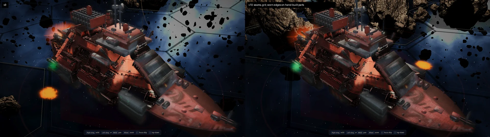
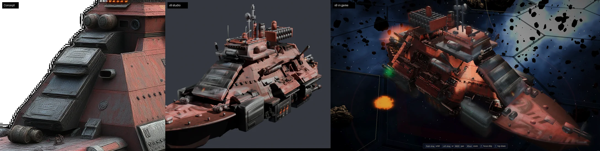

# Ship-model audit: finish the prototype before scaling the fleet

Reviewer: Codex. Date: October 21, 2026 (America/Chicago).

Audited repository: `rcbailey12/voidsworn`, `main` at **`2cfbde26e396e79cdba7ba889cc7d158547cc14b`**. This answers questions **1–6**, plus the brief's additional **question 0**. Findings describe that snapshot, not an unseen newer PC build.

**Verdict:** Keep the approved multi-view shape guide and selective Blender reconstruction. Do not repeat C19's current process on 35 more ships yet. It remains a bespoke prototype with inconsistent materials, real placement defects, incomplete asset delivery, and a loader designed around much smaller meshes. More grit and more triangles will not resolve those problems.

Contribution notes: this is a review only. No game source, tools, assets, queue, or other documentation is changed. Recommendations below are work for the main agent to implement and validate.

## Evidence and limits

I read the audit brief, pipeline README, BLOB_SWEEP, SHIP_QUEUE, AGENTS, contribution instructions, relevant history, C19 kit/library, projection and conversion scripts, mesh packer/decoder, job files, and runtime loading/material/model paths. I visually inspected the original C19 concept, generated side/front views, v6 multi-angle sheet, v7 game screenshot, v9 comparison and clay front, and v10/v9 comparison.

I ran small CPU checks against extracted repository code: loader error handling with mocked network/decode results; malformed kit decoding; C19 coordinate checks; the actual plane-region growth loop; and `paint_level.level` on controlled images. These are targeted reproductions, not a browser gameplay test or a real meshopt round trip.

The current full-resolution GLB, `.vsm`, kit JSON, and painted albedo assets are **absent from this Git tree**. I could not measure their actual intersections, manifoldness, compressed/decompressed sizes, or frame times. Blender/ComfyUI work and the owner's GPU/Pixel tests were not run. Older screenshots are explicitly identified below; they cannot certify v10 from unseen angles.

### What matters first

| Priority | Finding | Consequence | First fix |
|---|---|---|---|
| P1 | Current C19 delivery assets are missing; legacy fallback hides that fact | A fresh checkout does not reproduce the reviewed ship | Publish a complete versioned asset set and verify the selected asset revision |
| P1 | Required kit can fail silently; corrupt VSM does not fall back | A cut hull can load without its bow/bridge, or fail entirely | Validate and install the hull/kit bundle atomically, then fall back as a bundle |
| P1 | All hulls are fetched/decoded at boot; future capital conversions inherit phone high-detail overrides | Full-fleet rollout creates large memory/startup risks before combat | Load encounter assets first; make quality selection per asset and per LOD |
| P1 | Hull and kit exposure is derived independently from unrelated atlas averages | Matching paint changes when the part inventory changes | Shared calibration, explicit material settings, separate emission |
| P2 | Bow guns intersect the jackstaff; bridge window band floats ahead of its wall | Placement rules fail even before examining the AI hull | Fix these measured contacts and add assembly clearance checks |
| P2 | Kit attaches entirely to the fore half and is excluded from surface queries | Death breakup and muzzle/hit placement disagree with the visible model | Split kit by component and export named hardpoints |
| P2 | Smooth shading and painted noise are being used where plane quality is needed | Clean parts still read rounded; dirty hull stays melted | Verify normals, rebuild broad planes, then harmonize surface detail |

P1 means resolve before a fleet rollout, not an assertion that the current local prototype cannot be played. P2 means a concrete visual/correctness issue to resolve before calling this ship finished.

## 0. Detail consistency: shared treatment, with geometry first

**The v10 bake is not enough. Use a common material treatment for hull and kit, but do not start with a complex triplanar shader.** First repair broad shapes and shading normals, then unify material response. Bake most surface detail using one recipe; add a small shared runtime microdetail layer only if a controlled comparison shows a benefit.

The evidence is visible in the existing comparison:

The added markings make the bow less empty, but the abrupt change between crisp replacement surfaces and the broken, lumpy superstructure remains. The screenshots have different backgrounds/lighting content and are not a quantitative A/B test.

Three separate problems are being grouped under “detail”:

1. **Shape:** long panel lines, slope continuity, plate thickness, and silhouettes. Noise cannot straighten a plane or recover a collapsed gun.
2. **Shading:** `hs_lib.finish` sets every face smooth; it does not explicitly establish flat panel normals or a weighted-normal pass. The bevel setup is not evidence that the final exported normals are correct. The v9 clay front shows curved-looking highlights on nominally flat slabs. Inspect face normals versus exported shading normals before adding more texture. [S2]
3. **Surface finish:** `project_paint.py` adds brick seams, grit, and bevel-derived brightness only when `base_img is None`. It is a kit-only color bake, not a shared normal/roughness treatment. Its final EMIT bake records color variation; it does not create physical panel depth or a roughness map. [S3]

My order: make the large red superstructure faces coherent; fix the kit's broad-face normals; adopt common paint/metal/roughness settings; bake deliberate seams and wear. Reserve geometry for silhouette, recesses and prominent edges; use maps for fine scratches and grit. Do not apply the same brick pattern to a launch tube, a broad bow plate, and a small antenna.

If runtime microdetail is added, use the same **ship-local frame and physical scale** on hull and kit, including after breakup. World-space detail would slide when the ship moves. Mask by material and part type. Give Chorus and Ithar different surface treatments. Real edge wear needs a curvature/edge mask or authored edges; a generic triplanar pattern cannot identify meaningful wear by itself. Fade tiny detail at distance and test its cost on the actual phone.

## 1. Is the pipeline right for 35 more ships?

**The overall hybrid approach is right; the present execution is not ready for mass production.** Keep Qwen views as proposals, the approved side silhouette, Pixal as a shape/detail guide, projection for recognizable paint, and Blender for designed structures. Stop expecting another image-to-mesh pass to produce coherent machinery automatically.

### Change the production unit from a script to a ship recipe

For each ship, preserve a small manifest with source-image hashes, approved views and camera frames, seeds/model versions, length/width/height landmarks, protected features, cut regions, part anchors, paint masks, LOD outputs, and review status. The main agent maintains this; Ryan runs a double-click job and judges a contact sheet. Do not ask him to edit coordinates or repair command-line state.

Use reusable **assemblies**, not just primitives: supported launcher, turret with recoil clearance, bridge with a known roof/wall relationship, engine bell with a throat, and slab with an intentional border. Store each assembly's mount frame, muzzle/socket, material region, symmetry rule and owning breakup half before joining meshes. C19's 300-plus-line script repeatedly measures or guesses these relationships and then discards semantic names at export. [S1, S2, S5]

### Resolve view contradictions before generating the mesh

The generated front view shows a different arrangement inside the forward slope from the four slabs visible in the original concept. The side view is useful for approved length, but it is not an independent photograph of a real object. Mirroring it cannot establish unseen asymmetric details.

Keep the original concept authoritative for recognizable features, the approved side authoritative for the accepted length/profile, and ask the owner only about meaningful conflicts. Establish bridge, rack, bow and stern landmarks across views. Silhouette IoU around 0.9 does not prove that a gun, window or panel is registered correctly: `fitcam_fit.py` scores masks, not internal landmarks. [S10]

### Audit the existing generation settings before changing generators

The current graph still has `RemeshMesh` with `smooth_iters=20`, `DecimateMesh(target_face_count=tris)`, and two `MeshSmoothNormals` nodes with `crease_angle=180`. “Full detail compressed” describes shipping relative to the chosen export, not a raw untouched generator output. These settings are real candidates for some softness, but I have not run an A/B proving which one causes it. Compare the saved raw/remeshed/exported stages on one fixed seed before adopting a new generator or increasing resolution again. [S11]

### Make the job reproducible and fail visibly

The example jobs depend on pre-existing `mvC`, `mvD`, `mvC2`, projection and mesh files. The kit job invokes staged script basenames and continues through export, packing and screenshots without `if errorlevel` gates. A failed step can leave an old file available for the next step. `vsm_pack.mjs` imports `meshoptimizer`, but the repository package/lock files declare only Babylon. These are worked session recipes, not a fresh-machine one-click pipeline. [S6, S7, S12]

Use a per-run staging directory, dependency/version preflight, stop-on-error handling, and a manifest linking every output to the current inputs. Promote a complete bundle only after checks pass. Preserve successful checkpoints so a paint correction does not regenerate the mesh.

### The next three ships should test three different problems

After C19 passes, do **one Hegemony capital**, **one Chorus hull**, and **one Ithar sail ship**, sequentially. Hegemony tests whether the machinery and planar workflow works without the Corsair excuse. Chorus tests deliberate organic lobes, membranes and cavities, with no mechanical bolt-ons. Ithar tests clean spars, thin membranes, two-sided shading and translucency. Have Ryan approve the biological and sail shape languages before building reusable assemblies. Only then expand to similar hull families. This preserves ambition without repeating an unfinished method 35 times.

## 2. C19 kit: verified mistakes and unproven placements

**Corsair can be asymmetric and patched together. Floating interfaces and barrels passing through another part still need fixing.** These findings are in the committed script, not inferred function names.

| Finding | Evidence and confidence | Recommended correction |
|---|---|---|
| Bow chasers intersect the jackstaff | **Coordinate-confirmed.** Jackstaff axis is `x=-.458, y=0`, radius `.0035`; chasers run at `y=±.005`, radius `.0028`, crossing its x at `z≈-.06812`, inside its vertical span. Radial clearance is `.005-.0035-.0028=-.0013`; the larger muzzle collars make clearance worse. `c19_kit.py:187–190`, `hs_lib.py:46–48`. | Move the staff or spread/raise the guns based on the concept, then test the complete barrel volumes and forward firing corridor. |
| Bridge window band floats and has the wrong tilt relative to the wall | **Coordinate-confirmed.** The tier's front goes from `x=-.088` at `z=.056` to `x=-.068` at `z=.102`. All eight un-bevelled `winband` corners lie ahead of that plane, by about `.00338–.01592` in x. The box's negative Y rotation tilts the band opposite the wall's forward face. `c19_kit.py:148–154`. | Derive band/light transforms from the actual face plane, with a small intentional recess or supported visor. |
| “Crow rail” is a capped disk | **Code-confirmed.** `crowrail` uses `cyl`; that helper sets `cap_ends=True`. It closes the top of the nest instead of producing an open railing. `c19_kit.py:294–295`, `hs_lib.py:30–34`. | Use a ring plus posts, or an intentional enclosed observation pod. |
| Existing surface-snap functions are not placement guarantees | **Code-confirmed limitation.** Ray misses often fall back to constants; several parts use hard-coded positions. Gun direction blends toward a normal but never tests a barrel/swept firing volume. `c19_kit.py:90–145,211–232,258–265`. | Fail a named mount on missing support; validate a small support footprint and collision corridor, not one ray. |
| Cut boundaries can leave slivers or open seams | **Algorithm-confirmed risk, not a measured defect in the missing mesh.** Cuts delete faces by their centers; they do not clip triangles at the box boundary or construct caps. `c19_kit.py:69–87`. | Check boundary loops and remnants; clip/cap structural seams or explicitly cover them with a validated overlapping assembly. |
| “Paired” is not necessarily geometrically symmetric | Each flank's `SIDEF` and `TANK` are measured independently from a potentially asymmetric AI hull. The pair loops share a design but can produce different offsets. `c19_kit.py:44–68,210–242,280–289`. | Accept documented Corsair deviations; for disciplined factions mirror a designed anchor frame and validate both supports. |

The back-facing and broadside guns are not automatically wrong: they match the stated direction rules. I would not reverse them merely because their x direction points aft. The issue is clearance and support, which requires the real cut hull plus kit.

The fixed bow loft is a useful reconstruction, but `bow_sec` contains hand-coded shape equations, not a general section measurement system. Likewise, a percentile flank hit can measure a protrusion instead of the intended wall. Neither should be copied to other ships as automatic fitting. [S1]

**Do not mark the blob sweep passed.** The queue correctly leaves S blank. The current evidence does not contain a complete v10 nine-cell sweep. At minimum inspect:

| Region | Top | Side | Below |
|---|---|---|---|
| Bow | Fix staff/gun clash; recheck slab support | Check bow-to-AI seam and clean normals | Check loft closure and keel transition |
| Midship | Fix window band; verify bridge roof assemblies | Repair broad superstructure planes; check gun/tank supports | Verify old ventral parts are gone and new nozzles attach |
| Stern | Check aft gun brackets and deckhouse | Check old gun remnants and barrel clearance | Inspect rear engine mouths, cut boundaries and underside |

These are pending checks/corrections, not nine claims that defects were observed. The v6 sheet is useful historical evidence but cannot certify the latest kit, especially its underside and stern.

## 3. Front armour and bridge top: what I would build

### Front armour: keep the four-slab idea, redesign the surfaces

The v9 interpretation is substantially better than a 2×3 grid. The original concept shows one dark central column with **four separate heavy slabs**, visible thickness, distinct borders, and nonuniform spacing. Keep that identity.

The implementation still reads too much like one broad continuous ramp. It fits each slab to the noisy AI profile (`prof`), uses a regular sequence and near-uniform thickness, and places a raised central plaque on each. The clay image's pillowy highlights make the plates look softer than their geometry suggests. The concept's faces read as bordered inset panels, not four shiny badges. [S1:247–256; S2:60–68]

My replacement: one designed support slope, four separately positioned hard slabs with genuinely planar broad faces, shallow inset face panels, narrow stepped borders, dark contact gaps, and restrained edge wear. Preserve visible red shoulders on both sides. Match the width and projected corners against the concept's camera and approved front silhouette before adding texture. Do not choose new absolute dimensions from this screenshot alone. Do not use the AI surface's local waviness as the target angle for every slab.

The slab sidewalls and mounts need authored paint when projection sees them poorly. Keep the centers dark charcoal; let roughness and a narrow edge highlight describe thickness. Do not brighten the entire slab merely to expose a border.

### Bridge top: structured density, not more scattered sticks

The concept has a compact, layered roof and a dominant braced mast. The current dressing adds useful pieces, but a radar dish, crow's nest, four whips, searchlights and rangefinder are partly design inventions. More items are not automatically a closer match.

Keep the main mast, make its braces physically join, preserve the roof overhang and clear window band, and cluster the secondary sensor/funnel forms around that hierarchy. Reduce the four identical corner whips if they create a fence-like outline. Use a proper open nest only if it improves the concept silhouette; it is not a required feature. Add purposeful roof paneling, hatches, vents and cable routes at the concept's density rather than another general noise pass. Verify contacts against the newly built roof, not just the pre-kit BVH.

Show a matched-camera clay view, a paint-only view and a neutral-lit view together. The existing scene's orange lights and busy background make it too easy to mistake lighting changes for geometry improvement.

## 4. Automating the sweep and cut/measure work

**Automate locating and measuring candidates; keep semantic approval human.** A geometry algorithm can detect a thin region. It cannot reliably decide whether that region is junk, an antenna, a barrel or an Ithar sail.

| Check | Practical method | Guardrail/output |
|---|---|---|
| Thin debris | Connected components plus thickness samples and local aspect ratios; also search thin attached branches, not only detached islands | Ranked colored candidates with area, thickness and screen size. Protected masks for antennas, sails, fins and biological membranes. |
| Wavy intended planes | On an approved plate region, robustly fit a plane; report RMS and high-percentile residuals, normal spread and local ripple after removing the broad slope | Propose a patch, with a displacement heatmap and protected border. Never flatten curved hulls globally. |
| Blurred machinery | Compare expected part count, spacing, axes, circular profiles and gaps against annotated view landmarks | Flag missing bores, merged barrels and asymmetry. Low curvature alone is not proof of blur. |
| Placement | Multiple support rays or nearest-surface samples, mesh intersection checks, muzzle corridor casts | Named failures and close-up evidence. Allow only the intended small mounting overlap. |
| Cut completion | Boundary loops, connected scraps, duplicate silhouettes near replaced regions | Before/after overlay and a remnant report. Preserve structural boundaries. |
| Projection confidence | Camera visibility, facing, source disagreement and texel coverage | Confidence texture; unreliable regions retain authored paint instead of stretched projection. |

Use a low-resolution inspection copy for discovery, then transfer accepted regions to the full mesh by position/normal correspondence. Raw face indices will not survive remeshing. Store accepted regions and landmarks in the ship recipe; do not repeat the measuring work after every paint adjustment.

There is already a useful starting point: `tools/blender/hs/planesnap.py`. **Do not run it wholesale unmodified.** It marks rejected small regions with negative IDs, but both the seed and neighbor visited checks skip only IDs `>=0`. Rejected regions are therefore eligible for repeated traversal. Running its actual growth block on one connected ten-face patch below the area threshold produced ten rejected regions instead of one. This wastes work precisely on the noisy meshes it is meant to process. [S8:29–45]

Fix visitation, make the first output detection-only, keep all tolerances relative to a documented ship scale, and protect silhouettes/creases. Its existing adjacency lists and per-vertex sets also deserve memory measurement before a two-million-triangle PC run. After any accepted deformation, recheck inverted/degenerate faces, UV distortion and normal maps; old baked shading can preserve the appearance of dents that no longer exist.

For projection, the current per-vertex visibility threshold permits a first hit up to `.012` closer than the vertex. That is large relative to kit features such as `.002–.006` rims and plates, and weights interpolate across broad triangles. It can admit paint through a nearby occluder or smear coverage at part boundaries. Prefer camera depth comparisons at bake samples/texels, or sufficiently tessellated bake-only geometry with scale-aware tolerances. Store KEEP by component/material region, not broad coordinate boxes. [S3:40–61]

## 5. A principled paint/brightness fix

**Stop matching independent UV-atlas averages.** This is the largest avoidable source of the hull/kit mismatch.

`paint_level.level` targets the mean RGB of the whole opaque concept, then independently adjusts each atlas's non-near-black pixels toward it. Atlas area allocation, black bores, unpainted margins, metal parts and red paint have different proportions in the hull and kit. Those distributions are not comparable surface samples. The same material therefore receives a different gain. [S4:6–14; S5:45–52,82–89]

A controlled run of the actual function demonstrates this. Both atlases contained exactly the same red `[150,60,40]` and dark gray `[30,30,30]`, with the same opaque reference `[110,70,50]` and default K:

| Red share of atlas | Chosen gain | Identical red after levelling |
|---|---:|---|
| 80% | 0.689 | `[127,51,34]` |
| 20% | 2.497 | `[223,91,61]` |

The brief's “kit clamp 0.5 / hull 2.35” is not a pair of separate coded limits. The function has a common search interval **0.5–8**. Those figures can describe observed outputs, but the important error is the independently chosen statistic, not just the clamp.

The runtime is also not using one material response. The hull inherits environment intensity 1.5 and multiplies it by 1.25, giving **1.875**; kit uses **1.25**. Roughness is **.62 vs .68**, two-sided-lighting behavior differs, and kit adds **.3 albedo-based emission**. Direct-light multipliers are normally matched at this point; changing them again is not the first answer. [S9:57–70,777–779,874–878,904–918]

### Recommended sequence

1. **Calibrate the inputs once.** Choose corresponding red-painted, dark-painted and exposed-metal regions that actually represent the same materials. Convert sRGB correctly to linear light. Match generated views to the original with robust, masked overlap samples, excluding cast shadows, glows and highlights. Use a common reference transform, not one gain per exported atlas.
2. **Separate paint from illumination.** A concept painting includes highlights, shadows and occlusion. Emission-baking that picture does not remove them. Correct the worst directional shadows on broad rebuilt panels, preserve intentional color/markings, and retain a clear confidence mask. Perfect physical albedo cannot be recovered from one lit painting; choose a consistent stylized result rather than pretending it can.
3. **Use explicit shared material settings.** Hull and kit should use the same color-space handling, exposure, environment/direct light multipliers and paint roughness baseline. Allow intentional material differences through masks. Keep true lamp/engine emission separate. Remove the kit-only fill after lighting/calibration is stable; if an art-directed fill remains, apply the policy consistently to both.
4. **Give broad planes stable normals.** Use real hard edges and controlled bevel shading. A brighter albedo cannot compensate for a wrong normal or an inverted face.
5. **Encode once.** Work from lossless intermediate paint, apply calibration, then write final WebP. The current path saves lossy WebP and reopens/recompresses it in `paint_level`; avoid compounding damage to thin markings. [S5:45–52,86–89]
6. **Validate controlled seams.** Compare matched red/metal patches across the hull-kit join under neutral illumination, then on the belt and planet maps, from lit and shaded sides. Capture the same camera and light state with kit fill off/on. Judge texture-only and lit views separately.

Do not globally force the kit histogram to resemble the hull histogram. Corsair paint variation is legitimate; incompatible illumination is not the same thing.

## 6. Runtime, delivery, size and performance risks

### The committed game cannot show the current C19 model

The recursive tree contains no `.vsm`, no `C19_51_kit.json`, and neither C19 painted `_a.webp` nor `_kit_a.webp` in either hull directory. The actual committed C19 JSON files contain **38,000 desktop triangles** and **15,998 phone triangles**, with baked map metadata but no `alb` field. `loadAIHulls` falls from a missing VSM to these older JSON assets. That is a sensible legacy fallback, but it can misleadingly look like successful delivery of v10. This finding does not imply that the owner's local PC assets are missing.

Deliver assets in the repo or a versioned external location with a manifest and hashes. The HTML build alone does not package them. Record per ship: requested revision, actual revision, selected LOD, kit status, texture status and fallback reason. Current `hullPath()` only calls the result “concept”; same-directory VSM-to-JSON fallback does not increment its fallback counter. [S9:759–788; S12]

### Failure handling must treat the model as one bundle

`get()` catches fetch errors, but decoding happens later in the queued callback. A corrupt VSM can therefore bypass the JSON fallback. A required kit HTTP 404 is simply ignored; the code then installs the cut hull and increments `loaded`. Malformed kit decoding can throw after `AI_HULL_DATA[k]` has already been assigned the hull. [S9:765–788]

The extracted loader tests reproduced both important branches:

| Controlled case | Observed result |
|---|---|
| Successful VSM fetch followed by decode failure | `loaded=0`, `failed=1`; no legacy JSON request |
| Header says `kit:true`, kit fetch returns 404 | `loaded=1`, `failed=0`; no warning |

Validate header version/format, byte spans, finite positive extents, array lengths, triangle index bounds and expected assets before installing anything. `decodeKit` currently accepts a one-vertex fixture with empty normals/colors and index 999, yielding NaNs and out-of-range indices. Resource sanity limits should prevent invalid allocation requests; they are not artistic triangle limits. Use the previous **complete uncut bundle** or a placeholder if required assets fail.

### Assembly transforms and gameplay effects need the same model

The hull is split by triangle centers, but `hull_kit` is parented wholly to `fore`. When `splitModel` switches to the breakup prototype, aft guns, stern house and other kit pieces follow the bow half. Preserve ownership by named component; split structural pieces deliberately if they cross the break. [S9:696–701,804–817]

`seatOnHull` queries only the cut AI hull, excluding the reconstructed bow and all kit geometry. Procedural muzzle points are moved to that surface, not to the new visible gun mouths; nav lights, bounds and hit samples can also miss the replacement envelope. Export muzzle/engine/light sockets from the authored assemblies and use a cheap combined query mesh for generic hit effects. Do not raycast a two-million-triangle mesh at runtime to rediscover things known at build time. [S9:817,843–866]

The existing `AI_HULL_YAW` correction rotates hull positions/normals but is not applied to kit data. It does not affect current C19, whose correction is zero; it will affect a future converted I14/I15 unless that legacy correction is removed or incorporated consistently. [S9:719,800–815]

The station is another separate integration task: `objProto` and `buildMeshStation` construct the hull directly and do not attach `d.kit`. Merely adding the priority-1 station to `AI_VSM` will not display its hand-built parts. Validate every consumer of the new asset format, not only `applyAIHull`. [S9:892–897]

### Phone quality and texture lifetime are not fleet-ready

`AI_HI_ON_PHONE` still routes eleven other hull codes to `hulls_hi/`. C19 is correctly absent. As those capitals enter `AI_VSM`, phones will request their full desktop VSM files unless the rule changes. A simulated H10 conversion using the actual selector requested `hulls_hi/H10_23.vsm` on mobile. Make this asset/LOD metadata, not a legacy list written for 38k meshes. [S9:716–718,783–784]

Kit textures are cached in `AI_MATS`; `aiTexReleaseAll` only traverses `AI_TEX`. Consequently the kit atlas does not participate in the documented battle-end texture release. Cache keys also omit asset directory/revision, and `loadAIHulls` holds a single promise, so it is not a dynamic LOD switcher. Add an explicit bounded residency policy and consistent material/texture cleanup. This is a retained-resource risk, not a claim of an unbounded new allocation every frame. [S9:777–789,900–932]

`pixal_to_game` is a constrained GLB reader: it ignores node transforms and accessor byte stride, takes only the first hull primitive, and treats the kit's first material texture as the whole kit's texture. This can be valid for the current prepared exports, but needs validation or generalization before multi-object Chorus/Ithar assets enter it. Also require a complete map set: its `tex` flag depends on a normal map, while the runtime then waits for both normal and AO maps. [S5:9–15,24–30,60–92; S9:909–918]

### Compression is a transfer optimization, not a frame-rate plan

`decodeVSM` expands vertices into float position/normal/UV arrays and uint32 indices. Its persistent base arrays cost approximately **32V + 12T bytes**, where V is exported vertex count and T triangle count. During decode it additionally holds the compressed file and a 16V-byte decode buffer, before model assembly/GPU copies.

For illustration only, **V=1 million and T=2 million** means **56 MB per hull** in those base arrays, excluding kits and textures. Thirty-six such hulls retained in `AI_HULL_DATA` would be about **2.0 GB**, before prototype copies. The actual vertex counts are unavailable and UV seams can increase them. The brief's 8–14 MB compressed estimate would still imply roughly **288–504 MB** of hull downloads for 36 distinct hulls. [S9:765–770,781–788]

A decoded 4096×4096 RGBA texture with a complete mip chain is approximately **85.3 MiB** if uploaded uncompressed. One hull and one kit atlas can therefore approach **170.7 MiB**, before normal/AO maps. Twenty distinct active paint pairs would be about **3.33 GiB** at that representation. WebP file size is not GPU texture size. These are planning estimates, not measurements of this build.

Credit where due: `MODEL_CACHE` builds each class once and clones share geometry. Twenty copies of one class are not twenty independent CPU asset sets. However, they still render twenty ships; twenty 1–2M triangle hulls mean **20–40M visible hull triangles per main pass**, before kits, shadows and other passes. `makeWholeProto` also creates a merged live geometry alongside the split prototype. [S9:658–701]

The current ~10 ms yield check runs **between** decodes; one large decode remains synchronous. Splitting, compacting and constructing HullQ grids are also synchronous work when building a prototype. Preserve the full-detail source and close-up option, but preload only likely encounter ships, decode in a worker where practical, build/query simplified proxies offline, and stream full detail for inspection/near views. Choose LOD from visible error and screen size, with hysteresis, not an arbitrary blanket triangle cap.

Changing host or wrapping the game as an app can improve delivery/cache control. It does not reduce geometry, texture memory or shading cost by itself. Measure first; do not migrate the renderer to solve an unmeasured asset-loading problem.

### The acceptance test still needed

Run 1, 5, 10 and 20 ships, both repeated and mixed classes, on the owner's desktop and physical Pixel. Include cold/warm loads, zoom transitions, shadows/effects, concurrent deaths and repeated battle teardown. Record time to interactive, bytes requested by revision/LOD, longest main-thread task, median/p95 frame time, geometry/texture residency, draw calls, visible triangles and missing-asset events. Agree frame-time targets before judging the result.

`closeshot.py` launches Chromium with **SwiftShader** and emulates a mobile viewport. That is useful screenshot automation; it is not an RTX or physical Pixel performance test. Its readiness check of at least 25 loaded hulls also does not prove that the requested C19 revision and kit are ready. [S13:39–48]

## My recommended next five tasks

1. **Make C19 delivery honest:** complete asset manifest, required-kit validation, decode fallback and explicit actual revision/LOD reporting.
2. **Fix deterministic visual defects:** bow gun/staff clearance, bridge window-band placement, slab normals and breakup ownership. Produce matched clay/paint/lit views.
3. **Replace atlas-average levelling:** shared masked calibration and matching material settings, then remove the kit-only emission workaround if the comparison supports it.
4. **Finish C19's broad panel surfaces and nine-cell sweep:** start with detection-only plane candidates and named support/clearance checks. Keep the queue unpassed until current views support it.
5. **Prove the budget before the fleet:** real-device mixed-ship stress test and encounter-first loading; then one mechanical, one biological and one sail pilot.

The biggest risk is turning one ship's accumulating visual patches into a 36-ship production system before the prototype has a reproducible build, coherent materials and a measured runtime budget.

## Source index

All code links are pinned to the audited commit. Line numbers in the review refer to these exact files.

- **S1:** [c19_kit.py](https://github.com/rcbailey12/voidsworn/blob/2cfbde26e396e79cdba7ba889cc7d158547cc14b/tools/blender/hs/c19_kit.py)
- **S2:** [hs_lib.py](https://github.com/rcbailey12/voidsworn/blob/2cfbde26e396e79cdba7ba889cc7d158547cc14b/tools/blender/hs/hs_lib.py)
- **S3:** [project_paint.py](https://github.com/rcbailey12/voidsworn/blob/2cfbde26e396e79cdba7ba889cc7d158547cc14b/tools/blender/project_paint.py)
- **S4:** [paint_level.py](https://github.com/rcbailey12/voidsworn/blob/2cfbde26e396e79cdba7ba889cc7d158547cc14b/tools/blender/paint_level.py)
- **S5:** [pixal_to_game.py](https://github.com/rcbailey12/voidsworn/blob/2cfbde26e396e79cdba7ba889cc7d158547cc14b/tools/blender/pixal_to_game.py)
- **S6:** [vsm_pack.mjs](https://github.com/rcbailey12/voidsworn/blob/2cfbde26e396e79cdba7ba889cc7d158547cc14b/tools/blender/vsm_pack.mjs)
- **S7:** [mesh/fit/paint job](https://github.com/rcbailey12/voidsworn/blob/2cfbde26e396e79cdba7ba889cc7d158547cc14b/tools/pc/jobs/c19_2_mesh_fit_paint.bat), [kit job](https://github.com/rcbailey12/voidsworn/blob/2cfbde26e396e79cdba7ba889cc7d158547cc14b/tools/pc/jobs/c19_4_kit_to_game.bat)
- **S8:** [planesnap.py](https://github.com/rcbailey12/voidsworn/blob/2cfbde26e396e79cdba7ba889cc7d158547cc14b/tools/blender/hs/planesnap.py)
- **S9:** [ships3d.js](https://github.com/rcbailey12/voidsworn/blob/2cfbde26e396e79cdba7ba889cc7d158547cc14b/ships3d.js)
- **S10:** [fitcam_fit.py](https://github.com/rcbailey12/voidsworn/blob/2cfbde26e396e79cdba7ba889cc7d158547cc14b/tools/blender/fitcam_fit.py), [mv_prep.py](https://github.com/rcbailey12/voidsworn/blob/2cfbde26e396e79cdba7ba889cc7d158547cc14b/tools/blender/mv_prep.py)
- **S11:** [comfy_run.py](https://github.com/rcbailey12/voidsworn/blob/2cfbde26e396e79cdba7ba889cc7d158547cc14b/tools/pc/comfy_run.py#L115-L155)
- **S12:** [package.json](https://github.com/rcbailey12/voidsworn/blob/2cfbde26e396e79cdba7ba889cc7d158547cc14b/package.json), [package-lock.json](https://github.com/rcbailey12/voidsworn/blob/2cfbde26e396e79cdba7ba889cc7d158547cc14b/package-lock.json), [build.py](https://github.com/rcbailey12/voidsworn/blob/2cfbde26e396e79cdba7ba889cc7d158547cc14b/build.py), [desktop C19 JSON](https://github.com/rcbailey12/voidsworn/blob/2cfbde26e396e79cdba7ba889cc7d158547cc14b/hulls_hi/C19_51.json), [phone C19 JSON](https://github.com/rcbailey12/voidsworn/blob/2cfbde26e396e79cdba7ba889cc7d158547cc14b/hulls/C19_51.json)
- **S13:** [closeshot.py](https://github.com/rcbailey12/voidsworn/blob/2cfbde26e396e79cdba7ba889cc7d158547cc14b/closeshot.py#L39-L48)
- Scope and acceptance: [AUDIT_BRIEF.md](https://github.com/rcbailey12/voidsworn/blob/2cfbde26e396e79cdba7ba889cc7d158547cc14b/docs/ship_pipeline/AUDIT_BRIEF.md), [BLOB_SWEEP.md](https://github.com/rcbailey12/voidsworn/blob/2cfbde26e396e79cdba7ba889cc7d158547cc14b/docs/ship_pipeline/BLOB_SWEEP.md), [SHIP_QUEUE.md](https://github.com/rcbailey12/voidsworn/blob/2cfbde26e396e79cdba7ba889cc7d158547cc14b/docs/ship_pipeline/SHIP_QUEUE.md)
