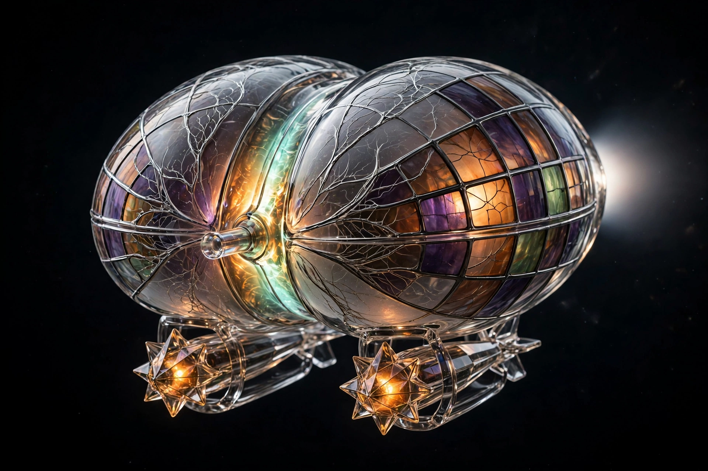

# Bomber: Heliograph Prism (squadron craft)

Squadron craft, five per wing (squadrons synthesis, section 4.5). Not a data.js hull.

Pick: W4b (Ryan, Nov 16, 2026): closed twin lobes, star torpedoes carried under the bow.

Build notes:

- Form: two plump lobes of blown glass fused side by side, symmetric, both lobes the same size and shape. Fully closed hull: no holes, no bay openings, no porthole. Ryan rejected the porthole bow lens and the flank bay holes from the W3 round; the skin stays unbroken.
- Skin: clear pearly glass, silver veins, stained panes in amber, violet and green lit from inside. The seam between the lobes glows seafoam and amber from the core. Ryan pulled the W3 milky, opaque rendering back to this faction treatment; keep the glass clear.
- Star torpedoes: two, slung in clear glass cradles at the front underside of the hull, star heads forward and glowing amber. This is the same carried-torpedo grammar as the destroyer's startorp: carried visibly, never a bay.
- Prism gun: one small lens on the centreline between the lobes at the front, grown as a solid point. The sketch rendered it as a short tube stub; build it as a point.
- Stern: soft white bloom where the lobes taper together.
