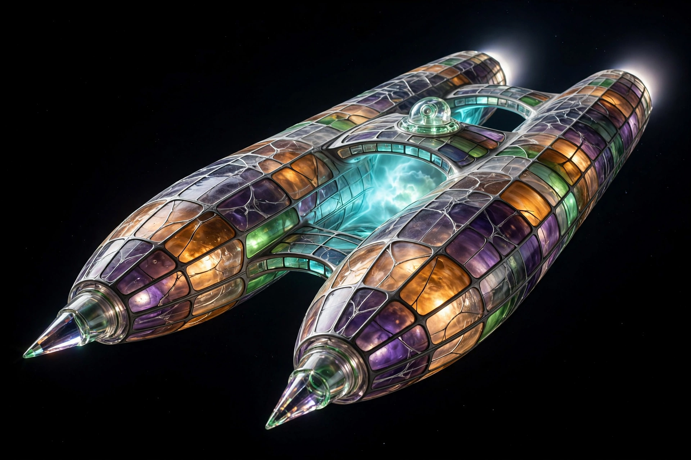

# Cruiser: Glasswright prism (i_song)

Data: Cruiser, size .74, cp 4, weapons pulsar F, pulsar F and turret T, ability surge.

Pick: step 3 (Ryan's brief, Nov 16, 2026): two parallel pane hulls, with the parallel aspect kept deliberately. Ryan likes the parallel read; do not merge the hulls into one body.

Build notes:

- Form: two elongated hulls of blown glass running side by side, joined by curved glass bridges, each skinned in thick lens panes (amber, violet, green, lit from inside). Stored light glows in the cleft between the hulls.
- Pulsar F x2: one lance per hull, at each bow, a grown solid lens point. The sketch round rendered these correctly as points; keep them points, never tubes.
- Turret T: one lens blister grown in the cleft on top amidships.
- Sterns: a soft white bloom at each stern.
- This is the one hull in the family where a twin body is the design. Family language without shape cloning still holds: no other hull copies this arrangement.
