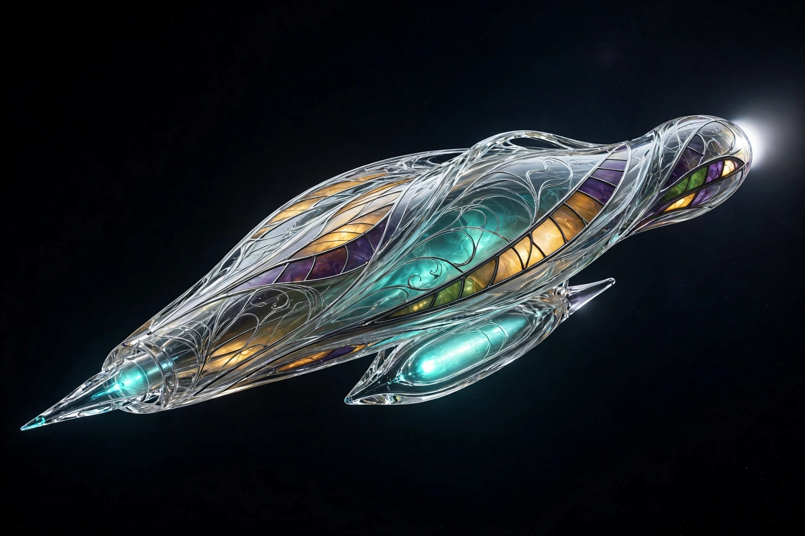

# Destroyer: Glasswright lancet (i_blade)

Data: Destroyer, size .58, cp 2, weapons shard F and startorp F, ability blink. Breach anchors 2.

Pick: step 1 (Ryan, Nov 16, 2026): the leaf, closest of the set to the CD5 form.

Build notes:

- Form: one slender leaf of flowing blown glass, stained panes lit from inside, stored light in the core.
- Shard F: the shard cluster grown into the bow optic on the centreline.
- Startorp F: the star torpedo slung visibly on the axis under the bow, in a glass cradle that is clearly attached to the hull. In the ribbon exploration the torpedo in a cleft read as a small separate craft; the cradle must read as carried, not docked.
- Stern: soft white bloom at the stern optic.
- Ryan reserved the step 2 twin-ribbon design for this hull as an alternate direction; the leaf is the pick of record, the ribbon is not to be built unless Ryan reopens it.
