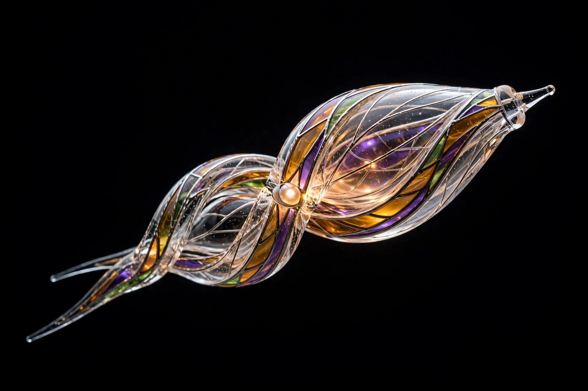

# Fighter: Starling Shard (squadron craft)

Squadron craft, flown five per wing in Starling Diamond formation (squadrons synthesis, section 4.5). Not a data.js hull.

Pick: V2d (Ryan, Nov 16, 2026, "perfect"): the seamless stained ribbon dart.

Build notes:

- Form: two ribbons of blown glass twisted tightly into one small dart. One continuous stained-glass skin from nose to stern: the canopy section carries the same amber, violet and green panes and silver veining as the ribbons, with no seam and no change of material. Ryan asked for the enclosure matched to the rest of the craft, and V2d is that match.
- Pilot: the front third is a closed canopy section, fused shut, the ribbons flowing into it.
- Light: one very small, warm pearl of light at the ribbons' crossing. Ryan rejected a large central blue glow on the earlier version; keep the light small, warm and off-centre-axis, or spread as threads inside the ribbons.
- Weapon: one tiny solid lens point at the nose (shard gun). Grown, never a tube.
- Stern: a short streamer of rigid glass.
