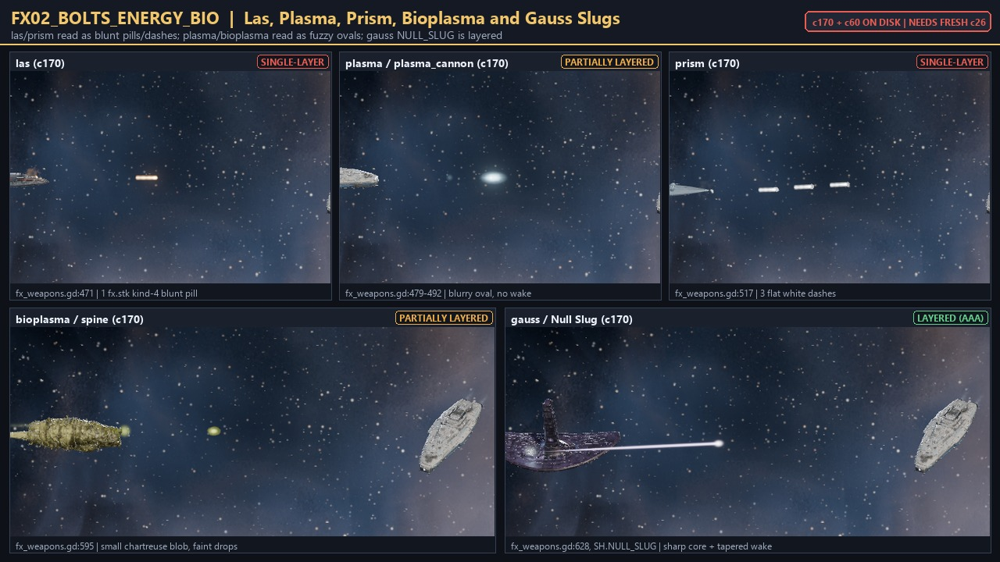
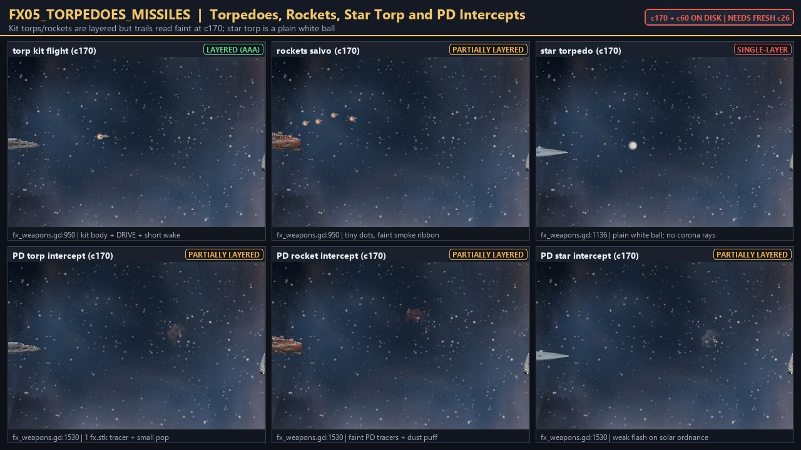
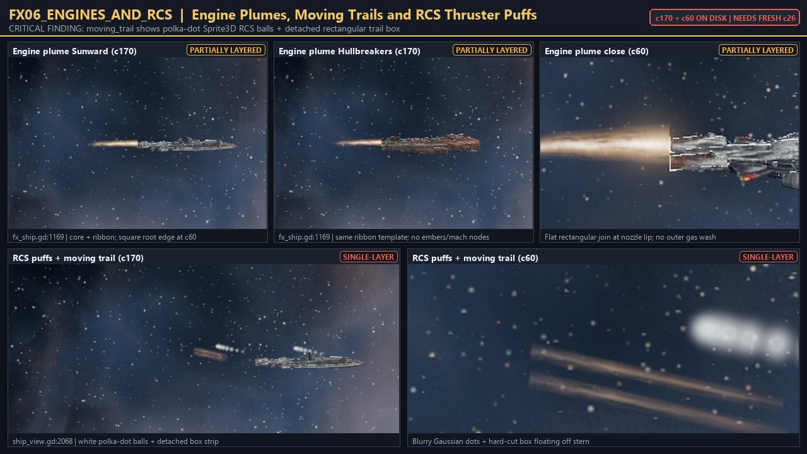
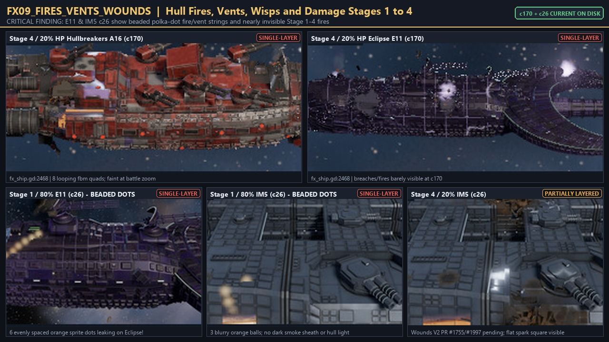
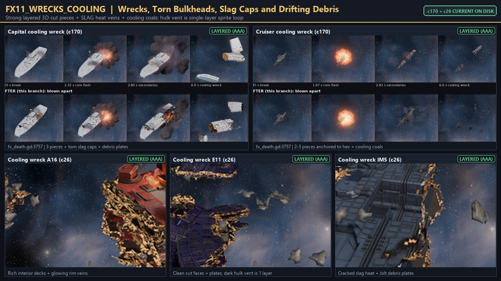
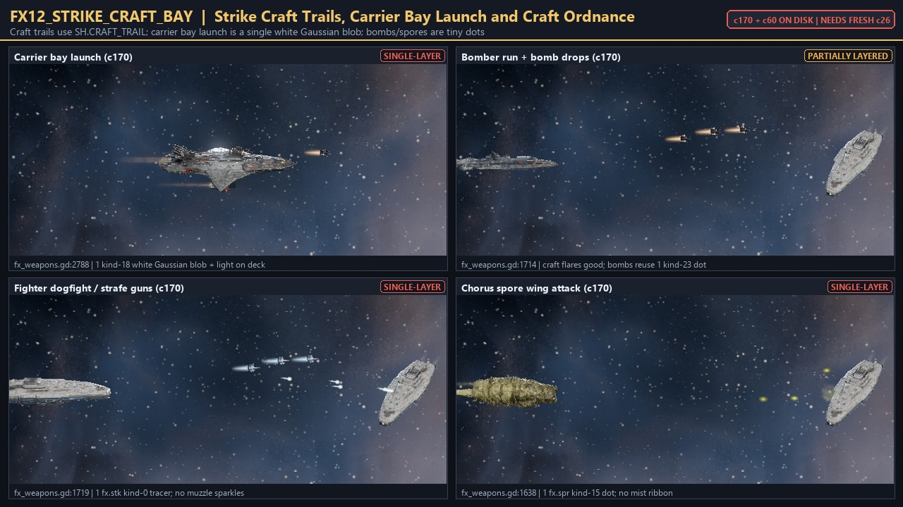

# Full Effects Sweep: Master Single-Layer Audit, In-Flight Tie-In and AAA Upgrade Plan (Nov 24 2026)

- **Issue:** `#2031` (AAA item 6, R450)
- **Branch:** `neon/issue-2031`
- **Owner:** Neon
- **Role:** **One master effects list** tying every visual effect in `godot/` to the 10 effect jobs already in flight, marking every row `COVERED`, `PARTLY`, or `NEW` so nothing is fixed twice and nothing is missed.
- **Shield rule (R450):** Shields are **one pool** everywhere. No recommendations below restore 4-facing shield UI or rules.

---

## 1. Executive Summary

- **Total distinct effects audited:** **68 numbered effects** (Categories 1-14) plus **5 terrain sub-systems** (Category 15) = **73 tracked rows**.
- **Layer audit today (68 numbered effects):**
  - **Single-layer (flat, programmer-art, or placeholder):** **27 effects (40%)**
  - **Partially layered (2+ pieces, missing core/sheath/taper/light/faction parity):** **23 effects (34%)**
  - **Layered (AAA-grade foundation, polish or readability tuning only):** **18 effects (26%)**
- **In-flight coverage status across all 73 tracked rows (68 numbered + 5 terrain):**
  - **`COVERED`:** **18 rows** (16 numbered + 2 terrain: already owned and made layered or kept at AAA by an in-flight/merged job; no duplicate build job).
  - **`PARTLY`:** **27 rows** (24 numbered + 3 terrain: an in-flight job fixes colour, sparks, marks, framing, or one sub-layer, but leaves a specific single-layer piece or readability gap named in the table).
  - **`NEW` (`none, new job needed`):** **28 rows** (all numbered: no in-flight job owns them; need net-new Codex build issues).
- **Picture coverage today:**
  - **28 effects** have current `c170` AND `c26` captures on disk (`battle_baseline_1118`, `deaths_small`, `hit_fragments`, `nebula`, `1361`, `issue-1264`).
  - **26 effects** have current `c170` + `c60` captures in `docs/shots/look_bench/kit/round3/` and `round4/` (weapons, muzzles, torps, plumes, craft) and need **fresh `c26` close-up captures**.
  - **14 effects** have **zero current look bench captures** at either `c170` or `c26` and are queued in Section 6.

### Top 5 Visual Gaps Verified in Rendered Frames

1. **RCS Thrusters + Moving Engine Trail (`FX06_engines_and_rcs.jpg`) [NEW / PARTLY `#1991`]:** In `kit/round3/moving_trail.png`, turning and braking puffs (`ship_view.gd:2068-2148`) render as **strings of blurry white Gaussian polka-dot balls** (`o o o o`), and `_trail_strip` floats behind the stern as a **detached hard-cut rectangular box**. (`#1991`/`#2007` fixes Eclipse's orange trail tint only; neither fixes the dots or detached strip.)
2. **Stage 1-4 Damage Fires & Vents (`FX09_fires_vents_damage_stages.jpg`) [PARTLY `#1741`/`#1755`/`#1997`, `#1991`, `#2018`]:** In `BATTLE1076_E11_c26_standard.jpg` and `BATTLE1076_IM5_c26_standard.jpg`, Stage 1-2 vents render as **evenly spaced strings of orange sprite dots** (even on purple Eclipse ships!), while Stage 3-4 hull fires are nearly invisible. Wounds V2 (`#1741`/`#1755`/`#1997`) upgrades interiors, cutouts, dressing, and cavity lights, but leaves the looping procedural fbm quad fire/smoke emitters single-layer.
3. **Nova Cannon, Arrivals, Blink, Phase, Jump-Out, Ability/Command Pulses (`FX15_arrivals_warp_nova_status_boarding.jpg`) [NEW]:** Nova Cannon still calls retired placeholder `fx_stub.gd` (single `Sprite3D` dot + flat orange flash). Reinforcements pop in instantly with one `fx.pop` circle and text. Blink, Phase, Jump-Out, Ability, and Command pulses are 1-2 primitive stand-ins identical across all 6 factions. Zero in-flight jobs own any of these.
4. **Single-Layer Weapon Bolts, Muzzles & Star Torpedo (`FX01`, `FX02`, `FX04`, `FX05`) [NEW / PARTLY `#1689`, `#2018`]:** `macro`, `auto`, `junk`, `scatter`, `flak`, `guns` are tiny 1-layer `fx.stk` crumbs; `las` is a blunt rectangular glow-pill; `prism` is 3 flat white dashes; `star` torpedo is a plain white ball (`SPRITE` kind 17 corona unused); `bombs` reuse the dark craft dot (`kind 23`); `_muzzle` leaks ballistic Cone-B smoke onto `las`/`prism`.
5. **Non-Doom Beams (`FX03_beams_all_factions.jpg`) [NEW, except `tendril` COVERED by `#1877`/`#1904`]:** `doom` Round 4 (`SH.ECLIPSE_ARC`, 3 twisting filaments + dark violet sheath + shed motes/lenses) is our AAA benchmark. `needle` is a single plain white line with zero distortion/shimmer, `ion` is a washed-out white-blue Gaussian tube, and `lance`/`pulsar` read as uniform smooth cylinders at `c60`.

---

## 2. Tie-In to the 10 Effect Fixes Already in Flight

This table maps every in-flight job named in issue `#2031` so the Board knows exactly what each job already makes layered, what it only fixes (colour/framing/bug), and what single-layer work stays outside it.

| In-Flight Job / PR | What It Owns | Makes Layered vs Fix-Only | Rows Marked `COVERED` | Rows Marked `PARTLY` (What It Leaves Single-Layer or Unresolved) |
|---|---|---|---|---|
| **`#2018`** (Codex, running) | Shared HDR tapered camera-facing motion-blurred spark across all factions (`faction_looks.json`) | **Makes layered** (spark primitive only) | Shared sparks (hits, muzzles, deaths, breaches, boarding, wisps, RCS grit) | Does NOT replace non-spark `fx.stk` projectiles (`macro`, `auto`, `junk`, `scatter`, `flak`, `las`, `prism`, `guns`, `PD_TRACER`) or `fx_acid_thorn.gd` (`#1904`); leaves `"tidal"` pull-stream, boarding tethers, and wisp smoke single-layer |
| **`#1693` / PR `#2021`** (Codex, running run 4) | Wave 2B persistent acid mist (`_emit_acid` 2-3 puffs, lavender on Eclipse), bio hit no-orange heat spot (`_heat_spot`), `BIO_CONTACT_GLOB` kind 29, live-shield-gated `ion_arc`, low-shield `<25%` strain | **Fix + partial layering** (low-shield strain layered; acid mist split into 2-3 puffs) | Low-shield strain (`<25%` flicker/crackle); bio/acid hit no-orange heat spot | Persistent acid mist still 1 layer of soft puffs (no wet bubbling surface etch / droplets); `ion_arc` is 1px shield line gated to `shp > 0` (invisible when shield is broken at 0); does NOT cover turn-start `tick` flares (`fire`/`acid`/`tidal`/`storm`) |
| **`#1991` / PR `#2007`** (Codex, running run 2) | Faction colour leaks (Eclipse `TRAIL` style 3, Eclipse `_implode`, turn-start `"fire"` tick colour, Chorus `_wing_death` spore death, Meridian cool `damage_glow`), depth-tested blocker outlines, darker wreck cap | **Fix-only** (colour & depth bugs; does not add layers) | Blocker outlines depth fix | Turn-start `"fire"` tick still 1-layer procedural quads; Eclipse moving trail still detached box; Chorus wing death still 1 small spore pop; `crit` still needs full faction blowout kit beyond `damage_glow` |
| **`#2022`** (Codex, held for `#2007`) | Rewrites `SLAG` shader (lit, smooth value noise, faction `scorch_tint`, thin hot seam cooling in 3s, no glitter dots) + part-kit bulkheads/decks/ribs inside authored breaks + Glasswright/Chorus break audit | **Makes layered** (upgraded wreck caps & interiors) | Cut wreck pieces, `SLAG` caps, break interiors (supersedes `#1991` item 8) | Does NOT cover `fx_hulk_vent` (single-layer 9-quad sprite loop on burnt/boarded hulks) or edge-fire sprite kit |
| **`#1689`** (R412 tracker: `#1690`, `#1691`/`#1736`, `#1692`/`#1758`, `#1693`) | Ship hit reactions/recoil/miss (`#1690`), target-material impacts & metal-only wear (`#1691`), weapon silhouette tuning (`#1692`), Wave 2B status (`#1693`); `#1692(d)` folded into `#1741` | **Mixed** (hit reactions/material rules landed; bolts/beams stayed existing shaders) | Ship hit reaction/recoil | Left ballistic/energy bolts (`fx.stk`) single-layer, non-Doom beams uniform `SH.RIBBON`, and `_muzzle` energy smoke leak unaddressed |
| **`#1741` / PRs `#1755`, `#1997`** (Opus, Wounds V2 + default flip, R416) | 6-faction wound/interior profiles, 8-ray footprint clamp, normal-gated overlays, mid-battle cutouts, Layer 1 triplanar PBR + cavity AO `SH.INTERIOR`, Layer 2 3D breach-mouth dressing, `_hole_lights` cavity lights, `#1692(d)` (`prism`/`star`/`nlance` marks), M3 capability loss (`#1749`) | **Makes layered** (wounds, interiors, breach dressing, hull marks) | Breach mouths/throats/interiors, weapon hull marks (`prism`/`star`/`nlance` included), capability-loss links | Leaves looping Stage 1-4 fire/vent/smoke emitters (`fx_ship.gd:2468`, `_build_wisp`, damaged wing smoke) as single-layer procedural fbm quad dots (`FX09`) |
| **`#1399` and `#1875`** (Opus, faction deaths & death variety) | `#1399` (merged PRs `#1400`/`#1418`/`#1470`/`#1522`): 6-faction death colours/styles + calm small wrecks; `#1875`: big metal hull "cooks off first" walking-blast variant | **Makes layered** (multi-beat faction deaths) | Capital/cruiser 3-beat faction deaths & cook-off variety; Chorus rupture & acid melt structure | `tear_particles` sparks need `#2018`; small-hull bow `_split_vent` (`fx_death.gd:2810`) still reads as a single round white puff ball at c26; Chorus rupture/melt needs fresh c170+c26 capture |
| **`#1877` / PR `#1904`** (Opus/Muse, open) | Replaces Chorus `tendril` wavy noodle ribbon with built Chorus bone/acid thorn projectiles (`fx_acid_thorn.gd`) | **Makes layered** | `tendril` (retired -> Acid Thorns) | None once PR `#1904` merges and passes c170+c26 capture |
| **`#2032`** (Claude API arm, running) | 3 dynamic cut-in camera presets (fading grid/rings/text) + minimum on-screen sizing for kill core flash & ring at c170 (within R186/R193) | **Fix / readability** (camera framing + c170 kill flash sizing; no new particle layers) | Kill cut-in framing & c170 core-flash sizing | Does not layer underlying beams, torpedoes, or hull vents seen inside cut-ins (`lance`/`torp`/deaths stay owned by their respective FX builds) |
| **`#1779`** (PR `#1961` merged, opt-in) | Per-region 3D battle LUTs, close-up kill-cam DoF, half-res SSR benchmark, `CompositorEffect` capital-death shockwave warp + Dead Star lensing, Forward+ clustered `Decal` scorch nodes | **Infrastructure (opt-in)** | Post-FX LUT, kill-cam DoF, shockwave `CompositorEffect` | `terrain_scorch.gd` uses Forward+ `Decal` node, but its baked texture (`terrain_scorch.gd:15-55`) is still a single-layer 64x64 procedural wobbled circle |

*(Additional non-list PRs tracked for coordination: `#1980` standalone hits respect shields; `#1986` animated storm lightning.)*

### Artoo Technical Review Note on Shields (`main` @ `ee398fcf`)
Artoo verified that `godot/fx/fx_shaders.gd:1376-1394` **already implements** a 3-ring expanding local ripple (`rg`, from `float d = length(lp - h.xyz)`) **plus** a separate whole-shield broad glow (`glow_all`, line 1392: `(0.10 + 0.22 * far) * S`). At camera 170 (`far` near 1.0), `glow_all` visually overwhelms `rg`, making a heavy hit read like a full white bubble (`FX07`). Accordingly, Shield Impact Ripple (Row #37) is classified as **`LAYERED (AAA)`** in code and tagged **`NEW` (readability/balance tuning, NOT missing ripple code)**: the fix is an A/B `c170` capture comparing `rg` with reduced vs current `glow_all`.

---

## 3. Ranked Master List (Every Group Tied to In-Flight Jobs)

Ranked from highest player-visible impact down to already-AAA systems. Every row carries its **Owner Job**, **Status (`COVERED` / `PARTLY` / `NEW`)**, and **Next Action** (add to in-flight run vs net-new Codex job).

| Rank | Code | Effect / Group | Today | In-Flight Owner | Status | What Owner Leaves Single-Layer / Gap | Camera Status | Next Action |
|---:|---|---|---|---|---|---|---|---|
| 1 | `RCS-01` | RCS / attitude / braking thruster puffs + detached moving trail box | **SINGLE-LAYER** | `#1991` / PR `#2007` (Eclipse trail tint only); `#2018` (grit sparks only) | **PARTLY** | `ship_view.gd` Gaussian polka-dot balls (`o o o o`) + detached hard-cut `_trail_strip` box untouched by `#1991`/`#2018` | `c170 + c60` (needs `c26`) | **New Build A:** Shared Drive & RCS Cone-Jet Kit |
| 2 | `WP-BOLT` | Ballistic & energy bolts (`macro`, `auto`, `junk`, `scatter`, `las`, `prism`, `plasma`, `flak`, `guns`, `bombs`, `spores`) | **SINGLE-LAYER** | `#1689` (Wave 2A silhouette only); `#2018` (sparks only) | **NEW** (bolts) / **PARTLY** (impacts) | All non-spark `fx.stk` bolts & `fx.spr` blobs (`las` pill, `prism` dashes, `flak` circle, `bombs` craft dot) remain 1-layer | `c170 + c60` (needs `c26`) | **New Build B:** Shared Layered Bolt & Ordnance Kit |
| 3 | `DMG-FIRE` | Hull damage fires, vents, wisps, damaged wing smoke (Stages 1-4) | **SINGLE-LAYER** | `#1741` / PRs `#1755`, `#1997` (Wounds V2 interiors/lights); `#1991` (colours); `#2018` (sparks) | **PARTLY** | Looping Stage 1-4 fires (`fx_ship.gd:2468`), `_build_wisp`, and wing smoke remain beaded procedural fbm quad dots (`FX09`) | `c170 + c26` current | **New Build C:** Baked Fire Core + Dark Smoke Plume Kit (stacks on `#1755`/`#1997`) |
| 4 | `SPEC-NOVA` | Nova Cannon projectile & detonation | **SINGLE-LAYER** | none, new job needed (`#1980` fixes splash shield check only) | **NEW** | Still calls retired `fx_stub.gd` single `Sprite3D` dot + flat orange flash | **NONE** (needs `c170 + c26`) | **New Build D:** Nova Cannon, Warp & Ability Kit |
| 5 | `WARP-ARR` | Reinforcement warp-in, `blink`, `phase`, `jump_out`, `risen` | **SINGLE-LAYER** | none, new job needed | **NEW** | Instant spawn + 1 `fx.pop` dot; zero warp rift, hull stretch, distortion, or afterimage | Battle frame only (needs `c170 + c26`) | **New Build D:** Nova Cannon, Warp & Ability Kit |
| 6 | `STAT-TICK` | Turn-start status ticks (`fire`, `acid`, `tidal`, `storm`) + 0-shield Ion crawl | **SINGLE-LAYER** | `#1693` / PR `#2021` (persistent acid/ion); `#1991` (`fire` colour); `#2018` (`tidal` sticks) | **PARTLY** | `"fire"` still 1-layer quads; `"acid"` 6 flat puffs; `"tidal"` lacks pull stream; `"storm"` draws NOTHING on 0-shield ships; persistent `ion_arc` hidden at 0 shield; acid mist lacks wet surface etch | **NONE** (needs `c170 + c26`) | **New Build E** (or `#1693` run 5 for persistent 0-shield ion + wet acid) |
| 7 | `WP-BEAM` | Non-Doom beams (`needle`, `ion`, `pulsar`, `lance`, `nlance`) | **SINGLE-LAYER / PARTIAL** | `#1877` / PR `#1904` (`tendril` ONLY); `#1741` (`nlance` mark); `#2032` (lance cut-in camera) | **NEW** (`needle`, `ion`, `pulsar`, `lance`, `nlance`) / **COVERED** (`tendril`) | `needle` plain white line (no dst/shimmer); `ion` washed Gaussian tube; `lance`/`pulsar` uniform cylinders at c60; `nlance` lacks `fx.dst` | `c170 + c60` (needs `c26`) | **New Build F:** Beam Sheath, Filament & Refraction Pass (to Doom R4 bar) |
| 8 | `WP-STAR` | `star` torpedo, `rockets` smoke, PD intercept | **SINGLE-LAYER / PARTIAL** | `#1741` (`star` hull mark only); `#2018` (intercept sparks only) | **NEW** (`star` body, `rockets` trail) / **PARTLY** (PD intercept) | `star` is plain white ball (`SPRITE` k=17 corona unused); `rockets` smoke nearly invisible; PD tracer is 1 `fx.stk` line | `c170 + c60` (needs `c26`) | **New Build B:** Ordnance Core, Corona & Rocket Trail Kit |
| 9 | `SPEC-AB` | `ability` & `command` pulses + `fx.launch` carrier bay glow | **SINGLE-LAYER** | none, new job needed | **NEW** | 2-primitive stand-in identical for all 6 factions (`API.md:129`); carrier bay is 1 white Gaussian blob | `bay`: `c170+c60`; `ab/cmd`: **NONE** | **New Build D:** Nova Cannon, Warp & Ability Kit |
| 10 | `MUZ-01` | Muzzle flashes (`las`/`prism` smoke leak; `auto`/`plasma`/`flak` 1-layer flash; beam charge-up) | **PARTIALLY LAYERED** | `#2018` (muzzle sparks only) | **PARTLY** (`macro` sparks) / **NEW** (`las`/`prism`/`auto`/charge) | `_muzzle` leaks ballistic Cone-B smoke onto lasers/crystals; `auto`/`flak`/`plasma` use 1 flat flash; `lance`/`ion`/`needle` lack charge-up rings | `c170 + c60` (needs `c26`) | **New Build B:** Faction Muzzle & Beam Charge Kit |
| 11 | `BOARD-01` | Boarding breach & boarding tethers | **PARTIALLY LAYERED** | `#2018` (breach sparks only) | **PARTLY** | Hardcoded amber/orange hatch & 3 flat untextured `line_style` arcs for all 6 factions; no pods/teleporter beams/cutters | **NONE** (needs `c170 + c26`) | **New Build E:** Faction Boarding, Status & Storm-Arc Kit |
| 12 | `ENG-PLM` | Main engine plumes (`DRIVE` + `PLUME` ribbon) & sick nozzles | **PARTIALLY LAYERED** | `#2018` (sick sparks); `#1741` M3 (engine capability loss) | **PARTLY** | Square rectangular join at nozzle lip at c60; single warm wedge across factions (no Mach shock nodes / outer wash / aft hull bounce) | `c170 + c60` (needs 6 factions `c170+c26`) | **New Build A:** Shared Drive & RCS Cone-Jet Kit |
| 13 | `SPK-01` | Sparks across hits, muzzles, deaths, breaches, boarding, RCS | **SINGLE-LAYER** (on main) | **`#2018`** (Codex, running) | **COVERED** (makes layered) | `#2018` owns all spark sites (`fx.stk` k=1/8 + RCS grit + `tear_particles`); audit confirm after merge | `c170 + c26` current | Track `#2018` (no new job) |
| 14 | `HIT-HULL` | Hull hits (`crit`, `bio`, `plasma`, `gauss`, standalone `_impact`) | **PARTIAL / AAA** | `#1689` (`#1691` material); `#1693`/`#2021` (bio no orange); `#1991` (Meridian glow); `#2018` (sparks); `#1741` (marks); `#1980` (standalone shield) | **PARTLY** | `crit` still leaks orange flame on Eclipse/Chorus; standalone `_impact` is generic `fx.pop`; plasma/bio hits softer than shell/torp | `c170 + c26` current | **Add to `#1991` next run** (`crit` Eclipse/Chorus check) + **Build B/C** (plasma/bio/standalone hit kit) |
| 15 | `CRAFT-01` | Strike craft patrol & attack trails (`squadron_wing.gd` fallback vs `SH.CRAFT_TRAIL`) | **PARTIALLY LAYERED** | none, new job needed | **NEW** | Raw `squadron_wing.gd` fallback is 1 flat gradient ribbon; patrol trails thin with no hot engine bead | `c170 + c60` (needs patrol `c26`) | **New Build A:** Unify Craft Trail & Bay Launch Kit |
| 16 | `IDLE-01` | Idle ship motion (`fx_idle.gd`, default OFF) | **SINGLE-LAYER** | none, new job needed | **NEW** | 1 batch sine-envelope Gaussian dots for all 6 factions | **NONE** (needs `c170 + c26`) | **New Build G:** Low-Priority Polish (Idle, Scorch, Infall, Dust) |
| 17 | `TERR-MISC` | Terrain minor layers (Dead Star `INFALL` motes, `terrain_scorch.gd`, `DUST_SHADER`, storm bolts, blocker outlines) | **SINGLE-LAYER / PARTIAL** | `#1779` (Forward+ Decal node); `#1991`/`#2007` (outlines); `#1986` (lightning) | **COVERED** (outlines `#1991`) / **PARTLY** (scorch `#1779`, bolts `#1986`) / **NEW** (infall, dust) | `terrain_scorch.gd` texture is still 64x64 procedural wobbled circle; `INFALL_SHADER` & `DUST_SHADER` are plain Gaussian dots | `c170 + c26` (scorch/infall need `c26`) | **New Build G** (scorch 256px tex, stretched infall embers, dust glints) + track `#1986` |
| 18 | `SHLD-01` | Shield hits, local ripple, low-shield strain, regen, route, collapse (One Pool, R450) | **LAYERED (AAA)** | `#1693`/`#2021` (low-shield strain) | **COVERED** (strain `#1693`) / **NEW** (c170 glare balance & collapse wave) | **Artoo verified (`fx_shaders.gd:1376-1394`):** 3-ring local ripple ALREADY exists; `glow_all` broad glow washes it out at c170 (readability gap, not missing code) | `c170 + c26` current | **New Build G:** A/B tune `glow_all` vs local `rg` ripple at c170 + collapse travelling edge wave |
| 19 | `DTH-01` | Ship deaths (wings, small 4 archetypes, cruiser/capital 3 beats, 6 faction styles) | **LAYERED (AAA)** | `#1399` & `#1875` (faction deaths & cook-off); `#2032` (c170 kill read & cut-ins); `#2018` (sparks); `#1991` (Chorus wing, Eclipse implode) | **COVERED** (capital/cruiser) / **PARTLY** (small bow vent, wing corkscrew) | Small-hull `_split_vent` (`fx_death.gd:2810`) still reads as a single round white cotton ball at c26; wing corkscrew needs brief blaze streak | `c170 + c26` current | **Add to `#1875` or Build G:** sharpen small-hull bow vent jet |
| 20 | `WRK-01` | Wrecks (cut pieces, `SLAG` caps, interiors, debris plates, `fx_hulk_vent`) | **LAYERED (AAA)** | **`#2022`** (edges & kit interiors, held for `#2007`); `#1991` (interim cap) | **COVERED** (cut pieces/caps/interiors `#2022`) / **PARTLY** (`fx_hulk_vent`) | `fx_hulk_vent` (`fx_death.gd:3681`) is still a 1-layer 9-quad looping sprite string | `c170 + c26` current | **Add to Build C** (replace `fx_hulk_vent` with cold-vapor ribbon) |
| 21 | `TERR-MAIN` | Calm Nebula, Ion Storm fog, Dead Star core/disc/lens, Ice Comets, Asteroids, Post-FX | **LAYERED (AAA)** | `#1779` (LUT, DoF, SSR, `CompositorEffect`); `#1986` (lightning) | **COVERED** | Keep as AAA baseline; opt-in `#1779` awaiting Ryan pick + `nebula_wake` GPU gate | `c170 + c26` current | Track `#1779` & `#1986` |

---

## 4. Exhaustive Category-by-Category Audit (All 68 Effects)

Every single row below explicitly lists: **Today (`file:line` & layer count)**, **Layer Class**, **In-Flight Owner & Status (`COVERED` / `PARTLY` / `NEW`)**, **Picture (`c170`/`c26`)**, **Size & Readability**, and **What a AAA Version Adds**.

---

### Category 1: Weapon Bolts & Projectiles (Per Faction)

| # | Effect (Factions) | Today (`file:line` & Layers) | Class | Owner & Status | Picture (c170 / c26) | Size & Readability | What a AAA Version Adds |
|---:|---|---|---|---|---|---|---|
| 1 | `macro` shell (Sunward, Hullbreakers, Meridian) | `fx_weapons.gd:433-444`, `fx_shaders.gd:552` (`STREAK` k=0): **1 layer** (`1x fx.stk` k=0) | **SINGLE-LAYER** | **NEW** (none, new job needed; `#1689` silhouette only) | `FX01` (`kit/round3/macro.png` c170+c60; **needs c26**) | Tiny ~6px crumb at c170, stubby white speck at c60 | Hot incandescent nose core + faction tracer sheath + tapered glowing tail + tiny drag sparks + faint pass-by light |
| 2 | `auto` autocannon (Sunward, Hullbreakers, Meridian) | `fx_weapons.gd:451-458`: **1 layer** (`4x1 fx.stk` k=0 burst) | **SINGLE-LAYER** | **NEW** (none, new job needed) | `FX01` (`kit/round3/auto.png` c170+c60; **needs c26**) | Thin bright dashes; no volume at c60 | Tapered tracer dart (hot tip, trailing smoke/ember filament), barrel-alternating parallax |
| 3 | `junk` scrap cannon (Hullbreakers) | `fx_weapons.gd:460-467`: **1 layer** (`1x fx.stk` k=0, warm rust) | **SINGLE-LAYER** | **NEW** (none, new job needed) | `FX01` (shares `macro`; **needs c170+c26**) | Identical to `macro` except tint | Tumbling glowing slag chunk silhouette + dirty orange ember wake + smoke tail |
| 4 | `scatter` shrapnel (Hullbreakers) | `fx_weapons.gd:500-509`: **1 layer** (`6x1 fx.stk` k=0 cone) | **SINGLE-LAYER** | **NEW** (none, new job needed) | `FX01` (`kit/round3/scatter.png` c170+c60; **needs c26**) | 6 tiny identical pellets | Varied shard sizes, hot leading glints, trailing ash wisps, tighter muzzle cone bloom |
| 5 | `flak` / `pflak` / `mflak` / `gflak` (gun factions) | `fx_weapons.gd:1628-1658`: **1 layer** tracer (`fx.stk` k=0/4) + 1 round beige puff (`_burst`) | **SINGLE-LAYER** | **NEW** (none, new job needed) | `FX01` (`kit/round3/flak.png`, `pflak/mflak/gflak` c170+c60; **needs c26**) | Pinprick dots + round beige circle at target | Layered airburst: hot star core flash + dark expanding shrapnel ring + metallic glint flecks + faction-tinted smoke cloud |
| 6 | `las` laser bolts (Sunward, Meridian) | `fx_weapons.gd:469-475`, `fx_shaders.gd:572` (`STREAK` k=4): **1 layer** (`1x fx.stk` k=4) | **SINGLE-LAYER** | **NEW** (none, new job needed) | `FX02` (`kit/round3/las.png` c170+c60; **needs c26**) | Blunt flat rectangle pill (`====`) at both c170 and c60 | Needle-sharp white core inside colour-saturated outer sheath, pointed/tapered ends, subtle heat-shimmer tail |
| 7 | `plasma_cannon` (Meridian, Sunward) | `fx_weapons.gd:477-482`: **2 layers** (`fx.spr` k=14 envelope + `fx.spr` k=4 white core) | **PARTIALLY LAYERED** | **NEW** (none, new job needed) | `FX02` (`kit/round3/plasma.png` c170+c60; **needs c26**) | Soft white-cyan oval; flat without wake | Swirling hot core + crackling corona sheath + tapered ionised wake strip + `fx.dst` shimmer + travel light |
| 8 | `plasma` bolt (Meridian, Sunward, Eclipse) | `fx_weapons.gd:484-497`: **3 layers** (k=14 orb + k=0 streak + 3x k=18 dots + light) | **PARTIALLY LAYERED** | **NEW** (none, new job needed) | `FX02` (`kit/round3/plasma.png` c170+c60; **needs c26**) | Blurry white oval at c170 & c60; streak buried in bloom | Distinct hot core inside turbulent faction plasma shell (cyan Meridian, gold Sunward, violet Eclipse) + visible tapered wake |
| 9 | `prism` crystal bolts (Glasswrights) | `fx_weapons.gd:511-521`: **2 layers** (`fx.stk` k=4 + `fx.spr` k=16 facet glint) | **SINGLE-LAYER** (reads 1-layer) | **PARTLY** (`#1741` owns hull mark only; bolt itself is **NEW**) | `FX02` (`kit/round3/prism.png` c170+c60; **needs c26**) | 3 flat white capsule dashes (`=== === ===`) | Sharp crystalline lance-dart core + chromatic RGB/cyan-amber prism dispersion fringe + glittering micro-facet trail |
| 10 | `bioplasma` / `spine` (Chorus) | `fx_weapons.gd:586-604`: **2 layers** (k=15 glob + 8x k=6 dripping streaks + light) | **PARTIALLY LAYERED** | **PARTLY** (`#1693`/PR `#2021` fixes hit heat-spot & Eclipse tint; flight bolt is **NEW**) | `FX02` (`kit/round3/bioplasma.png` c170+c60; **needs c26**) | Tiny fuzzy chartreuse pill; drips barely visible at c170 | Translucent pulsing acid sac with bright bile core + viscous trailing filament + visible falling corrosive droplets |
| 11 | `gauss` / Null Slug (Eclipse) | `fx_weapons.gd:616-660`, `fx_shaders.gd:2470-2508` (`SH.NULL_SLUG`): **4 layers** (4 coil glows + tapered slug/wake + muzzle shock ring + dst) | **LAYERED (AAA)** | **COVERED** (already AAA; `#2018` covers hit sparks) | `FX02` (`kit/round3/gauss.png` c170+c60; **needs c26**) | Crisp white head + long violet-white wake | Already AAA; optional Mach-ring ripples along path at c26 |
| 12 | `nova` Nova Cannon (Sunward flagship ability) | `battle.gd:2240-2248`, `fx_stub.gd:55-103`: **1 layer** (retired placeholder `Sprite3D` dot + 1 flat orange `_flash`) | **SINGLE-LAYER** | **NEW** (none, new job needed; `#1980` fixes splash shield check only) | `FX15` (**NONE - needs c170 + c26**) | Placeholder dot + giant flat orange disc | Full 3-beat superweapon: 0.5s prow charge-up with converging rings & barrel light -> recoil shockwave + relativistic shell with plasma sheath & lensing -> multi-stage detonation (white core + shock ring + dst lens + lingering fire/smoke + hex-wide hull light) |

---

### Category 2: Weapon Beams (Per Faction)

| # | Effect (Factions) | Today (`file:line` & Layers) | Class | Owner & Status | Picture (c170 / c26) | Size & Readability | What a AAA Version Adds |
|---:|---|---|---|---|---|---|---|
| 13 | `doom` Eclipse Arc (Eclipse) | `fx_weapons.gd:550-585`, `fx_shaders.gd:2125-2270` (`ECLIPSE_ARC`): **5 layers** (3 twisting filaments + dark violet sheath + converging ring + corona + `_doom_shed` lenses & motes + hull light) | **LAYERED (AAA)** | **COVERED** (already AAA gold standard) | `FX03` (`kit/round4/doom.png` c170+c60; **needs c26**) | Benchmark AAA look at phone, c170, and c60 | Gold standard reference for all other beams; capture at c26 |
| 14 | `lance` (Sunward, Hullbreakers) | `fx_weapons.gd:523-548`, `fx_shaders.gd:801-960` (`SH.RIBBON` k=2 + `_beam_ends` + charge k=12 + mid `fx.dst`): **3 layers** | **PARTIALLY LAYERED** | **PARTLY** (`#2032` upgrades lance cut-in camera only; beam shader is **NEW**) | `FX03` (`kit/round3/lance.png` c170+c60; **needs c26**) | Strong silhouette at c170, uniform flat glowing tube at c60 | High-frequency longitudinal flow filaments inside core, muzzle-to-target taper, helical outer heat corona, sharper charge-up ramp |
| 15 | `nlance` Null Lance (Eclipse) | `fx_weapons.gd:523-548` (`SH.RIBBON` k=2 + 3 converging rings k=3; **no `fx.dst`**, remaps hull mark to orange `"lance"`): **3 layers** | **PARTIALLY LAYERED** | **PARTLY** (`#1741` fixes `nlance` hull mark; beam shader & `fx.dst` are **NEW**) | Same ribbon as `lance` (**needs own c170 + c26**) | No mid-beam distortion; orange burn mark until `#1741` lands | Dark-violet outer sheath matching `doom`, gravity-lens `fx.dst` along beam |
| 16 | `ion` Ion Beam (Meridian) | `fx_weapons.gd:523-548`, `fx_shaders.gd:860-920` (`SH.RIBBON` k=5 + `_beam_ends` + `fx.dst`): **3 layers** | **PARTIALLY LAYERED** | **NEW** (none, new job needed) | `FX03` (`kit/round3/ion.png` c170+c60; **needs c26**) | Broad washed-out white-blue Gaussian bar at c60 | Tighter razor-hot electric core + 2 crackling secondary arc tendrils dancing around shaft + target static crawl |
| 17 | `pulsar` (Glasswrights) | `fx_weapons.gd:523-548` (`SH.RIBBON` k=2 + pulsing beads + `_beam_ends` + `fx.dst`): **3 layers** | **PARTIALLY LAYERED** | **NEW** (none, new job needed) | `FX03` (`kit/round3/pulsar.png` c170+c60; **needs c26**) | 3 bright beads at c170, soft white Gaussian smear at c60 | Crisp harmonic pulse rings sliding down a faceted crystalline beam + RGB prism edge dispersion + sparkling ends |
| 18 | `needle` (Glasswrights) | `fx_weapons.gd:523-548` (`SH.RIBBON` k=8 + `_beam_ends`; **no `fx.dst`**, **no recoil light**): **2 layers** | **SINGLE-LAYER** (reads 1-layer) | **NEW** (none, new job needed) | `FX03` (`kit/round3/needle.png` c170+c60; **needs c26**) | Plain thin white line with pale grey halo | Focused diamond-sharp core + turquoise/prism refraction sheath + crisp crystal focus muzzle burst + heat shimmer |
| 19 | `tendril` (Chorus - retiring) | `fx_weapons.gd:606-615` (`SH.RIBBON` k=9 + 5 spore puffs): **1-2 layers** | **SINGLE-LAYER** | **COVERED** (`#1877` / PR `#1904` replaces with layered Acid Thorns) | `FX03` (`kit/round3/tendril.png` c170+c60) | Uniform wavy yellow-green noodle | Replaced by Chorus Acid Thorns (`fx_acid_thorn.gd`) in PR `#1904`; verify at c170 + c26 |

---

### Category 3: Muzzle Flashes

| # | Effect | Today (`file:line` & Layers) | Class | Owner & Status | Picture (c170 / c26) | Size & Readability | What a AAA Version Adds |
|---:|---|---|---|---|---|---|---|
| 20 | Ballistic `_muzzle_blast` (`macro`, `junk`, `scatter`) | `fx_weapons.gd:875-889`: **4 layers** (baked `flash` + baked Cone-B `muzzle` gas jet + 4 sparks + OmniLight) | **LAYERED (AAA)** | **COVERED** (already layered; `#2018` upgrades muzzle sparks) | `FX04` (`vent_sheet_close.png`; **needs c170+c26**) | Punchy warm jet + hull illumination on turret deck | Already strong; `#2018` replaces flat muzzle sparks; optional shock-ring at c26 |
| 21 | Light ballistic `_burst` (`auto`, `flak`, `plasma`) | `fx_weapons.gd:453, 486, 1628`: **1 layer** (single baked `flash` quad, no gas/jet/sparks/light) | **SINGLE-LAYER** | **NEW** (none, new job needed) | `FX01`, `FX02` (**needs close c26**) | Brief flat star flash pasted on turret | Directional muzzle cone + faction plasma vent (`plasma`) or barrel flash light + `#2018` micro-sparks |
| 22 | Energy/Crystal `_muzzle` (`las`, `plasma_cannon`, `prism`) | `fx_weapons.gd:870-874`: **3 layers**, **BUG**: ignores `kind` param and calls ballistic Cone-B `_vent`! | **PARTIALLY LAYERED** (wrong look) | **NEW** (none, new job needed) | `FX04` (`p_las_muzzle.png`, `p_prism_muzzle.png` c170+c60; **needs c26**) | Visible orange gunpowder smoke puff on laser & crystal barrels! | Remove ballistic smoke; clean energy aperture bloom + focusing ring (`las`), plasma discharge arcs (`plasma_cannon`), or prism starburst (`prism`) |
| 23 | Gauss coil sequence (`gauss`) | `fx_weapons.gd:618-626`: **4 layers** (4 sequential coil lights + sharp flash + pale shock ring + `fx.dst`) | **LAYERED (AAA)** | **COVERED** (already AAA) | `FX02` (`gauss.png`; **needs muzzle c26**) | Clean railgun charge cascade | Keep as AAA reference for charge-up muzzles |
| 24 | Bio spit muzzle (`bioplasma`, `spine`) | `fx_weapons.gd:588-592`: **2 layers** (k=15 splatter sprite + light) | **PARTIALLY LAYERED** | **NEW** (none, new job needed) | `FX02` (`bioplasma.png`; **needs c26**) | Small green glow dot at maw | Directional bile spray mist + wet droplet burst + pulsing bio-luminescent maw recoil |
| 25 | Beam charge-up (`lance`, `ion`, `pulsar`, `needle`, `nlance`, `doom`) | `fx_weapons.gd:523-560`: **1-2 layers** (k=12 sprite; `nlance` adds 3 rings; `doom` adds converging ring + corona) | **PARTIALLY LAYERED** | **NEW** (none, new job needed) | `FX03` (**needs charge-frame c170+c26**) | `doom`/`nlance` telegraph clearly; `lance`/`ion`/`needle` only blink 1 dot | All heavy beams get 0.25-0.4s converging energy ring + barrel core brighten + turret deck light before firing |

---

### Category 4: Torpedoes & Missiles

| # | Effect | Today (`file:line` & Layers) | Class | Owner & Status | Picture (c170 / c26) | Size & Readability | What a AAA Version Adds |
|---:|---|---|---|---|---|---|---|
| 26 | Kit Torpedo (`torp`: Sunward, Meridian, Hullbreakers, Chorus, Eclipse) | `fx_weapons.gd:923-1285`: **5 layers** (launch puff + coast + ignite flash + 3D kit body + `DRIVE` core + `_kit_trail_*` strip) | **LAYERED (AAA)** | **PARTLY** (`#2032` frames torpedo chase cut-in; faint c170 trail boost is **NEW**) | `FX05` (`torp.png`, `p_missile_launch.png` c170+c60; **needs c26**) | Visible orange engine flare & 3D casing; wake trail reads faint/short at c170 | Lengthen and boost tapered ribbon wake so trajectory reads across 2 hexes at c170 + subtle nose glint |
| 27 | Rocket Salvo (`rockets`) | `fx_weapons.gd:950-1285`: **4 layers** (kit rocket + `DRIVE` + thin smoke ribbon + launch pops) | **PARTIALLY LAYERED** | **NEW** (none, new job needed) | `FX05` (`rockets.png` c170+c60; **needs c26**) | Tiny dots with stubby orange tails; smoke ribbons nearly invisible at c170 | Thicker curling exhaust smoke ribbons with hot ignition roots so salvos arc across the board |
| 28 | Star Torpedo (`star`, Glasswrights) | `fx_weapons.gd:1136-1195`, `fx_shaders.gd:2095` (`STAR_BODY`): **2 layers** (white sphere + `DRIVE` + looping vent quad; `SPRITE` k=17 corona unused!) | **SINGLE-LAYER** (reads 1-layer) | **PARTLY** (`#1741` owns `star` hull mark only; flight body is **NEW**) | `FX05` (`star.png` c170+c60; **needs c26**) | Plain blurry white circle (`o`) floating in space | Wire unused `SPRITE` k=17 solar corona rays + golden-cyan outer plasma sheath + lensing `fx.dst` halo + sparkling stardust wake |
| 29 | Non-kit ordnance fallback (`_casing`) | `fx_weapons.gd:1100-1135`: **3 layers** (procedural cylinder + `DRIVE` + looping `exhaust` flipbook + puffs) | **PARTIALLY LAYERED** | **COVERED** (kit meshes installed for all 6 factions; fallback only) | Kit covers all 6 factions | Basic cylinder only if kit missing | Keep fallback; verify all 6 factions route to kit meshes |
| 30 | PD Intercept (`torp_intercept`, `rocket_intercept`, `star_intercept`) | `fx_weapons.gd:1530-1595`: **2-3 layers** (`1x fx.stk` k=4 PD tracer + small flash/puff + `#2018` sparks) | **PARTIALLY LAYERED** | **PARTLY** (`#2018` upgrades intercept sparks only; PD tracer & airburst are **NEW**) | `FX05` (`*_intercept.png` c170+c60; **needs c26**) | Faint tracer + tiny dust pop; `star` intercept under-reads | Layered rapid tracer stream (core + sheath) + sharp mid-air detonation ring + secondary fuel burn-off puff |

---

### Category 5: Engine Plumes & RCS Thrusters (Per Faction)

| # | Effect | Today (`file:line` & Layers) | Class | Owner & Status | Picture (c170 / c26) | Size & Readability | What a AAA Version Adds |
|---:|---|---|---|---|---|---|---|
| 31 | RCS / Attitude / Braking Thruster Puffs (all factions) | `ship_view.gd:2068-2148`: **1 layer** (`Sprite3D` with 64x64 procedural Gaussian `_glow_tex` or flat circle `_ripple_tex`; missing `disable_fog = true`) | **SINGLE-LAYER** | **PARTLY** (`#2018` covers Hullbreakers grit sparks; `#1991` checks Glasswright tint; puff dots themselves are **NEW**) | `FX06` (`moving_trail.png` c170+c60; `movement/cruiser_turn.jpg` c170; **needs c26**) | **Worst visual eyesore in sweep:** reads as strings of blurry white polka-dot balls (`o o o o`)! | Replace `Sprite3D` dots with directional conical gas-jet shader (hot nozzle root -> fast-tapered cold vapor cone -> turbulent dissipation, `fog_disabled`), faction-styled |
| 32 | Moving Ship World Trail (`_trail_strip`) | `fx_ship.gd:1169-1310`, `fx_shaders.gd:748` (`PLUME`): **1 ribbon strip** | **SINGLE-LAYER** (artifacted) | **PARTLY** (`#1991`/PR `#2007` fixes Eclipse style-3 orange leak only; detached box geometry is **NEW**) | `FX06` (`moving_trail.png` c170+c60; **needs c26**) | **Broken geometry:** floats behind the stern as a detached rectangular box with a hard vertical cut-off edge! | Anchor strip root strictly to live nozzle socket every frame, smooth alpha/width fade at root and tail, add hot inner filament + softer outer wake |
| 33 | Main Engine Plumes per Faction (`DRIVE` + `PLUME`) | `fx_ship.gd:1060-1260`, `fx_shaders.gd:700-795`: **2-3 layers** (`DRIVE` core + accent corona + `PLUME` ribbon; fallback `Sprite3D` on low) | **PARTIALLY LAYERED** | **NEW** (none, new job needed) | `FX06` (`ribbon_0/1/3.png` c170+c60; **needs all 6 factions at c170+c26**) | Good length at c170, but square nozzle join at c60 and same silhouette across factions | Blend nozzle root softly inside bell, add pulsing hot inner core / Mach shock diamonds + outer low-alpha ion wash + faction distinction + aft hull bounce light |
| 34 | Hit-Reaction RCS Stabilisers (`_rcs`) | `fx_ship.gd:1491-1550`: **1-2 layers** (1 sprite k=16 Glasswrights, 1 ring k=3 Eclipse, 2 sprites k=7+18 others) | **SINGLE-LAYER** | **PARTLY** (`#1689` Wave 1A triggers it; primitive stays 1-2 flat sprites -> **NEW**) | **NONE** (needs `c170 + c26`) | Brief flat dot/ring | Route through the same new directional RCS cone-jet kit as movement thrusters |
| 35 | Sick / Damaged Engine Nozzle Coughs | `fx_ship.gd:1265-1340`: **2 layers** (flickering `DRIVE` + `fx.stk` sparks + smoke quads) | **PARTIALLY LAYERED** | **PARTLY** (`#1741` M3 triggers tiered loss; `#2018` upgrades sparks; smoke quads are **NEW**) | **NONE** (needs `c170 + c26`) | Sparks moving to `#2018`; smoke uses raw quads | Pair sputter flash with baked dark smoke puffs + `#2018` embers + brief nozzle choke-out dark frame |

---

### Category 6: Shield Hits & Breaks (One Pool, R450)

*(All recommendations preserve the single shield pool approved in R450. No 4-facing shield visuals or rules.)*

| # | Effect | Today (`file:line` & Layers) | Class | Owner & Status | Picture (c170 / c26) | Size & Readability | What a AAA Version Adds |
|---:|---|---|---|---|---|---|---|
| 36 | Resting Shield Rim & Gap | `fx_ship.gd:1650-1760`, `fx_shaders.gd:1425-1458` (`SHIELD`): **2 layers** (fitted/egg Fresnel rim + faction hex/crack/swirl lattice) | **LAYERED (AAA)** | **COVERED** (already AAA; keep restrained per `#1693` L409) | `FX07` (`shields_r303`, `BATTLE1076_A16/IM5_c26`) | Clean subtle rim at c170 and c26 | Keep restrained; minor faction pattern polish |
| 37 | Shield Impact Ripple & Flash | `fx_ship.gd:1875-1985`, `fx_shaders.gd:1376-1394`: **4 layers** (impact hot `core` + **existing 3-ring expanding local ripple `rg`** + broad whole-shield `glow_all` + hex `pat`/crackle/shards + light) | **LAYERED (AAA)** | **NEW** (readability/balance tuning only; **per Artoo review, local ripple code ALREADY exists at `fx_shaders.gd:1376-1394`**) | `FX07` (`shield_torp_hegemony.png` c170, `BATTLE1076_A16_c26`) | Crisp at c26; at c170 `glow_all` (`0.10 + 0.22 * far`) washes the egg white and hides the local `rg` ripple | **Readability fix (not missing ripple code):** A/B compare `rg` ripple with reduced `glow_all` at c170 so the expanding local rings and impact hot-spot read cleanly without white-washing the whole bubble |
| 38 | Shield Collapse / Break (`shield_break`) | `fx_ship.gd:1994-2085`, `fx_shaders.gd:1459-1510`: **4 layers** (collapse wave + fading hex mask + rim shards + light + `shield_down` event) | **LAYERED (AAA)** | **PARTLY** (`#2018` upgrades break sparks; travelling fracture edge polish is **NEW**) | `FX07` (`C15s_23_collapse_c170`, `BATTLE1076_A16/IM5_c26`) | Clean collapse, zero smoke leak (R297); fades somewhat uniformly at c26 | Sharper travelling fracture wave sweeping from impact point to far side + crisp discharging hex shards (`#2018`) |
| 39 | Low-Shield Strain & Regen / Route Pulses | `fx_ship.gd:1765-1870`, `fx_shaders.gd:1395-1421`: **2 layers** (edge `strain` surge + stern-to-bow `regen_t` band + `route_on` pulse) | **LAYERED (AAA)** (strain) / **PARTIAL** (regen) | **COVERED** (low-shield `<25%` strain owned by **`#1693` / PR `#2021`**) | **NONE** (PR `#2021` captures pending; **needs c170+c26**) | Strain built in `#1693`; regen shimmer subtle at c170 | Verify `#1693` strain sheet at c170+c26; boost regen sweep leading edge slightly across the single pool |

---

### Category 7: Hull Hits & Marks

| # | Effect | Today (`file:line` & Layers) | Class | Owner & Status | Picture (c170 / c26) | Size & Readability | What a AAA Version Adds |
|---:|---|---|---|---|---|---|---|
| 40 | Shell / Torpedo / Rocket Hull Hits | `fx_weapons.gd:2045-2265`: **5 layers** (baked flash + baked fireball + dark smoke + `#2018` sparks + torn hull fragments + hull OmniLight + breach mark) | **LAYERED (AAA)** | **COVERED** (`#1689` Wave 1B material impacts + `#2018` sparks + `#1741` marks) | `FX08` (`C15s_23_torpedo_before_after_c170`, `H9_23_torpedo_fragments_c26`, `BATTLE1076_A16_c26`) | Strong punch, lighting, and fragments; stick sparks replaced by `#2018` | Lands at AAA once `#2018` merges; optional subtle heat-shimmer `fx.dst` on torpedo hits at c26 |
| 41 | Lance / Beam Hull Burn | `fx_weapons.gd:2120-2175`, `fx_breach.gd:1798`: **4 layers** (beam end glow + molten cooling `HOLE`/`MARK` slot + sparks + light) | **LAYERED (AAA)** | **COVERED** (`#1741` marks + `#2018` sparks) | `FX08` (`BATTLE1076_A16_c26`, `kit/round3/p_lance_burn.png`) | Molten glowing cut looks strong at c26 | `#2018` replaces sparks; optional dark vapor curl rising from fresh slot |
| 42 | Critical Hit (`crit`) | `fx_weapons.gd:2270-2315`: **3 layers** (extra fireball + shock ring + sparks + light; **hardcoded orange fire!**) | **PARTIALLY LAYERED** | **PARTLY** (`#1991`/PR `#2007` fixes Meridian `damage_glow` + sweeps warm leaks; `#2018` sparks; verify Eclipse/Chorus crit fireball!) | `FX08` (`kit/round3/p_crit.png` c170+c60; **needs c26**) | Leaks bright orange flame on purple Eclipse hull in `p_crit.png`! | Confirm `#1991` stops orange crit fire on Eclipse/Chorus/Glasswrights; add secondary internal vent flare + faction blowout |
| 43 | Energy / Plasma / Bio Hull Hits | `fx_weapons.gd:2180-2260`: **2-3 layers** (tinted flash + k=14/15 splatter + mark) | **PARTIALLY LAYERED** | **PARTLY** (`#1693`/PR `#2021` fixes bio no-orange heat spot & Eclipse violet; `#1741` marks; plasma/bio splash layers are **NEW**) | `kit/round3/p_bile_hit.png` c170+c60 (**needs c26**) | Plasma/bio hits feel softer than torpedo/shell hits | Plasma: white core + ionized shock ring + glowing slag pool; Bio: directional acid splash fan + sizzling bubble mist |
| 44 | Gauss Entry & Exit (`gauss`) | `fx_weapons.gd:2320-2375`, `fx_breach.gd:1822`: **4 layers** (entry ring/flash + far-side exit spall blast + entry/exit craters + sparks) | **LAYERED (AAA)** | **COVERED** (already layered; `#2018` upgrades exit sparks; `#1741` marks) | `kit/round3/p_gauss_exit.png` c170+c60 (**needs c26**) | Great concept (through-hull exit blow) | Optional stronger exit-side debris cone + directional violet shock-ring at c170 |
| 45 | Ram Impact (`ram` & `ram_self`) | `battle.gd:2256-2277`, `fx_breach.gd:1834`: **4 layers** (target dent + bow dent + blast + zoom punch + shove) | **LAYERED (AAA)** | **PARTLY** (`#2018` upgrades sparks; contact scrape shower & capture are **NEW**) | **NONE** (needs `c170 + c26`) | Good mechanical hit; no look bench shot | Add metallic scraping spark shower (`#2018`) along contact seam + compressed shock-ring |
| 46 | Standalone Hits (`battle.gd:_impact`) | `battle.gd:2185-2192, 3409-3415`: **1-2 layers** (generic orange `_flash` `fx.pop` + light) | **SINGLE-LAYER** | **NEW** (none for visuals; `#1980` fixes shield routing only) | **NONE** (needs `c170 + c26`) | Generic orange pop on Nova splash, reactor hits, counter-fire | Route through faction-aware hull/shield impact kit so standalone hits match weapon hits |

---

### Category 8: Fires, Vents, Wounds & Idle Ship Motion

| # | Effect | Today (`file:line` & Layers) | Class | Owner & Status | Picture (c170 / c26) | Size & Readability | What a AAA Version Adds |
|---:|---|---|---|---|---|---|---|
| 47 | Hull Damage Fires & Smoke (Stages 1-4) | `fx_ship.gd:2468-2528`: **1 layer** per site (8 looping `SH.SPRITE` procedural fbm quads k=25/26/20/7) | **SINGLE-LAYER** | **PARTLY** (`#1741`/PRs `#1755`,`#1997` add cavity lights/interiors; `#1991` fixes colour leaks; **looping fire/vent sprites stay single-layer quads -> NEW**) | `FX09` (`BATTLE1076_A16/E11/IM5` c170 + c26) | **Major gap:** Stage 1-2 read as beaded polka-dot strings at c26; Stage 3-4 fires barely visible; leaks orange on Eclipse | Replace looping procedural quads with **2-layer baked flipbook fire core + dark rising smoke plume** anchored inside wound mouth + flickering cavity light (`#1741`) + faction fire palettes |
| 48 | Jammed Turret / Dead Mount / Dead Nozzle Wisps (`_build_wisp`) | `fx_ship.gd:2690-2765`: **1-2 layers** (3 looping k=3/7/8/20 quads + flat `fx.stk` sparks) | **SINGLE-LAYER** | **PARTLY** (`#1741` M3 triggers capability loss; `#2018` upgrades sparks; **wisp smoke stays 3 repeating dots -> NEW**) | `FX09` (`BATTLE1076_IM5_c26` Stage 4) | Reads as 3 repeating dots + clipped white spark square | Tight rising dark smoke ribbon + `#2018` intermittent electrical spark bursts + dim dying ember glow |
| 49 | Damaged Squadron Smoke | `fx_ship.gd:2546-2552`: **1 layer** (hardcoded grey k=3 quads; leaks orange spawn flash from `fx_shaders.gd:392`!) | **SINGLE-LAYER** | **PARTLY** (`#1991` sweeps orange leaks; **smoke remains 1-layer dot loop -> NEW**) | **NONE** (needs `c170 + c26`) | Faint dot trail + orange flash bug | Continuous ribbon trail (dark smoke + tiny hot engine-fire root) with no orange leak |
| 50 | Breach Mouths, Throats & Blowouts | `fx_breach.gd`, `fx_shaders.gd:1650-1715` (`HOLE` & `MARK`): **2-3 layers** on main; upgraded to **5 layers** in Wounds V2 | **PARTIALLY LAYERED** (on main) | **COVERED** (**`#1741` / PRs `#1755`, `#1997`** Wounds V2 makes layered: triplanar PBR `SH.INTERIOR` + 3D dressing + cavity lights + `#1692(d)` marks) | `FX09` (`BATTLE1076_IM5/A16_c26` Stage 3-4) | Too dim on main; Wounds V2 fixes full chain | Land PRs `#1755` & `#1997` (plus `#1743` Blender Interior Kit V2 for new builds) |
| 51 | Idle Ship Motion (`fx_idle.gd`, default OFF) | `fx_idle.gd:1-207`: **1 layer** (batch of `SH.SPRITE` k=18 soft sine-envelope Gaussian dots for all 6 factions) | **SINGLE-LAYER** | **NEW** (none, new job needed) | **NONE** (needs `c170 + c26`) | Pure pulsing Gaussian circles; disabled by default | Directional sweep cone (Meridian radar), furnace shimmer (Hullbreakers), faceted crystal glint (Glasswrights), pulsing bio-sac vein glow (Chorus), corona arc flick (Eclipse) |

---

### Category 9: Deaths & Breakups

| # | Effect | Today (`file:line` & Layers) | Class | Owner & Status | Picture (c170 / c26) | Size & Readability | What a AAA Version Adds |
|---:|---|---|---|---|---|---|---|
| 52 | Capital & Cruiser 3-Beat Deaths | `fx_death.gd:39-105, 2500-2900, 3700-4200`: **6+ layers** (drive flare -> deck blackout -> strain bulge + tear + 3-5 chain blasts -> 2/3/late split -> staged baked core flash + shockwave lens + 2-3 hex OmniLight -> 10 secondaries + fragments) | **LAYERED (AAA)** | **COVERED** (`#1399` faction styles, `#1875` cook-off variety, `#2032` c170 flash sizing & cut-ins, `#1779` shockwave `CompositorEffect`, `#2018` `tear_particles` sparks, `#1991` Eclipse implode fix) | `FX10` (`capital_death_beats.jpg` c170, `BATTLE1076_A16/E11_c26`) | Dramatic and readable at both c170 and c26 | Already AAA & fully owned; verify all 6 faction death styles at c26 after `#1875`, `#1991`, `#2018`, `#2032` land |
| 53 | Small Hull Deaths (Frigate/Destroyer, 4 archetypes) | `fx_death.gd:2552-2650`, `fx_death_beats.gd`: **5 layers** (spin/torch/roll archetype + curling flame/cool trail + bow vent + baked core pop + smoke body + cut pieces) | **LAYERED (AAA)** | **PARTLY** (`#1399` & `#2032` own faction colours & c170 read; **initial bow `_split_vent` at `fx_death.gd:2810` still reads as 1 flat round white puff at c26 -> NEW**) | `FX10` (`frigate_c170.jpg`, `frigate_c26.jpg`) | Great silhouette and piece spread; `0.017s` bow puff reads as round white cotton ball at c26 | Upgrade initial small-hull `_split_vent` with sharper directional jet root + hot ignition core |
| 54 | Wing / Squadron Death (`_wing_death`) | `fx_death.gd:2609-2628`, `fx_death_beats.gd` (`corkscrew`): **3 layers** (1-frame flash + smoke puff + corkscrew spin trail) | **PARTIALLY LAYERED** | **PARTLY** (`#1991`/PR `#2007` fixes Chorus wing organic death; `#2018` sparks; blazing corkscrew streak is **NEW**) | `FX10` (`wing_c26.jpg`, `wing_c170.jpg`) | Quick and clean; single small pop | Add brief blazing tail streak during corkscrew + 3-4 `#2018` micro-sparks on pop |
| 55 | Chorus Organic Rupture & Acid Melt Kills | `fx_death.gd:2522-2544, 298-323, 4071-4083`: **4 layers** (spore bleed + skin burst + `_organic_spill` spores/clots + faction cook-offs on metal melt) | **LAYERED (AAA)** | **COVERED** (`#1399` & R398; `#1693` fixes Eclipse acid melt violet) | **NONE** current c170+c26 sheet (**needs fresh capture**) | Designed per R398 (no vapour/smoke on melt) | Queue fresh c170 + c26 capture to verify `_organic_spill` reads as viscous burst rather than dots |

---

### Category 10: Wrecks

| # | Effect | Today (`file:line` & Layers) | Class | Owner & Status | Picture (c170 / c26) | Size & Readability | What a AAA Version Adds |
|---:|---|---|---|---|---|---|---|
| 56 | Cut Wreck Pieces, `SLAG` Caps & Break Interiors | `fx_death.gd:123-166, 3757-3915`: **4 layers** (real cut 3D meshes + `SLAG` shader + edge fires + afterlife pops + hex anchor) | **LAYERED (AAA)** | **COVERED** (**`#2022`** rewrites `SLAG` lit scorched metal + 3s seam cool + part-kit bulkheads/decks/ribs; supersedes `#1991` item 8) | `FX11` (`capital_wreck.jpg`, `cruiser_wreck.jpg`, `BATTLE1076_A16/E11/IM5_c26`) | Strong silhouette; `#2022` removes glitter-dot rim & empty black interiors | Owned by `#2022`; ensure wreck edge fires share Build C baked fire/smoke kit |
| 57 | Drifting Debris Plates (`DEBRIS_BODY`) | `fx_death.gd:168-200, 484-636`: **2 layers** (4 folded jagged plate variants + Jolt physics + cooling rim glow) | **LAYERED (AAA)** | **COVERED** (already AAA; `#1991` checks faction `rim_col`) | `FX11` (`BATTLE1076_E11/IM5_c26`) | Convincing tumbling metal plates that settle cleanly | Already solid |
| 58 | Burnt Hulks & `fx_hulk_vent` (`dark`/`hulk`/`board`) | `fx_death.gd:3641-3692`, `board.gd:1119`: **1-2 layers** (darkened hull copy + **1 layer** of 9 looping `SH.SPRITE` k=7/20 quads for `fx_hulk_vent`) | **PARTIALLY LAYERED** | **PARTLY** (`#2022` covers cut wrecks only; **`fx_hulk_vent` stays 1-layer sprite dots -> NEW**) | `FX14` (board hulk in `AC1361_comets_c26.jpg`; **needs kill hulk c170+c26**) | `fx_hulk_vent` uses same looping sprite dots as Stage 1 vents | Replace `fx_hulk_vent` with slow curling cold-vapor ribbon + occasional `#2018` dying electrical arc |

---

### Category 11: Boarding

| # | Effect | Today (`file:line` & Layers) | Class | Owner & Status | Picture (c170 / c26) | Size & Readability | What a AAA Version Adds |
|---:|---|---|---|---|---|---|---|
| 59 | Boarding Breach & Tethers (`fx.board`) | `fx.gd:1997-2146`, `battle.gd:2278-2310`: **5 primitives**, **hardcoded orange/amber** (pried hatch mark + k=2 burst + 14x k=7 vents + `#2018` sparks + k=2 pop ring + amber interior light + 3 flat `line_style` amber arc tethers) | **PARTIALLY LAYERED** | **PARTLY** (`#2018` upgrades breach sparks only; **hardcoded orange hatch + flat `line_style` tethers are NEW**) | `FX15` (**NONE - needs c170 + c26**) | Hardcoded amber for ALL 6 factions; tethers are flat untextured curves with no pods or pulse | Faction-specific boarding language: glowing assault pods zipping along animated grapple cables (Sunward/Meridian/Hullbreakers), violet phase-teleport beams (Eclipse), prismatic phase-locks (Glasswrights), pulsing bio-umbilicals (Chorus) + molten plasma-cutter ring around hatch |

---

### Category 12: Ion, Acid, Fire, Tidal & Storm Status Effects

| # | Effect | Today (`file:line` & Layers) | Class | Owner & Status | Picture (c170 / c26) | Size & Readability | What a AAA Version Adds |
|---:|---|---|---|---|---|---|---|
| 60 | Turn-Start Status Ticks (`fx_ship.gd:3024-3046`) | `"fire"` = **1 layer** (8 k=1 quads + light); `"acid"` = **1 layer** (6 k=20 mist puffs); `"tidal"` = **1 layer** (20 blue-white `fx.stk` k=1 sticks); `"storm"` = calls `shield_hit` **ONLY if `_shield_mat != null`** (draws **NOTHING** on Chorus/Eclipse or 0-shield ships!) | **SINGLE-LAYER** | **PARTLY** (`#1991` fixes `"fire"` colour only; `#2018` upgrades `"tidal"` sticks only; **`"acid"`, `"storm"`, `"tidal"` pull stream & `"fire"` layering are NEW**) | `FX15` (**NONE - needs c170 + c26**) | `"storm"` silently invisible on unshielded ships; `"fire"`/`"acid"` are 1-layer quads | **Fire:** baked flame + dark smoke + embers + light; **Acid:** sizzling splatter droplets + bright corrosive etch pulse + vapour; **Tidal:** directional violet gravity pull-stream toward Dead Star + hull rim stress glow + `#2018` sparks; **Storm:** visible 3D lightning arc jumping from storm cloud onto hull/shield even when shields are 0! |
| 61 | Persistent Ion (`regenLock`) & Persistent Acid | `fx_ship.gd:1786-1855`, `fx_shaders.gd:1583-1595`: Ion = **1 layer** (1px jagged line on `SHIELD` shader, gated to `shp > 0`); Acid = **1 layer** (`POOLS.Pool` of 2-3 k=20 mist puffs in PR `#2021`) | **SINGLE-LAYER** | **PARTLY** (**`#1693` / PR `#2021`** owns both, fixes Eclipse violet & mist quad slicing, **but leaves Ion invisible at 0 shield & 1px line, and Acid without wet surface etch/droplets**) | `FX15` (**NONE - PR `#2021` WIP; needs c170 + c26**) | Ion disappears when shield breaks (when lock matters most!); acid is soft mist only | Add to `#1693` next run or Build E: 3D hull-crawling micro-arcs + `#2018` crackle visible at 0 shield; Acid gets wet glowing surface sheen on hull marks + rising bubbles/droplets |

---

### Category 13: Strike Craft Trails & Carrier Launches

| # | Effect | Today (`file:line` & Layers) | Class | Owner & Status | Picture (c170 / c26) | Size & Readability | What a AAA Version Adds |
|---:|---|---|---|---|---|---|---|
| 62 | Strike Craft Patrol & Attack Trails (`squadron_wing.gd`, `fx_weapons._wing_trail_update`) | Live/attack uses `SH.CRAFT_TRAIL` (`fx_shaders.gd:1016-1060`: core + sheath + flow mask, 24px cap); fallback `squadron_wing.gd:54-78` (`TRAIL`) is **1 flat gradient ribbon** | **PARTIALLY LAYERED** | **NEW** (none, new job needed) | `FX12` (`bombs.png`, `bay.png` c170+c60; **needs patrol c26**) | Attack flares look good; patrol ribbons thin/faint; fallback is 1-layer | Make `SH.CRAFT_TRAIL` the single shared trail everywhere (retire raw `TRAIL`), add tiny hot engine bead at each craft tail + subtle banking vapour curl |
| 63 | Carrier Bay Launch (`fx.launch`) | `fx_weapons.gd:2788-2818`, `fx.gd:2150`: **1 layer** (1 `fx.spr` k=18 soft white glow + OmniLight on deck) | **SINGLE-LAYER** | **NEW** (none, new job needed) | `FX12` (`bay.png` c170+c60; **needs c26**) | Reads as a single round white headlight blob sitting on top of the carrier | Directional bay aperture glow + launch catapult/rail flash strip + brief deck vapor wash + sequential craft ignition flares |
| 64 | Strike Craft Ordnance (`guns`, `bombs`, `sporeb`, `spores`) | `fx_weapons.gd:1638, 1714-1719`: **1 layer** (`guns` = 1 `fx.stk` k=0; `bombs` = 1 `fx.spr` k=23 reusing craft dot!; `sporeb`/`spores` = 1 k=15 dot) | **SINGLE-LAYER** | **NEW** (none, new job needed) | `FX12` (`bombs.png`, `guns.png`, `spores.png` c170+c60; **needs c26**) | Bombs & spores are nearly invisible specks at c170 | Glowing dive-bomb warhead bead + short descent trail (`bombs`); rapid flickering twin tracer streams (`guns`); pulsing bile globs + misty green trails (`spores`/`sporeb`) |

---

### Category 14: Warp-In, Reinforcement Arrivals, Blink & Command/Ability Pulses

| # | Effect | Today (`file:line` & Layers) | Class | Owner & Status | Picture (c170 / c26) | Size & Readability | What a AAA Version Adds |
|---:|---|---|---|---|---|---|---|
| 65 | Reinforcement Arrivals (`_arrive`) | `battle.gd:5755-5785`, `board.gd:1383`: **1 layer** (instant `_make_view` pop + 1 `fx.pop` circle + light + `"Arrived"` text + board edge strip) | **SINGLE-LAYER** | **NEW** (none, new job needed) | `FX15` (`5_enemy_reinforcements_banner.jpg`; **needs c170 + c26**) | Ships pop into existence instantly with zero warp-in animation | **Multi-beat faction warp-in:** 0.35s warp rift tears open (`fx.dst` lens + converging faction light ring + filaments) -> ship slides/un-stretches forward out of rift over 0.4s with bow-to-stern wash & hull rim light -> lingering wake dissipates |
| 66 | Blink, Phase & Risen (`battle.gd:2142-2157, 2231-2239`) | **1 layer**: `blink` = 1 `fx.pop` dot -> 250ms wait -> instant `sv.position` snap -> 1 `fx.pop` dot; `phase` = 1 violet `fx.pop` dot | **SINGLE-LAYER** | **NEW** (none, new job needed) | `FX15` (**NONE - needs c170 + c26**) | Plain Gaussian circle flash; no afterimage silhouette or fold rift | Departure shimmer-dissolve + translucent ghost afterimage holding 0.4s + spatial distortion `fx.dst` + paired arrival slit-flash & directional warp streak |
| 67 | Warp-Out / Flee (`fx.jump_out`) | `fx_ship.gd:3048-3065`: **3 simple primitives** (nozzle k=2 flash + 1 `fx.stk` k=0 streak + 1 `fx.ring` k=1 + instant `_hide_meshes()`) | **SINGLE-LAYER** (reads 1-layer) | **NEW** (none, new job needed) | `FX15` (**NONE - needs c170 + c26**) | Ship vanishes abruptly on 1 frame with a generic streak | 0.4s drive spool-up + forward hull stretch/flash + `fx.dst` pinch lens + collapsing faction warp-ring wake |
| 68 | Ability & Command Pulses (`fx.ability`, `fx.command`) | `fx_ship.gd:3012-3022`, `fx.gd:1963, 2148`: **2 stand-in primitives** (1 `fx.ring` k=2 + 1 `fx.spr` k=18 soft lift + dim light); `API.md:129` notes *"stand-in; coming"* | **SINGLE-LAYER** | **NEW** (none, new job needed) | `FX15` (**NONE - needs c170 + c26**) | Identical plain ring + dot for every ability & command across all 6 factions | Shared faction-styled command/ability kit: vertical cathedral flare (Sunward), tactical scan wave + hex ripple (Meridian), furnace overpressure vent (Hullbreakers), crystalline harmonic rings (Glasswrights), dark-violet fold wave + `fx.dst` (Eclipse), pulsing pheromone spore bloom (Chorus) |

---

### Category 15: Terrain Effects & Post-FX (Nebula, Storms, Dead Star, Comets, Asteroids, Decals)

| Sub-Effect | Today (`file:line` & Layers) | Class | Owner & Status | Picture (c170 / c26) | Size & Readability | What a AAA Version Adds |
|---|---|---|---|---|---|---|
| **Calm Nebula** (`world_living.gd`, `nebula_wake.gd`) | **3 layers:** 4-band world-noise `GAS_SHADER` cards + `FogVolume` + `nebula_wake` (default OFF) | **LAYERED (AAA)** | **COVERED** (already AAA; `nebula_wake` awaiting GPU gate) | `FX13` (`N368_nebula_c170/c26`) | Rich depth at both c170 and c26 | Enable `nebula_wake` by default after GPU gate pass |
| **Ion Storm Clouds & Lightning** (`ion_storm.gd`, `world_living.gd`) | **4 layers:** `ION.CARDS` + `ION.FOG` + 3D hex-tube `BOLT_SHADER` forks + cloud scatter flash + OmniLight | **LAYERED (AAA)** (bolts partial) | **PARTLY** (PR `#1986` owns animated storm lightning; ship-jump arc on `"storm"` tick is **NEW**) | `FX13` (`N368_storm_c170/c26`, `N368A_R6_lightning_c170`) | Storm fog reads well; static bolts blink in place | Track PR `#1986`; add ship-jump arc on `"storm"` tick (Build E) |
| **Dead Star Black Hole** (`world.gd:766-870`, `world_living.gd`) | **6 layers:** black core + `DISC` + `disc_soft` + 2x `DISC_HAZE` + `LENS` + warm OmniLight; **`INFALL_SHADER` motes are 1-layer soft dots** | **LAYERED (AAA)** (`INFALL` single-layer) | **PARTLY** (`#1779` owns `CompositorEffect` lensing; `#1991`/PR `#2007` fixes amber outline leak; **`INFALL_SHADER` dots are NEW**) | `FX14` (`deadstar.jpg` c170; **needs c26**) | Showpiece terrain at c170 | Upgrade `INFALL_SHADER` motes from plain Gaussian dots (`exp(-r*r*4)`) to motion-stretched tidal embers spiralling into the disc |
| **Ice Comets & Tails** (`world.gd:1176-1275`) | **2 layers:** detailed ice rock nucleus + anti-sun `TAIL_SHADER` dual-noise gas streamer | **LAYERED (AAA)** | **COVERED** (already AAA) | `FX14` (`AC1361_comets_wide/c26`) | Clean, natural silhouettes at c170 and c26 | Keep as AAA baseline |
| **Asteroids, Scorch Decals, Dust & Post-FX** (`world.gd`, `world_rocks.gd`, `terrain_scorch.gd`) | Asteroids/sky/wisps/dawn = **LAYERED (AAA)**; **`terrain_scorch.gd`** = **1 layer** (64x64 procedural wobbled circle Decal); **`DUST_SHADER`** = **1 layer** (Gaussian dots) | **AAA** (scorch & dust single-layer) | **PARTLY** (`#1779` owns Forward+ `Decal` node, LUT, kill-cam DoF, SSR; `#1991` owns blocker outlines; **64px scorch texture & `DUST_SHADER` dots are NEW**) | `FX14` (`BD1264_rocks_r26`, `graveyard.jpg`; **scorch needs c26**) | Rocks & sky strong; 64px rock scorch looks soft at c26 | Upgrade `terrain_scorch.gd` 64px disc to crisp 256px crater/char normal+albedo decal; give `DUST_SHADER` subtle glints |

---

## 5. Issue `#2018` (Sparks) Boundary Check

To ensure `#2018` and the new build jobs have zero overlap:

- **Owned by `#2018` (`COVERED`):** Flat `fx.stk` sparks (kinds 1 & 8) in `fx_weapons._impact_sparks` & `_muzzle_blast`, `fx_weapons.gd:1555` PD intercept sparks, `fx_ship.gd` hit blowouts & `_build_wisp`, `fx_breach.gd`, `fx.gd` boarding breach sparks, `fx_death.gd:431` `tear_particles`, `fx_death_beats.gd`, `fx_ship.gd:3036` `"tidal"` tick sticks, and `ship_view.gd:2120` Hullbreakers RCS grit sparks.
- **Explicitly outside `#2018` (`NEW`):** Non-spark `fx.stk` projectiles (`macro`/`auto`/`junk`/`scatter`/`flak`/`guns` k=0, `las`/`prism` k=4, `PD_TRACER` at `fx_weapons.gd:1540`, `spine` drops k=6, molten drips k=7), `fx_acid_thorn.gd` (`#1877`/`#1904`), and `fx_death.gd:431` `fx_vent_cone`.

---

## 6. Fresh PC Capture Queue for the Board

Per RULEBOOK 3.12 (no GPU capture run from this audit seat), the Board should queue these fresh PC look-bench rows at **both `c170` and `c26`**:

### Batch 1: Zero Captures on Disk Today (Highest Priority, 14 Effects + Shield A/B)
1. `nova_cannon` (Sunward flagship) - charge-up (`t=0.3s`), flight (`t=0.65s`), detonation (`t=0.95s`) at `c170` + `c26`.
2. `arrival_warp_in` (Reinforcements `_arrive`) - entry frame + `+0.25s` at `c170` + `c26`.
3. `blink_and_phase` (Glasswrights `blink`, Eclipse `phase`) - departure + arrival frames at `c170` + `c26`.
4. `jump_out_flee` (Sunward/Meridian `jump_out`) - nozzle flare + hide frame at `c170` + `c26`.
5. `ability_and_command` (1 per faction across all 6 factions) at `c170` + `c26`.
6. `boarding_breach` (Hullbreakers & Chorus boarding Meridian) - breach + tethers at `c170` + `c26`.
7. `status_ticks` (`fire`, `acid`, `tidal`, `storm` on BOTH shielded Meridian and unshielded Eclipse/Chorus) at `c170` + `c26`.
8. `status_persistent` (Ion `regenLock` at 50% shield and 0% shield; Acid mist) - coordinate with `#1693` / PR `#2021` at `c170` + `c26`.
9. `ram_impact` (Hullbreakers ramming Meridian) - contact frame + `+0.3s` dent at `c170` + `c26`.
10. `idle_motion` (`fx_idle.gd` enabled, 1 ship per faction) at `c26`.
11. `chorus_rupture_and_melt` (Chorus big rupture + metal acid melt kill) at `c170` + `c26`.
12. `hulk_vent_and_sick_nozzle` (`dark` burnout hulk + damaged stern nozzle cough + damaged wing smoke) at `c170` + `c26`.
13. `deadstar_c26_and_scorch` (Dead Star `INFALL` motes + `terrain_scorch.gd` rock decal) at `c26`.
14. `shield_ripple_ab_c170` (per Artoo's review: Meridian torpedo shield hit at `c170` comparing `glow_all` on vs reduced so the existing 3-ring `rg` local ripple readability is measured directly).

### Batch 2: Add `c26` Close-Ups for Current `kit/round3` & `round4` Rows (26 Effects)
- Re-run existing `kit/round3` + `round4` rows at `c26` (already current at `c170` + `c60`):
  - **Bolts:** `macro`, `auto`, `junk`, `scatter`, `flak`/`gflak`, `las`, `plasma`, `prism`, `bioplasma`, `gauss`.
  - **Beams:** `lance`, `nlance`, `ion`, `pulsar`, `needle`, `doom` (R4), plus `acid_thorns` after PR `#1904` merges.
  - **Muzzles:** `macro`, `las`, `prism`, `gauss`, `bioplasma`, `missile_launch`.
  - **Ordnance & Craft:** `torp`, `rockets`, `star`, `torp_intercept`, `bay`, `bombs`, `guns`, `spores`, patrol `squadron_wing`.
  - **Drives & RCS:** `ribbon_0/1/3` + Glasswrights/Eclipse/Chorus plumes + `moving_trail` (RCS puffs + moving ribbon).

---

## 7. Action Plan for the Board: In-Flight Next Runs vs Net-New Codex Build Issues

All new builds land in shared kits (`godot/fx/`, `godot/render/`, RULEBOOK 2.17). Effort is estimated in Codex runs and review rounds (zero human-hour estimates).

### A. Small Additions to In-Flight Jobs' Next Runs (No New Issue Needed)
- **`#1991` / PR `#2007` (next run if reopened, else Build C):** Verify `p_crit` (`fx_weapons.gd:2270`) never leaks orange fireball onto Eclipse/Chorus/Glasswright hulls.
- **`#1693` / PR `#2021` (run 5, or fold into Build E):** Add 3D hull-crawling ion micro-arcs when `regenLock > 0` at `0` shield (so lock reads after shield collapse), plus subtle wet glowing acid surface sheen on `acid_spots`.
- **`#1875` (or Build G):** Sharpen small-hull initial `_split_vent` (`fx_death.gd:2810`) so it reads as a directional vent jet rather than a round white ball at `c26`.

### B. Net-New Codex Build Issues (Turning `NEW` and Major `PARTLY` Rows into Shared Kits)

| Build | Title | Scope (Master List Rows) | Shared Kit Target | Depends On | Est. Effort |
|---|---|---|---|---|---|
| **Build A** | **Shared Drive Plume, Moving Trail & Directional RCS Kit** | Rows #31-35, #62: Replace `ship_view.gd` polka-dot RCS `Sprite3D`s & `_rcs` with directional cone-jet shader; fix detached `_trail_strip` root anchor & taper; upgrade `PLUME` (soft root blend, Mach core, outer wash, 6 faction looks); unify strike craft `SH.CRAFT_TRAIL`. | `godot/fx/fx_ship.gd`, `godot/fx/fx_shaders.gd`, `godot/render/ship_view.gd`, `godot/render/squadron_wing.gd` | After `#1991`/`#2007` | 1-2 Codex runs, 1-2 review rounds |
| **Build B** | **Shared Layered Projectile, Ordnance & Faction Muzzle Kit** | Rows #1-10, #21-22, #24-28, #30, #43, #64: Upgrade `STREAK`/bolt shader to 2-layer hot core + tapered faction sheath (`macro`, `auto`, `junk`, `scatter`, `las`, `prism`, `plasma`, `flak`, `guns`, `bombs`, `spores`, `bioplasma`, PD tracer); wire `star` torpedo `SPRITE` k=17 solar corona + boost `torp`/`rockets` trails; fix `_muzzle` energy/crystal smoke leak, upgrade `_burst` & heavy beam charge-ups. | `godot/fx/fx_weapons.gd`, `godot/fx/fx_shaders.gd` | After `#2018` | 2 Codex runs, 2 review rounds |
| **Build C** | **Baked Multi-Layer Hull Fires, Vents, Wisps & Faction Crits** | Rows #42, #46-49, #58: Replace looping procedural fbm quad dots (`fx_ship.gd:2468`, `_build_wisp`, `fx_hulk_vent`, damaged wing smoke) with 2-layer baked fire core + dark smoke plume anchored inside `#1741` wound mouths; route standalone `_impact` & `crit` through faction hit kit. | `godot/fx/fx_ship.gd`, `godot/fx/fx_death.gd`, `godot/fx/fx_weapons.gd` | After `#1741` (`#1755`/`#1997`) & `#2018` | 1-2 Codex runs, 1-2 review rounds |
| **Build D** | **Nova Cannon, Warp-In/Out, Blink & Faction Ability/Command Kit** | Rows #12, #63, #65-68: Retire `fx_stub.gd` for Nova Cannon (3-beat charge/shell/detonation); build shared faction warp rift kit for reinforcements `_arrive`, `blink`, `phase`, `jump_out`; replace 2-primitive `ability`/`command` stand-in and 1-blob `fx.launch` carrier bay glow. | `godot/fx/fx_ship.gd`, `godot/fx/fx_weapons.gd`, `godot/fx/fx.gd`, `godot/scenes/battle/battle.gd` | Independent (coordinate `#1980` for Nova splash) | 2 Codex runs, 2 review rounds |
| **Build E** | **Multi-Layer Status Ticks, Storm Ship-Arcs & Faction Boarding Kit** | Rows #59-61: Upgrade turn ticks (`fire` baked plume, `acid` droplets/etch, `tidal` gravity pull stream, `storm` 3D cloud-to-hull arc even at 0 shield); coordinate 0-shield ion hull crawl & wet acid with `#1693`/`#2021`; replace hardcoded amber boarding breach & flat `line_style` tethers with faction boarding pods/beams/cutters. | `godot/fx/fx_ship.gd`, `godot/fx/fx.gd`, `godot/world/ion_storm.gd` | After `#1693`/`#2021` & `#2018` | 1-2 Codex runs, 1-2 review rounds |
| **Build F** | **Beam Upgrade Pass (Bring All Non-Doom Beams to Doom R4 Bar)** | Rows #14-18: Upgrade `SH.RIBBON` for `lance`, `nlance` (add `fx.dst` + dark-violet sheath), `ion` (secondary dancing arcs), `pulsar` (faceted harmonic rings), and `needle` (prism dispersion + shimmer). (`tendril` already covered by `#1877`/`#1904`.) | `godot/fx/fx_shaders.gd`, `godot/fx/fx_weapons.gd` | Independent | 1-2 Codex runs, 1 review round |
| **Build G** | **Shield c170 Ripple Balance, Small-Death Vent & Terrain Minor Polish** | Rows #37-38, #51, #53-54, Cat 15 (`INFALL`, `terrain_scorch`, `DUST_SHADER`): Tune `glow_all` vs existing `rg` local ripple at c170 (single pool, R450) + collapse fracture wave; sharpen small-death bow vent & wing corkscrew streak; upgrade Dead Star `INFALL` motes, `terrain_scorch.gd` 256px decal texture, `DUST_SHADER`, and `fx_idle.gd`. | `godot/fx/fx_shaders.gd`, `godot/fx/fx_death.gd`, `godot/fx/fx_idle.gd`, `godot/fx/terrain_scorch.gd`, `godot/world/world_living.gd` | Independent (`#1779` merged) | 1 Codex run, 1 review round |

---

## 8. Files Read

| File | Lines | First 40 chars of last non-empty line |
|---|---:|---|
| `godot/fx/fx_weapons.gd` | 2819 | `		_craft_run(fx, C.faction, kind, from +` |
| `godot/fx/fx_shaders.gd` | 2508 | `"""` |
| `godot/fx/fx_ship.gd` | 3087 | `		_dmg_request(fx)` |
| `godot/fx/fx_death.gd` | 4850 | `		nd.global_position -= back` |
| `godot/fx/fx_death_beats.gd` | 592 | `			_implode(fx, s, p, T - 0.25)` |
| `godot/fx/fx.gd` | 2508 | `	return hk` |
| `godot/fx/fx_breach.gd` | 1879 | `		_tube(pt, points, e.R * 0.06, e.R * 0.` |
| `godot/fx/fx_idle.gd` | 207 | `	return {"node": holder, "mat": material` |
| `godot/fx/terrain_scorch.gd` | 92 | `	_plasma = ImageTexture.create_from_imag` |
| `godot/fx/thrust_profile.gd` | 47 | `	return p` |
| `godot/fx/faction_looks.json` | 106 | `}` |
| `godot/fx/API.md` | 617 | `neither these tools nor their pictures r` |
| `godot/scenes/battle/battle.gd` | 8084 | `	get_tree().quit(code)` |
| `godot/scenes/battle/fx_stub.gd` | 167 | `	items.clear()` |
| `godot/render/ship_view.gd` | 2321 | `		ring.rotation.y = -rotation.y` |
| `godot/render/squadron_wing.gd` | 487 | `	mesh.surface_end()` |
| `godot/render/stage_in.gd` | 221 | `	return cam.is_position_in_frustum(box.g` |
| `godot/world/world.gd` | 1633 | `	if _living != null: _living.use_ship_de` |
| `godot/world/world_living.gd` | 1575 | `		if c != null: m.set_shader_parameter(p` |
| `godot/world/world_rocks.gd` | 609 | `			(entry["decal"] as Decal).transform =` |
| `godot/world/ion_storm.gd` | 130 | `"""` |
| `godot/world/nebula_wake.gd` | 337 | `		(m as ShaderMaterial).set_shader_param` |
