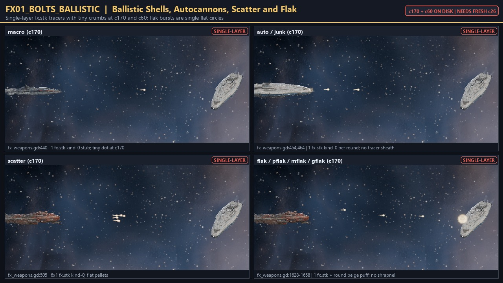
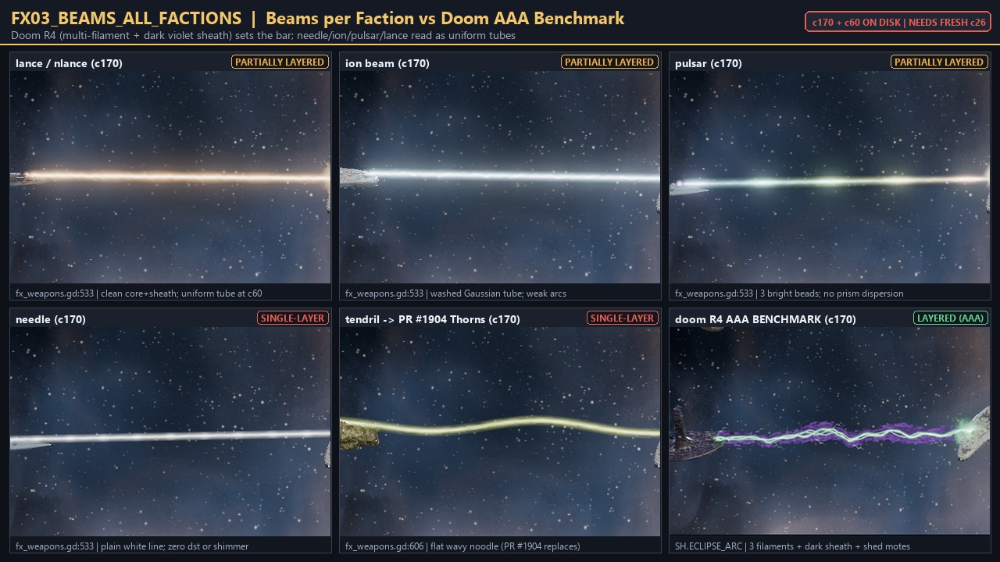
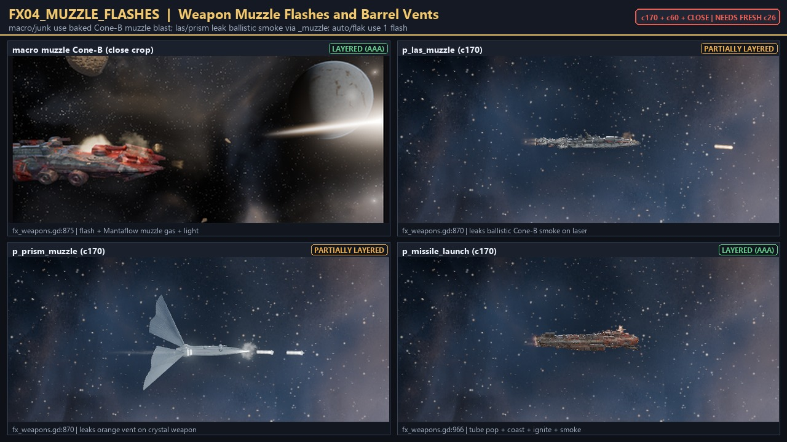
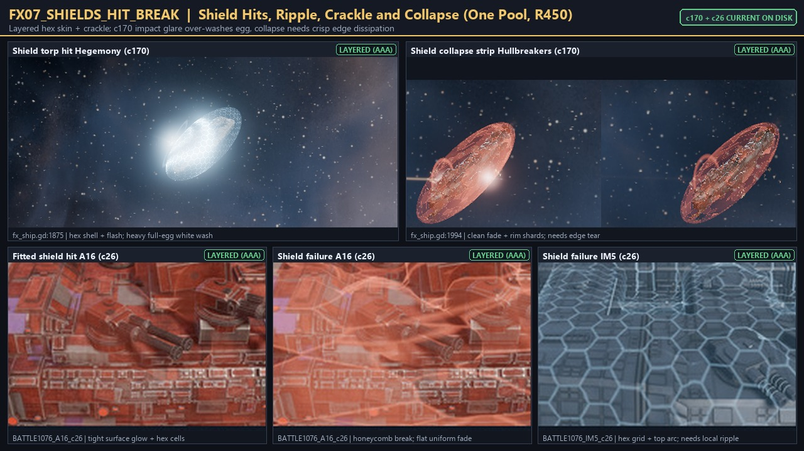
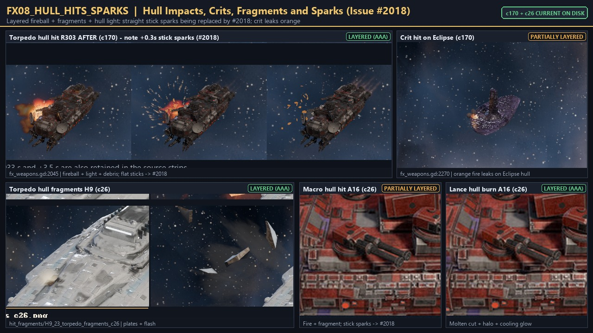
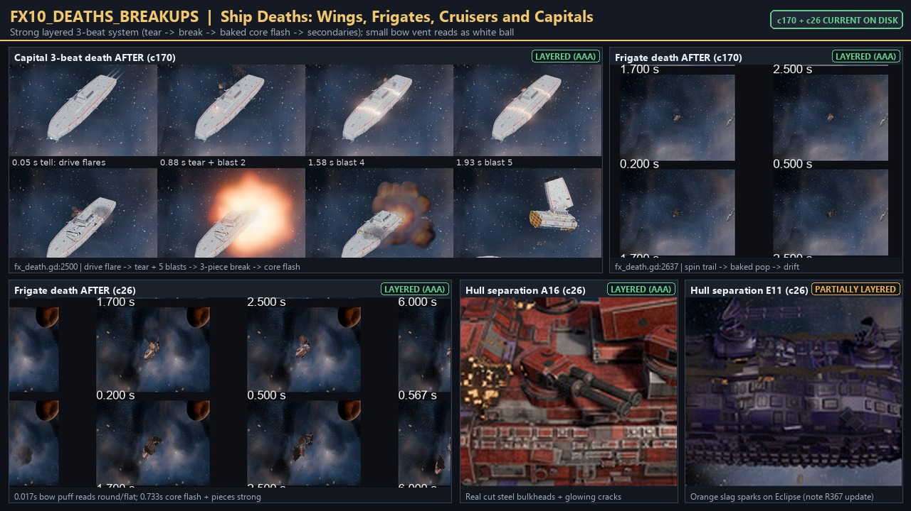
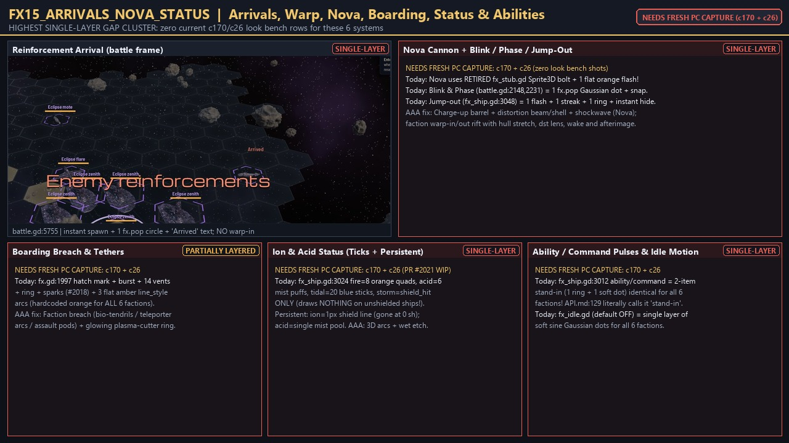
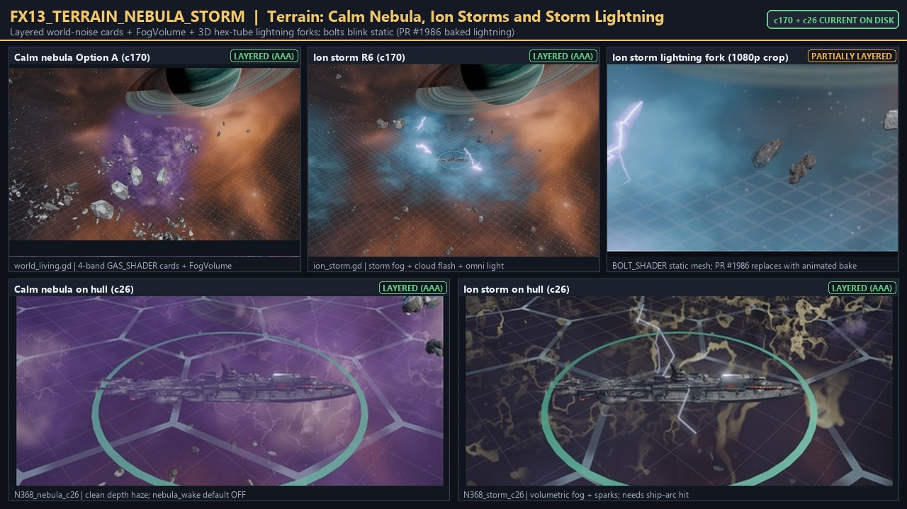
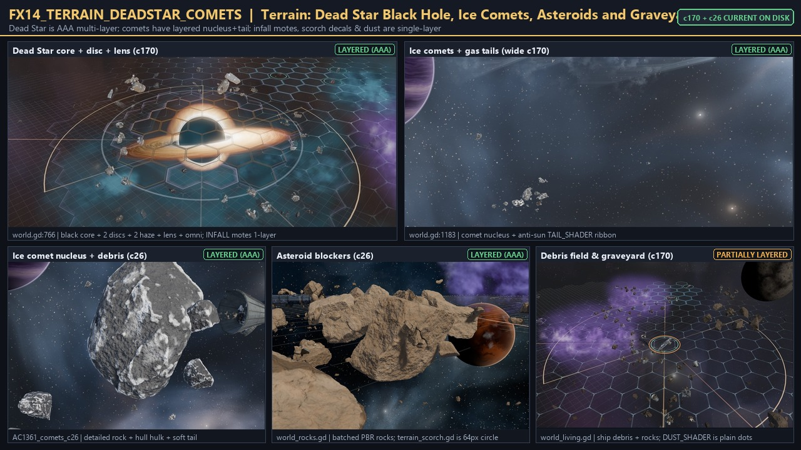

# Full Effects Sweep: Single-Layer Audit and AAA Upgrade Plan (Nov 24 2026)

- **Issue:** `#2031` (AAA item 6, R450)
- **Branch:** `neon/issue-2031`
- **Owner:** Neon
- **Scope:** Every visual effect in `godot/` (weapons, muzzles, torpedoes/missiles, engine plumes & RCS thrusters, shields, hull hits, sparks, fires/vents/wounds, deaths/breakups, wrecks, boarding, ion/acid/fire/tidal/storm status, strike craft trails & launches, warp-in/out & reinforcement arrivals, ability/command pulses, idle ship motion, and terrain).
- **Shield rule (R450):** Shields are **one pool** everywhere. No recommendations below restore 4-facing shield UI or rules.
- **In-flight work tracked:** `#2018` (shared HDR sparks), `#2021` (Wave 2B persistent acid/ion + low-shield strain), `#1904` (Chorus Acid Thorns replacing `tendril`), `#1755` / `#1997` (Wounds V2 + default flip), `#1980` (standalone hits respect shields), `#2007` (colour leaks, blocker outlines, wreck cap), `#1986` (animated storm lightning).

---

## 1. Executive Summary

- **Total distinct effects audited:** **68** across **15 categories**.
- **Single-layer (flat, programmer-art, or placeholder):** **27 effects (40%)**
- **Partially layered (2+ pieces, missing core/sheath/taper/light/faction parity):** **23 effects (34%)**
- **Layered (AAA-grade foundation, minor polish only):** **18 effects (26%)**
- **Picture coverage today:**
  - **28 effects** have current `c170` AND `c26` captures on disk (`battle_baseline_1118`, `deaths_small`, `hit_fragments`, `nebula`, `1361`, `issue-1264`).
  - **26 effects** have current `c170` + `c60` captures in `docs/shots/look_bench/kit/round3/` and `round4/` (all weapon bolts, beams, muzzles, torps, plumes, craft runs) and need **fresh `c26` close-up captures**.
  - **14 effects** have **zero current look bench captures** at either `c170` or `c26` (Nova Cannon, Blink/Phase/Warp-in/Jump-out, Boarding, Status ticks, Persistent Acid/Ion, Ability/Command pulses, Idle motion, Dead Star infall motes, Terrain scorch decals) and are listed in the **Fresh PC Capture Queue** (Section 5).

### Top 5 Visual Shock Findings (Verified in Rendered Frames)

1. **RCS Thrusters + Moving Engine Trail (`FX06_engines_and_rcs.jpg`):** In `kit/round3/moving_trail.png`, turning and braking puffs (`ship_view.gd:2068-2148`) render as **strings of blurry white Gaussian polka-dot balls** (`o o o o`), and the moving engine trail (`_trail_strip`) floats behind the stern as a **detached hard-cut rectangular box**.
2. **Stage 1-4 Damage Fires & Vents (`FX09_fires_vents_damage_stages.jpg`):** In `BATTLE1076_E11_c26_standard.jpg` and `BATTLE1076_IM5_c26_standard.jpg`, Stage 1-2 vents render as **evenly spaced strings of orange sprite dots** (even on purple Eclipse ships!), while Stage 3-4 hull fires are nearly invisible on dark plating.
3. **Nova Cannon, Arrivals, Blink, Phase, Jump-Out, Ability/Command Pulses (`FX15_arrivals_warp_nova_status_boarding.jpg`):** Nova Cannon still calls retired placeholder `fx_stub.gd` (a single `Sprite3D` dot + single flat orange flash). Reinforcements just pop onto a hex with one `fx.pop` circle and floating text. Blink, Phase, Ability, and Command pulses are 1-2 primitive stand-ins identical across all 6 factions.
4. **Single-Layer Weapon Bolts & Star Torpedo (`FX01`, `FX02`, `FX05`):** `macro`, `auto`, `junk`, `scatter`, `flak`, `guns` are tiny 1-layer `fx.stk` crumbs; `las` is a blunt rectangular glow-pill; `prism` is 3 flat white dashes; `star` torpedo is a plain white circle with zero corona rays; `bombs` literally reuse the dark craft silhouette sprite (`kind 23`); `las`/`prism` muzzles leak orange Cone-B ballistic smoke.
5. **Non-Doom Beams (`FX03_beams_all_factions.jpg`):** `doom` Round 4 (`SH.ECLIPSE_ARC`, 3 twisting filaments + dark violet turbulent sheath + shed motes/lenses) is our AAA benchmark. By comparison, `needle` is a single plain white line with zero distortion or crystal shimmer, `ion` is a washed-out white-blue Gaussian tube, and `lance`/`pulsar` read as uniform smooth cylinders at `c60`.

---

## 2. Ranked Master List (Ready for Codex Build Issues)

Ranked from highest player-visible impact (single-layer eyesores seen every battle) down to already-AAA reference systems.

| Rank | Code | Effect / Group | Today | Layers | Cameras on Disk | In-Flight Overlap | Proposed Codex Issue |
|---:|---|---|---|---|---|---|---|
| 1 | `RCS-01` | RCS / attitude / braking thruster puffs + detached moving trail box | **SINGLE-LAYER** | 1 `Sprite3D` Gaussian dot + detached strip | `c170 + c60` (needs `c26`) | None | **Build A:** Shared Drive & RCS Thruster Kit |
| 2 | `WP-BOLT` | Ballistic & energy bolts (`macro`, `auto`, `junk`, `scatter`, `las`, `prism`, `plasma`, `flak`, `guns`, `bombs`, `spores`) | **SINGLE-LAYER** | 1 `fx.stk` or 1-2 `fx.spr` | `c170 + c60` (needs `c26`) | `#2018` (sparks only) | **Build B:** Shared Layered Projectile & Bolt Kit |
| 3 | `DMG-FIRE` | Hull damage fires, vents, wisps, damaged wing smoke (Stages 1-4) | **SINGLE-LAYER** | 1 batch procedural fbm quads (beaded dots) | `c170 + c26` current | `#1755`/`#1997` Wounds V2, `#2018` sparks, `#2007` colour | **Build C:** Baked Multi-Layer Hull Fire, Smoke & Vent Kit |
| 4 | `SPEC-NOVA` | Nova Cannon projectile & detonation | **SINGLE-LAYER** | 1 `fx_stub.gd` `Sprite3D` dot + 1 flat flash | **NONE** (needs `c170 + c26`) | `#1980` (shield check) | **Build D:** Nova Cannon, Warp-In/Out & Ability Kit |
| 5 | `WARP-ARR` | Reinforcement warp-in, `blink`, `phase`, `jump_out`, `risen` | **SINGLE-LAYER** | 1 `fx.pop` dot or 1 streak + 1 ring + instant pop | Battle frame only (needs `c170 + c26`) | None | **Build D:** Nova Cannon, Warp-In/Out & Ability Kit |
| 6 | `STAT-ION` | Turn-start ticks (`fire`/`acid`/`tidal`/`storm`) + persistent Ion & Acid | **SINGLE-LAYER** | 1 quad pool / 20 sticks / 1px shield line (silent if 0 sh) | **NONE** (needs `c170 + c26`) | `#2021` (Wave 2B persistent), `#2018` (tidal sticks) | **Build E:** Multi-Layer Status, Boarding & Storm-Arc Kit |
| 7 | `WP-BEAM` | Non-Doom beams (`needle`, `ion`, `pulsar`, `lance`, `nlance`) | **SINGLE-LAYER / PARTIAL** | 1 uniform `SH.RIBBON` pass (Doom is AAA) | `c170 + c60` (needs `c26`) | `#1904` (`tendril` -> Acid Thorns) | **Build F:** Beam Sheath, Filament & Refraction Upgrade (to Doom bar) |
| 8 | `WP-STAR` | `star` torpedo, `rockets` smoke, non-kit torp fallback & PD intercept | **SINGLE-LAYER / PARTIAL** | Plain white sphere (`star`); faint rocket trail | `c170 + c60` (needs `c26`) | `#2018` (intercept sparks) | **Build B / G:** Ordnance Core, Corona & Rocket Trail Kit |
| 9 | `SPEC-AB` | `ability` & `command` pulses + `fx.launch` carrier bay glow | **SINGLE-LAYER** | 2 stand-in primitives (all factions identical); 1 white blob | `bay`: `c170+c60`; `ab/cmd`: **NONE** | None | **Build D:** Nova Cannon, Warp-In/Out & Ability Kit |
| 10 | `MUZ-01` | Muzzle flashes (`las`/`prism` smoke leak; `auto`/`plasma`/`flak` 1-layer flash) | **PARTIALLY LAYERED** | `_muzzle` leaks Cone-B smoke; `_burst` only 1 flash | `c170 + c60` (needs `c26`) | `#2018` (muzzle sparks) | **Build B:** Faction Muzzle Kit (Ballistic / Energy / Crystal / Bio) |
| 11 | `BOARD-01` | Boarding breach & boarding tethers | **PARTIALLY LAYERED** | Orange-only hatch/vents + 3 flat `line_style` arcs | **NONE** (needs `c170 + c26`) | `#2018` (breach sparks) | **Build E:** Faction Boarding Breach, Pods & Tether Kit |
| 12 | `ENG-PLM` | Main engine plumes (`DRIVE` + `PLUME` ribbon) & sick nozzles | **PARTIALLY LAYERED** | Core + 1 ribbon (square root edge, no mach nodes) | `c170 + c60` (needs `c26`) | `#2018` (sick sparks) | **Build A:** Shared Drive & RCS Thruster Kit |
| 13 | `SPK-01` | Sparks across hits, muzzles, deaths, breaches, boarding, RCS | **SINGLE-LAYER** | Flat `fx.stk` sticks (kinds 1, 8) + `Sprite3D` grit | `c170 + c26` current | **Covered by `#2018`** (verify all sites) | Track `#2018` + audit non-spark `fx.stk` |
| 14 | `HIT-HULL` | Hull hits (`crit` orange leak, `gauss` exit, standalone hits, `bio`) | **PARTIALLY LAYERED / AAA** | Fireball + fragments + light (crit ignores faction) | `c170 + c26` current | `#2018`, `#1980`, `#2007` | **Build C / B:** Faction Crit & Bio/Gauss Hit Polish |
| 15 | `CRAFT-01` | Strike craft patrol & attack trails (`squadron_wing.gd` fallback vs `CRAFT_TRAIL`) | **PARTIALLY LAYERED** | `SH.CRAFT_TRAIL` live; raw fallback 1 flat ribbon | `c170 + c60` (needs `c26`) | None | **Build A:** Unify Craft Trail & Bay Launch Kit |
| 16 | `IDLE-01` | Idle ship motion (`fx_idle.gd`, default OFF) | **SINGLE-LAYER** | 1 batch sine-envelope Gaussian dots | **NONE** (needs `c170 + c26`) | None | **Build H:** Low-Priority Polish (Idle, Scorch, Infall, Dust) |
| 17 | `TERR-MISC` | Terrain minor layers (Dead Star `INFALL` motes, `terrain_scorch.gd`, `DUST_SHADER`, storm static bolts) | **SINGLE-LAYER / PARTIAL** | 1 dot / 64px circle decal / static bolt mesh | `c170 + c26` (scorch/infall need `c26`) | `#1986` (lightning), `#2007` (outlines) | **Build H** + track `#1986` |
| 18 | `SHLD-01` | Shield hits, local ripple, low-shield strain, regen, route, collapse | **LAYERED (AAA)** | Fitted/egg hex shell + ripple + crackle + collapse | `c170 + c26` current | `#2021` (low-shield strain) | **Build I (Polish):** Tighter local ripple (cut c170 glare) + collapse edge tear |
| 19 | `DTH-01` | Ship deaths (wings, small 4 archetypes, cruiser/capital 3 beats, 6 faction styles) | **LAYERED (AAA)** | Multi-beat tear/vent/chain/cut/core/secondaries/slag | `c170 + c26` current | `#2018` (death sparks) | **Polish:** Replace round white small-bow vent puff; Eclipse spark/slag parity |
| 20 | `WRK-01` | Wrecks (cut pieces, slag caps, coals, edge fires, Jolt plates, hulk vent) | **LAYERED (AAA)** | 3D cut pieces + `SLAG` + coals + Jolt plates | `c170 + c26` current | `#2007` (wreck cap) | **Polish:** Upgrade `fx_hulk_vent` (single sprite loop) to baked cold vent |
| 21 | `TERR-MAIN` | Calm Nebula, Ion Storm fog, Dead Star core/disc/lens, Ice Comets, Asteroids | **LAYERED (AAA)** | Multi-band cards + FogVolume + lens + 2 discs + tails | `c170 + c26` current | `#1986`, `#2007` | Keep as AAA baseline; enable `nebula_wake` after GPU check |

---

## 3. Issue `#2018` (Sparks) Coverage Audit

Issue `#2018` replaces flat stick sparks with one shared HDR tapered camera-facing motion-blurred spark in the shared FX kit, respecting `faction_looks.json`. To prevent accidental overlap or blind spots:

- **Covered by `#2018` (flat `fx.stk` spark kinds 1 & 8 + RCS grit):**
  - Weapon impact sparks: `godot/fx/fx_weapons.gd:2045-2405` (`_impact_sparks`), muzzle sparks (`_muzzle_blast` at `fx_weapons.gd:883`), PD intercept sparks (`fx_weapons.gd:1555`)
  - Hull & breach sparks: `godot/fx/fx_ship.gd:1430-1490` (hit blowouts), `fx_ship.gd:2690-2745` (`_build_wisp` jammed turret/dead mount/dead nozzle), `godot/fx/fx_breach.gd` (spall/breach sparks)
  - Boarding breach sparks: `godot/fx/fx.gd:2065-2085`
  - Death & breakup sparks: `godot/fx/fx_death.gd:431-480` (`tear_particles` `fx_tear_sparks` GPU quad!), `godot/fx/fx_death_beats.gd` (afterlife crackle, roll end, drumbeat)
  - Turn-start `"tidal"` tick sparks: `godot/fx/fx_ship.gd:3036-3041` (20 blue-white `fx.stk` kind-1 sticks; `#2018` upgrades the spark primitive, but `"tidal"` still needs a gravity pull stream + hull rim strain in Build E)
  - Hullbreakers RCS grit sparks: `godot/render/ship_view.gd:2120-2148` (also currently missing `disable_fog = true`)
- **Explicitly NOT covered by `#2018` (must be fixed in our Build Issues below):**
  - Non-spark `fx.stk` projectiles (`macro`/`auto`/`junk`/`scatter`/`flak`/`guns` kind-0, `las`/`prism` kind-4, `PD_TRACER` at `fx_weapons.gd:1540`, `spine` drops kind-6, molten drips kind-7). Artoo on `#2018` specifically confirmed PD tracers stay out of `#2018`.
  - `fx_acid_thorn.gd` (in-flight PR `#1904`).
  - `fx_death.gd:431` `fx_vent_cone` (non-spark smoke cone companion).

---

## 4. Exhaustive Category-by-Category Audit (All 68 Effects)

Each category embeds its `1280x720` labelled card (`contrib/neon/reviews/effects_sweep_1124_pics/FX*.jpg`) and cites exact `file:line`, layer count, camera status, size at `c170`/`c26`, and AAA specification.

---

### Category 1: Weapon Bolts & Projectiles (Per Faction)

| # | Effect (Factions) | Today (`file:line` & Layers) | Class | Picture (c170 / c26) | Size & Readability | What a AAA Version Adds |
|---:|---|---|---|---|---|---|
| 1 | `macro` shell (Sunward, Hullbreakers, Meridian) | `fx_weapons.gd:433-444`, `fx_shaders.gd:552` (`STREAK` k=0): **1 layer** (`1x fx.stk` kind 0) | **SINGLE-LAYER** | `FX01` (`kit/round3/macro.png` c170+c60; **needs c26**) | Tiny ~6px crumb at c170, stubby white speck at c60 | Hot incandescent nose core + faction-tinted plasma/tracer sheath + tapered glowing tail + tiny drag sparks + faint travel light on pass-by |
| 2 | `auto` autocannon (Sunward, Hullbreakers, Meridian) | `fx_weapons.gd:451-458`: **1 layer** (`4x1 fx.stk` kind 0 burst) | **SINGLE-LAYER** | `FX01` (`kit/round3/auto.png` c170+c60; **needs c26**) | Thin bright dashes; no volume at c60 | Tapered tracer dart (hot tip, trailing smoke/ember filament), slight velocity jitter and barrel-alternating parallax |
| 3 | `junk` scrap cannon (Hullbreakers) | `fx_weapons.gd:460-467`: **1 layer** (`1x fx.stk` kind 0, warm rust) | **SINGLE-LAYER** | `FX01` (shares `macro` path; **needs c170+c26**) | Identical to `macro` except tint | Tumbling glowing slag chunk silhouette + dirty orange ember wake + smoke tail so Hullbreakers look distinct from Meridian |
| 4 | `scatter` shrapnel (Hullbreakers) | `fx_weapons.gd:500-509`: **1 layer** (`6x1 fx.stk` kind 0 cone) | **SINGLE-LAYER** | `FX01` (`kit/round3/scatter.png` c170+c60; **needs c26**) | 6 tiny identical pellets | Varied shard sizes, hot leading glints, trailing ash wisps, tighter muzzle cone bloom |
| 5 | `flak` / `pflak` / `mflak` / `gflak` (all gun factions) | `fx_weapons.gd:1628-1658`: **1 layer** tracer (`fx.stk` k=0/4) + 1 round beige puff (`_burst`) | **SINGLE-LAYER** | `FX01` (`kit/round3/flak.png`, `pflak/mflak/gflak` c170+c60; **needs c26**) | Pinprick dots + round beige circle at target | Layered airburst: hot star core flash + dark expanding shrapnel ring + metallic glint flecks + faction-tinted smoke cloud (blue/cyan for `gflak`) |
| 6 | `las` laser bolts (Sunward, Meridian) | `fx_weapons.gd:469-475`, `fx_shaders.gd:572` (`STREAK` k=4): **1 layer** (`1x fx.stk` kind 4) | **SINGLE-LAYER** | `FX02` (`kit/round3/las.png` c170+c60; **needs c26**) | Blunt flat rectangle pill (`====`) at both c170 and c60 | Needle-sharp white core inside a colour-saturated outer sheath, pointed/tapered leading & trailing ends, subtle heat-shimmer tail |
| 7 | `plasma_cannon` (Meridian, Sunward) | `fx_weapons.gd:477-482`: **2 layers** (`fx.spr` k=14 envelope + `fx.spr` k=4 white core) | **PARTIALLY LAYERED** | `FX02` (`kit/round3/plasma.png` c170+c60; **needs c26**) | Soft white-cyan oval; reads flat without wake | Swirling hot core + crackling corona sheath + tapered ionised wake strip + heat distortion (`fx.dst`) + dynamic travel light on hull |
| 8 | `plasma` bolt (Meridian, Sunward, Eclipse) | `fx_weapons.gd:484-497`: **3 layers** (k=14 orb + k=0 streak + 3x k=18 dots + light) | **PARTIALLY LAYERED** | `FX02` (`kit/round3/plasma.png` c170+c60; **needs c26**) | Blurry white oval at c170 & c60; streak hidden inside bloom | Distinct bright core inside turbulent faction plasma shell (cyan Meridian, gold Sunward, violet Eclipse) + visible tapered wake + trailing plasma flecks |
| 9 | `prism` crystal bolts (Glasswrights) | `fx_weapons.gd:511-521`: **2 layers** (`fx.stk` k=4 + `fx.spr` k=16 facet glint) | **SINGLE-LAYER** (reads 1-layer) | `FX02` (`kit/round3/prism.png` c170+c60; **needs c26**) | 3 flat white capsule dashes (`=== === ===`) | Sharp crystalline lance-dart core + chromatic RGB/cyan-amber prism dispersion fringe + glittering micro-facet trail |
| 10 | `bioplasma` / `spine` (Chorus) | `fx_weapons.gd:586-604`: **2 layers** (k=15 glob + 8x k=6 dripping streaks + light) | **PARTIALLY LAYERED** | `FX02` (`kit/round3/bioplasma.png` c170+c60; **needs c26**) | Tiny fuzzy chartreuse pill; drips barely visible at c170 | Translucent pulsing acid sac with bright bile core + viscous trailing filament + visible falling corrosive droplets + vapour trail |
| 11 | `gauss` / Null Slug (Eclipse) | `fx_weapons.gd:616-660`, `fx_shaders.gd:2470-2508` (`SH.NULL_SLUG`): **4 layers** (4 coil glows + tapered slug/wake shader + muzzle shock ring + dst) | **LAYERED (AAA)** | `FX02` (`kit/round3/gauss.png` c170+c60; **needs c26**) | Crisp white head + long violet-white wake; reads great at c170 and c60 | Already AAA tier; minor polish: add tiny trailing Mach-ring ripples along the flight path at c26 |
| 12 | `nova` Nova Cannon (Sunward flagship ability) | `battle.gd:2240-2248`, `fx_stub.gd:55-103`: **1 layer** (retired placeholder `Sprite3D` Gaussian dot + single flat orange `_flash`) | **SINGLE-LAYER** | `FX15` (**NONE - needs c170 + c26**) | Placeholder dot + giant flat orange disc; splash hits skip shields (`#1980`) | Full 3-beat superweapon: 0.5s prow charge-up with converging rings & barrel light -> recoil muzzle shockwave + relativistic shell with plasma sheath & lensing distortion -> multi-stage detonation (white core + shock ring + dst lens + lingering fire/smoke + hex-wide hull light) |

---

### Category 2: Weapon Beams (Per Faction)

| # | Effect (Factions) | Today (`file:line` & Layers) | Class | Picture (c170 / c26) | Size & Readability | What a AAA Version Adds |
|---:|---|---|---|---|---|---|
| 13 | `doom` Eclipse Arc (Eclipse) | `fx_weapons.gd:550-585`, `fx_shaders.gd:2125-2270` (`ECLIPSE_ARC`): **5 layers** (3 twisting filaments + dark violet turbulent sheath + converging ring + corona + `_doom_shed` heat lenses & motes + hull light) | **LAYERED (AAA)** | `FX03` (`kit/round4/doom.png` c170+c60; **needs c26**) | Benchmark AAA look: reads unmistakably at phone, c170, and c60 | **Gold standard reference** for all other beams. Keep as-is; capture at c26 for close-up check. |
| 14 | `lance` (Sunward, Hullbreakers) | `fx_weapons.gd:523-548`, `fx_shaders.gd:801-960` (`SH.RIBBON` k=2 + `_beam_ends` + charge k=12 + mid `fx.dst`): **3 layers** | **PARTIALLY LAYERED** | `FX03` (`kit/round3/lance.png` c170+c60; **needs c26**) | Strong silhouette at c170, but uniform flat glowing tube at c60 | Animated high-frequency longitudinal flow filaments inside core, muzzle-to-target width taper, helical outer heat corona, sharper charge-up ramp + hull scorch light |
| 15 | `nlance` Null Lance (Eclipse) | `fx_weapons.gd:523-548` (`SH.RIBBON` k=2 + 3 converging rings k=3; **no `fx.dst`**, remaps hull mark to orange `"lance"`): **3 layers** | **PARTIALLY LAYERED** | Same ribbon as `lance` (**needs own c170 + c26**) | No mid-beam distortion; leaves orange Sunward burn mark on hit | Dark-violet outer sheath matching `doom`, gravity-lens `fx.dst` along beam, violet-white scorch mark (fix `"lance"` remap) |
| 16 | `ion` Ion Beam (Meridian) | `fx_weapons.gd:523-548`, `fx_shaders.gd:860-920` (`SH.RIBBON` k=5 + `_beam_ends` + `fx.dst`): **3 layers** | **PARTIALLY LAYERED** | `FX03` (`kit/round3/ion.png` c170+c60; **needs c26**) | Broad washed-out white-blue Gaussian bar at c60; arcs too faint | Tighter razor-hot electric core + 2 crackling secondary arc tendrils dancing around the shaft + target shield/hull static crawl |
| 17 | `pulsar` (Glasswrights) | `fx_weapons.gd:523-548` (`SH.RIBBON` k=2 + pulsing beads + `_beam_ends` + `fx.dst`): **3 layers** | **PARTIALLY LAYERED** | `FX03` (`kit/round3/pulsar.png` c170+c60; **needs c26**) | 3 bright beads at c170, soft white Gaussian smear at c60 | Crisp harmonic pulse rings sliding down a faceted crystalline beam + RGB prism edge dispersion + sparkling lens-flare ends |
| 18 | `needle` (Glasswrights) | `fx_weapons.gd:523-548` (`SH.RIBBON` k=8 + `_beam_ends`; **no `fx.dst`**, **no recoil light**): **2 layers** | **SINGLE-LAYER** (reads 1-layer) | `FX03` (`kit/round3/needle.png` c170+c60; **needs c26**) | Plain thin white line with pale grey halo | Focused diamond-sharp core + turquoise/prism refraction sheath + crisp muzzle crystal focus burst + subtle heat shimmer |
| 19 | `tendril` (Chorus - retiring) | `fx_weapons.gd:606-615` (`SH.RIBBON` k=9 + 5 spore puffs): **1-2 layers** | **SINGLE-LAYER** | `FX03` (`kit/round3/tendril.png` c170+c60) | Uniform wavy yellow-green noodle | **In-flight PR `#1904` replaces with Chorus Acid Thorns** (`fx_acid_thorn.gd`). Verify Acid Thorns at c170 + c26 on merge. |

---

### Category 3: Muzzle Flashes

| # | Effect | Today (`file:line` & Layers) | Class | Picture (c170 / c26) | Size & Readability | What a AAA Version Adds |
|---:|---|---|---|---|---|---|
| 20 | Ballistic `_muzzle_blast` (`macro`, `junk`, `scatter`) | `fx_weapons.gd:875-889`: **4 layers** (baked `flash` + baked Cone-B `muzzle` gas jet + 4 sparks + OmniLight) | **LAYERED (AAA)** | `FX04` (`vent_sheet_close.png`; **needs c170+c26**) | Punchy warm jet + hull illumination on turret deck | Already strong; `#2018` replaces flat muzzle sparks; add subtle barrel recoil kick & shock-ring at c26 |
| 21 | Light ballistic `_burst` (`auto`, `flak`, `plasma`) | `fx_weapons.gd:453, 486, 1628`: **1 layer** (single baked `flash` quad, no gas/jet/sparks/light) | **SINGLE-LAYER** | `FX01`, `FX02` (**needs close c26**) | Brief flat star flash; looks pasted on turret | Add directional muzzle cone + faction plasma vent (`plasma`) or brief barrel flash light + micro-sparks (`#2018`) |
| 22 | Energy/Crystal `_muzzle` (`las`, `plasma_cannon`, `prism`) | `fx_weapons.gd:870-874`: **3 layers**, **BUG**: ignores `kind` param and calls ballistic Cone-B `_vent`! | **PARTIALLY LAYERED** (wrong look) | `FX04` (`p_las_muzzle.png`, `p_prism_muzzle.png` c170+c60; **needs c26**) | Visible orange gunpowder smoke puff on laser & crystal barrels! | Remove ballistic smoke; replace with clean energy aperture bloom + faction-tinted focusing ring (`las`), plasma discharge arcs (`plasma_cannon`), or prism starburst (`prism`) |
| 23 | Gauss coil sequence (`gauss`) | `fx_weapons.gd:618-626`: **4 layers** (4 sequential coil lights + sharp flash + pale shock ring + `fx.dst`) | **LAYERED (AAA)** | `FX02` (`gauss.png`; **needs muzzle c26**) | Clean railgun charge cascade | Keep as AAA reference for charge-up muzzles |
| 24 | Bio spit muzzle (`bioplasma`, `spine`) | `fx_weapons.gd:588-592`: **2 layers** (k=15 splatter sprite + light) | **PARTIALLY LAYERED** | `FX02` (`bioplasma.png`; **needs c26**) | Small green glow dot at maw | Directional bile spray mist + wet droplet burst + pulsing bio-luminescent maw recoil |
| 25 | Beam charge-up (`lance`, `ion`, `pulsar`, `needle`, `nlance`, `doom`) | `fx_weapons.gd:523-560`: **1-2 layers** (k=12 sprite; `nlance` adds 3 rings; `doom` adds converging ring + corona) | **PARTIALLY LAYERED** | `FX03` (**needs charge-frame c170+c26**) | `doom`/`nlance` telegraph clearly; `lance`/`ion`/`needle` only blink 1 dot | All heavy beams get 0.25-0.4s converging energy ring + barrel core brighten + turret deck light before firing |

---

### Category 4: Torpedoes & Missiles

| # | Effect | Today (`file:line` & Layers) | Class | Picture (c170 / c26) | Size & Readability | What a AAA Version Adds |
|---:|---|---|---|---|---|---|
| 26 | Kit Torpedo (`torp`: Sunward, Meridian, Hullbreakers, Chorus, Eclipse) | `fx_weapons.gd:923-1285`: **5 layers** (launch puff + coast + ignite flash + 3D kit body + `DRIVE` core + `_kit_trail_*` strip) | **LAYERED (AAA)** | `FX05` (`torp.png`, `p_missile_launch.png` c170+c60; **needs c26**) | Visible orange engine flare & 3D casing; wake trail reads faint/short at c170 | Lengthen and boost tapered ribbon wake so trajectory reads across 2 hexes at c170; add subtle nose glint & dynamic trail light |
| 27 | Rocket Salvo (`rockets`) | `fx_weapons.gd:950-1285`: **4 layers** (kit rocket + `DRIVE` + thin smoke ribbon + launch pops) | **PARTIALLY LAYERED** | `FX05` (`rockets.png` c170+c60; **needs c26**) | Tiny dots with stubby orange tails; smoke ribbons nearly invisible at c170 | Thicker curling exhaust smoke ribbons with hot ignition roots so salvos arc across the board with Battlestar-style drama |
| 28 | Star Torpedo (`star`, Glasswrights) | `fx_weapons.gd:1136-1195`, `fx_shaders.gd:2095` (`STAR_BODY`): **2 layers** (white sphere + `DRIVE` + looping vent quad; `SPRITE` k=17 corona exists unused!) | **SINGLE-LAYER** (reads 1-layer) | `FX05` (`star.png` c170+c60; **needs c26**) | Plain blurry white circle (`o`) floating in space | Wire unused `SPRITE` k=17 solar corona rays + golden-cyan outer plasma sheath + lensing `fx.dst` halo + sparkling stardust wake + hull rim light |
| 29 | Non-kit ordnance fallback (`_casing`) | `fx_weapons.gd:1100-1135`: **3 layers** (procedural cylinder + `DRIVE` + looping `exhaust` flipbook + puffs) | **PARTIALLY LAYERED** | Covered by kit on all 6 factions; fallback only | Basic cylinder if kit missing | Ensure all 6 factions route through kit meshes (`issue-1943-opus` landed Meridian/Chorus/Eclipse meshes) |
| 30 | PD Intercept (`torp_intercept`, `rocket_intercept`, `star_intercept`) | `fx_weapons.gd:1530-1595`: **2-3 layers** (`1x fx.stk` k=4 PD tracer + small flash/puff + `#2018` sparks) | **PARTIALLY LAYERED** | `FX05` (`*_intercept.png` c170+c60; **needs c26**) | Faint tracer + tiny dust pop; `star` intercept under-reads | Layered rapid tracer stream (core + sheath) + sharp mid-air detonation ring + secondary fuel burn-off puff + hull-light flash on nearby escort |

---

### Category 5: Engine Plumes & RCS Thrusters (Per Faction)

| # | Effect | Today (`file:line` & Layers) | Class | Picture (c170 / c26) | Size & Readability | What a AAA Version Adds |
|---:|---|---|---|---|---|---|
| 31 | RCS / Attitude / Braking Thruster Puffs (all factions) | `ship_view.gd:2068-2148`: **1 layer** (`Sprite3D` with 64x64 procedural Gaussian `_glow_tex` or flat circle `_ripple_tex`; missing `disable_fog = true`) | **SINGLE-LAYER** | `FX06` (`moving_trail.png` c170+c60; `movement/cruiser_turn.jpg` c170; **needs c26**) | **Worst visual eyesore in sweep:** reads as strings of blurry white polka-dot balls (`o o o o`)! | Replace `Sprite3D` dots with a directional conical gas-jet shader (hot nozzle root -> fast-tapered cold vapor cone -> turbulent dissipation, `fog_disabled`), faction-styled (steam/grit Hullbreakers, clean cyan ion Meridian, violet fold shimmer Eclipse, organic cilia pulse Chorus, prism glint Glasswrights) |
| 32 | Moving Ship World Trail (`_trail_strip`) | `fx_ship.gd:1169-1310`, `fx_shaders.gd:748` (`PLUME`): **1 ribbon strip** | **SINGLE-LAYER** (artifacted) | `FX06` (`moving_trail.png` c170+c60; **needs c26**) | **Broken geometry:** floats behind the stern as a detached rectangular box with a hard vertical cut-off edge! | Anchor strip root strictly to live nozzle socket every frame, smooth alpha/width fade at both root and tail (`smoothstep` over 0..0.15 and 0.6..1.0), add hot inner filament + softer outer wake |
| 33 | Main Engine Plumes per Faction (`DRIVE` + `PLUME`) | `fx_ship.gd:1060-1260`, `fx_shaders.gd:700-795`: **2-3 layers** (`DRIVE` core + accent corona + `PLUME` ribbon; fallback `Sprite3D` on low) | **PARTIALLY LAYERED** | `FX06` (`ribbon_0/1/3.png` c170+c60; **needs all 6 factions at c170+c26**) | Good length at c170, but square nozzle join at c60 and same silhouette across factions | Blend nozzle root softly inside bell (no hard edge), add pulsing hot inner core / Mach shock diamonds + outer low-alpha ion wash + faction distinction (dirty spark-flecked torch Hullbreakers, crisp blue shock cones Meridian, golden cathedral flares Sunward, dark-violet ring glow Eclipse, prismatic crystal tail Glasswrights, trailing spore mist Chorus) + aft hull bounce light |
| 34 | Hit-Reaction RCS Stabilisers (`_rcs`) | `fx_ship.gd:1491-1550`: **1-2 layers** (1 sprite k=16 Glasswrights, 1 ring k=3 Eclipse, 2 sprites k=7+18 others) | **SINGLE-LAYER** | **NONE** (needs `c170 + c26`) | Brief flat dot/ring | Route through the same new directional RCS cone jet kit as movement thrusters |
| 35 | Sick / Damaged Engine Nozzle Coughs | `fx_ship.gd:1265-1340`: **2 layers** (flickering `DRIVE` + `fx.stk` sparks + smoke quads) | **PARTIALLY LAYERED** | **NONE** (needs `c170 + c26`) | Sparks moving to `#2018`; smoke uses raw quads | Pair sputter flash with baked dark smoke puffs + `#2018` embers + brief nozzle choke-out dark frame |

---

### Category 6: Shield Hits & Breaks (One Pool, R450)

*(Note: All recommendations preserve the single shield pool design approved in R450. No 4-facing shield visuals or rules.)*

| # | Effect | Today (`file:line` & Layers) | Class | Picture (c170 / c26) | Size & Readability | What a AAA Version Adds |
|---:|---|---|---|---|---|---|
| 36 | Resting Shield Rim & Gap | `fx_ship.gd:1650-1760`, `fx_shaders.gd:1460-1560` (`SHIELD`): **2 layers** (fitted/egg Fresnel rim + hex lattice) | **LAYERED (AAA)** | `FX07` (`shields_r303`, `BATTLE1076_A16/IM5_c26`) | Clean subtle rim at c170 and c26 | Keep restrained; slightly stronger faction pattern differentiation (Gothic lattice Sunward, crisp hex Meridian, welded static Hullbreakers, faceted crystal Glasswrights) |
| 37 | Shield Impact Ripple & Flash | `fx_ship.gd:1875-1985`: **4 layers** (local ripple uniform + hex highlight + impact flash + crackle/shards + light) | **LAYERED (AAA)** | `FX07` (`shield_torp_hegemony.png` c170, `BATTLE1076_A16_c26`) | Strong at c26; at c170 heavy hits wash the whole egg in uniform white glare | Tighten impact bloom radius & Fresnel falloff so the travelling ripple ring and local bright impact spot read crisply without white-washing the whole ship |
| 38 | Shield Collapse / Break (`shield_break`) | `fx_ship.gd:1994-2085`: **4 layers** (collapse wave + fading hex mask + rim shards + light + `shield_down` event) | **LAYERED (AAA)** | `FX07` (`C15s_23_collapse_c170`, `BATTLE1076_A16/IM5_c26`) | Clean collapse, zero smoke leak (fixed in R297); fades somewhat uniformly at c26 | Add travelling fracture edge wave sweeping from impact point to far side + crisp discharging hex shards (`#2018` sparks) + momentary inward flash on hull |
| 39 | Low-Shield Strain & Regen / Route Pulses | `fx_ship.gd:1765-1870`, `fx_shaders.gd:1565-1605`: **1-2 layers** (shader shimmer + faint pulse) | **PARTIALLY LAYERED** | **NONE** (PR `#2021` captures pending; **needs c170+c26**) | Subtle; easy to miss at c170 | Verify PR `#2021` low-shield flicker + ensure regen pulse sweeps cleanly bow-to-stern across the single shield pool with faint bright leading edge |

---

### Category 7: Hull Hits & Marks

| # | Effect | Today (`file:line` & Layers) | Class | Picture (c170 / c26) | Size & Readability | What a AAA Version Adds |
|---:|---|---|---|---|---|---|
| 40 | Shell / Torpedo / Rocket Hull Hits | `fx_weapons.gd:2045-2265`: **5 layers** (baked flash + baked fireball + dark smoke + `#2018` sparks + torn hull fragments + hull OmniLight + breach mark) | **LAYERED (AAA)** | `FX08` (`C15s_23_torpedo_before_after_c170`, `H9_23_torpedo_fragments_c26`, `BATTLE1076_A16_c26`) | Strong punch, lighting, and fragments; stick sparks look dated until `#2018` lands | Lands at AAA once `#2018` replaces stick sparks; add subtle heat-shimmer `fx.dst` on torpedo/heavy impacts at c26 |
| 41 | Lance / Beam Hull Burn | `fx_weapons.gd:2120-2175`, `fx_breach.gd:1798`: **4 layers** (beam end glow + molten white-orange-red cooling `HOLE`/`MARK` slot + sparks + light) | **LAYERED (AAA)** | `FX08` (`BATTLE1076_A16_c26`, `kit/round3/p_lance_burn.png`) | Molten glowing cut looks great at c26 | Add molten metal splatter droplets (`#2018` / hot drips) + dark vapor curl rising from the fresh slot |
| 42 | Critical Hit (`crit`) | `fx_weapons.gd:2270-2315`: **3 layers** (extra fireball + shock ring + sparks + light; **hardcoded orange fire!**) | **PARTIALLY LAYERED** | `FX08` (`kit/round3/p_crit.png` c170+c60; **needs c26**) | Leaks bright orange flame on purple Eclipse & green Chorus hulls! | Respect target `faction_looks.json` internal colour (violet arc blowout Eclipse, bile rupture Chorus, prism shatter Glasswrights) + secondary venting flare + brief camera/hull punch |
| 43 | Energy / Plasma / Bio Hull Hits | `fx_weapons.gd:2180-2260`: **2-3 layers** (tinted flash + k=14/15 splatter + mark) | **PARTIALLY LAYERED** | `kit/round3/p_bile_hit.png` c170+c60 (**needs c26**) | Plasma/bio hits feel softer than torpedo/shell hits | Plasma: bright white core + ionized shock ring + glowing slag pool mark; Bio: directional acid splash fan + sizzling bubble mist + wet glowing etch |
| 44 | Gauss Entry & Exit (`gauss`) | `fx_weapons.gd:2320-2375`, `fx_breach.gd:1822`: **4 layers** (entry ring/flash + far-side exit spall blast + entry/exit craters + sparks) | **LAYERED (AAA)** | `kit/round3/p_gauss_exit.png` c170+c60 (**needs c26**) | Great concept (through-hull exit blow); sparks move to `#2018` | Boost exit-side debris cone + directional violet shock-ring so the punch-through reads unmistakably at c170 |
| 45 | Ram Impact (`ram` & `ram_self`) | `battle.gd:2256-2277`, `fx_breach.gd:1834`: **4 layers** (target dent + bow dent + blast + zoom punch + shove) | **LAYERED (AAA)** | **NONE** (needs `c170 + c26`) | Good mechanical hit; no dedicated look bench shot | Add metallic scraping spark shower (`#2018`) along contact seam + compressed shock-ring + hull plate shards |
| 46 | Standalone Hits (`battle.gd:_impact`) | `battle.gd:2185-2192, 3409-3415`: **1-2 layers** (generic orange `_flash` `fx.pop` + light, bypasses shield!) | **SINGLE-LAYER** | **NONE** (needs `c170 + c26`) | Generic orange pop; PR `#1980` fixes shield routing | Route through faction-aware hull/shield impact kit so Nova splash, reactor hits, and counter-fire match main weapon hits |

---

### Category 8: Fires, Vents, Wounds & Idle Ship Motion

| # | Effect | Today (`file:line` & Layers) | Class | Picture (c170 / c26) | Size & Readability | What a AAA Version Adds |
|---:|---|---|---|---|---|---|
| 47 | Hull Damage Fires & Smoke (Stages 1-4) | `fx_ship.gd:2468-2528`: **1 layer** per site (8 looping `SH.SPRITE` procedural fbm quads k=25/26/20/7; `_hole_lights` unused on main) | **SINGLE-LAYER** | `FX09` (`BATTLE1076_A16/E11/IM5` c170 + c26) | **Major gap:** Stage 1-2 read as beaded polka-dot strings at c26; Stage 3-4 fires are barely visible; leaks orange on Eclipse | Replace looping procedural quads with **2-layer baked flipbook fire core + dark rising smoke plume** anchored inside wound mouth + flickering local hull light (`Wounds V2` PR `#1755`/`#1997`) + faction fire palettes (violet plasma fire Eclipse, corrosive vapour Chorus, prism static Glasswrights) |
| 48 | Jammed Turret / Dead Mount / Dead Nozzle Wisps (`_build_wisp`) | `fx_ship.gd:2690-2765`: **1-2 layers** (3 looping k=3/7/8/20 quads + flat `fx.stk` sparks) | **SINGLE-LAYER** | `FX09` (`BATTLE1076_IM5_c26` Stage 4) | Reads as 3 repeating dots + clipped white spark square | Tight rising dark smoke ribbon + `#2018` intermittent electrical spark bursts + dim dying ember glow at mount base |
| 49 | Damaged Squadron Smoke | `fx_ship.gd:2546-2552`: **1 layer** (hardcoded grey k=3 quads; leaks orange spawn flash from `fx_shaders.gd:392`!) | **SINGLE-LAYER** | **NONE** (needs `c170 + c26`) | Faint dot trail + orange flash bug | Continuous ribbon trail (dark grey smoke + tiny hot engine-fire root) with no orange leak on non-fire ticks |
| 50 | Breach Mouths, Throats & Blowouts | `fx_breach.gd`, `fx_shaders.gd:1650-1715` (`HOLE` & `MARK`): **2-3 layers** (recessed dark interior + faction wound shader + surface halo) | **PARTIALLY LAYERED** | `FX09` (`BATTLE1076_IM5/A16_c26` Stage 3-4) | Good geometry close up, too dim at c170 until Wounds V2 lands | Land PR `#1755`/`#1997` (Wounds V2) + pair every deep stage-3/4 breach with interior flickering light + escaping debris/ember wisp |
| 51 | Idle Ship Motion (`fx_idle.gd`, default OFF) | `fx_idle.gd:1-207`: **1 layer** (batch of `SH.SPRITE` k=18 soft sine-envelope Gaussian dots for all 6 factions) | **SINGLE-LAYER** | **NONE** (needs `c170 + c26`) | Pure pulsing Gaussian circles; disabled by default | Replace dots with directional sweep cone (Meridian radar), furnace shimmer heat-haze (Hullbreakers), faceted crystal glint (Glasswrights), pulsing bio-sac vein glow (Chorus), corona arc flick (Eclipse) |

---

### Category 9: Deaths & Breakups

| # | Effect | Today (`file:line` & Layers) | Class | Picture (c170 / c26) | Size & Readability | What a AAA Version Adds |
|---:|---|---|---|---|---|---|
| 52 | Capital & Cruiser 3-Beat Deaths | `fx_death.gd:39-105, 2500-2900, 3700-4200`: **6+ layers** (drive flare -> deck blackout -> strain bulge + tear + 3-5 chain blasts -> 2/3/late split -> staged baked core flash + shockwave lens + 2-3 hex OmniLight -> 10 secondaries + fragments) | **LAYERED (AAA)** | `FX10` (`capital_death_beats.jpg` c170, `BATTLE1076_A16/E11_c26`) | Dramatic, readable at both c170 and c26 | Already AAA core. Polish: verify all 6 faction death styles (`drumbeat`, `arc`, `patch`, `shatter`, `peel`, Chorus rupture) at c26 so zero orange leaks remain on Eclipse/Glasswrights; `#2018` upgrades `tear_particles` sparks |
| 53 | Small Hull Deaths (Frigate/Destroyer, 4 archetypes) | `fx_death.gd:2552-2650`, `fx_death_beats.gd`: **5 layers** (spin/torch/roll archetype + curling flame/cool trail + bow vent + baked core pop + smoke body + cut pieces) | **LAYERED (AAA)** | `FX10` (`frigate_c170.jpg`, `frigate_c26.jpg`) | Great silhouette and piece spread; note `0.017s` bow vent reads as one flat round white puff ball at c26 | Upgrade initial small-hull `_split_vent` (`fx_death.gd:2810`) with sharper directional jet root + hot ignition core so it doesn't read as a round white cotton ball |
| 54 | Wing / Squadron Death (`_wing_death`) | `fx_death.gd:2609-2628`, `fx_death_beats.gd` (`corkscrew`): **3 layers** (1-frame flash + smoke puff + corkscrew spin trail) | **PARTIALLY LAYERED** | `FX10` (`wing_c26.jpg`, `wing_c170.jpg`) | Quick and clean; single small pop | Add brief blazing tail streak during corkscrew + 3-4 `#2018` micro-sparks on pop |
| 55 | Chorus Organic Rupture & Acid Melt Kills | `fx_death.gd:2522-2544, 298-323, 4071-4083`: **4 layers** (spore bleed + skin burst + `_organic_spill` spores/clots + cook-off blasts on metal melt) | **LAYERED (AAA)** | **NONE** current c170+c26 sheet (**needs fresh capture**) | Designed per R398 (no vapour/smoke on melt, faction cook-offs) | Capture c170 + c26 to verify organic spill reads as viscous burst rather than dots |

---

### Category 10: Wrecks

| # | Effect | Today (`file:line` & Layers) | Class | Picture (c170 / c26) | Size & Readability | What a AAA Version Adds |
|---:|---|---|---|---|---|---|
| 56 | Cut Wreck Pieces, `SLAG` Caps & Cooling Coals | `fx_death.gd:123-166, 3757-3915`: **4 layers** (real cut 3D meshes + charred cracked `SLAG` heat veins + edge fires + afterlife pops + hex anchor) | **LAYERED (AAA)** | `FX11` (`capital_wreck.jpg`, `cruiser_wreck.jpg`, `BATTLE1076_A16/E11/IM5_c26`) | Outstanding close-up detail at c26 and readable silhouette at c170 | Keep as AAA baseline; ensure `edge fires` share the new baked fire/smoke kit (Build C) |
| 57 | Drifting Debris Plates (`DEBRIS_BODY`) | `fx_death.gd:168-200, 484-636`: **2 layers** (4 folded jagged plate variants + Jolt physics + cooling rim glow) | **LAYERED (AAA)** | `FX11` (`BATTLE1076_E11/IM5_c26`) | Convincing tumbling metal plates that settle cleanly | Already solid; ensure faction rim tint (`rim_col`) matches Eclipse/Chorus/Glasswrights |
| 58 | Burnt Hulks & `fx_hulk_vent` (`dark`/`hulk`/`board`) | `fx_death.gd:3641-3692`, `board.gd:1119`: **1-2 layers** (darkened hull copy + **1 layer** of 9 looping `SH.SPRITE` k=7/20 quads for `fx_hulk_vent`) | **PARTIALLY LAYERED** | `FX14` (board hulk in `AC1361_comets_c26.jpg`; **needs kill hulk c170+c26**) | `fx_hulk_vent` uses same looping sprite dots as Stage 1 vents | Replace `fx_hulk_vent` with slow curling cold-vapor ribbon + occasional `#2018` dying electrical arc |

---

### Category 11: Boarding

| # | Effect | Today (`file:line` & Layers) | Class | Picture (c170 / c26) | Size & Readability | What a AAA Version Adds |
|---:|---|---|---|---|---|---|
| 59 | Boarding Breach & Tethers (`fx.board`) | `fx.gd:1997-2146`, `battle.gd:2278-2310`: **5 primitives**, **hardcoded orange/amber** (pried hatch mark + k=2 burst + 14x k=7 vents + `#2018` sparks + k=2 pop ring + amber interior light + 3 flat `line_style` amber arc tethers) | **PARTIALLY LAYERED** | `FX15` (**NONE - needs c170 + c26**) | Hardcoded amber for ALL 6 factions; tethers are flat untextured curves with no boarding pods or pulse | Faction-specific boarding language: glowing assault pods/shuttles zipping along animated grapple cables (Sunward/Meridian/Hullbreakers), violet phase-teleport beams (Eclipse), prismatic phase-locks (Glasswrights), pulsing bio-umbilicals (Chorus) + molten plasma-cutter ring around hatch |

---

### Category 12: Ion, Acid, Fire, Tidal & Storm Status Effects

| # | Effect | Today (`file:line` & Layers) | Class | Picture (c170 / c26) | Size & Readability | What a AAA Version Adds |
|---:|---|---|---|---|---|---|
| 60 | Turn-Start Status Ticks (`fx_ship.gd:3024-3046`) | `"fire"` = **1 layer** (8 hardcoded orange k=1 quads + light); `"acid"` = **1 layer** (6 k=20 mist puffs); `"tidal"` = **1 layer** (20 blue-white `fx.stk` k=1 sticks); `"storm"` = calls `shield_hit` **ONLY if `_shield_mat != null`** (draws **NOTHING** on Chorus/Eclipse or 0-shield ships!) | **SINGLE-LAYER** | `FX15` (**NONE - needs c170 + c26**) | Hardcoded colours; `"storm"` silently invisible on unshielded ships | **Fire:** baked flame + dark smoke + embers + hull light; **Acid:** sizzling splatter droplets + bright corrosive etch pulse + vapour; **Tidal:** directional violet gravity pull-stream toward Dead Star + hull rim stress glow + `#2018` structural sparks; **Storm:** visible 3D lightning arc jumping from storm cloud onto hull/shield even when shields are 0! |
| 61 | Persistent Ion (`regenLock`) & Persistent Acid | `fx_ship.gd:1786-1855`, `fx_shaders.gd:1583-1595`: Ion = **1 layer** (1px jagged line on `SHIELD` shader, invisible at 0 shield); Acid = **1 layer** (1 `POOLS.Pool` of k=20 mist puffs) | **SINGLE-LAYER** | `FX15` (**NONE - PR `#2021` WIP; needs c170 + c26**) | Ion disappears when shield breaks (the exact time lock matters!); acid is flat puff dots | **Coordinate with PR `#2021`:** Ion gets hull-crawling 3D micro-arcs & crackle sparks visible at 0 shield; Acid gets wet glowing surface sheen on hull marks + rising bubbles + faint corrosive mist |

---

### Category 13: Strike Craft Trails & Carrier Launches

| # | Effect | Today (`file:line` & Layers) | Class | Picture (c170 / c26) | Size & Readability | What a AAA Version Adds |
|---:|---|---|---|---|---|---|
| 62 | Strike Craft Patrol & Attack Trails (`squadron_wing.gd`, `fx_weapons._wing_trail_update`) | Live/attack upgraded to `SH.CRAFT_TRAIL` (`fx_shaders.gd:1016-1060`: core + sheath + flow mask, 24px cap); fallback `squadron_wing.gd:54-78` (`TRAIL`) is **1 flat gradient ribbon** | **PARTIALLY LAYERED** | `FX12` (`bombs.png`, `bay.png` c170+c60; **needs patrol c26**) | Attack flares look good; patrol ribbons thin/faint; fallback is 1-layer | Make `SH.CRAFT_TRAIL` the single shared trail everywhere (retire raw `TRAIL`), add tiny hot engine bead at each fighter tail + subtle banking vapour curl |
| 63 | Carrier Bay Launch (`fx.launch`) | `fx_weapons.gd:2788-2818`, `fx.gd:2150`: **1 layer** (1 `fx.spr` k=18 soft white glow + OmniLight on deck) | **SINGLE-LAYER** | `FX12` (`bay.png` c170+c60; **needs c26**) | Reads as a single round white headlight blob sitting on top of the carrier | Directional bay aperture glow + launch catapult/rail flash strip + brief deck vapor wash + sequential craft ignition flares |
| 64 | Strike Craft Ordnance (`guns`, `bombs`, `sporeb`, `spores`) | `fx_weapons.gd:1638, 1714-1719`: **1 layer** (`guns` = 1 `fx.stk` k=0; `bombs` = 1 `fx.spr` k=23 reusing craft dot!; `sporeb`/`spores` = 1 k=15 dot) | **SINGLE-LAYER** | `FX12` (`bombs.png`, `guns.png`, `spores.png` c170+c60; **needs c26**) | Bombs & spores are nearly invisible specks at c170 | Give `bombs` a glowing dive-bomb warhead bead + short descent trail; give `guns` rapid flickering twin tracer streams; give `spores`/`sporeb` pulsing bile globs + misty green trails |

---

### Category 14: Warp-In, Reinforcement Arrivals, Blink & Command/Ability Pulses

| # | Effect | Today (`file:line` & Layers) | Class | Picture (c170 / c26) | Size & Readability | What a AAA Version Adds |
|---:|---|---|---|---|---|---|
| 65 | Reinforcement Arrivals (`_arrive`) | `battle.gd:5755-5785`, `board.gd:1383`: **1 layer** (instant `_make_view` pop + 1 `fx.pop` circle + light + `"Arrived"` text + board edge strip) | **SINGLE-LAYER** | `FX15` (`5_enemy_reinforcements_banner.jpg`; **needs c170 + c26**) | Ships pop into existence instantly with zero warp-in animation | **Multi-beat faction warp-in:** 0.35s warp rift tears open (`fx.dst` lens + converging faction light ring + energy filaments) -> ship slides/un-stretches forward out of the rift over 0.4s with bright bow-to-stern wash & hull rim light -> lingering wake dissipates |
| 66 | Blink, Phase & Risen (`battle.gd:2142-2157, 2231-2239`) | **1 layer**: `blink` = 1 `fx.pop` dot -> 250ms wait -> instant `sv.position` snap -> 1 `fx.pop` dot; `phase` = 1 violet `fx.pop` dot | **SINGLE-LAYER** | `FX15` (**NONE - needs c170 + c26**) | Plain Gaussian circle flash; no afterimage silhouette or fold rift | Departure shimmer-dissolve + translucent ghost afterimage holding 0.4s + spatial distortion `fx.dst` + paired arrival slit-flash & directional warp streak linking origin to destination |
| 67 | Warp-Out / Flee (`fx.jump_out`) | `fx_ship.gd:3048-3065`: **3 simple primitives** (nozzle k=2 flash + 1 `fx.stk` k=0 streak + 1 `fx.ring` k=1 + instant `_hide_meshes()`) | **SINGLE-LAYER** (reads 1-layer) | `FX15` (**NONE - needs c170 + c26**) | Ship vanishes abruptly on 1 frame with a generic streak | 0.4s drive spool-up + forward hull stretch/flash + `fx.dst` pinch lens + collapsing faction warp-ring wake |
| 68 | Ability & Command Pulses (`fx.ability`, `fx.command`) | `fx_ship.gd:3012-3022`, `fx.gd:1963, 2148`: **2 stand-in primitives** (1 `fx.ring` k=2 + 1 `fx.spr` k=18 soft lift + dim light); `API.md:129` notes *"stand-in; coming"* | **SINGLE-LAYER** | `FX15` (**NONE - needs c170 + c26**) | Identical plain ring + dot for every ability & command across all 6 factions | Shared faction-styled command/ability kit: vertical holo-beacon/cathedral flare (Sunward), tactical scan wave + hex grid ripple (Meridian), furnace overpressure vent (Hullbreakers), crystalline harmonic rings (Glasswrights), dark-violet fold wave + `fx.dst` (Eclipse), pulsing pheromone spore bloom (Chorus) |

---

### Category 15: Terrain Effects (Nebula, Storms, Dead Star, Comets, Asteroids, Decals)

| Sub-Effect | Today (`file:line` & Layers) | Class | Picture (c170 / c26) | Size & Readability | What a AAA Version Adds |
|---|---|---|---|---|---|
| **Calm Nebula** (`world_living.gd`, `nebula_wake.gd`) | **3 layers:** 4-band world-noise `GAS_SHADER` cards + `FogVolume` + `nebula_wake` (default OFF) | **LAYERED (AAA)** | `FX13` (`N368_nebula_c170/c26`) | Rich depth at both c170 and c26 | Enable `nebula_wake` by default after GPU gate pass so ships part the nebula gas as they burn through |
| **Ion Storm Clouds & Lightning** (`ion_storm.gd`, `world_living.gd`) | **4 layers:** `ION.CARDS` + `ION.FOG` + 3D hex-tube `BOLT_SHADER` forks + cloud scatter flash + OmniLight | **LAYERED (AAA)** (bolts partial) | `FX13` (`N368_storm_c170/c26`, `N368A_R6_lightning_c170`) | Storm fog reads well; static bolt meshes blink in place | Track PR `#1986` (animated baked storm lightning); add ship-jump arc when a ship takes a storm tick (Build E) |
| **Dead Star Black Hole** (`world.gd:766-870`, `world_living.gd`) | **6 layers:** opaque black core + opaque `DISC` + translucent `disc_soft` + 2x `DISC_HAZE` + gravitational `LENS` + warm OmniLight; **`INFALL_SHADER` motes are 1-layer soft dots** | **LAYERED (AAA)** (`INFALL` single-layer) | `FX14` (`deadstar.jpg` c170; **needs c26**) | Showpiece terrain at c170; PR `#2007` fixes amber outline leak | Upgrade `INFALL_SHADER` motes from plain Gaussian dots (`exp(-r*r*4)`) to motion-stretched tidal embers spiralling into the accretion disc |
| **Ice Comets & Tails** (`world.gd:1176-1275`) | **2 layers:** detailed ice rock nucleus + anti-sun `TAIL_SHADER` dual-noise gas streamer | **LAYERED (AAA)** | `FX14` (`AC1361_comets_wide/c26`) | Clean, natural silhouettes at both c170 and c26 | Keep as AAA baseline; optional faint sunlit ice-rim glint on nucleus |
| **Asteroids, Debris Fields, Sky, Wisps & Finale Dawn** (`world.gd`, `world_rocks.gd`, `terrain_scorch.gd`) | Asteroids/sky/wisps/dawn projector = **LAYERED (AAA)**; **`terrain_scorch.gd`** = **1 layer** (procedural 64x64 wobbled circle Decal); **`DUST_SHADER`** = **1 layer** (Gaussian dots) | **AAA** (scorch & dust single-layer) | `FX14` (`BD1264_rocks_r26`, `graveyard.jpg`; **scorch needs c26**) | Rocks & sky look great; 64px rock scorch looks soft/low-res at c26 | Replace `terrain_scorch.gd` 64px procedural disc with a crisp 256px crater/char normal+albedo decal; give `DUST_SHADER` subtle specular glints |

---

## 5. Fresh PC Capture Queue for the Board

Per RULEBOOK 3.12 (no GPU capture run from this audit seat), the Board should queue these fresh PC look-bench rows at **both `c170` and `c26`** (the existing `kit/round3/` sheets only have `c170` + `c60` + phone):

### Batch 1: Zero Captures on Disk Today (Highest Priority, 14 Effects)
1. `nova_cannon` (Sunward flagship) - charge-up (`t=0.3s`), flight (`t=0.65s`), impact/detonation (`t=0.95s`) at `c170` + `c26`.
2. `arrival_warp_in` (Reinforcements `_arrive`) - frame of entry + `+0.25s` at `c170` + `c26`.
3. `blink_and_phase` (Glasswrights `blink`, Eclipse `phase`) - departure + arrival frames at `c170` + `c26`.
4. `jump_out_flee` (Sunward/Meridian `jump_out`) - nozzle flare + hide frame at `c170` + `c26`.
5. `ability_and_command` (1 per faction: Sunward, Meridian, Hullbreakers, Glasswrights, Eclipse, Chorus) at `c170` + `c26`.
6. `boarding_breach` (Hullbreakers & Chorus boarding Meridian) - breach + tethers at `c170` + `c26`.
7. `status_ticks` (`fire`, `acid`, `tidal`, `storm` on BOTH shielded Meridian and unshielded Eclipse/Chorus) at `c170` + `c26`.
8. `status_persistent` (Ion `regenLock` at 50% shield and 0% shield; Acid mist) - coordinate with PR `#2021` at `c170` + `c26`.
9. `ram_impact` (Hullbreakers ramming Meridian) - contact frame + `+0.3s` dent at `c170` + `c26`.
10. `idle_motion` (`fx_idle.gd` enabled, 1 ship per faction) at `c26`.
11. `chorus_rupture_and_melt` (Chorus big rupture + metal acid melt kill) at `c170` + `c26`.
12. `hulk_vent_and_sick_nozzle` (`dark` burnout hulk + damaged stern nozzle cough + damaged wing smoke) at `c170` + `c26`.
13. `deadstar_c26_and_scorch` (Dead Star `INFALL` motes + `terrain_scorch.gd` rock decal) at `c26`.

### Batch 2: Add `c26` Close-Ups for Current `kit/round3` & `round4` Rows (26 Effects)
- Re-run existing `kit/round3` + `round4` weapon & plume rows at `c26` (already current at `c170` + `c60`):
  - **Bolts:** `macro`, `auto`, `junk`, `scatter`, `flak`/`gflak`, `las`, `plasma`, `prism`, `bioplasma`, `gauss`.
  - **Beams:** `lance`, `nlance`, `ion`, `pulsar`, `needle`, `doom` (R4), plus `acid_thorns` after PR `#1904` merges.
  - **Muzzles:** `macro`, `las`, `prism`, `gauss`, `bioplasma`, `missile_launch`.
  - **Ordnance & Craft:** `torp`, `rockets`, `star`, `torp_intercept`, `bay`, `bombs`, `guns`, `spores`, patrol `squadron_wing`.
  - **Drives & RCS:** `ribbon_0/1/3` + Glasswrights/Eclipse/Chorus plumes + `moving_trail` (RCS puffs + moving ribbon).

---

## 6. Proposed Codex Build Issues (Shared-Kit Architecture, RULEBOOK 2.17)

Every upgrade lands in a shared kit in `godot/fx/` or `godot/render/`, never one-off per-ship patches. Effort is estimated in Codex runs and review rounds (no human-hour estimates).

| Build | Title | Scope (Ranked Items Covered) | Shared Kit Target | Est. Effort |
|---|---|---|---|---|
| **Build A** | **Shared Drive Plume, Moving Trail & Directional RCS Kit** | Ranks 1, 12, 15: Replace `ship_view.gd` polka-dot RCS `Sprite3D`s with directional cone-jet shader; fix detached `_trail_strip` root anchor & taper; add Mach-core + outer wash + faction palettes to `PLUME`; unify strike craft `SH.CRAFT_TRAIL`. | `godot/fx/fx_ship.gd`, `godot/fx/fx_shaders.gd`, `godot/render/ship_view.gd`, `godot/render/squadron_wing.gd` | 1-2 Codex runs, 1-2 review rounds |
| **Build B** | **Shared Layered Projectile, Ordnance & Faction Muzzle Kit** | Ranks 2, 8, 10: Upgrade `STREAK`/bolt shader to 2-layer hot core + tapered faction sheath (covers `macro`, `auto`, `junk`, `scatter`, `las`, `prism`, `plasma`, `flak`, `guns`, `bombs`, `spores`, `bioplasma`); add `star` torpedo solar corona (`SPRITE` k=17) + rocket smoke trails; fix `_muzzle` energy/crystal smoke leak and upgrade `_burst` muzzles. | `godot/fx/fx_weapons.gd`, `godot/fx/fx_shaders.gd` | 2 Codex runs, 2 review rounds |
| **Build C** | **Baked Multi-Layer Hull Fires, Vents, Wisps & Faction Crits** | Ranks 3, 14, 20: Replace looping procedural fbm quad dots (`fx_ship.gd:2468`, `_build_wisp`, `fx_hulk_vent`, damaged wing smoke) with baked fire core + dark smoke sheath + local wound light (building on Wounds V2 PR `#1755`/`#1997` and `#2018` sparks); fix orange `crit` leak on Eclipse/Chorus. | `godot/fx/fx_ship.gd`, `godot/fx/fx_death.gd`, `godot/fx/fx_weapons.gd` | 1-2 Codex runs, 1-2 review rounds |
| **Build D** | **Nova Cannon, Warp-In/Out, Blink & Faction Ability/Command Kit** | Ranks 4, 5, 9: Retire `fx_stub.gd` for Nova Cannon (3-beat charge/shell/detonation); build shared faction warp rift kit for reinforcements `_arrive`, `blink`, `phase`, `jump_out`; replace 2-primitive `ability`/`command` stand-in and 1-blob `fx.launch` bay glow. | `godot/fx/fx_ship.gd`, `godot/fx/fx_weapons.gd`, `godot/fx/fx.gd`, `godot/scenes/battle/battle.gd` | 2 Codex runs, 2 review rounds |
| **Build E** | **Multi-Layer Status Ticks, Storm Arcs & Faction Boarding Kit** | Ranks 6, 11: Upgrade turn ticks (`fire`, `acid`, `tidal` pull stream, `storm` 3D cloud-to-hull arc even at 0 shield); coordinate with PR `#2021` for 0-shield ion hull crawl; replace hardcoded orange boarding breach & flat `line_style` tethers with faction boarding pods/beams/cutters. | `godot/fx/fx_ship.gd`, `godot/fx/fx.gd`, `godot/world/ion_storm.gd` | 1-2 Codex runs, 1-2 review rounds |
| **Build F** | **Beam Upgrade Pass (Bring All Beams to Doom R4 Bar)** | Rank 7: Upgrade `SH.RIBBON` for `lance`, `nlance` (add `fx.dst` + violet mark), `ion` (secondary dancing arcs), `pulsar` (faceted harmonic rings), and `needle` (prism dispersion + shimmer). | `godot/fx/fx_shaders.gd`, `godot/fx/fx_weapons.gd` | 1-2 Codex runs, 1 review round |
| **Build G** | **Shield Impact Glare, Small-Death Bow Vent & Terrain Polish** | Ranks 16, 17, 18, 19: Tighten shield impact local ripple (reduce c170 full-egg wash, keep single pool R450) + collapse edge wave; sharpen small-death bow vent; upgrade Dead Star `INFALL` motes, `terrain_scorch.gd` decal, `DUST_SHADER`, and `fx_idle.gd`. | `godot/fx/fx_shaders.gd`, `godot/fx/fx_death.gd`, `godot/fx/fx_idle.gd`, `godot/fx/terrain_scorch.gd`, `godot/world/world_living.gd` | 1 Codex run, 1 review round |

---

## 7. Files Read

| File | Lines | First 40 chars of last non-empty line |
|---|---:|---|
| `godot/fx/fx_weapons.gd` | 2819 | `		_craft_run(fx, C.faction, kind, from +` |
| `godot/fx/fx_shaders.gd` | 2508 | `"""` |
| `godot/fx/fx_ship.gd` | 3087 | `		_dmg_request(fx)` |
| `godot/fx/fx_death.gd` | 4850 | `		nd.global_position -= back` |
| `godot/fx/fx_death_beats.gd` | 592 | `			_implode(fx, s, p, T - 0.25)` |
| `godot/fx/fx.gd` | 2508 | `	return hk` |
| `godot/fx/fx_breach.gd` | 1879 | `		_tube(pt, points, e.R * 0.06, e.R * 0.` |
| `godot/fx/fx_idle.gd` | 207 | `	return {"node": holder, "mat": material` |
| `godot/fx/terrain_scorch.gd` | 92 | `	_plasma = ImageTexture.create_from_imag` |
| `godot/fx/thrust_profile.gd` | 47 | `	return p` |
| `godot/fx/faction_looks.json` | 106 | `}` |
| `godot/fx/API.md` | 617 | `neither these tools nor their pictures r` |
| `godot/scenes/battle/battle.gd` | 8084 | `	get_tree().quit(code)` |
| `godot/scenes/battle/fx_stub.gd` | 167 | `	items.clear()` |
| `godot/render/ship_view.gd` | 2321 | `		ring.rotation.y = -rotation.y` |
| `godot/render/squadron_wing.gd` | 487 | `	mesh.surface_end()` |
| `godot/render/stage_in.gd` | 221 | `	return cam.is_position_in_frustum(box.g` |
| `godot/world/world.gd` | 1633 | `	if _living != null: _living.use_ship_de` |
| `godot/world/world_living.gd` | 1575 | `		if c != null: m.set_shader_parameter(p` |
| `godot/world/world_rocks.gd` | 609 | `			(entry["decal"] as Decal).transform =` |
| `godot/world/ion_storm.gd` | 130 | `"""` |
| `godot/world/nebula_wake.gd` | 337 | `		(m as ShaderMaterial).set_shader_param` |
