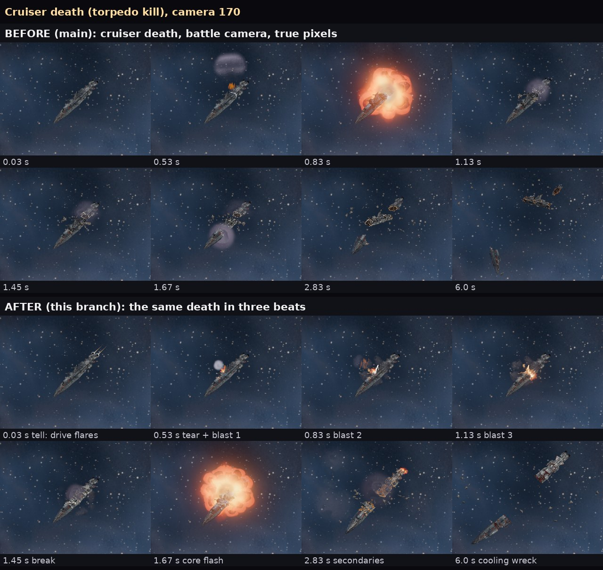
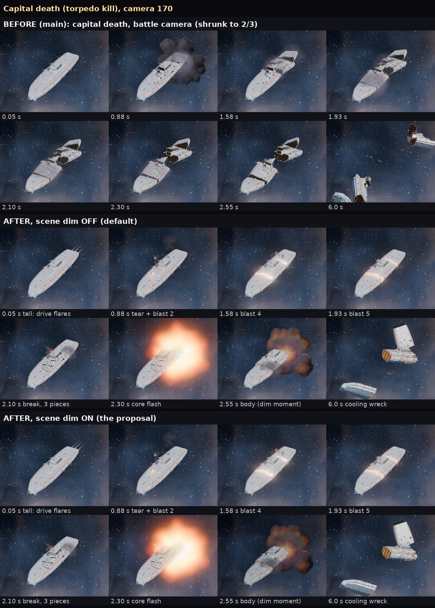

# Cruiser and capital deaths in three beats (issue 462, effects 366b)

Refs #462. Branch opus/issue-462. Built to docs/playbooks/deaths_and_hits.md ("A death in three beats", the cruiser and the
capital rows, and the cause table). Visual code only: no rules, saves, UI flow or data exports changed. No GPU bake: every
picture is a route B picture that already existed (godot/fx/atlases/rebake/, issue 426).

## In plain words

- Before: the ship sat unchanged, then broke at 0.8 s with one big flash, and the pieces went dark fast.
- After: the ship visibly dies first (its drive flares and goes black, a glowing tear opens across it, small blasts walk
  along the tear), then it parts at the tear, then the big white flash comes from the torn face, then smaller blasts go off
  on each piece while the torn faces glow white, orange, red and go dark. A capital does the same, longer, in three pieces.
- My pick for the scene dim proposal: keep it OFF. On the sheet it darkens the whole frame, sky and all, for a fifth of a
  second just after the flash; in motion that risks reading as a stutter more than "the flash took the light", and the
  core flash already reads without it. It is one switch if Ryan wants it.

## What was built, beat by beat

All times are seconds from the killing blow (fx clock). Where a number in the playbook could not be built as written the
nearest thing is said.

| Beat | Playbook (cruiser / capital) | Built (cruiser / capital) |
|---|---|---|
| Engines flare, then black | 0.0 to 0.3, a third brighter for two frames | the drive jumps to 1.33 times cruise (at least) for two frames, then drops to black in about 0.15 s (fx_ship.gd). Plain at camera 170 (first frame of both sheets). |
| Running lights die | bow to stern / deck by deck | bow to stern in 4 bands by 0.3 s / top to bottom in 5 bands by 0.75 s (power_material). Real but hard to see on these hulls at 170: they carry few lit windows. |
| Tear on the break line | 0.3 to 1.38, from the hit side, white tip, ember behind | a new overlay shader (fx_shaders.gd TEAR) on the game's own cut plane, growing from the side last hit (fx_ship hit_react now keeps the last hit; with none it grows from starboard), white tip, ember behind, at least 3 px wide at any camera. Capital: a second line on its second cut plane, 0.35 s later. Reads well on the capital; on the cruiser it is small (the cruiser is only about 30 px wide at 170). |
| Chain blasts | 3 at 0.5, 0.8, 1.1 / 5 over the tell; at least 75 px; core gone in 0.25 s | 3 at 0.5, 0.8, 1.1 / 5 at 0.5, 0.85, 1.2, 1.55, 1.9, each just behind the tear's tip, on the plating (hull ray): route B torpedo flash scaled to 80 / 84 px for 0.16 s, then a fire-through-gas body, a light on the hull and sparks off the plating. Each also sends a narrow fire jet off the plating; the capital shudders harder after each. |
| Vent | narrow jets of fire, then gas | the existing vent picture, smaller on big hulls (0.35 of the length), opened 0.04 s before the first chain blast so the two count as one flash. |
| Capital shudder | small shake of the ship, not the camera | the dying hull jitters up to 0.5 percent of its length, growing through the tell, with a kick at every chain blast. |
| The break | 1.38 / two halves; capital three pieces | 1.38 / 2.0. Cut counts changed: cruiser 1 cut (two capped halves), capital 2 cuts (three pieces, the third 0.3 s after the first two). Older hulls have no authored break lines, so the line is the game's own cut plane (the issue 167 fallback). |
| Core flash | 1.66, 302 px for 0.20 s / 423 px for 0.22 s, at the lip of the torn face, lights hulls nearby | break + 0.28 s, the approved route B core at the class's row (cruiser or capital by class, not by drawn length), at the lip of the torn face, with its light. |
| Body | 260 px / 380 px; fire at most 0.70 s, then gas | the route B torpedo body scaled to 260 / 380 px for 1.6 / 2.0 s (its fire is the first third: 0.53 / 0.67 s), born 0.12 s after the core so its smoke never covers the flash, then the dark cooling gas thinning over about 3 s. |
| Shrapnel | streamers along the plane of the break (torpedo: a cone away from the impact) | 16 / 22 hot streaks: in the break plane for blast and lance, in a cone away from the hit side for torpedo or ram. |
| Secondaries | cruiser 5 on each half from 2.1 to 4.9; capital 10 | 10 in all, from 2.1 to 4.9 / from 2.75 to 6.2, on each piece's own upward plating, at 78 px with a light on that piece. They go off in groups (one per piece, 0.05 s apart) so each group is one counted flash and all stay bright under the 3-a-second cap. |
| Cooling faces | white, orange, dull red, dark, to about 10 s / 14 s | the torn faces now glow over the whole face (deck ribs brightest), not only the rim, cooling over 8.6 / 14 s from release (lance kills 1.4 times longer: "the cut faces glow longest"). Visible on the 6 s frames. |
| Scene dim (proposal) | dims a fifth of a second after the core flash | one switch, `scene_dim` (setup option or VS_DEATH_DIM=1), off by default and never under reduce flashing: a black veil in front of the camera, 35 percent at its deepest, 0.20 s long, starting as the core flash ends. Measured on the sheet: the frame at 2.55 s averages 68 levels without it and 53 with it. |

### Causes (the cause table)

Done well: torpedo or ram (`big`: the tear and chain blasts walk away from the hit, shrapnel in a cone away from it),
lance (`cut`: the tear is a straight line drawn at once, slightly whiter, faces cool 1.4 times longer) and the plain blast
(`blast`: shrapnel in the break plane). Burn-out (`dark`) already matched the playbook (lights and engines die, one gas vent,
a cold whole hulk, no fire) and is unchanged except the engine flare. Melt only tints the tear sick green and draws its blasts
as the soft version (no hard white); the sag is not built. Gauss punctures and the tidal stretch are not built (gauss uses
the blast look; tidal keeps its existing drift toward the star). Small hulls, Chorus ruptures and faction deaths are out of
scope (366c, 366d).

## Measured on the bench strips (camera 170, 1920x1080, true pixels)

The bench draws over the real sky, so these are rough: the widest connected area more than 30 levels brighter than the same
spot before the death, on the frame nearest the event. The 30-frames-a-second strip lands 0.01 to 0.04 s after each
flash's birth, past the route B flash's first cell, so flash sizes read low; the issue 426 measurement scene (black
background, 60 Hz) is the right tool for exact sizes and was not run in this job.

| Event | Playbook | Measured after | Measured before (main) |
|---|---|---|---|
| Cruiser core flash | 302 px, 0.20 s | 182 px (sky diff, 0.01 s in) | 191 px (at its own 0.8 s break) |
| Capital core flash | 423 px, 0.22 s | 364 px | 77 px at 2.30 s (main's capital broke earlier) |
| Cruiser chain blasts | at least 75 px | 24 to 57 px on the frames 0.03 s after birth | none |
| Capital chain blasts | at least 75 px | 118 to 192 px with the body and the lit plating | none |
| Cruiser secondary (2.83 s frame) | at least 75 px | 88 px | none |
| Reduce flashing, cruiser core | same size, soft rise | 198 px, softened | |

Lives: the flash pictures run their table clocks (chain blasts and secondaries 0.16 s, soft twin 0.50 s; cores 0.20 and
0.22 s, soft 0.60 and 0.65 s), unchanged from issue 426's calibration. Every fire layer is inside the caps: full heat at
most one cell, fire at most a third of each body's life (0.53 s cruiser, 0.67 s capital), soft twins end by 0.65 s.

Counted flashes on a cruiser kill (headless, box ship): 0.47 (vent and blast 1, one flash), 0.82, 1.12, 1.67 (core), 2.12,
2.82, 3.52, 4.22, 4.92 (secondary groups); capital: 0.47, 0.87, 1.22, 1.57, 1.92, 2.30, then four groups. None refused,
never more than 3 in a second.

## Cost

No new textures (the chain blasts, secondaries and bodies reuse the issue 426 torpedo pictures the weapons already load), so
texture memory does not change. The 20-ship storm gate (scene_gate) was not run in this job. The 20-ship destruction fleet
probe in check_destruction (20 deaths in 400 frames, RTX 5080), round 3:

| | avg ms | p99 ms | max ms | fx p99 ms |
|---|---:|---:|---:|---:|
| main | 1.189 | 2.280 | 2.701 | 1.193 |
| this branch | 1.225 | 2.306 | 2.537 | 1.262 |

Round 1 showed one 33.6 ms first-death frame (63 ms of fx work building the tear shader on the death frame); the shader is
now built at battle load and warmed with the others, and the hitch is gone (round 2 and 3 max 2.4 and 2.5 ms).

## Checks

- godot/fx/test/check_destruction.bat on Ryan's PC (real hulls, RTX 5080): PASS on rounds 1 to 3; DEATH_SPAWN PASS, 21
  pictures, 21 recorded, 0 stray.
- Headless in the sandbox (Godot 4.7.2): destruction_staging_check, death_plane_check, death_leap_check, fx_smoke,
  destruction_steps_check, playtest_batch1/3, damage_surface_check, squadron_check, audio_check, smoke_lifetime_check,
  load_all: all pass.
- node contrib/opus/tools/run_all_checks.js: exit 0.
- Checks changed to the new design (no new test scripts, so godot_checks.txt is unchanged): the staging check adds a
  capital, the tear, chain blasts, the core 0.28 s after the break, the cut counts, cooling time and secondaries; the plane
  check expects two cruiser halves; the leap check expects a 2.67 s capital with three pieces 0.3 s apart; the spawn check
  follows pictures born on drifting pieces (fx.record_spawn takes the piece's frame).
- Look bench: four rounds on the five new rows (d_cruiser_beats, d_cruiser_beats_cut, d_cruiser_beats_calm,
  d_capital_beats, d_capital_beats_dim), 0 warnings each. Evidence on the PC under
  Downloads\voidsworn_test\opus462\lb\ (runs\main_r4, runs\after_r4, sheets\cmp_r4).

## Left out, and what to look at next

- The cruiser's tear is real but small at camera 170 (the hull is about 30 px wide); the chain blasts carry the cruiser's
  tell. If Ryan wants the tear itself to read on a cruiser, the next step is wider glow sprites along the line.
- Cruiser chain blasts measure under 75 px on the strip frames. They are sized 80 px by the same calibration as the torpedo
  hit; the strip catches them after their first cell. A follow-up should measure them in the issue 426 scene and, if short,
  raise them to about 100 px.
- A pale grey puff (the old vent picture) still shows beside the hull at the first blast. Smaller than before; a rebaked
  vent jet (issue 365's list) would replace it.
- Running lights going out are hard to see on these two hulls (few lit windows).
- Not built: the melt sag, gauss punctures, the tidal stretch, faction deaths, small hulls (366c).
- Pacing note: battle.gd holds a death for 0.6 of the time fx.death returns. The cruiser's return is unchanged (2.05 s); a
  capital's is now 2.67 s (was 2.05), so a capital kill holds the battle about 0.37 s longer. The returned time must cover
  the break, or the game could free the live ship before it parts.
