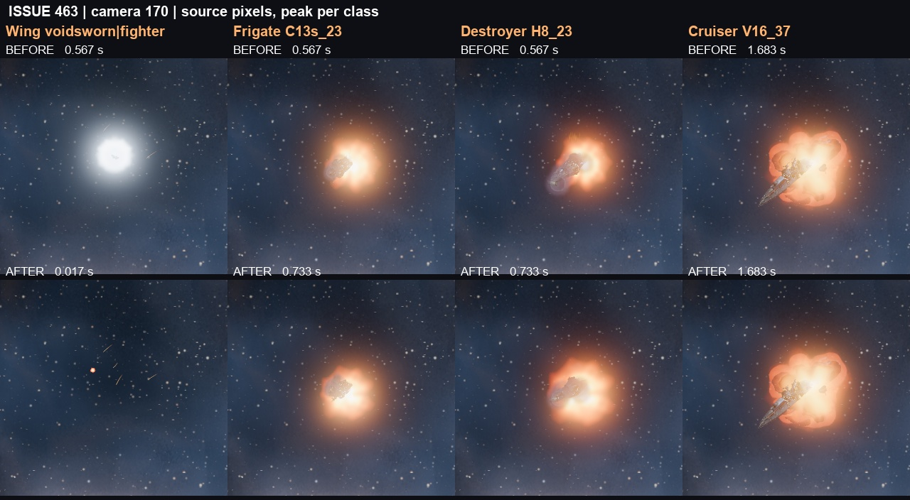

# Small ship deaths

Refs #463. The shared frigate and escort deaths now cut their lights at once, spin with a hot trail and pop at 0.72 s. Destroyers use their own flash row between frigate and cruiser: its own size, life and light reach, drawn over the small row's baked flash pictures (the 384 px cells cover both, no rebake). A small hull with no pre-cut pieces at the kill frame still throws one physical shard and an ember (the main fallback, kept by the Board). Wings leave one spark and a short puff, with no wreck or physical shards.

[PC evidence](C:/Users/rcbai/Downloads/voidsworn_test/board/issue-463/shots) contains the source strips, 60 Hz measurement frames, storm gates and logs. [Repository sheets](../../../docs/shots/look_bench/deaths_small/) include cameras 170, 60 and 26, normal and reduced, with each hull's code and sample times.

## Changes

- `godot/fx/fx_death.gd`, `fx_ship.gd`: class-based rows, the immediate surface jet, spinning trail, 0.72 s break, one-second body, two to four chunks and one chunk cooling over six seconds. Small effects apply the spin once to the captured hull pose. A wing spark is born on the next FX step so it gets a drawn frame before expiring. Normal and softened wings use the same baked seed and scale.
- Existing `death_plane_check.gd` and `destruction_staging_check.gd`: wings leave no wreck; escorts, oversized small hulls, surface roots, coals, slow-motion exclusion and twenty simultaneous wing deaths are checked. No new script under `godot/**/test/`, so the CI list needs no new line.
- `godot/bench/look_moments_deaths_small.json`, `death_small_measure.gd`, the sheets and this report: capture and measurement evidence. Body measurements read the real break caller's material, including its size and life. `docs/playbooks/effects.md` records the spin and one-frame birth traps.

Cruiser/capital staging, existing faction rupture and burn-out paths remain in place. No rules, saves, UI flow or data exports changed.

## Size and time

1920 x 1080, camera 170, Forward+, production calls, `VS_FX_ATLAS` empty. Widest horizontal or vertical lit extent uses RGB above 30/255, with at least twelve lit pixels. Raster life uses at least twelve pixels above 1/255, sampled at 60 Hz. Full frames, material clocks and per-frame numbers are in `shots/measure/`.

| Picture | Row px / clock s | Drawn px / raster s |
|---|---:|---:|
| Wing | under 40 / one frame | 8 / 0.017 |
| Wing reduced | same size / 0.20 | 8 / 0.150 |
| Frigate, escort | 216 / 0.18 | 220 / 0.167 |
| Frigate reduced | 216 / 0.55 | 220 / 0.500 |
| Destroyer | 255 / 0.19 | 251 / 0.183 |
| Destroyer reduced | 255 / 0.575 | 251 / 0.517 |
| Frigate body | 180 / 1.00 | 176 / 0.950 |
| Destroyer body | 218 / 1.00 | 214 / 0.950 |
| Cruiser reference | 302 / 0.20 | 301 / 0.200 |
| Cruiser reduced reference | 302 / 0.60 | 283 / 0.533 |

Material clocks match the rows. Soft fades shorten visible raster life by 0.05 to 0.067 s. The reference cruiser's existing reduced size gap is unchanged. The new small rows match normal/reduced visible size. Flame and full-heat lives stay within 0.70 and 0.25 s; gas and cooling coals have their own longer lives.

Each changed row was captured twice; the second capture is kept. Final calibration repeats replace only their affected rows. The unmodified cruiser control's worst cell difference is 0.096, 0.288 and 1.173 levels at cameras 170, 60 and 26, below the bench's 2.0 tolerance. All kept captures finished with zero warnings. Used rows are in each run's `moments.json`; `provenance.json` explains the existing bench metadata's default-file hash.

## Cost

RTX 5080, the real twenty-ship storm gate, two sessions of 720 measured frames per mode. These are means of session medians, in ms, with other heavy jobs finished before measurement.

| Gate | Before | After | Delta |
|---|---:|---:|---:|
| 1080p battle frame | 2.668 | 2.715 | +0.047 |
| 1080p death-stress frame | 2.849 | 3.047 | +0.198 |
| 4K GPU | 5.247 | 5.177 | -0.070 |

Texture allocation stays 1600.99 MiB at 1080p and 2658.47 MiB at 4K, delta 0.00. No new textures or bakes: the existing 384 px cells cover the small rows at the battle camera. Costs are reported, not capped. Both scene-gate measurements remain below 12.5 ms. Death-stress sessions refused zero flash requests; six and three gun hits yielded to the flash budget.

## Checks and omissions

- `godot/fx/test/check_destruction.bat`: PASS, exit 0, including rendered inside and twenty-ship probes. Smoke: worst three counted flashes per second, zero stray spawns, 1152 recorded spawns. Death-spawn guard: 33 pictures, all recorded, zero stray. Twenty wing deaths: zero wrecks in both comfort modes.
- Final `destruction_staging_check`, `flash_area_check`, `fx_smoke`: PASS, exit 0 after calibration. Staging failures 0; flash-area failures 0.
- Bundled Node 22, `contrib/opus/tools/run_all_checks.js`: PASS, exit 0; 48 PASS, two KNOWN, zero FAIL/SKIP. Known rows retain seven findings and twelve baseline constant differences.
- Godot captures, isolated measurements and both performance runs exited 0. Diff whitespace and no-em-dash checks pass.

The commit-oriented `look_bench.bat` wrapper was skipped because this checkout must stay uncommitted. Its production `look_bench.tscn` scene was run directly against the working files. Rebaking was unnecessary. No commit, push or PC deletion was made.
