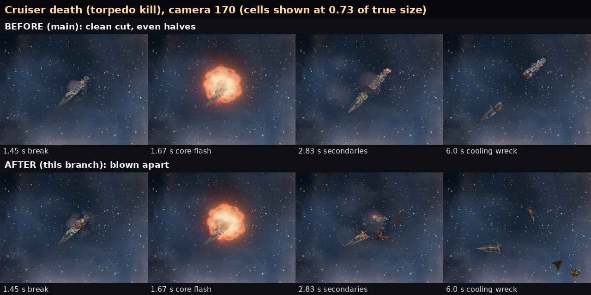
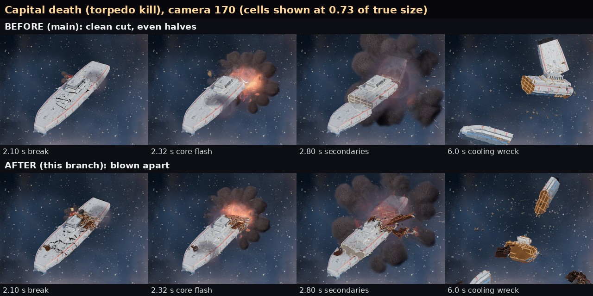

# Wrecks that look blown apart, not sliced (issue 484, effects 366d)

Refs #484. Branch opus/issue-484. Visual code only (godot/fx/fx_death.gd, godot/fx/fx_hull.gd, one check). No rules, saves,
UI flow, data tables or textures changed. Reduce flashing is untouched: no new flash was added.

Ryan, Nov 11: "the wreckage comes out looking too clean at the end. It's like straight lines and even halves. It doesn't
feel like an explosion or major hit happened. It feels like they're just getting sliced in half after everything"

The same content as four short pictures (each 340 px tall): docs/shots/look_bench/deaths/cruiser_wreck_before.jpg,
cruiser_wreck_after.jpg, capital_wreck_before.jpg, capital_wreck_after.jpg. Cells are the bench's camera 170 frames at 0.73
of true size (true pixels clipped the 6 s wreck, which spreads wider than a 320 px cell).

## What Ryan will see

- Cruiser: it breaks about a third of the way from one end, not in the middle, on a slanted, kinked, torn line. The core
  flash goes off in a bite on the side that was hit; four or so chunks of that hull fly out tumbling, glowing and cooling,
  with a cloud of torn plates. At 6 s: one big piece with a ragged red end, one clearly smaller piece, separate fragments
  and plates between them.
- Capital: three pieces of three different sizes (about a half, a third and a fifth), torn rims, dark rust fragments and
  plates thrown from the core, a scorched patch round the wound.

## How it is built (and what I tried)

The old cut gave each hull triangle to its nearest seed: one flat plane square to the length, seeds evenly spaced, so two
near-equal halves that fit back together. Big hulls (cruiser and capital class, not Chorus) now break on a fracture plan
made per ship on the main thread just before the existing worker cut (fx_death.gd `fracture_plan`, `_plan_assign`):

1. Uneven pieces. Cruiser: 31 to 37 percent and the rest, which end is random per ship. Capital: about 50, 30 and 20 percent
   in a random order. Seeded by the ship id, so a replay breaks the same way.
2. No straight line. Each break is tilted 20 to 34 degrees off square in plan and 10 to 22 degrees in pitch, bent into a V
   across the beam (two planes meeting at an angle), and torn by three summed waves (teeth about 3 percent of the length).
   All three are scaled down together when a piece is short, so breaks never cross. The V's shift of the mean line is
   corrected so pieces keep their planned sizes.
3. The bite. Centred on the hull sample furthest out on the side last hit (a per-ship side if there was no recent hit),
   on the core's break, a little into the bigger piece: an ellipsoid 0.12 L long on a cruiser (0.09 L on a capital) and
   about half the beam deep, its rim torn by two waves. It is cut into four (cruiser) or six (capital) fragments. They ride
   with the wreck until the core flash and are then thrown out tumbling (kinematic, no physics bodies). The core flash now
   sits in the bite.
4. Chips: two small wedges per break, thrown with the bite.
5. Ragged rims. Torn cap loops get bent plates peeled outward with a torn tooth (`_cap_petals`; some keep a hot rim) and
   about half their deck ribs run long past the skin. Only loops on a break or in the bite are torn (`_loop_torn`); the
   hull's own open kit edges stay plain.
6. Scorch. The hull damage shader gets up to eight wound spots (fx_scorch): soot black at the wound, a faint heat stain
   further out, sparse embers that cool with the torn faces. Off (count 0) for every live ship.
7. Debris. At the core: 12 small and 5 medium torn plates (capital 18 and 8) from the existing pool, on top of the plates
   at the break.

Also from the issue 462 list: the cruiser's chain blasts are drawn at 100 px (were 80), and the pale vent puff beside a big
hull is gone (its sparks stay). The Chorus rupture cut is warped by waves so it no longer breaks on flat Voronoi planes.

Tried and changed on the bench: round 1 had three-wave bite rims and wave-picked chips, which holed a capital's deck like
lace; a wide bronze scorch ring that turned white hulls cardboard brown; long white petals; fragments at full white heat.
Round 2 shortened the petals, made the bite one shape and the chips compact, made the scorch darker and smaller, and started
fragments cooler. Round 3 stopped petals on the hull's own kit seams.

## What falls short (blunt)

- Lance kills are not cleaner. The cut is prepared before the ship dies, when the killing weapon is unknown, so a lance kill
  breaks the same torn way (its tear still draws straight and its faces still cool longest). Doing it properly means a
  second prepared cut per ship (double the worker cost) or a cut on the death frame; I chose neither.
- The capital's middle piece can tumble so its cut face looks at the camera by 6 s: then the strip shows a big flat tan
  face (the glowing deck face of issue 462, cooling). Its rim is ragged but the face itself reads flat.
- At camera 60 a capital's deck shows short light sticks after the break. Round 3 removed the petals on kit seams; what
  is left looks like the hull's own kit detail, but I did not prove it on a closer sheet.
- The bite is clear at camera 60 and on the capital at 170; on the cruiser at 170 (hull about 30 px wide) it reads as a
  ragged glowing end and flying chunks more than as a crater shape.
- Not benched: Chorus (no Chorus row on the bench; a missing hull would stop the run) and reduce flashing (unchanged code
  path, no new flashes).
- After the last bench round, the PC death spawn check failed on round 3's code: on one real hull the bite's ray hit a
  part with no plating samples round it, so the core flash, its gas and body sat 4.0 units from the plating (limit 1.86).
  Fixed after the bench: the bite centre is now a real hull sample. The strips are round 3's pictures, so on that hull the
  bite may now sit a little lower on the side than pictured.

## Cost

- Worker cut (sandbox CPU, a 48 by 64 capsule hull, old cut against new on the same hull): 57 to 99 ms became 128 to 254
  ms. It runs on the worker thread ahead of the death, as before; nothing new runs on the death frame except building up to
  ten small fragment nodes from prebuilt meshes.
- Cap geometry per wreck: about 1,400 to 3,200 vertices became 7,700 to 16,800 (torn rims, petals, long ribs, fragment
  caps). Under a megabyte per prepared ship; no new textures.
- Pieces: 2 or 3 main pieces as before, plus 4 to 10 fragments without physics bodies.
- 20-death fleet probe (check_destruction, RTX 5080), main at the time: avg 1.331 ms, p99 2.543, max 3.145, fx p99 1.393.
  The branch's run stopped at the death spawn failure above before the probe; see the hand-off for the rerun.

## Checks

- Headless in the sandbox (Godot 4.7.2): destruction_staging_check, death_plane_check, death_leap_check,
  destruction_steps_check, fx_smoke (0 stray), playtest_batch1/3, damage_surface_check, squadron_check, load_all: all pass.
  node contrib/opus/tools/run_all_checks.js: exit 0.
- New in destruction_staging_check (`_check_blown_apart`): fails when a big death has no fracture plan, its main pieces
  are near equal (smallest over 0.72 of the largest by side skin; a capital's neighbours within 0.88), the bite is missing
  or under 0.12 of the length, fewer than three fragments fly, or the first piece's torn end is one straight line across
  the beam. Main fails it.
- Look bench on Ryan's PC: three rounds of the cruiser, lance cruiser and capital rows at cameras 170 and 60, 0 warnings.
  Evidence under Downloads\voidsworn_test\opus484\lb\ (runs\main_r1, runs\after_r1 to after_r3).
- Known in the PC check log, main too: death_spawn_check reads a missing `directional` uniform as a float (16 script errors
  on main); not from this branch.
