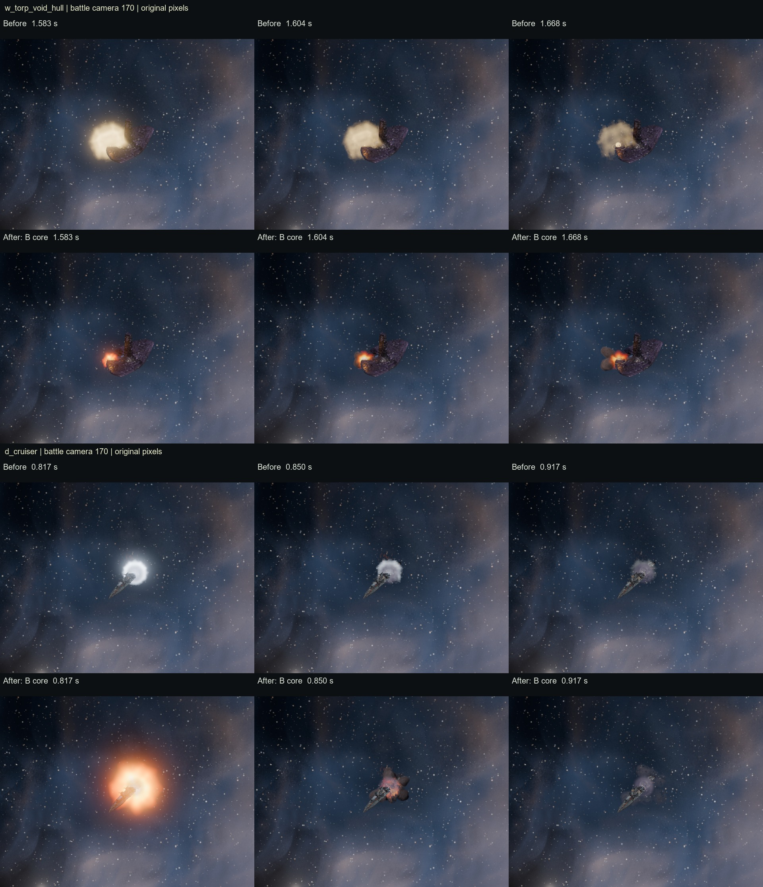

# Explosion rebake: production route B

Refs #365. Refs #426. The game now draws route B with flash plus hot core for macro hull hits, torpedo hull hits and the main death flash of each size, with no bench switch. Three seeds are chosen per picture. No route A pictures were added.

The [PC battle sheet](C:/Users/rcbai/Downloads/voidsworn_test/board/issue-426/shots/rebake_battle.jpg), all fifteen full strips, measurement frames and logs are in `board/issue-426/shots/`. Repository strips are in `docs/shots/look_bench/rebake/`. Both looks were benched twice; the second run is kept. All captures use the default production calls with VS_FX_ATLAS empty.

## Inventory and scope

Each entry below has color, flow and thickness PNGs. These are every shipped atlas family before this change:

| Existing pictures under godot/fx/atlases/ | This job |
|---|---|
| weapons/muzzle/muzzle_* | Kept. Muzzles wait for the wider effects rollout. |
| weapons/impact/impact_* | Macro and torpedo hull callers now use rebake/s0,s1,s2/weapons/. The old shared pictures remain for other impacts. |
| death/small/flash_* | Main small-ship flash replaced by B. Legacy secondary and comparison callers remain. |
| death/cruiser/flash_* | Main cruiser flash replaced by B. Legacy pictures retained. |
| death/capital/flash_* | Main capital flash replaced by B. Legacy pictures retained. |
| death/small/vent_*, death/cruiser/vent_*, death/capital/vent_* | Kept for issue 366. Their measured hull roots are unchanged. |
| death/small/cool_*, death/cruiser/cool_*, death/capital/cool_* | Kept for issue 366. |

The new set has 63 game maps plus six preview strips: three seeds, separate weapon flash and body maps at macro and torpedo sizes, and three death flash sizes. Macro cells are 128 px, torpedo cells 384 px, death cells 384/512/768 px. All source renders are 768 px. These exceed their battle-camera display needs; no source cell is enlarged to reach its row.

## Measurements

1920 x 1080, camera 170, the battle look and its bloom. The measurement scene calls the same production functions and isolates each layer against black. Lit extent uses RGB above 30/255; connected regions under 12 pixels are excluded as spark/debris points. Raster life is sampled at 60 Hz using at least twelve pixels above 1/255, through the fade to black; the JSON separately records the shorter bright span above 30/255. The clock column reports the actual material life. Peak frame is counted from event start. The full battle strips retain their source pixels at camera 170 and recorded effect times.

| Event | Table px / s | Rendered px / raster s | Material clock s | Peak frame |
|---|---:|---:|---:|---:|
| macro | 56 / 0.12 | 56 / 0.117 | 0.12 | 0 |
| torpedo | 154 / 0.16 | 153 / 0.150 | 0.16 | 0 |
| frigate | 216 / 0.18 | 219 / 0.167 | 0.18 | 0 |
| cruiser | 302 / 0.20 | 300 / 0.183 | 0.20 | 0 |
| capital | 423 / 0.22 | 422 / 0.217 | 0.22 | 0 |
| macro reduced | 56 / 0.42 | 56 / 0.367 | 0.42 | 7 |
| torpedo reduced | 154 / 0.50 | 153 / 0.450 | 0.50 | 12 |
| frigate reduced | 216 / 0.55 | 216 / 0.483 | 0.55 | 13 |
| cruiser reduced | 302 / 0.60 | 301 / 0.533 | 0.60 | 16 |
| capital reduced | 423 / 0.65 | 422 / 0.583 | 0.65 | 18 |
| macro body | 48 / 0.50 | 46 / 0.467 | 0.50 | 17 |
| torpedo body | 140 / 0.90 | 136 / 0.850 | 0.90 | 31 |

Normal flash floors are now 56 and 154 px, and 216/302/423 px for deaths. Macro flash life changes from 0.32 to 0.12 s; torpedo from 0.32 to 0.16 s; small/cruiser/capital death flashes from the shared 0.20 s and 70 px floor to 0.18/0.20/0.22 s and their rows. Macro body changes from 0.34 to 0.50 s, torpedo body from 0.42 to 0.90 s. Hits scale by target at 0.8/1.0/1.2. Close views grow from the same world extent. Screen calibration includes bloom, with separate normal and softer-flash divisors, rather than treating the quad diameter as the visible diameter.

Reduce Flashing keeps the row sizes and uses its 0.42/0.50/0.55/0.60/0.65 s smooth rise and fall. The original bench-only quarter-size compensation is bypassed by the production calls. The production shader reads baked colour and heat directly; the older weapon shader text patch still serves the untouched effects.

On normal playback the core weights are zero from cell 5 onward: at most 0.30 s in the longest 0.90 s body, with full weight for one cell, 0.06 s. Spark points retain heat through cell 8 and are gone from cell 9. The reduced flashes have no full-heat hold and end by 0.65 s. All remain inside the 0.25 s full-heat and 0.70 s flame caps.

Normal flash raster lives are within two 60 Hz frames of their rows. The softened variants reach their size targets and use the exact table clocks, but their measured nonzero raster spans are 0.05 to 0.067 s shorter because of the smooth fade. This remains a strict visible-duration gap. The 30 Hz battle strips can miss the single-frame peak of a hit; the separate 60 Hz measurement frames establish that peak. These limits are recorded rather than counted as a full optical-timing pass.

## Cost and bake

RTX 5080, Godot 4.7.2 Forward+, the real 20-ship storm gate. Two sessions per mode, 720 measured frames per session. Numbers are means of session medians, in ms:

| Gate | Before | After | Delta |
|---|---:|---:|---:|
| Battle frame, 1080p | 5.433 | 5.412 | -0.021 |
| Death stress frame, 1080p | 5.553 | 5.665 | +0.112 |
| GPU, 4K | 5.051 | 5.063 | +0.013 |

Reported 1080p texture allocation: 1349.62 to 1601.74 MiB, delta +252.13 MiB. Both the 1080p frame and 4K GPU readings are below 12.5 ms. These are measured costs, not a claim of a speed win. The 63 game PNGs total 105,819,552 bytes on disk, which is not GPU memory.

Six new 128-cell smoke simulations, three seeds per source kind, no detail noise: 631.5 s simulation and 304.5 s GPU rendering. The production pack authors the picked short core and larger first-cell flash, and writes native sizes. Source scripts, bake records, fill measurements and file sizes are in the route manifest. One GPU job ran at a time. Nothing on the PC was deleted.

## Validation and remaining work

- `node contrib/opus/tools/run_all_checks.js`: 41 PASS, two KNOWN, zero FAIL/SKIP. The known rows retain seven findings failures and twelve baseline constant differences.
- `godot/fx/test/check_destruction.bat`: PASS, exit 0: geometry, plane, staging, flash limit, stray puff guards, playtest checks, blockers, inside renders and the 20-ship fleet probe. FX_SMOKE: worst 3 flashes/second, zero stray spawns, 952 recorded spawns; DEATH_SPAWN PASS.
- Atlas validation: all 63 maps decode at the stated native sizes; the central core is cold from cell 5 and all heat, including spark points, is gone from cell 9.
- Before and after: fifteen strips each, zero bench warnings, LOOK_BENCH_DONE, clean exits. Performance gates and the final measurement run also exited 0. The discarded early isolated measurement included warm-up particles; the delivered measurement hides that whole system and creates a fresh one.
- Diff whitespace and no-em-dash checks: PASS, including the new text files.
- R129: only visual callers, atlas loading, warm-up, sizing and timing changed. No rules, saves, browser twin, UI flow or data exports changed. No new script under godot/**/test/ needs registration. CI still runs standing checks, rules parity and Godot load/list/bot checks.

The core flash now reads, but the death still has no readable tell or three-beat progression. The other death layers remain faint between the pop and the wreck. Chain blasts, 75 px secondaries, the full death body/aftermath, wounds and light on neighbours are deliberately left to issue 366. Destroyers still share the small flash row; their separate staging is that job's work. Muzzles, shield hits and other weapon looks retain their current pictures.

Changed: godot/fx/atlases/rebake/, four fx scripts, tools/blender/vfx/pack_routes.py plus rebake.bat and rebake_evidence.py, the wider optional bench capture and isolated measurement script, the evidence strips and this report. The bench crop is wider because the normal 216 px-high cell clips a 423 px flash. Generated import churn outside the new pictures was restored. No ship files or UID files are delivered. No commit or push was made.
