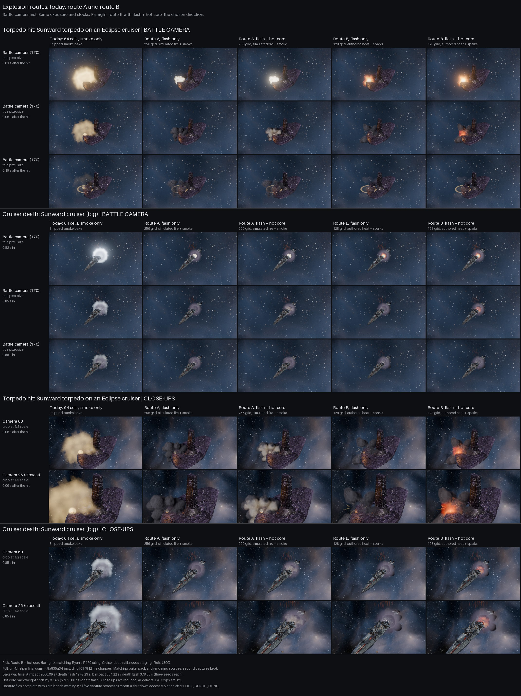

# Explosion routes: final sheet

Refs #419. Refs #353. Pick: **route B, flash plus hot core**, the far-right column. It gives the torpedo hit a short, readable orange core against dark gas, with much faster baking than A. This agrees with Ryan's recorded pick in FINDINGS R170. The cruiser death still needs the staging work in issue 366.

The [PC sheet](C:/Users/rcbai/Downloads/voidsworn_test/board/issue-419/shots/explosion_routes_sheet.jpg), [torpedo timing strip](C:/Users/rcbai/Downloads/voidsworn_test/board/issue-419/shots/w_torp_void_hull_c170_all.jpg) and [cruiser timing strip](C:/Users/rcbai/Downloads/voidsworn_test/board/issue-419/shots/d_cruiser_c170_all.jpg) are all in the requested `board/issue-419/shots/` folder. Repository copies are under `docs/shots/look_bench/explosions/`. Strip rows are Today, A flash, A core, B flash, B core; cells retain their original pixel size and show the recorded times.

## What the routes are

Route A: a 256-cell Mantaflow fire-and-smoke simulation, detail noise enabled at scale 2, with separately rendered smoke and fire.
The pack makes flash-only and short-core versions from the same simulation; the run used the normal `fire` exposure.

Route B: a 128-cell smoke simulation without detail noise, with authored hot cores, a heat colour ramp and sparks added during packing.
Each effect has three seeded source shapes: shards, sphere and ring. The sheet uses seed 0; seeds 1 and 2 were also baked and packed.

Today uses the shipped 64-cell smoke-only pictures. Both candidates replace only the weapon impact and death flash through the existing `VS_FX_ATLAS` test switch. They do not replace the other death layers.

## What the battle camera shows

The first six rows are camera 170, both moments before any close-up. Each cell is the bench's 384 x 216 crop at one source pixel per sheet pixel. Open the JPEG at 100 percent to judge size. Camera 60 is reduced by half and camera 26 by a third, as in the bench.

- Torpedo, about 0.01 s after impact: today's pale cloud covers much of the hull. A has a tight white flash; B adds a warmer flash with more distinct surrounding dark gas.
- Torpedo, about 0.06 s: B with the core retains a clear orange contact point. B flash-only has already lost that point. A's core version is brighter than its flash-only version but looks pale and smoky. At about 0.19 s all columns have largely cooled, with the ring and hull visible again.
- Cruiser, 0.82 to 0.88 s into the event: B adds a small hot spot, but none of the five columns reads as a major cruiser death. Today's white puff is larger and brighter, yet it also lacks the staged weight of a capital-scale event. The closer cameras help explain the materials; they do not establish battle-distance readability.

The pack's hot-core weights occupy the first five of sixteen frames and are zero from cell 5 onward: nominally gone by 0.14 s of the 0.42 s impact body and 0.067 s of the 0.20 s death flash. Those are pack timings, not measured visible-flame durations. They are inside the staging table's 0.70 s flame cap, but the candidates have not yet been sized and timed to the full approved table.

## Provenance and reuse

The source is the completed full run at `C:/Users/rcbai/Downloads/voidsworn_test/fx353/out4`, recorded at **8a835a34dce548c47e872890156c07256e62d897**, the final helper branch commit. It contains f094812's fire-through-gas, uneven burst, reach and dissolve changes. Contrary to the handover note, run 4 also finished its sheet and scene gates on Nov 10, at 15:34 CST. Run 3 was not used.

Started `codex/issue-419` from `origin/opus/issue-353` and merged main `f83bbad5df9bb42459831afbc2fb1291104954d5` with `--no-commit --no-ff`. No conflicts. The merge is deliberately pending because this task forbids commits. No new commit identifier is claimed for the deliverables.

Before reuse, `git diff 8a835a34` was empty for `godot/bench`, `godot/fx`, `godot/render`, `godot/world`, `tools/blender/vfx` and both explosion job/sheet scripts. The capture clone is still at 8a835a34; its working changes are generated import metadata and a noise-cache file, not changed bake or rendering code. The current bench and moment-table hashes match all five kept run manifests:

- Bench SHA256: `a6508280cdf08bc24f6eea7f9f87200252ad1f745547a440f849f03886915409`.
- Moment table SHA256: `888c73a3b8c45baf9ead799ddc1b044e55d86396b7be7a65e17441bc733b1416`.

Rebuilt the presentation from run 4's second captures, preserving the original crops, with all battle rows first, labelled strips, source and cost notes. No new GPU job or out5 was needed. The frame-cost readings below are retained run-4 measurements, not a new benchmark of main's later rules changes. [Provenance and output hashes](C:/Users/rcbai/Downloads/voidsworn_test/board/issue-419/shots/provenance.json) and [source logs and JSON](C:/Users/rcbai/Downloads/voidsworn_test/board/issue-419/shots/run4_evidence/) are saved beside the sheet.

## Bake cost on Ryan's PC

Blender 4.5.14, Cycles on the RTX 5080; Mantaflow simulation runs on the CPU. All source cells are 512 pixels, sixteen rendered cells over a 32-frame simulation. Seconds below are measured wall-clock seconds, not estimates.

| Effect | A simulation | A normal smoke + fire render | A extra exposure renders | A whole call | B simulation, all 3 seeds | B render, all 3 seeds | B whole call |
|---|---:|---:|---:|---:|---:|---:|---:|
| Weapon impact | 1532.5 | 216.5 | 304.7 | 2060.09 | 289.0 | 59.4 | 351.22 |
| Death flash | 1512.1 | 205.7 | 218.9 | 1942.23 | 316.1 | 60.2 | 378.35 |
| Total | 3044.6 | 422.2 | 523.6 | 4002.32 | 605.1 | 119.6 | 729.57 |

Whole-call times come from `times.txt`; component times come from each `bake.json`. Calls include setup and writing overhead. A also rendered unused low/high fire exposures, so its whole-call comparison includes that extra work. Even comparing simulation plus normal rendering, A took 3466.8 s versus B's 724.7 s for three variants, about 4.8 times as much. Both route packs together took a further 96.90 s; this job did not time them separately. Today's bake time was not remeasured.

## Picture sizes on disk

Exact PNG bytes, colour + flow + thickness combined. All routes use the same output dimensions: impact 1024 square; death flash small 1024, cruiser 1536, capital 2048. Disk bytes are not GPU texture memory.

| Picture set | Today | A flash | A core | B flash, seed 0 | B core, seed 0 |
|---|---:|---:|---:|---:|---:|
| Weapon impact | 319,287 | 2,132,265 | 2,149,155 | 1,280,968 | 1,293,455 |
| Death flash, small | 187,309 | 1,793,486 | 1,812,662 | 1,865,263 | 1,877,069 |
| Death flash, cruiser | 336,012 | 3,568,213 | 3,611,516 | 3,776,349 | 3,795,732 |
| Death flash, capital | 630,061 | 5,322,053 | 5,417,701 | 5,897,913 | 5,933,973 |
| All four sets | 1,472,669 | 12,816,017 | 12,991,034 | 12,820,493 | 12,900,229 |

B's additional core variants total 16,250,851 bytes for seed 1 and 15,703,206 for seed 2. All candidate texture PNGs, excluding preview strips: A 25,807,051 bytes across two fire amounts; B 57,674,779 across flash and three core variants. B is cheaper to bake, not uniformly smaller to store.

## Frame cost, retained run 4

Godot 4.7.2 Forward+, RTX 5080, 20-ship storm scene, two sessions per mode, 720 measured frames per session. Values are the arithmetic mean of the two session medians, in milliseconds; deltas are against switch-off. Only the core amount was profiled.

| Mode | Today | A core | A delta | B core | B delta |
|---|---:|---:|---:|---:|---:|
| Base battle frame, 1080p | 6.729 | 6.845 | +0.116 | 6.794 | +0.066 |
| Death stress frame, 1080p | 7.049 | 7.216 | +0.168 | 6.988 | -0.061 |
| GPU median, 4K `res_2160` | 5.530 | 5.511 | -0.019 | 5.514 | -0.016 |

Both candidates were below the R116 12.5 ms threshold on both gate readings. The two-session ranges overlap: base frame 6.356 to 7.101 ms off, 6.286 to 7.403 A, 6.429 to 7.159 B; 4K GPU 5.479 to 5.582 off, 5.470 to 5.553 A, 5.455 to 5.574 B. These small deltas do not establish a runtime speed win. Both core candidates added about 21.74 MiB of reported texture allocation in the recorded modes.

## Pick, remaining weaknesses and scope

Choose B with the hot core. It preserves a brief hot contact point at the battle camera, its heat is easier to author independently of the gas, and it delivers three source variants for much less bake time. A's extra simulation detail does not buy a clear battle-camera improvement on this sheet. Ryan has already chosen B with the core; keep A here as comparison evidence, not as a second rollout route.

The faint cruiser death is chiefly a **death-staging issue**, not evidence that B cannot work. Swapping pictures leaves the same small event, spawn placement, lifetime, split and secondary choreography in every column. The approved staging table asks for a 302 px cruiser flash, a 260 px body, separate readable secondaries and a cooling aftermath. Issue 365 must size and time B's rebakes to that table; issue 366 must stage the death in beats. The atlas swap alone cannot supply them. B also still has soft, rounded smoke clumps close up, while A's impact reaches 245 of 256 pixels rather than the approximate four-fifths target (A death 201; B impact 209, death 202). These are reported weaknesses; no route was reworked here.

All five retained capture runs wrote six valid strips, their complete manifests, zero bench warnings and `LOOK_BENCH_DONE`. All five then exited with access violation `-1073741819` during renderer teardown, with leaked-resource/null-renderer messages after completion. The pictures are complete and usable; these were **not clean process exits**. Bake calls, packing, sheet generation and all three gate runs exited 0. Teardown repair is outside this sheet/report task.

No `.import` files were copied or added. These JPEGs are review evidence outside the Godot project; the game does not load them. The helper clone's regenerated `.import` files remain untouched. Candidate textures are loaded by the existing test switch directly from PNGs, so their editor sidecars are not needed for this delivery. No ship files, generated hulls, UID files, rules changes or new test scripts were added by this task.

## Validation

- `node contrib/opus/tools/run_all_checks.js`: exit 0, 41 PASS rows, two KNOWN rows, zero FAIL or SKIP. The KNOWN rows retain 12 listed findings failures and 12 baseline constant differences; they are not new failures.
- Verified all 30 source strips decode, dimensions match their cell counts, all five manifests name the final helper commit, and bench/moment hashes match this checkout.
- Visually inspected the final comparison and the battle timing strips. Output copies and provenance are in `board/issue-419/shots/`.
- R129 sweep: the inherited route callers and switch are unchanged; no save, browser twin, UI flow or data export changes were needed. GitHub's existing checks run standing checks, rules/campaign parity and Godot game load/list/bot checks when the runner pushes. No new `godot/**/test/` script needs registration.
- No em dashes in the delivered report or inherited branch text. `git -c core.whitespace=cr-at-eol diff --check origin/main` passes; the plain form flags the helper's existing CRLF batch files. No batch files were reformatted.
- No fresh bake, capture or scene-gate run: matched run-4 bakes and complete second captures were reused as the task permits. No commit or push was made.
