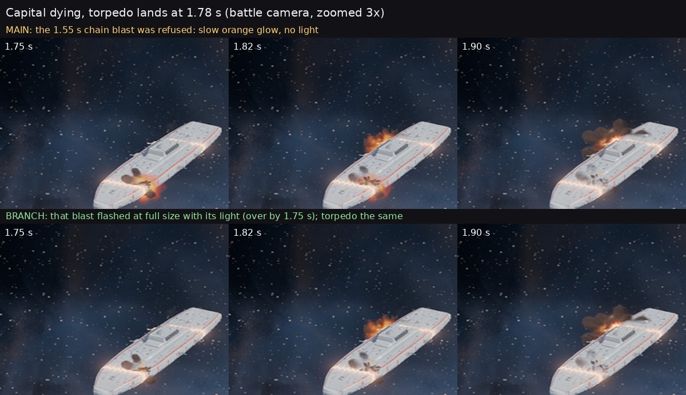

# The flash counter counts by area (issue 504)

Opus 5.5 worker, Nov 11 2026. Branch opus/issue-504 (merged with main after issue 484 landed).

## What Ryan will see

When several things blow up in the same second, each keeps its full flash and its light, as long as they are not all
piled into one small patch of screen. On main only three large flashes a second got through anywhere on screen; the
rest became slow orange glows with no light. In the bench picture (a super-dreadnought dying with a torpedo landing at
1.78 s) main had already booked the torpedo, so the dying ship's own 1.55 s chain blast was the one turned soft: it
still glows orange at 1.75 s with no light on the hull. On the branch it flashes white-hot with its light and is over
by 1.75 s; the torpedo looks the same in both. The bigger gain is in crowded moments: in the headless worst second (two
deaths and a torpedo) main turned 8 flashes soft, the branch none. Reduce flashing is unchanged, frame for frame.

## The guideline, word for word

From W3C, Understanding SC 2.3.1 Three Flashes or Below Threshold
(https://www.w3.org/WAI/WCAG22/Understanding/three-flashes-or-below-threshold.html), the sentences built from:

- "there are no more than three general flashes and / or no more than three red flashes within any one-second period"
- "the combined area of flashes occurring concurrently occupies no more than a total of .006 steradians within any 10
  degree visual field on the screen (25% of any 10 degree visual field on the screen) at typical viewing distance"
- "A general flash is defined as a pair of opposing changes in relative luminance of 10% or more of the maximum relative
  luminance (1.0) where the relative luminance of the darker image is below 0.80"
- "The combined area of flashes occurring concurrently and contiguously means the total area that is actually flashing
  at the same time." The page's calculation note: "It is calculated by adding up the contiguous area that is flashing
  simultaneously within any 10 degree angle of view."
- Note 1: "using a 341 x 256 pixel rectangle anywhere on the displayed screen area when the content is viewed at 1024 x
  768 pixels will provide a good estimate of a 10 degree visual field for standard screen sizes and viewing distances
  (e.g., 15-17 inch screen at 22-26 inches)"
- "The specification cannot account for the actual viewing distance that a person chooses."

## How the counter decides (plain words)

1. Every bright, short flash is treated as a round patch as wide as it is drawn on screen, never smaller.
2. All bright flashes that are on screen at the same moment are added up inside every 10 degree box that could hold
   them. Small flashes close together add up; small flashes far apart do not.
3. Only when some box holds more than a quarter of its area in flash is it a "general flash". Those still count against
   the same limit as before: at most three in any rolling second. A fourth is drawn soft.
4. A flash within 0.12 s of a counted one is part of it (as before).

## Assumptions (all in one place: godot/fx/fx.gd, the block under FLASH_KINDS)

- The screen: 32 inch, 16:9, seen from 24 inches (`flash_screen_in`, `flash_aspect`, `flash_view_in`; setup options
  `screen_in` and `view_in`). The cautious end of a desk set-up: a 10 degree box is 26.8 percent of the screen height,
  289 px at 1080 lines (rounded down), and a quarter of it is 20,880 px2. On a 27 inch screen the box would be bigger
  (more room); a closer seat or a bigger screen would need these changed.
- The game fills the screen's height. In a smaller window the real 10 degree box is bigger, so the counter is stricter
  than it needs to be there.
- Lit area: a disc as wide as the sprite is drawn, including its pixel floor, rounded up to whole pixels. The baked
  flashes' sizes are their widest lit extent including bloom, and the zoomed-in world size is also taken when bigger.
- Rounding: the 10 degree box is tested on a lattice a quarter of its side apart, each tested box one lattice step
  wider than the real one, so any real box lies inside a tested one. Each flash adds the smaller of its disc area and its
  bounding square's overlap with the box, which is never less than the real overlap. Areas are rounded up, never down.
- "At the same moment": two flashes overlap when their bright lives overlap (at least 0.12 s each).
- Unchanged from main, and stated so the Board can see them: only sprites at intensity 4 or more and 0.6 s or shorter
  are flash candidates (FLASH_I, FLASH_KINDS); a soft lift (kind 18 or a soft flipbook) is not counted; a flash whose
  place is unknown (vent ignition, death core, a light of 8 or more) still counts on its own, as on main; with no camera
  every bright flash counts, as on main; offscreen flashes still count (the box may sit anywhere).

## A refused flash

It keeps its size, colour and smoke as before (the soft sprite and the soft flipbook were already same size and colour)
and now keeps its light: the light rises over at least 0.1 s (new light shape 3), at most 7.2 (under the 8 that counts),
instead of being dropped. A refused capital core also keeps its light this way. The soft brightness of the sprite and
the flipbook is unchanged from main, on purpose: it is the same soft look reduce flashing uses, already accepted as not
a flash.

## Reduce flashing is unchanged

- Every new path returns at once under reduce flashing, before booking anything (flash_at, flash_ok); light() keeps its
  calm branch untouched; the death core's light is still skipped under it.
- A trace of everything the effects system makes in the worst-second staging under reduce flashing (every event light's
  time, life, peak and shape each frame, every flipbook's lifetime, intensity, soft switch and size, the particle count):
  identical on main (01e5560) and the branch, hash f27cbd29acad9e3516f9d2850aac572a on both, twice each. The probe is
  contrib/opus/compute/flash504_calm_trace.gd.
- The calm checks still pass: destruction_staging_check (zero counted in calm at every beat), damage_surface_check,
  fx_smoke (reduce flashing counts nothing), flash_area_check (calm: nothing counted, nothing booked).
- The look bench's reduce-flashing row on the RTX 5080: the five frames of main 01e5560 and of the branch fb27ff8 match
  (four bit for bit, the last within 3 of 255 on any pixel). The bench is repeatable: main's frames from two separate
  runs are bit-identical. Picture: docs/shots/look_bench/flash_counter/capital_torpedo_reduce_flashing.jpg.

## The worst-case check (godot/fx/test/flash_area_check.gd, new, in CI and in check_destruction.bat)

Box ships at the battle camera, 1920x1080. "together": a capital death, a cruiser death 0.6 s later beside it and a
torpedo on the capital at 1.75 s, all in one 10 degree box. "spread": the same across the screen. "salvo": five waves of
sixteen heavy hits 0.3 s apart in one box. Each also under reduce flashing. Every flash drawn bright and uncounted is
re-measured by brute force (exact discs on a 4 px raster, the box slid over every 4 px position).

| staging | counted | refused | worst rolling second | uncounted over the limit | counter below brute force |
|---|---|---|---|---|---|
| together | 5 | 0 | 2 | 0 | 0 |
| spread | 4 | 0 | 2 | 0 | 0 |
| salvo | 4 | 4 | 3 | 0 | 0 |
| any, calm | 0 | 0 | 0 | 0 | 0 |

The same "together" staging on main counts 14 and refuses 8, including the torpedo. In the salvo, each wave of sixteen
small hits passes the quarter only together, is counted, and the fourth wave in a second is partly drawn soft.

## The salvo test of issue 232 (scene_gate --flash, the real battle scene, RTX 5080)

Per-frame screen luminance with WCAG counting. Main 96099ce7 and the branch (before the 484 merge): both PASS, zero
luminance flash pairs per second (whole screen and per block), counted effect flashes 14 and 11, refused 10 and 10,
largest frame-to-frame luminance change 0.0060 and 0.0044 (the threshold is 0.10). Evidence on the PC under
Downloads\voidsworn_test\opus504\r1_*\salvo.

## The look bench (Ryan's PC, Downloads\voidsworn_test\opus504)

Two rows at the battle camera (a Hegemony super-dreadnought dies, a torpedo from the attacker lands on it 1.78 s in;
the same under reduce flashing), main against the branch, 0 warnings. Round 3 (main 01e5560, branch fb27ff8) is the one
shown; runs in opus504\lb\runs\main_r3 and after_r3. The bench can now land a second volley during an event (row
field "also" in godot/bench/look_bench.gd).

## Frame cost

- The 20-death fleet probe, RTX 5080, 1080p, two runs each: main avg 1.56 and 1.56 ms, p99 3.04 and 2.91 ms; branch avg
  1.29 and 1.30 ms, p99 2.56 and 2.63 ms (no worse; the gap is run noise). The counter itself: 3.5 and 3.7 ms over 660
  frames, about 6 microseconds a frame.
- flash_area_check on the PC: 2 to 6 microseconds a frame on average; the worst single frame is the sixteen-hit salvo
  wave, 0.73 ms on the PC (1.1 ms in the CPU-only sandbox). A cheap exit skips the box search whenever all flashes
  together are under the quarter.

## Tests changed on purpose (destruction_staging_check.gd)

The staging of death beats is now checked on bright-flash requests (fx.flash_area_log); the safety checks stay on the
counted flashes (fx.flash_log). Kept as they were: zero counted in calm mode at every beat, at most three counted in any
rolling second. Changed: the vent ignition before the split (was "exactly one counted", now "one request"), chain blasts
during the tell (was "two or more counted"), the core flash 0.28 s after the break (found among requests), the vent,
chain and core sequence (was "three or more counted"), the small hull's vent and core (was "exactly two counted", now
"two or more requests"), secondaries after the core (was "two or more counted"), "normal keeps its core" (was "one or
more counted"). Lines (branch): 95-97 (logging on), 106, 115, 131, 137-138, 141, 144, 160-161, 165. fx_smoke.gd and
death_leap_check.gd are unchanged (their rolling maximum still holds).

## Every line touched in fx.gd, fx_death.gd and fx_weapons.gd (branch numbering)

- fx.gd: 29-49 (assumptions block, new), 206-207 (setup options), 384-385 and 389-394 (spr: flash_at, then _emit_spr),
  458-462 and 465-477 (flash_ok takes an optional place; its old body is now _flash_count), 517-659 (flash_at and its
  helpers, new), 666-669 (pop books once), 681-684, 687 and 690-697 (light: a refused flash's light kept, soft), 740 (light
  shape 3).
- fx_death.gd, three lines: 1748 (_blast: flash_at), 2285 (_core_flash: flash_ok with its place), 2295 (the core's light
  also when refused, never under reduce flashing).
- fx_weapons.gd, two lines: 414 (_burst), 1075 (_staged_hit). No hit, muzzle or hull light size was changed.
- Also: fx/API.md (one new bullet in section 8), godot/bench/look_bench.gd (a row may land a second volley during an
  event, "also"), godot/tools/ci/godot_checks.txt and fx/test/check_destruction.bat (the new check).

## Red flashes

Searched every colour the effects use: no flash sprite or light is saturated red (the reddest is the hit orange, red
share 0.53; the 0.8 rule needs 0.8). One thing for the Board: the Hullbreakers' faction look sets an `accent` of
(1.0, 0.1, 0.05), which draws a saturated red corona round every engine core with a small 31 Hz flicker (fx_ship.gd:239,
kind 4); the comment there says no accent is in use. It is small and steady, not a flash pair as built, but it is the only
saturated red that moves. Not changed here.

## What I am unsure of

- The soft versions are judged "not a flash" by brightness alone, as on main; nothing measures their real luminance
  step at Ryan's screen. The salvo test's frame luminance found no flash pairs on either branch, but its camera is far.
- Light patches on hulls are not given an area: a light under 8 is free, one of 8 or more counts on its own (as on main).
- In the bench picture the difference is small at the battle camera (a refused chain blast on main is a slower orange
  glow, which reads about as big). Which flash main refused there is worked out from main's counter rules (the torpedo
  was booked at launch, 1.78 s ahead, so the 1.55 s blast made four in that torpedo's second), not logged on the PC.
- Round 2 of the bench compared main after the issue 484 merge with the branch before it, so it was rerun once (round 3)
  after merging main into the branch: three bench runs in all, the third a corrective rerun of the second.
- 32 inch at 24 inches is the default; Ryan's two monitors are of unrecorded size. If either is bigger than 32 inch or
  he sits closer, the numbers in the assumptions block should change.
