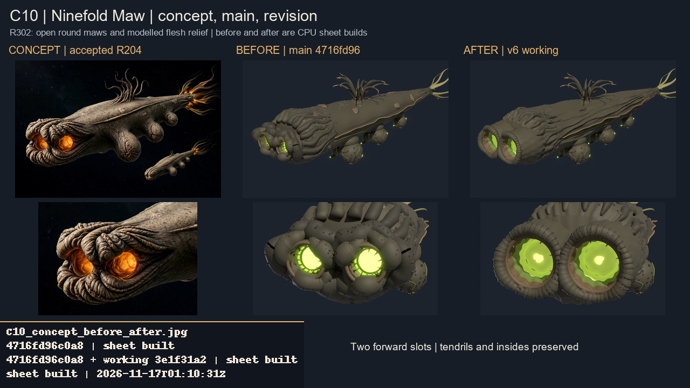

# C10: The Ninefold Maw, build sheet v6

Issue 921, R302. Current stage: **sheet built, unpainted**, rebuilt on Ryan's PC with Blender 4.5.14, Cycles CPU. Baseline: main `4716fd96`. After: the working v6 design. Every review picture names its revision and stage and is 720 px tall.

[Concept, main and revision](C10_concept_before_after.jpg) | [open maws](C10_maws.jpg) | [flesh relief](C10_flesh.jpg) | [camera 170](C10_camera170.jpg) | [current proof](issue921_proof.json)

## What changed

- Both maws have open round lips, continuous recessed funnels, wall-mounted spines and a deep bile gland. The closing coils are gone. Each mouth has a 2.6-unit throat envelope and a clear central circle about 2 units across. The mouth centres moved outward by 0.09 units each. Its firing lane begins past the actual foremost lip; its muzzle remains on the gland.
- The separate hide-pad layer is replaced by continuous modelled wrinkles. The head folds gather and taper into the skin. Eight regrowth scars are sunk into the skin and have puckered lips and surrounding folds, replacing flat patches with straight knit bars.
- The original section curve, tendril crown, brood sacs, three spore glands, siphons, vents, membranes and authored insides are preserved. World-space geometry fingerprints match main for the tendrils, every other organ, and all 35 inside objects. The new skin clears the existing siphon collars.
- Only `tools/blender/build_sheets/ships/chorus_C10.py` changes the design. The shared Chorus kit and other ship designs are untouched. M1 and M2 are hand-built C10 forms assembled from the existing kit throat organs; the manifest and feature table name that route.

The game entry remains `data.js b_boss`, Bio-titan, length 28.0: two forward bioplasma slots, tendril T, spores T, hangar 3, regeneration 20, no shields. The original break paths and inside machinery stay in place.

## What belongs to this sheet

**Named voids:** `M1` and `M2`, the two great maw openings. Preserve the round central opening, the outward rolled lip, the recessed sphincter and spines, and the continuous funnel down to the gland. No front cap, plate, fold or later material treatment may fill either void. The exposing view is [C10_maws.jpg](C10_maws.jpg); the [concept camera](C10_after_concept.jpg) shows their relation to the head.

**Modelled flesh relief:** the continuous lengthwise hide wrinkles, gathered head folds, raised flank membranes, sunk scar channels, puckered regrowth lips, pore fields and existing veins. The hull keeps real 0.3-unit shell thickness. Large wrinkles, folds and scars are sheet geometry, and do not wait for paint.

The ray measurement samples a 2-unit diameter circle at each actual mouth with axial rays. About 99.6 percent reach more than 0.5 units behind the lip; the median first surface is 1.654 / 1.646 units back, against main's 0.593 / 0.498. These are measurements of the built openings, not a new acceptance gate.

## Inputs for the future Chorus stack

| Input | Preserve or add |
|---|---|
| Maw glow, M1 and M2 | Bile yellow-green light deep in the gland, a small hotter centre, and dimmer light down the wet funnel. Keep the outer lip dark and preserve the visible depth. Final intensity and variation belong to surfacing. |
| Flesh relief | Preserve the sheet's actual wrinkles, head folds, scar channels and puckered lips. Curvature and ambient-occlusion masks come from this geometry. Do not replace it with smooth panels or a repeating pad pattern. |
| Hide | Dark olive flesh with ochre chitin on the flank edge. Add fine pore grain, mottling, wet sheen and roughness variation at surfacing. |
| Regrowth scars | Preserve the sunk wound and gathered tissue. Add pale scar colour, fine scar grain and local roughness at surfacing. |

The Chorus stack does not exist yet. The sheet uses the existing schematic materials and is not a paint proof. The concept's grey flesh and amber light remain translated to the approved lore colours, dark olive and bile yellow-green. Fine pores and scar mottling still differ from the concept; their surface treatment belongs to the future stack. At camera 170 the large mouths and gathered flesh carry, while individual small wrinkles need the exposing close view.

## Checks and cost

| Check | Current result |
|---|---|
| Standing checks | PASS, exit 0; only the existing findings and constant-drift baselines remain |
| Sheet contract self-test | PASS, including its broken-input cases |
| Fit | PASS, zero CLASH, MOUNT, ARC, SENSOR, SWEEP, EXHAUST, EXIT and LANE findings |
| Weapon match | PASS, all four data slots, fixed maws and original turret hierarchy |
| Per-cell inventory | PASS, zero missing, unshaped or undetailed lines |
| Recipe build and audit | PASS, no floating parts, no machine crossing a seam, no gun into the ship |
| Unpainted export readback | PASS, 8 gun points, 3 engines, 6 bays, 9 breaches, core, 4 RCS and 2 boarding points |
| Build manifest | PASS, current feature table and four break pieces |
| Orthographic view agreement | PASS, length and height agree; beam differs by 0.27 percent |

Actual unpainted GLB: **346,354 triangles, 16 mesh surfaces, 12 materials**. Estimated material draws are **16 for one pass**; shadows and other render passes are additional. Authored inside geometry is 13,900 triangles across 35 objects; the total also includes the hull's inner skin. Cost is reported without a cap. No game installation or GPU frame-time measurement was part of this CPU sheet job.

The density report flags the spinal organs below the hull's triangles and sharp-edge counts per area, and the gun group just below its triangle density. The continuous hide needs dense sampling for its geometry wrinkles. These ratios are reported in [density_seams.json](density_seams.json); they are not hidden or treated as visual acceptance. The optional concept-sheet proportion analysis was omitted because SciPy is absent. The per-cell inventory and measured true-view agreement still ran.

Rebuild with `build.py chorus_C10 OUT render --quick` inside Blender, with `SHEET_DEVICE=CPU`. Run `tools/recipe/sheet_contract_selftest.py` with `tools/recipe/ships/chorus_C10.json`. The recipe continues to read the design through its existing build contract.

## Review files

[Sheet](sheet.jpg), [feature table](feature_table.md), [manifest](manifest.json), [inventory](inventory.md), [fit report](fit_report.md), [weapon match](weapon_match.json), [true views and measurements](checks.json), [density](density_seams.json).

The earlier `weapon_proof.json` is the historical issue 676 recipe and Godot firing proof for v5. It is not verification of this revision. Current v6 CPU evidence is `issue921_proof.json`.
