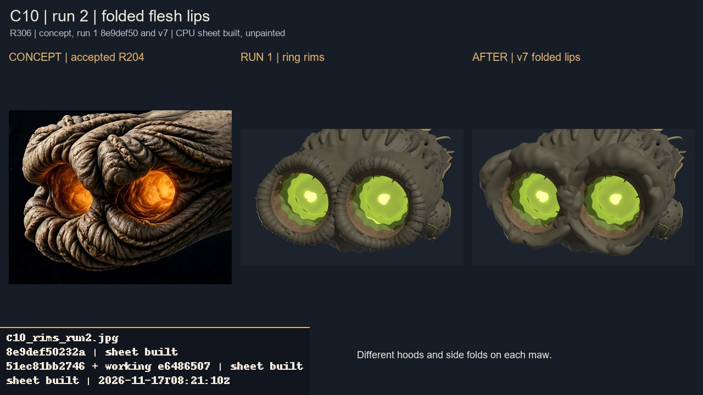

# C10: The Ninefold Maw, build sheet v7

Issue 921 run 2, R306. Stage: **sheet built, unpainted**, Blender 4.5.14, Cycles CPU on Ryan's PC. Main baseline: `51ec81bb`. Run 1 baseline: `8e9def50`. Current: working v7, identified by its source revision and diff hash on every picture. Review pictures are 1280 by 720.

[Concept, run 1 rims and new lips](C10_rims_run2.jpg) | [concept, main and after](C10_concept_before_after.jpg) | [maws](C10_maws.jpg) | [flesh](C10_flesh.jpg) | [camera 170](C10_camera170.jpg) | [current proof](issue921_proof.json)

## Run 2: only the rims

- Replaced the thin circular rolls and 43 repeated cross-rim ribs on each maw with continuous cheek-to-throat flesh and four overlapping folds of different sizes. A heavy upper hood, a second hood set behind it, a side fold and a smaller low fold curl toward the opening. Gathered valleys are modelled in the flesh. The edges taper into the cheek instead of ending at a separate ring seam.
- Each maw has its own layout, thickness, sweep and outline. The upper and side lips are heavier than the lower lip. The common Chorus kit and the other ship designs are untouched.
- The open funnels, sphincters, spines, bile glands and glow are exactly run 1 geometry and materials. All **232 non-rim exterior meshes** and all **35 authored inside objects** match run 1 by evaluated world-space geometry fingerprints. The hull skin relief, tendrils, brood sacs, spore glands, siphons, vents, membranes, weapons and inside machinery are preserved.
- The fleshy lips project further forward. Raw sheet length is 28.472 units, versus run 1's 28.107. The existing recipe normalises the whole ship to the game length of 28.0, so its exported scale changes by about 1.3 percent. The throat anatomy is unchanged; the forward firing lanes still begin past the actual foremost lip.

The game entry remains `data.js b_boss`, Bio-titan: two forward bioplasma slots, tendril T, spores T, hangar 3, regeneration 20, no shields. No game data, paint stack or game assets are changed.

## Sheet geometry and future surfacing

**Named voids M1 and M2:** preserve the large open centres, the thick unequal flesh lips and their return into the recessed funnels. No cap, later fold or material treatment may fill the openings. [The close-up](C10_maws.jpg) exposes them; [the concept camera](C10_after_concept.jpg) shows the head in the whole ship.

**Already modelled:** large wrinkles in the continuous hide, the gathered head folds, the new lip folds and furrows, raised flank membranes, sunk scar channels, puckered regrowth lips, pore fields and veins. These stay sheet geometry. The hull's real shell thickness remains 0.3 units. Run 2 changes none of run 1's hull relief.

| Input to the future Chorus stack | Preserve or add |
|---|---|
| Maw glow, M1 and M2 | Preserve the deep bile yellow-green glands and small hot centres, with dimmer light on the wet funnel and dark outer lips. Final intensity and variation belong to surfacing. |
| Flesh relief | Preserve actual lip folds, wrinkles and sunk scar channels. Derive curvature and occlusion masks from this geometry; never replace it with smooth panels or repeated pads. |
| Hide | Dark olive flesh and ochre chitin on the flank edge. Fine pore grain, mottling, wet sheen and roughness variation belong to surfacing. |
| Scars | Preserve the regrowth recess and gathered tissue. Add pale scar colour, fine grain and local roughness at surfacing. |

There is no Chorus paint stack yet. These are schematic materials, not a paint proof. The concept is greyer and its light amber; the existing lore translation stays dark olive and bile yellow-green. The current lips are smoother and less finely crumpled than the concept's skin. Broad lip folds are modelled now; fine grain and wet surface character remain for the future stack. Individual fold detail needs the close view; camera 170 shows the two mouth lights and heavier head outline.

## Checks and cost

| Check | Result |
|---|---|
| Sheet contract, including broken inputs | PASS |
| Fit | PASS, zero CLASH, MOUNT, ARC, SENSOR, SWEEP, EXHAUST, EXIT and LANE findings |
| Weapon match | PASS, all four slots, original muzzles and turret hierarchy |
| Per-cell inventory | PASS, zero missing, unshaped or undetailed lines |
| Recipe build and audit | PASS, no floating parts, no machine on a seam, no gun aimed into the ship |
| Unpainted GLB readback | PASS, 8 gun points, 3 engines, 6 bays, 9 breaches, core, 4 RCS, 2 boarding points |
| Orthographic agreement | PASS, length and height agree; beam disagreement 0.18 percent |
| Build manifest | PASS, matches the current feature table and break pieces |
| Standing checks | PASS, exit 0; existing findings and constant-drift baselines remain |

Actual unpainted GLB: **387,678 triangles**, including 13,900 authored inside triangles, **16 mesh surfaces**, **12 materials**. Estimated draws: **16 per single material pass**; shadows and other passes add draws. Run 1 was 346,354 triangles, so the rim change adds 41,324. Costs are reported without a cap; no scene-gate measurement was part of this CPU sheet job.

Axial rays through each 2-unit central circle all reach more than 0.5 units behind the lip. Median first-surface depths are 2.019 and 1.867 units, measured from each new foremost lip. The unchanged funnel and gland geometry is also covered by the fingerprint comparison. These measurements describe the built mouths; they are not new acceptance gates.

[Density](density_seams.json) reports the spinal group's sharp-edge density below the hull and the gun group slightly below its triangle density. Smooth broad flesh folds have fewer sharp edges than the wrinkled hull. The optional concept-sheet proportion analysis was omitted because SciPy is absent. Per-cell inventory and actual orthographic measurements still ran.

## Rebuild and evidence

Only `tools/blender/build_sheets/ships/chorus_C10.py` changes the design. M1 and M2 are C10 hand-built forms over existing Chorus throat organs. [The manifest](manifest.json) and [feature table](feature_table.md) name this route and the four break pieces.

Set `SHEET_DEVICE=CPU`, then run `tools/blender/build_sheets/build.py chorus_C10 OUT/renders render --quick` inside Blender. Use `tools/blender/build_sheets/layout.py`, `sheet_extras.py` and `inventory.py` for the standard sheet records. The saved [capture script](review_capture.py) rebuilds main, run 1 and the working design at matched cameras. The saved [publisher](review_publish.py) composes the pictures and reads the recipe checks and actual GLB for the budget. Its docstring gives the invocation. Scratch builds and logs stay in TEMP; final review files are also copied to the issue's shots folder.

The old `weapon_proof.json` is historical issue 676 verification of v5. Current evidence is [issue921_proof.json](issue921_proof.json). No game installation, paint bake or GPU frame-time measurement was requested or run.
