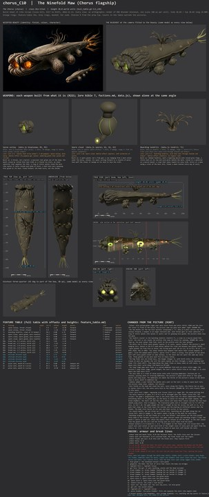

# chorus_C10 build sheet: The Ninefold Maw, the Chorus flagship (version 5: the recipe)

**Issue 676 (R241): three spore glands, one firing pore each.** Ryan, Nov 13 2026 (R241): "all ships should have weapons that match their actual weapons in game, so they line up with firing, effects, turns, etc". Spores fires 3 shots a volley; five glands of two pores each left every gland silent on some volleys. Three glands (G1 at 4.9, G2 at 0.2, G3 at -5.1) of one pore each now fire on every volley, and the B-2 seam still passes between two of them. The weapon-match check (tools/blender/build_sheets/weapon_match.py; `chorus_C10_weapon_match.json` from every build) passes on this sheet; the views on this page were re-rendered from the changed design file in the issue 676 sandbox (Blender 4.5, CPU); the outline check picture is unchanged.

The Chorus, class Bio-titan, **28.0 world units** mouth to membrane tip (godot/render/hull_table.gd CLS_LEN; data.js `b_boss`:
bioplasma F, bioplasma F, tendril T, spores T; hangar 3; regen 20; no shields). The model is 28.0. Version 5 (the recipe, issue 623), 2026-11-13,
issue 623. Designer of record: Opus (R205, R207). Accepted picture: contrib/muse/design/concept_round8b_2026_11/chorus_C10_beauty.jpg
and chorus_C10_sheet.jpg (R204). Built with the new Chorus kit, `tools/blender/kits/chorus/` (grown parts; its README says what
each part is and does). The views were rendered in the Opus sandbox (Blender 5.3, CPU, 20 samples) from the same build.py the PC
runs; nothing ran on Ryan's PC.

**Start here, the whole ship first (R229):** [whole beside whole](../../../shots/issue_623_chorus/c10_whole_compare.jpg), then
[side against side](../../../shots/issue_623_chorus/c10_side_compare.jpg), [plan against plan](../../../shots/issue_623_chorus/c10_top_compare.jpg),
the [bow](../../../shots/issue_623_chorus/c10_bow_compare.jpg) and the [stern](../../../shots/issue_623_chorus/c10_stern_compare.jpg).
The two classes from above at one scale: [c10_c11_classes.jpg](../../../shots/issue_623_chorus/c10_c11_classes.jpg).
Then [side_by_side.jpg](side_by_side.jpg), [cells.jpg](cells.jpg) and [fit_view.jpg](fit_view.jpg).

## The recipe (issue 623): unpainted, bake none, the route E11 and E12 took

The ship json is [tools/recipe/ships/chorus_C10.json](../../../../tools/recipe/ships/chorus_C10.json): game_code **B16_23**, the
`chorus|Bio-titan` folder of godot/render/hull_table.gd AI_HULLS. Proved in the Opus sandbox on the sheet hull build (stage 4) and
the unbaked export (stage 7); the PC run is tools/pc/jobs/C10_C11_RUN_623.bat (the Board queues it).

| check | result |
|---|---|
| fit check | 0 of every kind (CLASH, MOUNT, ARC, SWEEP, EXHAUST, EXIT, LANE) |
| machines on a seam, insides outside the skin | 0 of 15; 0 of 7484 vertices |
| build sheet contract self-test | PASS |
| stage 4 audit, audit self-test | PASS (sacs cross seams as structure; no machine does), PASS |
| export (default tolerance) | 163,849 triangles; gun 15, engine 3, bay 6, breach 9, core 1, rcs 4, board 2; 6 turrets |
| check_export, its self-test | PASS, PASS |
| install, cache, readback | manifest PASS, ships refreshed, INSTALL READBACK PASS (52 nodes) |
| authored_interiors_check | 0 failures (21,778 interior triangles) |
| death_seam_check | 0 machines split of 15; 0 insides outside of 16,865 (4 main pieces) |

What the recipe changed on the sheet (each is in the sheet's changes list):
1. **The belly seam B-4 is gone.** The game's longitudinal seam is one level plane over its whole compartment that takes
   everything above it (fx_death.gd); at the belly it cut through the lower septum, the brood chambers, the heart vat and the
   spore stores and left 1512 inside triangles outside their piece. A peel needs a clear band in the insides; this body has none
   at the belly, so it breaks across in four pieces and bursts at its sacs.
2. **B-1 to B-3 run on straight past the flanks**, to 7.5 off the axis, as E11's do. The game weighs a tear's height by how far
   across the path it is (fx_death.gd _break_f), so a path that stops at the flank tears the septa and the liner at different
   places from the plating there.
3. **Six launch mouths** (hp_bay), one on each brood sac's birth slit, launching out and down (data.js hangar 3).
4. **Boarding origins** on the mid flanks, and the **throats' hard points on the bile glands' faces** deep in the throats (the
   mouth's centre is open air, which check_export refuses as off the mesh); the arcs and the firing lane still start at the mouth
   (the Chorus kit's lane_from).
5. **Breach anchors 6 to 8 moved** (x -4.9, -7.0 higher on the flank, -8.9) so the export finds open hull for the last one.

## Round 4: the body (the Board on round 3)

The Board passed the face (and passed C11). The body behind the head was a round cylinder whose sides ran parallel to
mid-ship and then turned into a cone. Now:

1. **Broad and low.** Behind the head the section is a flattened oval, about 1.4 wide to 1 tall mid-body, with a soft dorsal
   dome.
2. **One smooth taper.** From above, the outline swells a little just behind the head (6.1 across) and then tapers in one
   smooth curve to the tail. There is no parallel run and no corner where a cone starts.
3. **The membrane fold runs along the widest line of each flank**, standing straight out like a ray's edge, up to about 0.6.
4. The length, the crown, the sacs and the face are unchanged. The veins move below the fold, and the aft siphons move above
   it.

## Round 3: the face (the Board on round 2)

1. **Face first.** The head swells tallest and fullest just behind the lips (5.4 deep, 6.0 across), then the back line falls
   away. The two throats are big (1.7 across, about a third of the head's height), glowing deep inside.
2. **The lips are folded flesh**: two thick rolls whose reach, set-back and thickness wander round each mouth, merging into the
   head's fold rolls. They are no longer even tubes.
3. **The long ridge down each flank is a raised membrane fold** with height (up to about half a unit), wandering, with an
   ochre chitin edge. It replaces the beaded chitin row.

## Round 2: the massing (the Board on PR 628, Nov 12)

The Board passed the parts, jobs and checks and failed the massing: "both ships read as machines, not creatures". What changed:

1. **One lofted, varying body.** Fullest just behind the mouth's fold lips (5.5 across), tapering steadily and convexly to a thin
   tail; a soft back and a round belly (section exponents 2.3 and 2.0, were 3.0 and 2.3, so no flat top and no parallel sides);
   and a smooth swell over the whole skin (the hull's unevenness, up to 0.12, the same one the grown detail is laid on), so
   there are no flat faces and no straight lines.
2. **The brood sacs hang.** Each grows out of the lower flank on a soft neck and hangs below the belly as a heavy pendulous lobe
   (its axis leans from the flank's normal toward straight down); from above only the curve of each shows past the outline.
3. **The mouth's lips are thick, rolled and layered**: three fat rolls, each further back than the last, so each mouth is a
   domed lobe of coiled flesh.
4. **The glow is down in the throat** (R228 item 5 in spirit): the bile gland sits deep in the bore and its light falls on the
   wet throat wall, bright at the back and fading to dark tissue at the lip, never a disc at the mouth.
5. The shoulder's chitin seam wanders along the body instead of running ruled; the hide's pads are shifted, sized and turned at
   random so they never fall in rows; the vent crown is smaller to suit the thinner tail.

## What it is

Something vast and eyeless that was grown as a weapon. The double mouth at the bow is its two bile spitters; the tendril crown
on its back boards and holds; three spore glands hang under the belly as its point defence; three brood sacs a side carry the
spore swarms (hangar 3) and give birth to them through slits; a crown of three pulse vents with trailing membranes drives it.
No panels, no pipes, no metal: hide with callus pads and sense pores, fold rolls, a raised membrane fold down each flank with an ochre chitin edge,
veins carrying bile, scars knitting shut.

## The checks

| Check | Result |
|---|---|
| Views agree (side, top, bow): length, beam, height | 0.0, 0.31 and 0.0 percent apart; length 28.02 on the views (model 28.0) (checks.json, PASS) |
| Fit check (R217, R219, R221): clash, mount, arc, sweep, exhaust, exit, lane | **0** in all seven ([fit_report.md](fit_report.md), [fit_view.jpg](fit_view.jpg)) |
| Machines on a seam (R226) | **0** of 13 machines (2 throats, the crown, 3 spore glands, 3 vents, 4 siphons) across 4 seams (issue 676: two glands cut) |
| Insides inside the skin | 0 of 7,484 inside vertices within 0.15 of the skin |
| Inventory (R218, R221) | 15 lines, every one with a job; 0 not present, shaped and detailed ([inventory.md](inventory.md)) |
| Outline overlap at the concept's camera (reported, not a bar) | 76.4 percent ([outline_check.jpg](outline_check.jpg)) |
| Proportions, hull length to beam / to height (concept sheet against build, same measure) | 5.74 / 6.21 against 4.60 / 5.98 (broader: the body is now wider than tall, 1.4 to 1 mid-body, as the Board asked) |

### Detail density per part type (R224, measured on the blockout; numbers in [density_seams.json](density_seams.json))

Triangles and edge features (faces meeting at over 30 degrees, or an open rim) per square unit, against the hull's own. Under
0.75 on either is flagged. **None flagged.**

| Part type | Triangles per unit2 (vs hull) | Edge features per unit2 (vs hull) |
|---|---|---|
| hull (the body, hide pads, head folds, flank folds, veins, pores, scars) | 99.9 (1.00) | 59.5 (1.00) |
| spinal (the two throats) | 154.2 (1.54) | 111.2 (1.87) |
| gun (the crown and the spore glands) | 209.4 (2.09) | 113.0 (1.90) (measured with five glands, before issue 676 cut two) |
| brood (the brood sacs) | 291.3 (2.91) | 168.6 (2.83) |
| engine (the pulse vents and membranes) | 374.3 (3.74) | 190.6 (3.20) |
| thruster (the siphons) | 555.2 (5.56) | 252.1 (4.23) |

## Weapons, each from the lore (R221)

| Slot | Weapon | Built as |
|---|---|---|
| F, F | Spine volley (bioplasma) | the two throats of the double mouth: three fat rolled fold lips stacked round each mouth, an inner sphincter, a ring of chitin spines (the spines it spits), the bile gland deep in the bore lighting the wet throat wall. Fixed forward. |
| T | Boarding tendrils (tendril) | a crown of thirteen hooked tendrils on a muscle mound, each with grip rings, a chitin barb and acid pores; it turns to lean toward its prey (R219 turret marking) |
| T | Spore cloud (spores) | three spore glands hanging on necks under the belly (issue 676, R241: one firing pore each), veined sacs whose spouts curl forward to a rosette of pores; each swings on its neck |

The weapon pictures are on the sheet (weapon_bioplasma.jpg, weapon_tendril.jpg, weapon_spores.jpg).

## INSIDE (R209): flesh, bone and organs, never rooms that reach the skin

Bone hoops for frames (12 stations), two membrane septa for decks, and organs: the two bile glands behind the throats (the
shot's magazine), the Node (the knot of nerve that steers it; no bridge), the fore and aft guts, the heart vat (the core,
hp_core, lit bile-green), six brood chambers beside the brood sacs, three spore stores over the glands, the crown's root muscle,
four regrowth tissue chambers and the pulse bladder that squeezes the vents (the engine room). Armour by zone in the sheet's
INSIDE list. Break lines by the Chorus rule ("it bursts and tears: sacs rupture first, then the body tears open"): B-1 behind
the head, B-2 behind the crown, B-3 ahead of the tail; ragged plan paths across the body that run on straight past the flanks,
no machine on any of them. (Version 4's belly seam B-4 is gone: see "The recipe" above.) Nine breach anchors (Bio-titan 8, Chorus +1 on the big ones), next to the sacs and the trim.

## Changed from the picture (R207)

1. **Colour**: bile yellow-green light over dark olive flesh and ochre chitin (R204, the lore). The picture is grey with amber light.
2. **The double mouth is the two bile spitters** (bioplasma F, F), each with a sphincter, a spine ring and its gland; the picture shows only the glow.
3. **The tendril cluster is the boarding tendrils** (tendril T), a turning crown on a muscle mound; built as the profile draws it (curling), the tips splayed outward as the plan shows.
4. **The belly row is three spore glands** (spores T), spaced so the B-2 seam passes behind the crown and between two glands (R226). Issue 676 (R241) cut the row from five glands of two pores to three of one pore, so every gland fires on every 3-shot volley.
5. **The flank sacs are brood sacs** (hangar 3): the picture's crease on each becomes the birth slit, kept clear by the fit check.
6. **The long flank ridge is a raised membrane fold** with an ochre chitin edge (the lore's ochre trim; the line the hide tears first).
7. **The tail ends in a crown of three pulse vents** with trailing membrane veils (factions.md: no nozzles). The membranes are about two thirds of the picture's wisps so the ship is 28.0 mouth to membrane tip.
8. **Siphons added** (two pairs): a ship in space must turn, with siphons, not nozzles.
9. **Pore fields, veins and knit scars added**: the Chorus has no eyes and tastes the dark (lore 5.8); the veins carry bile to the throats (README 8b noted C9's vein tracery faded); scars knit shut (regen 20).

## What still differs from the concept, and why

- **The hide's surface** (fine wrinkle grain, mottling, wet sheen, scar colour) is paint: recipe stages 4 and 5. The blockout is schematic colour.
- **The head reads a little smaller** than the beauty's coiled mouth lobes: the beauty's strong perspective swells the bow; the lobes are modelled at the sheet's true size, and the body is now fullest just behind them.
- **The brood sacs hang a little further out** than the picture's, so their birth slits face down and out clear of the belly glands as they swing.
- **No underside view** on the concept sheet: the belly between the sacs is designed here.

The blockout .blend is not on Ryan's PC (nothing ran there); build.py rebuilds it from `tools/blender/build_sheets/ships/chorus_C10.py`.
