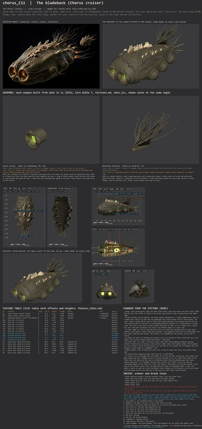

# chorus_C11 build sheet: the bladeback, the Chorus cruiser (version 4: the recipe)

**Issue 676 recipe proof:** [record](weapon_proof.json). Stage 4 contract, audit and audit self-test PASS; stage 5 unpainted geometry carried unchanged; stage 6 four LOD meshes exported and read back in Godot; stage 7 export, readback and planted-fault self-test PASS. Real Godot firing/turning, authored interiors and destruction PASS: 13 machines, zero split, zero inside triangles beyond their piece. Budget: 208646 triangles, 11 surfaces, 20850 inside triangles. Costs reported; the scene gate was not measured.

**Issue 676, PC verification (Nov 14, CPU).** The latest sheet and named [weapon picture](weapon_review.jpg) were rebuilt on this PC with Blender 4.5.14, Cycles CPU, 12 samples. [Weapon match](weapon_match.json): PASS, zero problems; the [feature table](feature_table.md) lists every data slot, its shots and its visible mounts. The existing weapon layout already passes R241, so its geometry is unchanged. The outline comparison remains the earlier reported reference. This is an unpainted weapon proof; the Board queues the paint bake.

The Chorus, class Cruiser, **14.5 world units** throat rim to filament tip (godot/render/hull_table.gd CLS_LEN; data.js `b_razor`,
"Chorus bladeback": tendril T, bioplasma F; ability frenzy; regen 6; no shields). Version 4 (the recipe, issue 623), 2026-11-13. Designer of
record: Opus (R205, R207). Accepted picture: contrib/muse/design/concept_round8b_2026_11/chorus_C11_beauty.jpg and
chorus_C11_sheet.jpg (R204). Built with the Chorus kit, `tools/blender/kits/chorus/`. Rendered in the Opus sandbox (Blender 5.3,
CPU, 20 samples) from the same build.py the PC runs; nothing ran on Ryan's PC.

**Start here, the whole ship first (R229):** [whole beside whole](../../../shots/issue_623_chorus/c11_whole_compare.jpg), then
[side against side](../../../shots/issue_623_chorus/c11_side_compare.jpg), [plan against plan](../../../shots/issue_623_chorus/c11_top_compare.jpg),
the [bow](../../../shots/issue_623_chorus/c11_bow_compare.jpg) and the [stern](../../../shots/issue_623_chorus/c11_stern_compare.jpg).
The two classes from above at one scale: [c10_c11_classes.jpg](../../../shots/issue_623_chorus/c10_c11_classes.jpg).
Then [side_by_side.jpg](side_by_side.jpg), [cells.jpg](cells.jpg) and [fit_view.jpg](fit_view.jpg).

## The recipe (issue 623): unpainted, bake none, the route E11 and E12 took

The ship json is [tools/recipe/ships/chorus_C11.json](../../../../tools/recipe/ships/chorus_C11.json): game_code **B21_11**, the
`chorus|Cruiser` folder of godot/render/hull_table.gd AI_HULLS. Proved in the Opus sandbox on the sheet hull build (stage 4) and
the unbaked export (stage 7); the PC run is tools/pc/jobs/C10_C11_RUN_623.bat (the Board queues it).

| check | result |
|---|---|
| fit check | 0 of every kind (CLASH, MOUNT, ARC, SWEEP, EXHAUST, EXIT, LANE) |
| machines on a seam, insides outside the skin | 0 of 13; 0 of 5764 vertices |
| build sheet contract self-test | PASS |
| stage 4 audit, audit self-test | PASS, PASS |
| export (default tolerance) | 208,646 triangles; gun 5, engine 6, breach 4, core 1, rcs 4, board 2 (no hangar; the mane is fixed, so no turret) |
| check_export, its self-test | PASS, PASS |
| install, cache, readback | manifest PASS, ships refreshed, INSTALL READBACK PASS (22 nodes) |
| authored_interiors_check | 0 failures (20,850 interior triangles) |
| death_seam_check | 0 machines split of 13; 0 insides outside of 16,363 (3 main pieces) |

What the recipe changed on the sheet (each is in the sheet's changes list):
1. **B-1 and B-2 run on straight past the flanks**, to 6.0 off the axis, as E11's do. The game weighs a tear's height by how far
   across the path it is (fx_death.gd _break_f), so a path that stopped at the flank tore the septa and the liner at different
   places from the plating there (171 inside triangles outside their piece before the change).
2. **Boarding origins** on the flanks at x 0.8, and the **throats' hard points on the bile glands' faces** deep in the throats
   (the mouth's centre is open air, which check_export refuses as off the mesh); the arcs and the firing lane still start at the
   mouth (the Chorus kit's lane_from).

## Round 3: the face (the Board on round 2)

1. **The mouths are fleshy rimmed holes flush in the face.** The face is a dome of flesh over the body's front, and the throats
   open in it. Each has one thick, lumpy lip with pores and a few uneven creases, and a dark wet throat with the bile glow deep
   inside. There is no cylinder, no ribs and no disc.
2. **The bile sacs are domes half sunk into the lower flank**, bulging out of the hide. They no longer hang like wheels.
3. **The bone plates are big, jagged and broken**, leaning, uneven and overlapping along the spine. The tallest is about a fifth
   of the body's height.
4. **From above it is a seed.** The sides curve from the front third to the stern and the face domes the front. The front
   corners have no boxes.

## Round 2: the massing (the Board on PR 628, Nov 12)

The Board passed the parts, jobs and checks and failed the massing: "both ships read as machines, not creatures". What changed:

1. **A bulbous seed.** Widest (5.8) and tallest (4.9) in the front third, rounding over the top and narrowing aft, round in
   every section (exponents 2.0 and 1.9) with a smooth swell over the whole skin: no flat faces. The separate brow and chin
   masses are gone; the head is the body's own swell.
2. **Knuckled bone crests of uneven size**, lying across the back at a slant like broken plates of bone, with gaps between them,
   growing out of the wound (a new kit part, `bone_crest`: a thick bony ridge rising and falling in knuckles, knuckle knobs,
   growth ridges, a collar of raw tissue); smaller crests along each shoulder. No sawtooth row.
3. **Deep throats.** The bile gland sits down in the throat; its light falls on the wet wall, bright at the back, fading to dark
   tissue at the lip.
4. **The bile sacs hang** below the flank on soft necks, as on C10.
5. Beam kept broad (the Board's pick A on the beam question).

## What it is

A short, fat hunter that closes fast and chews (Razormaw, blood frenzy). Two open throats side by side at the blunt bow are one
bile battery; knuckled crests of bone ram plates grow out of an open wound down its back, with smaller crests along each
shoulder; behind them a mane of boarding tendrils streams up and aft; three bile sacs a side feed the throats through veins; a
ring of six pulse vents with glowing filaments drives it.

## Two classes (the brief's question)

C10 is long and tapering (hull length to beam 4.6, to height 6.0): a folded double mouth, a tendril crown, hanging brood sacs,
flank folds and a vent crown with membranes. C11 is a short, broad seed (2.7 and 2.7): two throats flush in a domed face, knuckled bone
crests, a streaming mane, domed sacs and a filament ring. From above at one scale they share nothing but the hide and the
family grammar ([c10_c11_classes.jpg](../../../shots/issue_623_chorus/c10_c11_classes.jpg)).

## The checks

| Check | Result |
|---|---|
| Views agree (side, top, bow): length, beam, height | 0.0, 0.09 and 0.09 percent apart; length 14.54 on the views (model 14.52) (checks.json, PASS) |
| Fit check (R217, R219, R221): clash, mount, arc, sweep, exhaust, exit, lane | **0** in all seven ([fit_report.md](fit_report.md), [fit_view.jpg](fit_view.jpg)) |
| Machines on a seam (R226) | **0** of 13 machines (2 throats, the mane, 6 vents, 4 siphons) across 2 seams |
| Insides inside the skin | 0 of 5,764 inside vertices within 0.15 of the skin |
| Inventory (R218, R221) | 14 lines, every one with a job; 0 not present, shaped and detailed ([inventory.md](inventory.md)) |
| Outline overlap at the concept's camera (reported, not a bar) | 82.8 percent ([outline_check.jpg](outline_check.jpg)) |
| Proportions, hull length to beam / to height (concept sheet against build, same measure) | 2.78 / 3.44 against 2.44 / 2.81 (broad, as the Board picked) |

### Detail density per part type (R224, measured on the blockout; numbers in [density_seams.json](density_seams.json))

**None flagged** (no part type under 0.75 of the hull on either measure).

| Part type | Triangles per unit2 (vs hull) | Edge features per unit2 (vs hull) |
|---|---|---|
| hull (body, hide pads, pore fields, crests, wound, folds, veins, scars) | 260.5 (1.00) | 164.5 (1.00) |
| spinal (the two throats) | 266.0 (1.02) | 196.3 (1.19) |
| sac (the bile sacs) | 237.5 (0.91) | 133.7 (0.81) |
| gun (the mane) | 450.4 (1.73) | 346.0 (2.10) |
| engine (the six vents and filaments) | 794.6 (3.05) | 457.7 (2.78) |
| thruster (the siphons) | 833.5 (3.20) | 377.0 (2.29) |

## Weapons, each from the lore (R221)

| Slot | Weapon | Built as |
|---|---|---|
| F | Spine volley (bioplasma) | the two throats, one battery, flush in a domed face: a thick lumpy lip with pores and a few uneven creases, a sphincter, a ring of chitin spines deep in the bore, and the bile gland down in the throat lighting its wet wall. Fixed forward. |
| T | Boarding tendrils (tendril) | a mane of thirty hooked tendrils on a muscle crest behind the bone crests, each with grip rings, a chitin barb and acid pores, streaming up and aft. Fixed: a mane reaches every way at once (not marked as a turret). |

## INSIDE (R209): flesh, bone and organs, never rooms that reach the skin

Bone hoops for frames (10 stations), two membrane septa, and organs: the two bile glands behind the throats, the Node, the ram
muscle under the bone crests, six bile stores behind the sacs, the heart vat (the core, hp_core), the fore and aft guts, two
regrowth chambers, the mane's root muscle and the pulse bladder that feeds the six vents. Break lines by the Chorus rule: B-1
behind the head (the throats tear away with the head), B-2 ahead of the mane (the stern half tears through the heart vat's aft
end, the sacs bursting first); ragged plan paths, no machine on either. Four breach anchors (Cruiser base 4; the Chorus extra
is for the big ones).

## Changed from the picture (R207)

1. **Colour**: bile yellow-green light over dark olive flesh, pale ochre bone (R204, the lore). The picture is green-brown with amber light.
2. **The two throats are one battery**, the Spine volley (bioplasma F): b_razor has one bioplasma slot, both throats fire it. R184's single throat stays a later fleet-sheet question; the accepted picture has two.
3. **The plume on the back is the boarding tendrils** (tendril T), a fixed mane on a muscle crest; its roots stop well forward of the stern so no tendril hangs in a vent's jet.
4. **The bone ridge is a run of knuckled bone crests** of uneven size, slanting across the back like broken plates, growing out of an open wound channel, with smaller crests along each shoulder (the plan's separate pale plates).
5. **The domes are bile sacs** feeding the throats; veins run forward to the throats (every part has a job, R221).
6. **The stern is a ring of six pulse vents**, each with three glowing filaments splayed outward (the picture's amber nodes and filament plume; no nozzles). The filaments are about a third of the picture's so the ship is 14.5.
7. **Siphons added**, a pair forward and a pair aft.
8. **The small spines along the lower stern are cut**: no job (R221).
9. **The head is the body's own swell**: the hull's front stops behind the glands so the throats glow from inside, as the picture.

## What still differs from the concept, and why

- **The bone crests** are simpler than the picture's broken, branching bone; the fine breaks, holes and pitting are paint and a
  later pass on the crest shape.
- **The hide's surface** (fine wrinkles, wet sheen, mottling) is paint: recipe stages 4 and 5.
- **No underside view** on the concept sheet: the belly is designed here.

The blockout .blend is not on Ryan's PC (nothing ran there); build.py rebuilds it from `tools/blender/build_sheets/ships/chorus_C11.py`.
