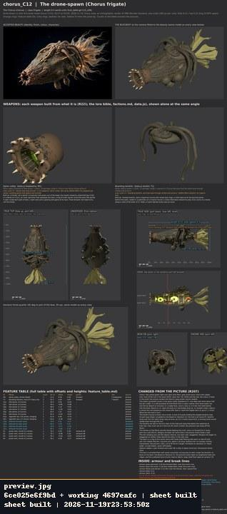

# chorus_C12 build sheet: the drone-spawn, the Chorus frigate (version 1, blockout v3 plus the Board's two bow fixes)

Issue 1153 (R328, R330). The Chorus, class Frigate, **6.5 world units** spine hooks to veil tips (godot/render/hull_table.gd
CLS_LEN; data.js `b_drone`, "Chorus drone-spawn": bioplasma F, tendril T; ability regrow; regen 3; speed 5, evasion 15; no
shields). The game folder is **B19_11** (`chorus|Frigate` in hull_table.gd AI_HULLS), replacing the old A4 ship there.
Designer of record: Opus (R205, R207). Accepted picture: contrib/muse/design/class_family_chorus_2026_11/
chorus_C12_drone_spawn_v10.jpg and chorus_C12_drone_spawn_sheet_v2.jpg (issue 631, Ryan accepted Nov 13); designs.md governs
where a picture differs. Built with the Chorus kit, `tools/blender/kits/chorus/`; design file
`tools/blender/build_sheets/ships/chorus_C12.py`, inventory `chorus_C12_inv.py`, fitted concept camera `chorus_C12_camera.json`,
recipe json `tools/recipe/ships/chorus_C12.json`. Rendered in the Opus cloud sandbox (bpy 5.3, Cycles CPU, 24 samples) from the
same build.py the PC runs. Stage: **sheet built, unpainted**.

**Start here, the whole ship first (R229):** [side_by_side.jpg](side_by_side.jpg) (concept and blockout at the fitted concept
camera, then bow, midships and stern), then [sheet.jpg](sheet.jpg), [cells.jpg](cells.jpg) and [fit_view.jpg](fit_view.jpg).

## The checks

| Check | Result |
|---|---|
| Views agree (side, top, bow): length, beam, height | 0.0, 0.17 and 0.09 percent apart; length 6.51 on the views (model 6.50) ([checks.json](checks.json), PASS) |
| Fit check (R217, R219, R221): clash, mount, arc, sensor, sweep, exhaust, exit, lane | **0** in all eight ([fit_report.md](fit_report.md), [fit_view.jpg](fit_view.jpg)) |
| Weapon match (R241) | PASS, 0 problems ([weapon_match.json](weapon_match.json), [weapon_review.jpg](weapon_review.jpg)) |
| Inventory (R218, R221) | 15 lines, every one with a job; 0 cells not present, shaped and detailed ([inventory.md](inventory.md)) |
| Outline overlap at the concept's camera (reported, not a bar) | 75.5 percent, mass outline 76.9 percent (v3 was 76.8 / 78.5; the wider mouth trims the prow's match) ([outline_check.jpg](outline_check.jpg)) |
| Proportions, envelope length to beam / to height (concept sheet against build, same measure) | 1.90 / 2.22 against 2.09 / 2.16 |

## What it is

A compact knot of grown flesh, short and quick: the fastest hull in the faction. The head ends in a round puckered mouth with a
big deep dark bore ringed by short bone hooks: the spine volley (bioplasma F), the only thing at the prow. On the back at about
two thirds aft sits a low mound of knotted muscle holding five heavy tendrils with blunt rounded tips and no claws: the boarding
tendrils (tendril T), arching out of the knot and draping back over the hull and down its flanks, the tips hanging free. Long
fleshy folds run bow to stern over the back under the tendrils. Three bile domes a side feed the mouth through veins; two
reserve sacs hang below (regrow, regen 3). The stern ends in a ring of four pulse vents, each trailing three wide veils that fan,
cup and curl. From above: the only Chorus hull that reads as a knot with a crown (R233).

## Weapons, each from the lore (R221)

| Slot | Weapon | Built as |
|---|---|---|
| F | Spine volley (bioplasma, 2 shots) | the head's puckered mouth (kit spinal style `knoll`): the head runs into a waist, then a soft lip that flares and puckers, with creases and pores and twelve short bone hooks set into it; the dark bore is about half the lip's width (Board on v3), a sphincter, a deep dark bore with the bile gland far down it. Fixed forward. One vent fires both shots in turn. |
| T | Boarding tendrils (tendril, 2 shots) | a knot of muscle with five draped blunt tendrils (kit gun `drape`, part type `drape`). Fixed: tendrils lying over the hull reach every way at once, as C11's mane (issue 623); a turning crown would sweep them through the hull. The Board accepted the drape type and the fixed knot on blockout v2. |

## INSIDE (R209): flesh, bone and organs, never rooms that reach the skin

Seven bone hoops for frames, two membrane septa, and organs: the bile gland behind the mouth, the Node (ganglion), six bile
stores behind the domes, the heart vat (the core, hp_core), the gut, two regrowth chambers over the reserve sacs, the knot's
root muscle and the pulse bladder that feeds the four vents. One break line (Frigate: 1, factions.md): B-1 ahead of the knot,
ragged, running on past both flanks; the prow and the mouth tear away, opening the gland, the Node and the gut, the fore domes
bursting first; no machine on it. Two breach anchors (Frigate base 2; the Chorus extra is for the big ones).

## Kit additions (issue 1153; R333: every Chorus ship reuses them)

- `spinal(style='knoll', crown=N)`: a head-end puckered mouth, deep dark bore, short bone hooks set into a soft flared lip;
  a small gland far down so the bore reads dark bow-on. Its collar stays inside the mouth so no ribs read as a can.
- `gun(weapon='tendril', drape=[...])`: part type `drape`, a knot mound with heavy blunt tendrils laid along paths the sheet
  computes on its own hull (`weapon_match.py` tendril row accepts `drape`).
- `engine_bell(trail='veil', veil=, fan=, splay=)`: wide thin cupped sheets that twist and ripple. `veil`, `fan` and `splay`
  also work on the old `membrane` trail; their defaults leave C10 and C11 unchanged (both still fit 0 and weapon match PASS).
- `inventory.py` and `sheet_extras.py` take a `rot` on a concept view, for a plan drawn bow down (this sheet).

## Changed from the picture (R207)

See the sheet's list ([feature_table.md](feature_table.md)): colour set in build (R204, R325 hard chitin plates in the paint);
the mouth as one deep bore with short hooks; the fixed draped knot; tendrils laid clear of the hide, tips hanging free; the
domes as bile stores; the staggered reserve sacs; four vents with three veils each, cut to fit 6.5; siphons added; folds, not
bone, on the back (the Board on v2).

## What still differs from the concept, and why

- **The veils** are broad sheets; the picture's fine fringes and strands are paint (translucent, lit from within) and a later
  pass.
- **The hide's surface** (wrinkle grain, wet sheen, mottling, the pink of the mouth) is paint: recipe stage 5.
- **The tendrils** are smoother cables than the picture's fibrous ones; fibre is paint.
