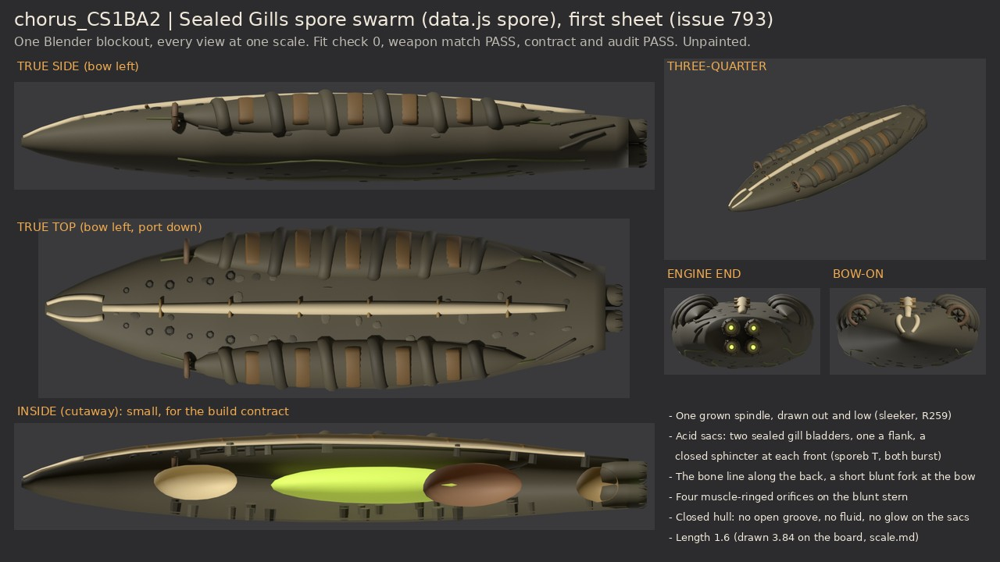
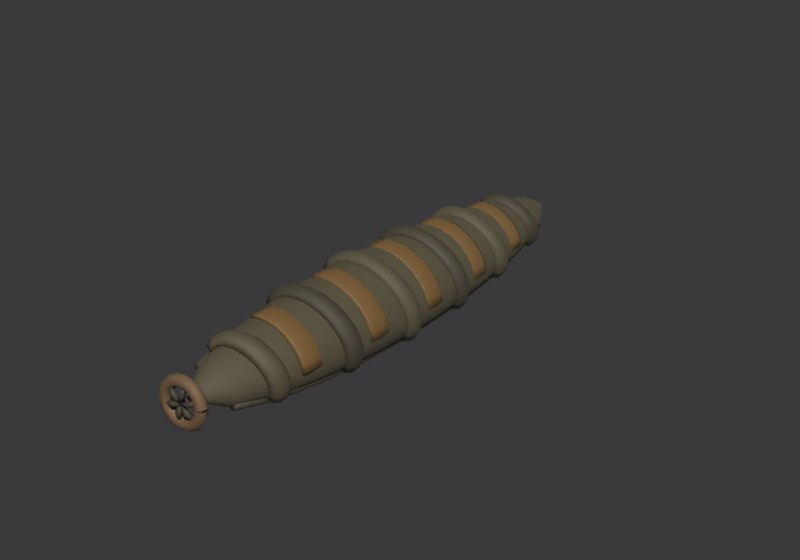

# chorus_CS1BA2 build sheet: the Sealed Gills, the Chorus spore swarm craft (first sheet)

Issue 793. Chorus spore swarm, data.js `spore` (cls Squadron, `sporeb` T: Acid sacs, 2 shots; hp 26, sp 5; a bomber-role wing,
sq 'bomber'; the Chorus launch spore swarms, data.js FACTIONS chorus sq 'spore'). Concept of record: CS1B-A2, the Sealed Gills,
sleek (contrib/muse/design/squadron_concepts_2026_11/chorus/round_4/CS1BA2.jpg; R259, Ryan, Nov 15: "the closed-hull Chorus
direction is much better", a bit sleeker; nothing open, no exposed fluid). Where the render drifts from the written sheet
(design_notes_785_round4.md), the written sheet governs. Designer of record: the Opus builder; the Board is the final designer and
CS1B-A2 is a base (R233, R236). Rendered in the issue 793 sandbox (Blender 5.3, Cycles CPU). No paint stack (the Chorus has none
yet) and no PC recipe run in this job.

Start here: [the overview](chorus_CS1BA2_sheet_overview.jpg), [the whole concept beside the build](chorus_CS1BA2_compare.jpg)
(R229), [the three issue 793 craft beside their flagships at true game scale](../hegemony_HF1D/issue793_craft_true_scale.jpg),
[the three at the battle camera, game size](../hegemony_HF1D/issue793_craft_battle_cam.jpg), [the weapon review](weapon_review.jpg)
(R241), then the full [sheet](sheet.jpg), [side_by_side.jpg](side_by_side.jpg), [fit_view.jpg](fit_view.jpg) and
[cells.jpg](cells.jpg) (the concept is one three-quarter picture with no true views, so cells.jpg shows it in place of the top
and side views).

Files: design `tools/blender/build_sheets/ships/chorus_CS1BA2.py`, inventory `chorus_CS1BA2_inv.py`, beauty camera
`chorus_CS1BA2_camera.json`, recipe entry `tools/recipe/ships/chorus_CS1BA2.json` (bake none), the Chorus kit's craft parts in
`tools/blender/kits/chorus/` (its README, "Squadron craft"), the sandbox helpers in `contrib/opus/tools/issue793/`.

## Size (scale.md wins)

LENGTH 1.6, the hull table's CLS_LEN['Squadron']; the board draws a craft at 1.6 x SHIP_K 1.6 x SQUADRON_K 1.5 = 3.84
(docs/playbooks/scale.md, Squadron rows, binding). Every station in the design file is a share of LENGTH. Measured off the views:
1.60 long, 0.46 across the bladders, 0.24 tall; the body alone 0.44 by 0.22 (length to beam 3.6: drawn out and low, R259).

## The design, in short

1. **The grown spindle**: one sleek body, drawn out along its flight axis and kept low, a smooth blunt bow, the stern tapering to a
   blunt end behind a full-size orifice cluster (the round 4 proportion guards). Callused hide pads, veins and short creases where
   the stern draws in: grown, never panels, never metal.
2. **The bone line**: one long low bone ridge along the back with chitin growth knuckles, parting at the bow into a short, low,
   blunt fork that runs down to the tip (never forward prongs).
3. **The sense pores** in two rows along the bow ridge: the concept's spots, made pores (the Chorus has no eyes).
4. **Two sealed gill bladders** (sporeb T), one either side of the bone line on the upper flank: each a long swell of the flank,
   six raised gill bands across it, a muted matte amber blush in the valleys (colour only, never a glow, never an open groove), a
   closed puckered sphincter at its front that squeezes the burst out. Fixed: the swarm turns onto its prey. Both burst every
   volley.
5. **The orifice cluster**: four muscle-ringed orifices on the blunt stern, facing aft (the drive: no nozzle), bile glow deep inside.
6. **INSIDE** (small, for the build contract only): grown organs, never boxes: two acid glands behind the sacs, the swarm-mind's
   ganglion behind the pores, the gut, the pulse muscle; one seam (B-1) behind the bladders. The game shows a craft's death as a
   spark (godot/fx/fx_death.gd `_wing_death`), so nothing breaks open.

## Weapons (R221, R241)

| Weapon | Mounts | data.js and lore | Built as |
|---|---|---|---|
|  Acid sacs (sporeb) | S1, S2 | 2 shots, 10 damage, range 1 (k sq), pierce 0.6; Chorus trait acid; battle look `acid` | a sealed gill bladder on each upper flank: the swell, its root roll, six gill bands, the amber valleys, a closed puckered sphincter at its front |

Weapon match (`weapon_match.json`): **PASS**, 0 problems. Slot 0 sporeb T, 2 shots: S1 and S2, one muzzle each (the sphincter's
centre), the same type, mount and size; both burst every volley. New row in the weapon-match table (`weapon_match.py` FITS
`sporeb`: an acid sac on a launcher, fixed), the Board's reading of ships.md rule 11 for a bomber-role craft, landed in ships.md
rule 11 in this pull request; its self-test adds a clean spore swarm and three planted faults (an acid sac shown as a turning spore
gland, a bomb tube standing in for a sac, two sacs far apart in size), each refused by name.

## Checks (sandbox, Nov 15 2026)

| Check | Result |
|---|---|
| Fit check (clash.py) | 0 of every kind; 44 objects, 6 parts, 62 rays, 4 exhaust cones, 2 apertures, 4 lanes ([fit_report.md](fit_report.md)); the first layouts' sac mouths sat in the skin (fixed) |
| Weapon match and `weapon_match_selftest.py` | PASS; self-test PASS (36 planted faults, 7 of them craft faults, 3 of them this craft's) |
| Build contract (`sheet_contract_selftest.py`) | PASS: length 1.6, 1 transverse seam, 2 muzzles in slot 0, 4 engines, 5 inside objects, the skin; its three broken inputs refused |
| Stage 4 audit (`audit.py` on the sheet_hull build) and `audit_selftest.py` | PASS: 34 parts, none across the seam (the first seam, at -0.50, ran through both sacs and was moved aft to -0.60); self-test PASS (E1 moved onto the seam is refused) |
| Inventory (R218, R221) | 0 failing; every built part has a job ([inventory.md](inventory.md)) |
| Outline overlap at the camera fitted to CS1B-A2 | 83.4 percent, mass outline 83.2 (reported, not a bar; [outline_check.jpg](outline_check.jpg)); the render's stern spike is the gap |
| Detail density, mesh (R224) | nothing flagged: the sacs 1.24 of the hull's triangles per square unit, the orifices 4.8 ([density_mesh.json](density_mesh.json)) |

## Budget (the stage 4 sheet_hull build)

22,230 triangles outside, 2,420 inside (the organs are lumpy blobs); 12 outside materials (flesh, flesh2, hide, vein, bone, chitin,
pore, tissue, maw, membrane, bile, amber), so about 12 draw calls a craft once joined by material, against 5 surfaces for today's
code-built craft. A wing of four: about 88,900 triangles. Against the Sunward pair: SF3 18,606 outside and 7 materials, SB4 20,516
and 6. Smooth-shaded grown surfaces cost more triangles than the faceted craft; the two sacs are 6,984 of them. Reported, not
capped; the scene gate is not measured here.

## Changed from CS1B-A2 (every change, with its reason)

The full list is in [feature_table.md](feature_table.md), "Changed from the picture"; the same list is on the sheet. In short: dark
olive-brown flesh and ochre bone, not the render's plum (factions.md, R204; the craft reads as the same faction as the C10 and C11
hulls); the spots are sense pores; the fork short, low and blunt; the stern ends blunt behind the full-size orifice cluster facing
aft; each bladder one fixed sac part with a closed sphincter mouth, aimed three degrees out; no trailing membranes at this size.

## Open

- The colours are schematic zones; the Chorus has no paint stack yet.
- data.js gives the Chorus hull colour as plum (#57364c) while factions.md and the C10 and C11 sheets use olive; the sheet follows
  factions.md. The Board may want the two brought in line.
- How a sheet craft reaches the game: the game builds every craft in code today (godot/render/squadron_craft.gd), so no stage 7
  export or install here.
