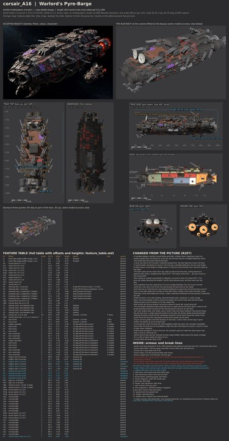

# corsair_A16 build sheet: the Warlord's Pyre-Barge (round 3c, R221 clean-ups)

Ashfall Hullbreakers flagship, class Battle-barge, **26.0 world units** (godot/render/hull_table.gd CLS_LEN; data.js c_boss).
Version 3, 2026-11-11, after Ryan's review of round 2 (R217: tubes as circles, guns blocking the rockets and in front of an
engine, engines and guns plain tubes) and his scaling rule (R218: whole-ship fidelity), with turrets that turn (R219).
Round 3b (2026-11-12) rebuilt the massing to the concept's measured proportions after the Board's review of round 3 (the hull
was a straight-sided box, too tall; the tubes small and low; the claws legs under midships). Round 3c (2026-11-12) rounded
the hull in section and tapered the plan more toward the bow (Board review of 3b). Designer of record: Opus (R205,
R207). Rendered on Ryan's PC (Blender 4.5, GPU), blockout
`C:\Users\rcbai\Downloads\voidsworn_test\opus532\r221a\corsair_A16\corsair_A16_blockout.blend`; the model is 26.14 long.

## Proportions and structure (measured the same way on the concept and the build)

| | Hull length:beam | Hull length:height | Envelope length:beam | Envelope length:height |
|---|---:|---:|---:|---:|
| Concept (round 8 sheet, top and side views) | 3.04 | 4.45 | 2.46 | 3.17 |
| Round 3 build | 2.74 | 3.39 | 2.06 | 2.02 |
| Round 3b build | 3.01 | 4.18 | 2.13 | 2.80 |
| Round 3c build | 3.02 | 4.18 | 2.13 | 2.80 |
| **R221 build** | **3.04** | **4.05** | 2.13 | 2.80 |

Hull: length over the median beam or height across the middle 60 percent of the length. Distinct masses per cell (concept by
eye, build from the model) are in [inventory.md](inventory.md); every cell has at least the concept's count.

## Into the recipe (issue 592, Nov 12 2026)

The recipe now builds this sheet itself (ship file `tools/recipe/ships/corsair_A16.json`, hull module `sheet_hull`, the
build contract `tools/blender/build_sheets/contract.py`; RECIPE.md "Ships built from a build sheet"). Two things the route
found on this sheet:

1. **Turret rests (changed).** The six deck-edge turrets rested at 15, 20 and 25 degrees off the bow, outside their own
   data.js arc (scatter P and S fire 30 to 150), so the game export check refused them (HARDPOINTS.md "Turrets"). They now
   rest at 30, 35 and 40 degrees. The fit check still finds zero clashes; the views on this page still show the old rests
   until the next PC render.
2. **Seams moved and kinked (R226, Board, Nov 12).** A machine never crosses a seam; structure may. The stage 4 audit now
   passes:
   - **B-1** moves from x 7.0 to 7.7, into the clear band between the P1 and S1 turrets (ring and casemate footprints end at
     7.15) and the bow casemates PB and SB (from 8.35). Its path wanders 7.3 to 8.0.
   - **B-2** stays at x -2.5 through the hangar bay (B1 tears across, by design). At the flanks it kinks forward to -1.7,
     clear of the P4 and S4 casemates and their barrels (to -1.86), and it runs aft of the P3 and S3 turret rings (from -1.56).
   - **B-3** moves from x -7.4 to -4.7. The bridge turret T2 and the stern grabber H4 overlap in plan, and the engines,
     antennas and stern thrusters fill everything aft of them, so no seam can run aft of T2. The seam now runs through the
     reactor core (the missing bite) and kinks aft to -6.6 at the flanks, behind the P5 and S5 casemates. The stern piece
     carries the bridge, T2, Q3, Q4, H4 and the engine block whole.
   - Structure still crossing: the bay B1, the deck boxes HB1 and HB2 (B-1), a lamp and two vents. The views on this page
     still show the old seams until the next PC render.
3. **Rooms fitted inside the hull (issue 532, the A17 build).** About 150 inside triangles stood outside the intact
   plating before any break (death_seam_check.gd on PR 608 counts them apart as a sheet matter): the lower corners of
   the claw machinery, kennel decks, loot hold, hangar and engine room poked through the rounded belly, and the tops of
   the two shell magazines through the rounded deck edge. Each room now fits the hull section at its corners with about
   0.1 to spare, and the claw machinery starts at x 8.4, clear of the B-1 seam's path (a room face on the tear line left one
   inside triangle outside its piece). Measured on the unpainted export with PR 608's check: 0 outside the whole ship and
   0 outside their own piece (was 150 and 0); machines split 0 of 37. The feature table's room rows carry the new sizes; the
   cutaway still shows the old rooms until the next PC render.
4. **Front tubes and launch bay at the hull's detail level (R224).** The paint job (issue 601) measured the tubes at 0.45
   and the bay at 0.18 of the hull's triangles per square unit. The Hullbreaker kit's launch tube now has three rings
   stepping down inside the bore, a ring of bolts on the lip, eight stiffeners along the barrel and bolted clamp bands; the
   bay has framed door leaves with five stiffeners each, guide rails on brackets down both sides, a door ram at each
   hinge, end frames and a rivet row on the rim. Measured on the build (mesh half of tools/recipe/density.py, PR 601):
   tubes 1.02 of the hull's triangles and 0.80 of its edge features per square unit (were 0.45 and 0.29), bay 1.64 and
   1.61 (were 0.18 and 0.18). The fit check is still zero. The views on this page show the old tubes and bay until the
   next PC render; [tubes_bay_r224.jpg](tubes_bay_r224.jpg) shows the new ones.
5. **Every inside clear of the plating, seen from outside (PR 610's surface check).** The paint job's check saw rooms
   reach the skin: the gun deck, warlord hall, shell magazines, bridge and engine room, and with them the gun deck floor
   and the lower deck. Each is pulled in to sit inside its own tier with room to spare (feature table rows updated).
   Measured on this branch: the surface check's six views at 1280 show 0 inside pixels (A17 also 0); no inside corner
   stands outside the plating; death_seam_check's "outside the whole ship" count is 0.

## Paint (issue 601, Nov 12 2026)

A16 is the first ship painted by a faction paint stack (RECIPE.md "The paint stack for sheet ships"): `"bake": "stack"` in
`tools/recipe/ships/corsair_A16.json`, the Hullbreaker stack `tools/blender/kits/hullbreakers/stack.py` on the shared machinery
`tools/blender/kits/shared/paint_stack.py`. Masks are baked from this ship's own geometry; colours were sampled from
the round 8 concept (`corsair_A16_beauty.jpg`; the method is in the stack's `CONCEPT`); the concept is never projected; the
trim sheet and decals are drawn by the stack (own work, CC0). The colour zones are this sheet's own materials: nothing on
the sheet's design changed. Nobody painted A16 by hand.

Sandbox preview (Blender 5.3 on CPU, 1024 atlases, 12 samples; the PC run bakes 4096 at 64 samples):
[full](paint/A16_paint_full.jpg), [bow](paint/A16_paint_bow.jpg), [midships](paint/A16_paint_midships.jpg),
[stern](paint/A16_paint_stern.jpg), [flat views](paint/A16_paint_views.jpg). The game's own pictures (camera 170 and 60) come
from the PC job `tools/pc/jobs/A16_RUN_601.bat`.

**Changed from the picture (paint), the builder's calls:**
- Decals the concept does not show at its scale, placed by the stack's rules on the ship's own surfaces: the hull code "C19"
  on both flanks forward, a clan mark (a broken ring torn by three claw slashes, dried-blood red) on the bow deck, kill
  tallies on both flanks aft of midships, faded bone and soot chevrons by the bow tubes, all half worn off. Why: the faction
  sheet asks for a crude, scavenged look and these read as the crew's own marks; no navy yellow (the concept has none).
- A share of the soot and iron hull plates carry a thin, worn maroon over-paint (red_share 0.12 to 0.20 per zone). Why: the
  concept scatters red plates through the dark hull more than the sheet's zone weights (one blood plate in eighteen) give.
- The launch bay mouth carries faded warning stripes (a trim sheet row). Why: a working opening; the concept cannot show
  the belly.

**R224 in paint (sandbox numbers, `paint/density_sandbox.json`; `tools/recipe/density.py`).** Every part type is at or above
the hull on texels per square unit (1.63 to 1.84 of the hull) and on paint detail (1.09 to 2.19; the dishes lowest). No
paint flag. Mesh flags (the build's, not the paint's): the front tubes (triangles 0.45, edge features 0.29 of the hull) and
the launch bay (0.18 and 0.18) are smoother in mesh than the hull; the paint carries rivets, scuffs and stripes on them.

**Pass 2 (Board review of PR 610; Ryan agreed, R228), all in the faction stack:** a plate patchwork (panel cells at the
concept's plate size plus each modelled plate's own island, each picking soot, gun-metal, brick red or a bare scrape) with
black seams; stronger cavities and worn edges; rust held a dark brick red under the 1.25 lift; running lights by the stack's rule as small round deep-red lamps (pass 3,
the Board's correction: about 0.3 units, about 1 px at camera 170 and 3 at camera 60, brightness carries the read; 15 on A16
along the flanks at the sheet's lamp row and at the deck edges), reported in the job's lights.json; engine glow left to the game (the export's hp_eng points with their bell radius drive the engine effect, fx_hull.gd; the sheet's
throat and bell lining stay emissive). 

**Pass 4 (Board's full pass over the first PC run; Ryan: "a white square near the back and another white square underneath"),
all in the stack and the route:** the insides take the dark liner (room colours showed through the hull: gun deck, warlord
hall, shell magazines, bridge, engine room reach outside it, which is sheet geometry for the A17/532 worker; the salmon bar
aft was the shell magazine); stage 5's new surface check counts 6,844 such pixels before and 0 after
([before](paint/surface_check_before.json), [after](paint/surface_check_after.json)); plates in two sizes with offset rows and
a few overlaid patches; the close-range grain cut; part faces carry plates and seams; the engine throat a dimmer red-orange
deep in the bell, the lining near dark. [Six views beside the concept](paint/A16_paint_views.jpg).

## R221 clean-ups (Ryan, Nov 12 2026)

1. **Chains cut.** Ryan: "let's get rid of the chains randomly around the ship. There's no purpose." All four are gone, and
   every inventory line now names its job (what the part does on the ship); a line or a built part with no job fails the
   inventory (39 lines, 0 failing).
2. **No gun behind the rockets.** Ryan: "There's a gun directly behind the rocket pods on a16 which seems like it conflicts?"
   The castle-front flak turret (T1) is now a belly flak turret (flak covers below, where the deck guns cannot reach); the
   rack and its plinth moved 0.8 forward and the bridge flak turret (T2) 0.35 aft. The fit check gained a seventh test, LANE:
   each rack's firing lane forward and backblast aft, and no gun in either, resting or turned through its arc. Zero.
3. **Turret reach** (the issue 560 lesson): the fit report now lists how far each turret really turns each way before
   something stops it. Every turret clears its whole data.js arc; P3 and S3 rest with their barrels just clear of the P2 and
   S2 barbettes and cannot turn toward the bow from rest (0 degrees that way, 140 the other), which their arc (30 to 150 off
   the bow) never needs.

## What round 3c changed

1. **A rounded wedge in section**: the hull loft is a superellipse (new kit option `hull(..., rounded=True)`), flatter on the
   deck with a rounded shoulder, round in the flanks and belly, still plated; the bow-on view now reads as a rounded hull.
2. **More taper in plan**: the forward sections narrow sooner (half beam 3.75 at 6.0, 3.25 at 8.6, 2.75 at 10.3), into a broad
   rounded nose behind the tubes.
3. **The armour belts follow the curve** (new kit `band`: the flank between two heights pushed out along the hull surface),
   and every flank and deck part (ribs, vents, lamps, patches, casemates, bow thrusters, deck boxes) is seated on the curve
   with the kit's `surf`, `surf_n` and `deck_z`.

## What round 3b changed

1. **A long, low slab** about 4 deep, with tier 2 and the castle as low steps (the whole ship about 5.7 tall, like the
   concept), the bow tapering in plan from the tube cluster (about 4.3 wide) and rounded by heavy chamfers.
2. **Layered flank belts**: an upper armour belt, a recessed band carrying the lights, vents and bow casemates, a lower belt.
3. **The two tubes are the face**: big, side by side across the nose, standing fully proud of a shortened brow and chin.
4. **Curved pincers under the bow tip**; short grabbers under the stern instead of legs under midships; the engine pods
   brought in close to the hull.

Start here: **[side_by_side.jpg](side_by_side.jpg)** (concept left, blockout right, same camera, full view then bow,
midships and stern at the same windows), then [fit_view.jpg](fit_view.jpg) and [cells.jpg](cells.jpg).

- [sheet.jpg](sheet.jpg): beauty and blockout, true side, top, underside, bow-on, engine end, INSIDE cutaway, feature table,
  changes, then the fit view and the nine cells.
- [inventory.md](inventory.md): the parts inventory written from the concept before modelling (R218), ticked per blob-sweep
  cell from the model: 39 lines (R221: chains cut, belly turret added; each names its job), every one present, shaped by its kit part type and detailed (every sub-part modelled); plus
  the proportions and the structure count per cell.
- [fit_report.md](fit_report.md): the fit check (RULEBOOK 5.15): 38 clashes on the round 2 layout (16 clash, 11 turret sweep,
  10 exhaust, 1 exit: the rack covered by the bunker turret), each fix, and **zero left** in round 3, including the R221
  firing lane and backblast test; plus each turret's real turning reach.
- [feature_table.md](feature_table.md), [manifest.json](manifest.json) (routes, the turret pivots and arcs), [checks.json](checks.json),
  views: [side](side.jpg), [top](top.jpg), [underside](underside.jpg), [bow-on](bow.jpg), [engine end](stern.jpg),
  [cutaway](cutaway.jpg), [three-quarter](threequarter.jpg), [outline overlay](outline_check.jpg).
- Design source: `tools/blender/build_sheets/ships/corsair_A16.py`; inventory `ships/corsair_A16_inv.py`; part shapes
  `tools/blender/kits/hullbreakers/parts.py`.

## What round 3 changed (parts, still in force)

1. **The front tubes** are deep tubes with hooded rolled lips, dark bores and clamp bands, a ribbed spine between them.
2. **Every part is its real shape**, from the Hullbreakers kit: engines are bells with a throat, an ember lining, an inner
   cone, cooling rings, gimbal struts, a banded housing and a mount collar; turrets have a ring and bolt ring, a faceted
   housing with a glacis and bustle, a mantlet on trunnions, breeches, barrels with recoil sleeves, clamps, muzzle brakes and
   dark bores; casemates have an armour plate, a box sponson and a ball mantlet; the rack is a framed box of ten cells with
   rocket noses set back in them, side cheeks, a yoke and a slewing ring; dishes have ribbed backs, rims and feed horns on
   struts; claws have hinge drums, armoured segments, joints, rams and hooked fingers. Hull plates
   carry thickness steps, bevels and corner rivets and are cleared under every mount.
3. **No gun blocks the rockets**: the round 2 bunker turret is gone; the rack sits on a plinth, pitched 12 degrees, every cell
   clear over the deck boxes and dishes; flak on a bridge barbette (T2) and, after R221, under the belly (T1).
4. **Turrets turn (R219)**: each turret is a pivot `<id>_turret` at its ring centre with `turret=1` and its data.js arc;
   the middle deck-edge turret on each side superfires on a barbette so neighbours never meet when trained aft.

## What still differs from the concept, and why

- **Surface density.** The concept is covered in small torn plates, rivet rows, grime and red glow. The blockout has plates
  with steps and rivets at a coarser size and flat colour: texture and wear are the paint stage (recipe 4 and 5), and the
  plate size is a kit setting the build can tighten.
- **The big port engine** in the concept is a short fat drum with many radial fins round a fire-filled bell; ours is a bell
  with three cooling rings and struts. Same part, plainer: the fin ring is a kit addition for the build.
- **The rack** in the concept is a bundle of round tubes; ours is a framed box of round cells. Same read from above; the
  bundle is a variant the kit can add.
- **The nose and flanks** are now round in section (round 3c), but the concept's hull is fuller still: it bulges wider at
  the waterline and its plates are many small overlapping slabs, where ours are fewer, larger panels on one smooth loft.
- **The castle** in the concept is busier (stacked boxes and sloped plates); ours keeps its low step with slits and hatches.
- **Guns** are matched batteries by slot (R213) where the concept scatters them; barrels are a little shorter than the
  concept's so neighbours clear each other when they turn.
- **Tube lip notch**: the concept's lower-lip notch is left for the build's kit pass.
