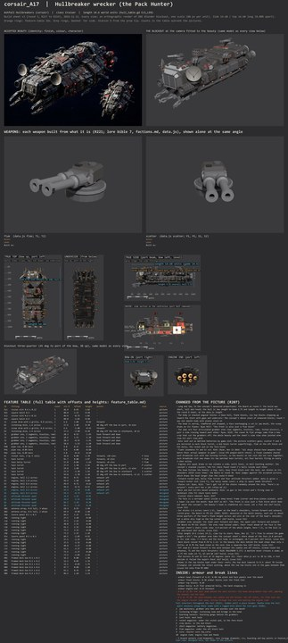

# corsair_A17 build sheet: Hullbreaker wrecker, the Pack Hunter (round 3c, R221 clean-ups, into the recipe)

**Issue 676 recipe proof:** [record](weapon_proof.json). Stage 4 contract, audit and audit self-test PASS; stage 5 unpainted geometry carried unchanged; stage 6 four LOD meshes exported and read back in Godot; stage 7 export, readback and planted-fault self-test PASS. Real Godot firing/turning, authored interiors and destruction PASS: 27 machines, zero split, zero inside triangles beyond their piece. Budget: 86208 triangles, 18 surfaces, 8473 inside triangles. Costs reported; the scene gate was not measured.

**Issue 676, PC verification (Nov 14, CPU).** The latest sheet and named [weapon picture](weapon_review.jpg) were rebuilt on this PC with Blender 4.5.14, Cycles CPU, 12 samples. [Weapon match](weapon_match.json): PASS, zero problems; the [feature table](feature_table.md) lists every data slot, its shots and its visible mounts. The outline comparison remains the earlier reported reference. This is an unpainted weapon proof; the Board queues the paint bake.

**Issue 676 (R241): the flank casemates P3 and S3 are cut.** Ryan, Nov 13 2026 (R241): "all ships should have weapons that match their actual weapons in game, so they line up with firing, effects, turns, etc". A fixed casemate shared each broadside slot with two turning turrets; each broadside now shows its two matched twin turrets (4 muzzles for scatter's 5 shots, all firing on every volley). The weapon-match check (tools/blender/build_sheets/weapon_match.py; `corsair_A17_weapon_match.json` from every build) passes on this sheet; the views on this page were re-rendered from the changed design file in the issue 676 sandbox (Blender 4.5, CPU); the outline check picture is unchanged.

Ashfall Hullbreakers cruiser, class Cruiser (14.5), **this ship 14.6 world units** claw tip to stern (godot/render/hull_table.gd CLS_LEN; data.js c_marauder);
the model is 14.58. Version 3c, 2026-11-12: round 3's parts, fit check and turret marking (R217 to R219), with the massing
rebuilt to the concept's measured proportions after the Board's review of round 3 ("short, tall and round, a lump").
Designer of record: Opus (R205, R207). The views on this page were re-rendered for the A17 build (issue 532) in the Opus
sandbox (Blender 5.3, CPU, 24 samples) from the same build.py; the round 3c blockout from Ryan's PC is
`C:\Users\rcbai\Downloads\voidsworn_test\opus532\r221a\corsair_A17\corsair_A17_blockout.blend`, and stage 4 of the PC run
saves the recipe build at `Downloads\voidsworn_test\recipe\corsair_A17\build\A17.blend`.

**Round 3c (the Board on 3b): the head follows the beauty**, the picture Ryan judges against: a big, tall, boxy front block
(about 2.3 tall and 3.4 wide) towering over the neck, two big ear dishes (1.9 across, about the head's height) standing out
from brackets at its upper corners, and broad flat prongs (0.7 and 0.55 wide). The neck turrets and the rocket pod were lifted
so their arcs and exits clear the taller head; the fit check is still zero.

## Paint (issue 601, Nov 12 2026)

A17 is painted by the same Hullbreaker paint stack as A16 (`"bake": "stack"`, tools/blender/kits/hullbreakers/stack.py),
nothing ship-specific: the colour zones are this sheet's own materials. Sandbox preview (1024 atlases):
[full](paint/A17_paint_full.jpg), [six views beside the whole beauty](paint/A17_paint_views.jpg),
[bow](paint/A17_paint_bow.jpg), [midships](paint/A17_paint_midships.jpg), [stern](paint/A17_paint_stern.jpg). Surface check 0
([json](paint/surface_check_after.json)); R224 paint flags none; 15 running lamps (1.44 px on a 70 px ship). The A17 concept
reads lighter and greyer than A16's; the stack's colours are sampled from A16, so A17 paints darker than its picture.

## Into the recipe (issue 532, the A17 build, Nov 12 2026)

The recipe builds this sheet itself, the route A16 proved (issue 592): ship file `tools/recipe/ships/corsair_A17.json`
(data.js `c_marauder`, game folder `C15s_23`, the corsair Cruiser the game draws; the class length 14.5 is read from this
sheet, `bake: none` until the sheet paint stack, issue 601, lands). What the route and the Board's notes changed here:

1. **The bow (Ryan R217: "the front is also just a flat block which does not match the concept").** The face is now a
   narrower panel (2.2 wide, 1.45 tall) inside a deep bevel frame: the corner and brow planes run back 0.45 to the full
   head (3.3 wide), each plated, with a lower lip over the mouth, as the beauty draws it. The neck block behind the head is
   raised from 0.78 to 1.12, so the head no longer stands on the neck like a separate box.
2. **Seams round machines (R226, RULEBOOK 5.17).** The aft seam B-2 cut the aft twin T1 and the stern thrusters Q3 and
   Q4 at x -4.75. It now runs along the weld between the saddle and aft blocks (about -3.15 to -3.7), kinked round the
   antennas AN1 and AN2 ahead of it and T1, Q3 and Q4 behind it, and bites through the core. The stage 4 audit passes: no
   machine across a seam; structure across: three lamps (L4s, LHp, LHs).
3. **Turret rests.** P2 and S2 rested at 25 degrees, outside their data.js arc (30 to 150); they now rest at 35. The fit
   check is still zero in all seven tests.
4. **Insides inside the plating.** 67 inside triangles stood outside the intact hull (death_seam_check.gd on PR 608
   counts them as a sheet matter): the top deck at 0.9 and the crew, rocket and flak rooms rose above the low top blocks
   and into the gaps between them. The top deck is now at 0.3 and each room sits under its own block's roof. Measured on
   the unpainted export with PR 608's check: 0 outside the whole ship; machines split 0 of 29.
5. **Detail density (R224).** Measured per part type on the build (the mesh half of tools/recipe/density.py, PR 601):
   no part type is under 0.75 of the hull's triangles or edge features per square unit; the lowest are the prongs (1.50
   and 1.29). The kit tube's new bore rings, bolted lip and stiffeners (added for A16) also reach A17's scoop drums.

6. **Ear dishes and the camera (the Board on PR 611, R207).** The dishes are now 1.24 across (were 1.9), a little under
   the face's height, on short brackets low on the head's shoulders, turned forward and outward, and the kit's dish colour
   is rusted grey, not white. The fitted beauty camera is refit from the concept's view (az 44.3, el 18.4) so the bow is on
   screen in side_by_side.jpg: outline IoU 76.8 percent then, 74.0 after the R229 arms and ears (the round 3b camera scored 62.8 with the same mask; it had framed the
   bow off the left edge).

7. **Bulkhead F2 off the neck seam.** F2 stood at x 2.4, on the B-1 seam's station, and PR 608's death check found its
   face left outside its piece after the tear (1 to 11 triangles, varying with the cut). It now stands at 2.05: 0. The
   cutaway picture still shows it at 2.4.

8. **The grabbers and the ears from the whole concept (R229).** Ryan: "the front claws or grabbers are coming out
   differently in the build model, they're more like 4 independent prongs." The bow crop had cut them off. In the whole
   beauty and the sheet's side view they are jointed arms, so the four flat prongs are replaced by four grabber arms, a new
   Hullbreaker kit part `claw_arm`: a shoulder hinge between hinge plates on a bracket in its housing under the jaw, two
   box segments with bolted top plates, a knuckle with hinge plates and pins, a ram across each joint and a forked,
   hooked pincer. A pair a side, upper and lower, close toward each other to pin a hull for the boarding gangs; the jaw
   hoses now feed their rams. The ears, measured on the whole beauty, are about three quarters of the head's flank height
   across: 1.6 (item 6's 1.24 came from the crop). Fit check zero; no machine on a seam; claw_arm at 2.53 and 2.33 of the
   hull's density; PR 608's death check 0 and 0.

9. **Arms splayed, ship length 14.6 (Ryan, Nov 12: "it's fine to extend the game length a bit").** The lower pair runs
   forward and down, the upper pair forward and outward, as the beauty draws them. In the concept sheet's side view the
   arms reach 6.8 percent of the whole length ahead of the head's face; here 7.3. The hull body is unchanged; the sheet's
   LENGTH is 14.6, claw tip to stern (+0.7 percent on the Cruiser class's 14.5, which stays as it is). The game still draws
   the ship at its class length (render/ship_view.gd reads CLS_LEN by class), so on the board it is 0.7 percent smaller
   than the sheet; the manifest entry and the stage 6 bench carry 14.6.

Side by side with the WHOLE concept at the same camera (R229): [whole ship](../../../shots/issue_532_a17/a17_whole_compare.jpg),
[side against the sheet's side view](../../../shots/issue_532_a17/a17_side_compare.jpg), then the [bow](../../../shots/issue_532_a17/a17_bow_compare.jpg).

**R221 clean-ups (Ryan, Nov 12 2026).** The two chain girdles are cut ("There's no purpose"), and every inventory line names
its job (27 lines, 0 failing). The fit check's new LANE test (each rack's firing lane forward and backblast aft; no gun in
either) found the neck turrets P1 and S1 in the rocket pod's firing lane and the mid turrets P2 and S2 in its backblast: the
neck turrets moved outboard (0.6 to 1.3 off the centreline) and the mid turrets out and aft. Zero clashes in all seven tests;
every turret turns at least 155 degrees each way from rest (the fit report's reach table).

Start here: **[side_by_side.jpg](side_by_side.jpg)** (concept left, blockout right, same camera, full view then bow,
midships and stern at the same windows), then [cells.jpg](cells.jpg) and [fit_view.jpg](fit_view.jpg).

## Proportions and structure (measured the same way on the concept and the build)

| | Hull length:beam | Hull length:height | Envelope length:beam | Envelope length:height |
|---|---:|---:|---:|---:|
| Concept (round 8 sheet, top and side views) | 2.75 | 4.06 | 2.04 | 3.54 |
| Round 3 build | 2.62 | 2.84 | 2.05 | 2.22 |
| Round 3b build | 2.82 | 3.84 | 1.91 | 2.88 |
| Round 3c build | 2.83 | 3.79 | 1.92 | 2.71 |
| R221 build | 2.84 | 3.82 | 1.92 | 2.71 |
| **Into the recipe (issue 532)** | **2.83** | **3.82** | 1.92 | 2.71 |

Hull: length over the median beam or height across the middle 60 percent of the length. The envelope includes the guns,
dishes and belly turret. Distinct masses per cell (concept by eye, build from the model) are in [inventory.md](inventory.md):
every cell has at least the concept's count.

## What round 3b changed

1. **Long and low.** A base hull about 2 deep with a dark belly band stepping in under it; flank armour blocks on both sides,
   uneven and unmatched; six top blocks stepping up toward the stern (0.78, 0.9, 1.2, 1.3, 1.4, 1.52), with gaps and
   undercut bases. About 30 percent lower than round 3.
2. **The head** is the front block: chamfered, two roof steps (brow and crown), framed face panels with straps, a face
   overhanging a cut-in jaw mouth, the scoop drums under its lower corners, the ear dishes bolted to the drum tops.
3. **The jaws are long flat prongs** (new kit part `prong`): four blades with spine ridges, joint knuckles and hooked tips,
   reaching about a sixth of the length ahead of the head, each in its own housing in the mouth.
4. **Squat engine drums** in two columns a side, exits level, no bell touching another.
5. Everything from round 3 stays: kit part shapes, the fit check (zero clashes; 43 on the round 2 layout, see
   [fit_report.md](fit_report.md)), turret pivots with arcs (manifest.json), the inventory ticked per cell (27 lines after R221, each with its job, all
   present, shaped and detailed).

## What still differs from the concept, and why

- **The head** now follows the beauty rather than the round 8 sheet (which draws it narrower and lower); the two pictures
  disagree, and the beauty is the accepted one.
- **Surface density and colour**: the concept's small torn plates, rivets, grime and red engine glow are the paint stage;
  plate size is a kit setting.
- **Hull height** is about 7 percent over the sheet's (length:height 3.79 against 4.06): the taller head and the turrets add
  height the sheet's smaller head and guns do not.
