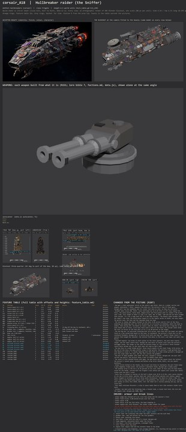

# corsair_A18 build sheet: Hullbreaker raider (the Sniffer) (issue 633, round 2)

**Issue 676 recipe proof:** [record](weapon_proof.json). Stage 4 contract, audit and audit self-test PASS; stage 5 unpainted geometry carried unchanged; stage 6 four LOD meshes exported and read back in Godot; stage 7 export, readback and planted-fault self-test PASS. Real Godot firing/turning, authored interiors and destruction PASS: 12 machines, zero split, zero inside triangles beyond their piece. Budget: 65644 triangles, 13 surfaces, 4513 inside triangles. Costs reported; the scene gate was not measured.

**Issue 676, PC verification (Nov 14, CPU).** The latest sheet and named [weapon picture](weapon_review.jpg) were rebuilt on this PC with Blender 4.5.14, Cycles CPU, 12 samples. [Weapon match](weapon_match.json): PASS, zero problems; the [feature table](feature_table.md) lists every data slot, its shots and its visible mounts. The existing weapon layout already passes R241, so its geometry is unchanged. The outline comparison remains the earlier reported reference. This is an unpainted weapon proof; the Board queues the paint bake.

Ashfall Hullbreakers frigate (the Sniffer, the pack's finder), class Frigate (6.5 world units, godot/render/hull_table.gd CLS_LEN); data.js c_raider: autocannon T, ability overburn, speed 6, evasion 28. The model is 6.51 long. Designer of record: Opus (R205, R207); the Board is the final designer (R233). Built from the accepted concept of PR 625 (contrib/muse/design/class_family_corsair_2026_11/, corsair_A18_beauty.jpg, v3, Ryan Nov 12 2026) and designs.md, the design of record for the fittings. The views were rendered in the Opus sandbox (Blender 5.3 as a Python module, CPU, 20 samples) from the same build.py; no PC run yet: the Board runs the recipe there after reviewing this sheet. Paint: `bake: none` (the sheet paint stack, PR 610, is not merged).

**Issue 668 (R239): broadened toward the concept.** Ryan, Nov 13 2026: "a18 and a19 are much slimmer than concept. It's not a huge deal but it'd add some variety." Every hull half-beam from the nose's 40 percent station aft is out by 0.18 (the design file's WIDEN), less toward the face so the grille nose keeps its taper (0.96 across at the face, 2.0 at 40 percent, was 0.85 and 1.7); the spine blocks, the engine block and drums, the belly band and the flank fittings moved out with it. The hull is 2.04 wide at midships (was 1.68): hull length to beam 3.87 to 3.19 on the sheet's own hull measure (checks.json), 3.50 to 2.94 on the inventory's (inventory.md; it reads the concept sheet's top view at 4.28). The class length (6.51) and the silhouette (the grille nose, the one big ear, the lopsided drums) are kept. The concept sheet's top view draws A18 slimmer than the beauty does; Ryan's words match the beauty, so the beauty is the target: with the camera refitted (camera only) to the same beauty mask, the outline overlap goes from 62.6 percent on the slim build to 63.3 on the broadened one (body 56.7 to 58.8). Fit check all zero. The aft port breach anchor hp_breach_2 moved down from height -0.05 to -0.45: the drum mount moved out with the widening and came within 0.03 of the length of the old spot, so stage 7 refused it. Sheet before this change: git history of this folder (issue 633 round 2).

**Start here (R229, the whole concept first):** [whole beauty beside the whole build](../../../shots/issue_633_hullbreakers/a18_whole_compare.jpg), [side against the concept sheet's side](../../../shots/issue_633_hullbreakers/a18_side_compare.jpg), [plan against plan](../../../shots/issue_633_hullbreakers/a18_top_compare.jpg), then the [bow](../../../shots/issue_633_hullbreakers/a18_bow_compare.jpg) and [stern](../../../shots/issue_633_hullbreakers/a18_stern_compare.jpg); the five Hullbreakers from above at one scale: [hullbreakers_lineup_top.jpg](../../../shots/issue_633_hullbreakers/hullbreakers_lineup_top.jpg). Then [side_by_side.jpg](side_by_side.jpg), [cells.jpg](cells.jpg) and [fit_view.jpg](fit_view.jpg).

## Paint (issue 651, Nov 13 2026)

A18 is painted by the same Hullbreaker paint stack as A16 and A17 (`"bake": "stack"`, tools/blender/kits/hullbreakers/stack.py),
nothing ship-specific: the colour zones are this sheet's own materials (its grille nose is built from kinds the stack already
knew, so it needed no new zone). Sandbox preview (stages 4 to 7 on the CPU, 1024 atlases, 16 samples; re-rendered for issue 668 on the broadened hull; nothing was installed, so the authored interiors and death seam results below are from the earlier installed run):
[full](paint/A18_paint_full.jpg), [six views beside the whole beauty](paint/A18_paint_views.jpg),
[bow](paint/A18_paint_bow.jpg), [midships](paint/A18_paint_midships.jpg), [stern](paint/A18_paint_stern.jpg),
[engines](paint/A18_paint_engines.jpg). Surface check 0 ([json](paint/surface_check_after.json)); R224 paint and mesh flags
none ([density](paint/density_sandbox.json)); 15 running lamps on the broadened hull (0.8 px on a 70 px ship; 16 before issue 668); authored interiors and the death seam
check pass on the export. As A17, the stack's colours are sampled from A16, so A18 paints darker than its picture.

## What the class is (the Board as designer, R233)

A chunky nose that tapers forward to a small wide-grilled face over a cut-in chin with one pair of grabbers, the body swelling behind it to its widest at midships (round 2: the Board found round 1 a long box with a dish at the front), a raised spine of five stacked blocks carrying the one twin autocannon turret, and two engine drums on short pylons at the stern quarters with a small bell between. Its outline from above is its own: a nose that widens from 0.85 at the face to 1.7 over the first 40 percent, the one oversized listening dish set nearly flush on a low mount on the nose to starboard (the picture's flush disc; designs.md's "little brick with one big ear"), and the PORT drum the larger, so the frigate is lopsided corner to corner. Every face is plated in courses at the frigate's plate size with patches over joints and plates, the top faces stepped (R196, R197). It is not a small A16 (no wide body, no gun rows, no stern pods block) or a small A17 (no boxy head, one ear).

## Checks (all on this sheet's build)

| Check | Result |
|---|---|
| Fit check, seven tests (CLASH, MOUNT, ARC, SWEEP, EXHAUST, EXIT, LANE) | CLASH 0, MOUNT 0, ARC 0, SWEEP 0, EXHAUST 0, EXIT 0, LANE 0, all zero ([fit_report.md](fit_report.md)); issue 668 broadened build: all zero |
| Machines on a seam (R226), sandbox stage 4 audit | 0 of 12 machines across a seam; structure across: none |
| Audit (tools/recipe/audit.py) | PASS: 0 problems |
| Audit self-test (audit_selftest.py) | PASS, all nine cases |
| Contract self-test (sheet_contract_selftest.py) | PASS (this branch carries PR 618's contract, merged in round 2) |
| Insides inside the skin (every inside vertex enclosed by the intact outside, rays six ways) | 0 of 232 outside |
| Detail density per part type (R224, under 0.75 of the hull is a fault) | none under; lowest slit at 0.95 of the hull's triangles and 0.97 of its edge features per square unit |
| Inventory (every part has a job, present, shaped, detailed per cell) | 0 failing ([inventory.md](inventory.md)) |
| Triangles (reported, never capped) | 58512 outside, 408 inside, 58920 in all (round 1: 37296 and 408; the plates in courses carry the scrap brick, R196) |
| Outline overlap with the beauty at the sheet camera (reported, not a bar, RULEBOOK 5.8) | 76.2 percent (mass outline 76.7; round 1 77.8), the round 2 record; issue 668 kept the camera and rescored against a remade beauty mask (luminance over 19, largest piece, holes filled): 53.5 on the broadened build against 54.9 on round 2 at this camera, 63.3 against 62.6 with the camera refitted to each (see the issue 668 note above; [outline_check.jpg](outline_check.jpg) is the rescore) |

The fit check, the seam and inside tests and the density were run in the sandbox (tools/blender/build_sheets/build.py fit mode; the seam, inside and density measures are scripted the same way as the Chorus sheets' check, issue 623). PR 608's death check in Godot needs the exported ship and runs on the PC.

## Proportions (concept against build, the same measure on both)

| | Hull length:beam | Hull length:height |
|---|---:|---:|
| Concept sheet, true top and side views (luminance mask over 14, median over the middle 60 percent) | 3.57 | 5.00 |
| Build (the sheet's top and side renders, same measure) | 3.46 | 4.02 |

Re-measured in round 2 with one script on both (round 1 read the concept at 3.62 and 5.18). From above the build now matches the concept's taper and swell: about 0.85 across at the face, about 1.7 at 40 percent; its length to beam over the middle is within 4 percent. It stands about a fifth taller than the sheet's side view over its raised spine, turret and dish mount (the concept's dark belly drops out of the mask, which flatters it); the beauty reads deeper than the sheet. The inventory's own table ([inventory.md](inventory.md)) uses a colour-difference mask that drops most of the dark concept hull; the row above is the one to read.

## Weapons, seams, breach anchors

One weapon slot (data.js c_raider): the twin autocannon turret T1 on the spine's gun block, all round, resting forward. One authored seam, B-1, behind the sensor head (the head tears away with the dish still on it, designs.md), kinked round the dish, the bow thrusters and the turret. Three breach anchors (frigate base 2, plus one for the Hullbreakers), uneven: port behind the head, starboard midships, port ahead of the engine block.

## The recipe (issue 633)

C13s_23 (`corsair|Frigate` in godot/render/hull_table.gd AI_HULLS), bake none. In the sandbox: contract self-test PASS; stage 4 audit and its self-test PASS; export7 unbaked at the default tolerance 57508 triangles, hard points gun 2, engine 3, breach 3, core 1, rcs 2, board 2, one turret; check_export PASS and its self-test PASS (the self-test now breaks a turret's muzzle through its turret, since the frigate's only gun is a turret); install (manifest_merge, build_assets --ships-only) and INSTALL READBACK PASS (15 nodes); authored_interiors_check 0 failures (4583 interior triangles); death_seam_check 0 of 12 machines split, 0 of 2055 insides outside their piece. No sheet change came from the recipe. The PC run: tools/pc/jobs/A18_A20_RUN_633.bat (queue file q_a633.bat), not queued.

## Changed from the picture (R207, R233)

- **Issue 668: the body is broadened, every half-beam from 40 percent aft out by 0.18 (2.04 wide at midships, was 1.68; the face 0.96, was 0.85), the length and the outline from above (taper, swell, drums) kept.** Ryan, Nov 13 2026 (R239): "a18 and a19 are much slimmer than concept. It's not a huge deal but it'd add some variety." The lines below that give round 2's widths are kept as the history
- **One gun: a twin autocannon turret on the spine's gun block.** data.js c_raider carries one weapon, autocannon T (R221: weapons from data.js); the picture's rows of flank guns, designs.md's two bow casemates and its rocket rack have no slot, so they are not built
- **The nose is chunky and tapers forward to the face: 0.84 across and 0.5 tall at the face, widening and deepening over the first 40 percent to 1.7 across at midships, where the body is widest, then easing aft.** the Board on round 1 (Nov 13, R233): the build was a long box (1.46 wide almost bow to stern, a 0.4 tall face) with a dish at the front; the concept sheet draws the nose 1.0 across at the face and 1.6 to 1.7 by 40 percent of the length
- **The one big ear: an oversized listening dish (0.9 across, more than half the beam) set nearly flush on a low raised dish mount on the nose, to starboard.** the picture's flush disc on the starboard foredeck; designs.md's "a little brick with one big ear". Round 2 drops round 1's sponson that bulged the shoulder: the outline from above is the nose's own taper and swell (the Board)
- **Lopsided engines: two drums on short pylons at the stern quarters, the port drum clearly larger, and one small centre bell.** designs.md (two bells of uneven size) with the picture's outrigger drums, the larger on the side the picture draws it; the picture's three stacked centre bells become one, so the stern does not read as A16's pods
- **The bow face is a wide intake grille: three louvre panels in one steel frame, 0.56 across, at the end of the nose; the wake-sniffer scoop is that grille.** the picture's wide grilled face (the Board on round 1: "a chunky tapering nose that ends in a wide intake grille"); designs.md puts the scoop under the chin, and the chin carries the grabbers
- **One pair of small grabber arms under the chin, splayed a little.** designs.md: one pair (A17 carries two pairs); the picture shows a pair of hooked claws there
- **The spine is five stacked blocks with gaps, the gun block and the sensor block the tallest.** the picture's raised spine; stacked and bolted scrap brick (R196, R197), not one smooth deckhouse
- **Armour bricks bolted on the flanks, two to port and three to starboard; the port flank keeps a pale Hegemony trophy plate.** the picture's patchwork flank; designs.md's trophy plate
- **The antenna array is the kit's at 65 percent of its size.** R224: at full size its base block, sized for the barge, carried half the frigate's hull detail per square unit (issue 618: detail scales with the part's size)
- **Every face is plated in courses at the hull's plate size (0.16 to 0.36), each course jointed on its own (a brick bond), patches laid over joints and offset patches over plates; upward faces stepped in terraces of one to three plate thicknesses.** the Board on round 1 (Nov 13): the faces read as big smooth grey planes with a few greebles; the concept is scrap brick, plates over plates on every face (R196, R197). Kit: the sheet kit's courses plating (kit.py, opt-in, issue 633)
- **Four small attitude thrusters.** a ship in space needs them to turn (the overburn raider turns hard)
- **Insides: one deck with the listening room, a kennel nook, a closet loot hold, the core and the engine room.** designs.md; R209, R215

## Open

- Belly detail between the grabber housings and the engine block is designed here; the picture does not show the underside
- A second autocannon mount on the T slot (a battery, as A17's P slot) would make the frigate read more armed from above; the brief asked for one turret, so it is not built.
