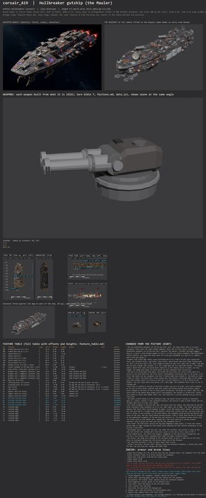

# corsair_A19 build sheet: Hullbreaker gutship (the Mauler) (issue 633, round 2)

**Issue 676 recipe proof:** [record](weapon_proof.json). Stage 4 contract, audit and audit self-test PASS; stage 5 unpainted geometry carried unchanged; stage 6 four LOD meshes exported and read back in Godot; stage 7 export, readback and planted-fault self-test PASS. Real Godot firing/turning, authored interiors and destruction PASS: 18 machines, zero split, zero inside triangles beyond their piece. Budget: 78562 triangles, 13 surfaces, 7959 inside triangles. Costs reported; the scene gate was not measured.

**Issue 676, PC verification (Nov 14, CPU).** The latest sheet and named [weapon picture](weapon_review.jpg) were rebuilt on this PC with Blender 4.5.14, Cycles CPU, 12 samples. [Weapon match](weapon_match.json): PASS, zero problems; the [feature table](feature_table.md) lists every data slot, its shots and its visible mounts. The outline comparison remains the earlier reported reference. This is an unpainted weapon proof; the Board queues the paint bake.

**Issue 676 (R241): one bow launcher, two spine turrets.** Ryan, Nov 13 2026 (R241): "all ships should have weapons that match their actual weapons in game, so they line up with firing, effects, turns, etc". The port long tube R1 is cut: one long tube beside a three-tube cluster were two different mounts on the one torp slot, which fires one shot a volley. The three starboard flank casemates S1 to S3 are cut: they mixed one and two barrels and sizes on the scatter slot and sat fixed beside the turning spine turrets S4 and S5, which are now the whole starboard battery. R241 is later than the Nov 12 ruling of two mismatched casemates in the bow face and replaces it; the starboard armour bricks stay. The weapon-match check (tools/blender/build_sheets/weapon_match.py; `corsair_A19_weapon_match.json` from every build) passes on this sheet; the views on this page were re-rendered from the changed design file in the issue 676 sandbox (Blender 4.5, CPU); the outline check picture is unchanged.

Ashfall Hullbreakers destroyer (the Mauler, the pack's gun ship), class Destroyer (9.5 world units, godot/render/hull_table.gd CLS_LEN); data.js c_reaver: torp F, scatter S, ability reload. The model is 9.50 long. Designer of record: Opus (R205, R207); the Board is the final designer (R233). Built from the accepted concept of PR 625 (contrib/muse/design/class_family_corsair_2026_11/, corsair_A19_beauty.jpg, v6, Ryan Nov 12 2026) and designs.md, the design of record for the fittings. The views were rendered in the Opus sandbox (Blender 5.3 as a Python module, CPU, 20 samples) from the same build.py; no PC run yet: the Board runs the recipe there after reviewing this sheet. Paint: `bake: none` (the sheet paint stack, PR 610, is not merged).

**Issue 668 (R239): broadened toward the concept.** Ryan, Nov 13 2026: "a18 and a19 are much slimmer than concept. It's not a huge deal but it'd add some variety." Every hull half-beam from 2.55 aft is out by 0.3 (the design file's WIDEN), less toward the face so the arrow-head prow keeps its point and its overhang (the bow face 1.24 across); the foredeck plate, the side block, the stern block, the spine blocks, the lower band and every flank fitting, hatch, keep-out, room, seam path and boarding point moved out with it. The hull is 2.36 wide (was 1.76): hull length to beam 5.40 to 4.03 on the sheet's own hull measure (checks.json), 4.11 to 3.27 on the inventory's (inventory.md; it reads the concept sheet's top view at 7.57). The class length (9.50) and the silhouette (the wedge prow over the bow-face casemates, the starboard battery) are kept. The concept sheet's top view draws A19 slimmer than the beauty does; Ryan's words match the beauty, so the beauty is the target: with the camera refitted (camera only) to the same beauty mask, the outline overlap goes from 68.0 percent on the slim build to 68.4 on the broadened one (body 66.0 to 66.7). Fit check all zero (the lower band's fore section is set at 1.06 so the bow casemates Q1 and Q2 stay clear of it). Sheet before this change: git history of this folder (issue 633 round 2).

**Start here (R229, the whole concept first):** [whole beauty beside the whole build](../../../shots/issue_633_hullbreakers/a19_whole_compare.jpg), [side against the concept sheet's side](../../../shots/issue_633_hullbreakers/a19_side_compare.jpg), [plan against plan](../../../shots/issue_633_hullbreakers/a19_top_compare.jpg), then the [bow](../../../shots/issue_633_hullbreakers/a19_bow_compare.jpg) and [stern](../../../shots/issue_633_hullbreakers/a19_stern_compare.jpg); the five Hullbreakers from above at one scale: [hullbreakers_lineup_top.jpg](../../../shots/issue_633_hullbreakers/hullbreakers_lineup_top.jpg). Then [side_by_side.jpg](side_by_side.jpg), [cells.jpg](cells.jpg) and [fit_view.jpg](fit_view.jpg).

## Paint (issue 651, Nov 13 2026)

A19 is painted by the same Hullbreaker paint stack as A16 and A17 (`"bake": "stack"`, tools/blender/kits/hullbreakers/stack.py),
nothing ship-specific: the colour zones are this sheet's own materials. Sandbox preview (re-rendered for issue 668 on the broadened hull, nothing installed, so the authored interiors and death seam results below are from the earlier installed run; stages 4 to 7 on the CPU, 1024
atlases, 16 samples): [full](paint/A19_paint_full.jpg), [six views beside the whole beauty](paint/A19_paint_views.jpg),
[bow](paint/A19_paint_bow.jpg), [midships](paint/A19_paint_midships.jpg), [stern](paint/A19_paint_stern.jpg),
[engines](paint/A19_paint_engines.jpg). Surface check 0 ([json](paint/surface_check_after.json)); R224 paint and mesh flags
none ([density](paint/density_sandbox.json)); 15 running lamps on the broadened hull (0.8 px on a 70 px ship; 16 before issue 668); authored interiors and the death seam
check pass on the export. As A17, the stack's colours are sampled from A16, so A19 paints darker than its picture.

## What the class is (the Board as designer, R233)

A long low slab whose defining shape is the arrow-head prow (round 2: the Board found round 1's bow blunt and square from above): a broad flat bow plate runs from a blunt point to the full beam over the first third, overhanging a narrow bow face that holds the rocket casemate (a short fat cluster of three tubes; issue 676 cut the long braced tube to port, R241), under a sloped chin with a pair of grabbers and a second pair under the forefoot. Behind the wedge a spine of three stacked blocks carries two scatter turrets, the whole scatter battery is on the STARBOARD side (the two spine turrets; armour bricks along the starboard flank), the port flank is widened by a side block with a big pale trophy plate in three torn sheets, and a raised stern block carries three lopsided bells. Every face is plated in courses at the destroyer's plate size with patches over joints and plates, the top faces stepped (R196, R197). It is not a small A16 (the barge's wide body and pods) or a small A17 (the cruiser's boxy head with two ears).

## Checks (all on this sheet's build)

| Check | Result |
|---|---|
| Fit check, seven tests (CLASH, MOUNT, ARC, SWEEP, EXHAUST, EXIT, LANE) | CLASH 0, MOUNT 0, ARC 0, SWEEP 0, EXHAUST 0, EXIT 0, LANE 0, all zero ([fit_report.md](fit_report.md)); issue 668 broadened build: all zero |
| Machines on a seam (R226), sandbox stage 4 audit | 0 of 22 machines across a seam; structure across: PH1 (a pipe) |
| Audit (tools/recipe/audit.py) | PASS: 0 problems |
| Audit self-test (audit_selftest.py) | PASS, all nine cases |
| Contract self-test (sheet_contract_selftest.py) | PASS (this branch carries PR 618's contract, merged in round 2) |
| Insides inside the skin (every inside vertex enclosed by the intact outside, rays six ways) | 0 of 264 outside |
| Detail density per part type (R224, under 0.75 of the hull is a fault) | none under; lowest antenna at 1.01 of the hull's triangles and 0.95 of its edge features per square unit |
| Inventory (every part has a job, present, shaped, detailed per cell) | 0 failing ([inventory.md](inventory.md)) |
| Triangles (reported, never capped) | 70054 outside, 464 inside, 70518 in all (round 1: 49934 and 464; the plates in courses carry the scrap brick, R196) |
| Outline overlap with the beauty at the sheet camera (reported, not a bar, RULEBOOK 5.8) | 77.9 percent (mass outline 80.2; round 1 77.3), the round 2 record; issue 668 kept the camera and rescored against a remade beauty mask (luminance over 19, largest piece, holes filled): 62.5 on the broadened build against 64.5 on round 2 at this camera, 68.4 against 68.0 with the camera refitted to each (see the issue 668 note above; [outline_check.jpg](outline_check.jpg) is the rescore) |

The fit check, the seam and inside tests and the density were run in the sandbox (tools/blender/build_sheets/build.py fit mode; the seam, inside and density measures are scripted the same way as the Chorus sheets' check, issue 623). PR 608's death check in Godot needs the exported ship and runs on the PC.

## Proportions (concept against build, the same measure on both)

| | Hull length:beam | Hull length:height |
|---|---:|---:|
| Concept sheet, true top and side views (luminance mask over 14, median over the middle 60 percent) | 4.57 | 7.18 |
| Build (the sheet's top and side renders, same measure) | 4.10 | 6.15 |

Re-measured in round 2 with one script on both (round 1 read the concept at 4.58 and 7.33). The build is about a tenth wider and a sixth taller than the sheet's true views; the concept's dark belly drops out of the mask, which makes it read thinner. From above, the first third is now the concept's arrow-head (0.4 across at the tip, 1.3 just behind it, 2.1 by a third of the length). The inventory's own table ([inventory.md](inventory.md)) uses a colour-difference mask that drops most of the dark concept hull; the row above is the one to read.

## Weapons, seams, breach anchors

data.js c_reaver: torp F (slot 0) fired by the bow-face casemate R2; scatter S (slot 1) by the twin turrets S4 and S5 (issue 676, R241). Two authored seams: B-1, the bow block weld (the bow tears away whole with its casemates, designs.md), and B-2, the stern block weld, each kinked round the machines near it. Four breach anchors (destroyer base 3, plus one), uneven: the bow seam to port, two along the middle deck (starboard, port), the stern block to starboard.

## The recipe (issue 633)

C14s_23 (`corsair|Destroyer` in godot/render/hull_table.gd AI_HULLS), bake none. In the sandbox: contract self-test PASS; stage 4 audit and its self-test PASS; export7 unbaked at the default tolerance 67666 triangles, hard points gun 13, engine 3, breach 4, core 1, rcs 2, board 2, two turrets; check_export PASS and its self-test PASS; install (manifest_merge, build_assets --ships-only) and INSTALL READBACK PASS (29 nodes); authored_interiors_check 0 failures (6938 interior triangles); death_seam_check 0 of 22 machines split, 0 of 3114 insides outside their piece. No sheet change came from the recipe. The PC run: tools/pc/jobs/A18_A20_RUN_633.bat (queue file q_a633.bat), not queued.

## Changed from the picture (R207, R233)

- **Issue 668: the slab is broadened, every half-beam from 2.55 aft out by 0.3 (2.36 wide, was 1.76), the length, the prow's point and the bow-face casemates kept.** Ryan, Nov 13 2026 (R239): "a18 and a19 are much slimmer than concept. It's not a huge deal but it'd add some variety." The lines below that give round 2's widths are kept as the history
- **The two mismatched casemates sit IN the bow face: port, one long rocket tube on a brace; starboard, three short fat tubes banded together.** Ryan, Nov 12 (the round's ruling): "the two mismatched casemates sit IN the bow face", whatever the beauty's foredeck housings suggest. data.js c_reaver's only forward weapon is torp F, so both are rocket casemates (the Hullbreaker rattle rockets); the long tube stays short of a prow gun (RULEBOOK 4.4, Ryan on v5 "added a giant front gun again?")
- **The bow is an arrow-head from above: the broad flat bow plate runs from a blunt point 0.4 across to the full beam over the first third, overhanging a narrow bow face (1.1 across, 0.52 tall) that holds the two casemates; the hull's flanks widen back behind it.** the Board on round 1 (Nov 13, R233): the build had a blunt square bow; the picture's defining shape is the wedge prow (the concept sheet: 0.4 across at the tip, 1.3 just behind it, 2.1 by a third of the length). The face stays blunt and narrow, not a thin edge: the casemates need a face to sit in (designs.md)
- **Every face is plated in courses at the hull's plate size (0.2 to 0.46), each course jointed on its own (a brick bond), patches laid over joints and offset patches over plates; upward faces stepped in terraces of one to three plate thicknesses.** the Board on round 1 (Nov 13): the faces read as big smooth grey planes with a few greebles; the concept is scrap brick, plates over plates on every face (R196, R197). Kit: the sheet kit's courses plating (kit.py, opt-in, issue 633)
- **The whole scatter battery on the starboard side: two spine turrets resting to starboard.** data.js c_reaver: scatter S (one starboard battery); the picture's pods on both flanks and its foredeck guns have no other slot (R221)
- **One rocket casemate in the bow face (R2, the three short fat tubes); the long tube R1 and the three starboard flank casemates S1 to S3 cut.** R241 (issue 676): the mounts on one slot must match; a single long tube beside a three-tube cluster did not, and torp fires one shot a volley, so one launcher is the plain match; the casemates mixed one and two barrels and sizes and sat fixed beside turning turrets. R241 is later than the Nov 12 ruling above and replaces it
- **No rocket racks on the middle deck.** designs.md's two racks would be a second forward launcher; data.js gives one torp slot and the bow casemates fire it
- **Port flank: the side block carries one big pale Hegemony trophy plate, in three torn sheets bolted edge to edge.** designs.md (the trophy plate widening the port outline amidships) on the picture's side block
- **Two grabber pairs: one under the chin, one under the forefoot.** the picture's claws at the chin and further aft; designs.md's four arms; split so the jaw is not a copy of A17's
- **Three engine bells, the centre the largest, staggered in the stern block.** designs.md; the picture's four become three, lopsided (port small and high, starboard lower)
- **Two dishes: the large one standing on the foredeck plate to port, a small one on the stern block to starboard.** designs.md; the picture shows one on the foredeck
- **Four attitude thrusters.** a ship in space needs them to turn
- **Insides: two decks, the gun crews' gallery along the starboard casemates, a kennel deck under the bow, the loot hold aft.** designs.md; R209, R215

## Open

- Belly detail between the grabber pairs and the stern block is designed here; the picture shows little of the underside
