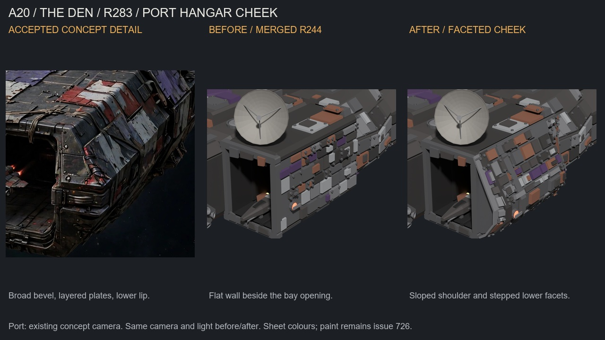

# A20 build sheet: the Den, R283 (issue 861)

Both forward hangar mouths now have an angular outer cheek: a broad bevel runs down and outward from the deck, irregular angled plates sit in steps on it, three armour courses wrap the front corner, and the lower edge turns under through three facets. This follows the block Ryan circled in `A20_hangar_mouth_ryan_1116.png` and ships.md rule 12. The existing bay opening and dark liner stay in place.

[Port mouth before and after beside the concept](A20_hangar_R283_before_after.jpg), [starboard mouth before and after](A20_hangar_starboard_R283_before_after.jpg), [full three-quarter view](A20_R283_threequarter.jpg), [whole concept and build](beauty_vs_blockout.jpg). These four labeled pictures are 1280 x 720. Port uses the existing concept camera; starboard mirrors that camera. Each before and after pair uses the same perspective, framing and light. The starboard sheet labels its concept detail as the near port cheek.

The [construction sheet](sheet.jpg), [preview](preview.jpg), [feature table](feature_table.md), [inventory](inventory.md), [manifest](manifest.json), [model](model.json), [fit view](fit_view.jpg) and [fit report](fit_report.md) are rebuilt from this design. The full construction sheet is 7.18 MB. Review pictures show schematic sheet colours, rendered with Cycles CPU at 12 samples.

## Scope and method

- Design source: `tools/blender/build_sheets/ships/corsair_A20.py`, using the existing Hullbreaker sheet kit. The two cheeks use explicit faceted section rings, the kit's irregular plate courses and solid wrapping strips. No shared kit, paint stack or game source changed.
- The old deck edge and bay dimensions stay: port 1.36 wide, starboard 1.32, both 1.72 high and 3.0 deep to the back wall. The broad shoulder flares outside the openings. The nose ring steps inward and the aft ring tapers into the existing flank.
- L0 and L3, the existing lamps on these cheeks, follow the new skin and normal. The third wrapping course clears L0. Original hull and wedge plating keeps its original lamp clearances; only the new cheek plating uses the moved clearances.
- [Geometry comparison](R283_validation.json): only the cheek meshes, their plates and rivets, six new wrapping strips and the two lamp mounts change. All other 367 meshes, including all 23 schematic inside meshes, are identical in geometry, transform and material assignments. All other fitting records, the inside records and every hard point are unchanged.
- Carrier class length stays **16.5**. Raw model extent is exactly **16.50462818** before and after. The two turrets, four muzzles, five stern engines, two launch points, three break seams, seven breach anchors, craft and intake bores are unchanged.

## Checks and cost

[Contract](R283_contract.json): PASS, all 13 checks, including three broken inputs refused. [Weapon match](weapon_match.json): PASS, c_hulk's two twin-barrel turret slots. Weapon-match self-test: PASS, 36 planted faults and 19 sheet ships.

[Fit](fit.json): PASS, zero CLASH, MOUNT, ARC, SENSOR (3c), SWEEP, EXHAUST, EXIT or LANE findings; 374 objects, 44 parts, 18 sensor pairs and 302 rays tested. Both turrets retain their full turning arcs. Inventory and the [sheet measurements](checks.json) pass. The validation script also checks that the non-cheek geometry, insides, craft, bays, other fittings and hard points are unchanged.

Budget for this schematic sheet: **94,350 exterior triangles**, **708 inside triangles**, **95,058 total**, up 3,900 exterior triangles from the merged R244 sheet. It has **374 exterior meshes** and **15 exterior schematic materials**. These are sheet costs, not painted export draw calls. Triangles are reported without a cap.

Outline overlap at the existing concept camera is reported, not a gate: **53.43% before**, **53.23% after**. The same luminance mask and render alpha method is recorded in checks.json. The small local flare broadens the mouth shoulders while leaving the rest of the ship unchanged.

Standing checks: **57 PASS, 2 KNOWN, zero FAIL or SKIP**, exit 0. The two KNOWN rows are the existing findings and oracle-drift baselines. The complete per-check result is saved in R283_validation.json. `git diff --check` and the changed-text em dash scan also pass.

## Reproduce and review

`render_R283.py` rebuilds the ship through the shared renderer with `SHEET_DEVICE=CPU`, records evaluated geometry fingerprints and renders cheek details as cropped sub-frustums of the existing concept camera. Use `SHIP_FILE` to point at main's pre-861 design for the before run. Raw renders and the blend stay in TEMP.

Run `tools/recipe/sheet_contract_selftest.py` with `tools/recipe/ships/corsair_A20.json`. Then run `assemble_R283.py BEFORE_RENDER_DIR AFTER_RENDER_DIR TEMP_SHEET_DIR CONTRACT_DIR` with Blender's bundled Python. It runs inventory, fit-sheet extras and layout, compares the full before and after geometry, refuses changes outside the cheeks and lamps, and writes the sheet and labeled pictures. Copy the resulting JPG, JSON and MD files into this folder. The design decisions and lamp clearance fix are also in the generated feature and fit tables.

Paint, export, game install and runtime measurements were not rerun: this issue requests the CPU build sheet only, with paint reserved for issue 726. The retained `paint/` pictures and `R244_*` records are earlier issue 688 evidence and predate these cheeks. They are not proof of the R283 model in game. Board visual review is still required before merge.
