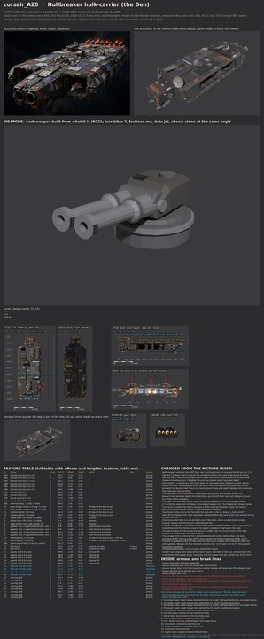

# corsair_A20 build sheet: Hullbreaker hulk-carrier (the Den) (issue 633, first sheet)

Ashfall Hullbreakers hulk-carrier (the Den), class Carrier (16.5 world units, godot/render/hull_table.gd CLS_LEN); data.js c_hulk: turret T twice, ability launch, hangar 2. The model is 16.50 long. Designer of record: Opus (R205, R207); the Board is the final designer (R233). Built from the accepted concept of PR 625 (contrib/muse/design/class_family_corsair_2026_11/, corsair_A20_beauty.jpg, v2s, Ryan Nov 12 2026) and designs.md, the design of record for the fittings. The views were rendered in the Opus sandbox (Blender 5.3 as a Python module, CPU, 20 samples) from the same build.py; no PC run yet: the Board runs the recipe there after reviewing this sheet. Paint: `bake: none` (the sheet paint stack, PR 610, is not merged).

**Start here (R229, the whole concept first):** [whole beauty beside the whole build](../../../shots/issue_633_hullbreakers/a20_whole_compare.jpg), [side against the concept sheet's side](../../../shots/issue_633_hullbreakers/a20_side_compare.jpg), [plan against plan](../../../shots/issue_633_hullbreakers/a20_top_compare.jpg), then the [bow](../../../shots/issue_633_hullbreakers/a20_bow_compare.jpg) and [stern](../../../shots/issue_633_hullbreakers/a20_stern_compare.jpg); the five Hullbreakers from above at one scale: [hullbreakers_lineup_top.jpg](../../../shots/issue_633_hullbreakers/hullbreakers_lineup_top.jpg). Then [side_by_side.jpg](side_by_side.jpg), [cells.jpg](cells.jpg) and [fit_view.jpg](fit_view.jpg).

## What the class is (the Board as designer, R233)

A wide flat slab with a narrow bow block carrying two big intake tubes, a salvage deck of three stacked plate tiers with lockers bolted down and a spare engine bell lying cold in a cradle, and five mismatched bells along the top of the stern, one in a violet Eclipse housing. Both hangar mouths are on the PORT flank, low (Ryan's ruling; the sheet's side view is the layout of record): the hull's core runs narrow there, so each mouth is a real recess 1.9 deep with a torn plate rim, armoured doors slid clear on rails, launch rails on the floor, ceiling beams with a dim red lamp, wall ribs and an inner blast door. A cobbled fighter (the game's 1.6) noses out of the forward mouth and a second is parked in the aft one. Its outline from above is a long rectangle with a narrow bow block, the widest Hullbreaker for its length; the starboard wall is closed patchwork brick. Two dorsal turrets (data.js), two shoulder dishes, a pair of bow grabbers and two heavy grapple arms folded flat under the stern quarters.

## Checks (all on this sheet's build)

| Check | Result |
|---|---|
| Fit check, seven tests (CLASH, MOUNT, ARC, SWEEP, EXHAUST, EXIT, LANE) | CLASH 0, MOUNT 0, ARC 0, SWEEP 0, EXHAUST 0, EXIT 0, LANE 0, all zero ([fit_report.md](fit_report.md)) |
| Machines on a seam (R226), sandbox stage 4 audit | 0 of 22 machines across a seam; structure across: H1, H2, HB1, HB5, L3 |
| Audit (tools/recipe/audit.py) | PASS: 0 problems |
| Audit self-test (audit_selftest.py) | PASS, all nine cases |
| Contract self-test (sheet_contract_selftest.py) | PASS on PR 618's contract (its slot_map deals the two turret T slots; main's slot_index refuses a doubled pair) |
| Insides inside the skin (every inside vertex enclosed by the intact outside, rays six ways) | 0 of 352 outside |
| Detail density per part type (R224, under 0.75 of the hull is a fault) | none under; lowest hangar at 1.14 of the hull's triangles and 1.22 of its edge features per square unit |
| Inventory (every part has a job, present, shaped, detailed per cell) | 0 failing ([inventory.md](inventory.md)) |
| Triangles (reported, never capped) | 75308 outside, 620 inside, 75928 in all |
| Outline overlap with the beauty at the sheet camera (reported, not a bar, RULEBOOK 5.8) | 55.9 percent (mass outline 55.9) |

The fit check, the seam and inside tests and the density were run in the sandbox (tools/blender/build_sheets/build.py fit mode; the seam, inside and density measures are scripted the same way as the Chorus sheets' check, issue 623). PR 608's death check in Godot needs the exported ship and runs on the PC.

## Proportions (concept against build, the same measure on both)

| | Hull length:beam | Hull length:height |
|---|---:|---:|
| Concept sheet, true top and side views (luminance mask over 14, median over the middle 60 percent) | 3.40 | 5.83 |
| Build (the sheet's top and side renders, same measure) | 2.71 | 5.74 |

Here the two pictures disagree: the accepted beauty (v2s, "hull deepened") draws the slab about 2.4 long for its width, the sheet's top view 3.4. The build takes 2.7 on its top view (measured over the starboard bricks and plates), nearer the beauty, as A17's head followed its beauty; it is the Board's call to look at first. The inventory's own table ([inventory.md](inventory.md)) uses a colour-difference mask that drops most of the dark concept hull, so its concept numbers read thinner than the picture; the row above is the one to read. Structure per cell is in the inventory: every cell has at least the concept's count of masses.

## Weapons, seams, breach anchors

data.js c_hulk lists turret T twice: T1 on the fore deck tier and T2 on the aft, all round. The contract deals them over the two slots in build order (slot_map, PR 618); main's slot_index refuses a doubled pair, so this sheet needs PR 618 merged before its recipe run. Bays: hp_bay_0 and hp_bay_1, one per mouth, launching to port, hangar 2. Three authored seams: B-1 the fore weld, B-2 through the hangar block between the mouths (the plate between them tears first and the craft spill, designs.md), B-3 the aft weld; machines kinked round. Seven breach anchors (carrier base 6, plus one), uneven, port anchors off the mouths.

## Changed from the picture (R207, R233)

- **Both hangar mouths on the PORT flank, low, the forward one 3.4 long and the aft one 2.8, 1.37 high and 1.9 deep.** Ryan's ruling for the round (the sheet's side view is the layout of record; the front view's mouths either side of the intakes are a drift); sized between the sheet's side view and the beauty so a 1.6 fighter fits and they read as launch bays with depth
- **Each mouth is a real recess with a torn plate rim, armoured doors slid clear on rails, launch rails on the floor, ceiling beams, a dim red lamp, frame ribs and an inner blast door on the back wall.** the Board's brief: they must read as launch bays with depth; designs.md's armoured doors slid open and red lamps
- **The bow block's front corners are closed plate, carrying the two shoulder dishes.** the beauty's front openings beside the intake block are the drift Ryan ruled out; designs.md puts the dishes on the shoulders
- **The slab is 5.5 wide over its hull, about 6 over the starboard bricks (hull length to beam 2.7 on the top view) and 2.05 deep.** the accepted beauty (v2s, "hull deepened") draws it about 2.4 long for its width, the sheet's top view 3.4; the build sits between, nearer the beauty (R229: the whole concept; as A17's head followed its beauty)
- **Two dorsal turrets, one on the fore deck tier and one on the aft.** data.js c_hulk: turret T twice (R221); designs.md's bow casemates, starboard flank guns and rocket rack have no slot, so they are not built
- **Five mismatched bells in a row along the top of the stern, one in a violet Eclipse trophy housing.** designs.md; the picture's eight become five
- **A fighter nosing out of the forward mouth and a second parked deeper in the aft one, both 1.6 long.** designs.md (the forward mouth); the game's squadron length gives the scale
- **The spare engine bell lies across the deck in a cradle, cold.** the picture's bell on the deck; designs.md: bolted down flat (field repairs)
- **The salvage deck is three low tiers of stacked plate with lockers bolted down, not loose junk.** Ryan R185: nothing hangs off the ship; stacked and bolted scrap brick (R196, R197)
- **One pair of grabbers under the bow block and two heavy grapple arms folded flat under the stern quarters.** designs.md (four bow arms become two, so the jaw is not A17's; the grapples drag prizes alongside)
- **Four attitude thrusters.** a ship in space needs them to turn
- **Insides: two hangar deck levels behind each mouth, loot holds in the bow, a kennel deck, the core between the hangar decks, machinery and the engine room aft.** designs.md; R209, R215

## Open

- Belly detail between the bow grabbers and the stern grapples is designed here; the picture does not show the underside
