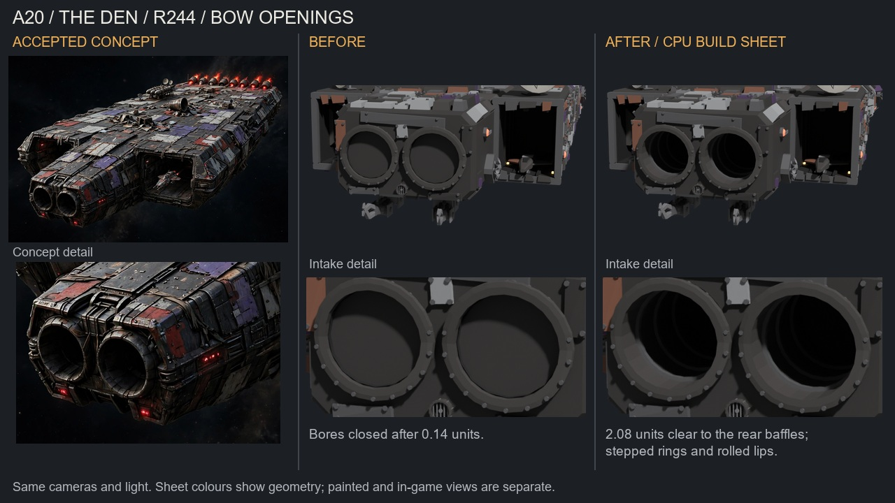

# A20 build sheet: the Den, R244 (issue 688)

Current record: rebuilt on Ryan's PC on Nov 16, 2026 from the merged R244 design and weapon-match work. Carrier class length stays **16.5**. The two bow openings have depth, rolled lips, inset rings and dark rear baffles. The flanks have broad shoulder facets, lower chines, a recessed waist and stepped armour wedges.

Start with the named [bow before and after](A20_bow_R244_before_after.jpg) and [side before and after](A20_side_R244_before_after.jpg), each beside the accepted concept. Both are 1280 x 720. The before captures are retained from run 1; the after captures were rebuilt in this run with the same cameras and light.

The [full construction sheet](sheet.jpg) now shows the R244 ship. It is 6,941,573 bytes, below the 8 MB runner limit, re-encoded at JPEG quality 85. [Preview](preview.jpg), [whole concept and build](beauty_vs_blockout.jpg), [feature table](feature_table.md), [inventory](inventory.md), [manifest](manifest.json), [fit report](fit_report.md). Sheet colours are geometry proof, rendered with Cycles CPU at 12 samples; the paint pictures below show the shared stack.

## What changed and what stays

- The bow housing is cut behind both existing intake tubes. Removing the redundant smooth liners exposes the stepped rings. Both bores are clear for at least **2.08 units**, against **0.14** before. Seventeen rays per bore test all outside geometry, then repeat with the interiors present. No room blocks either bore. The bow loot locker is behind the wells.
- The hull has upper chamfers, lower chines and diagonal shoulders into a narrower waist. Four starboard armour blocks are tapered wedges. Flank fittings and hard points follow the new skin. [Port detail](A20_flank_detail_after.jpg), [starboard detail](A20_flank_starboard_after.jpg), [bow detail](A20_bow_detail_after.jpg).
- R239 stays: two dark hangar mouths face forward, clear of the intakes. R240 stays: irregular Hullbreaker patchwork, warm hangar deck lights and guns clear of dishes and antennae.
- The intakes add no weapons. data.js c_hulk still has two turret T slots, one twin-barrel turret per slot and four registered muzzles. Five stern engines, two hangar launch points, three authored break seams and seven breach anchors remain. Full inside spaces stay behind the dark liner.
- ships.md section 0 keeps R241 as rule 11 and R244 as rule 12. render_R244.py sets SHEET_DEVICE=CPU. No build.py string replacement remains.

## Painted and in-game proof

The authorized GPU run completed recipe stages 4 to 7 from this branch in an isolated checkout, installed there, and read the installed ship back through Godot. No game assets in this working tree were replaced. The launcher was adapted from HB_PAINT_R240.bat for A20 only; its output is in the PC's hb696out folder.

[Whole concept and paint](paint/A20_paint_full.jpg), [six painted views](paint/A20_paint_views.jpg), [bow](paint/A20_paint_bow.jpg), [midships](paint/A20_paint_midships.jpg), [stern](paint/A20_paint_stern.jpg), [engines](paint/A20_paint_engines.jpg), [battle size](paint/A20_paint_cam170.jpg), [in-game camera 170](paint/A20_ingame_cam170.jpg), [in-game camera 60](paint/A20_ingame_cam60.jpg). These named comparison pictures are no taller than 720 px. Paint uses the shared Hullbreaker stack, 4096 maps, 64 samples, OPTIX, battle lift 1.25; export maps are 2048.

## Checks and cost

[Validation record](R244_validation.json): contract, weapon match, all eight fit categories including SENSOR, audit, audit self-test, export, export self-test, installed readback, authored interiors and death seams PASS. No machines split and no inside triangles outside their wreck piece. The full standing suite passed with 56 PASS and 2 KNOWN, zero FAIL or SKIP, after the stale sheet/manifest mismatch was corrected. Weapon-match self-test: 36 planted faults, 19 sheet ships.

Budget: **92,830 triangles** (89,978 body plus 2,852 turning turrets), **17 glTF material primitives**, 16,527 authored inside triangles reported by Godot. [Paint density](paint/density_PC.json), [surface check](paint/surface_check_PC.json), [running lights](paint/lights_PC.json), [studio benchmark](paint/studio_bench_PC.json).

The [scene measurement](paint/scene_gate_A20_PC.json) is a #207 variant with enemy d_harvester replaced by c_hulk so the new A20 is actually drawn. It retains the 20-ship 8/6/4/2 tier mix; only the temporary checkout's benchmark roster changed. Two full runs, second kept, three sessions per mode: 1080p frame median **3.699 ms**, 4K GPU median **5.512 ms**, both below 12.5 ms. The first attempt stopped for missing other hulls; the existing PC base cache was linked into the temporary checkout before both measured runs. No baseline was changed.

Known limits for the Board: Cycles emitted five SVM shader stack warnings during the hull normal bake. The surface check still found zero exposed room or bare pixels, but those warnings are not claimed fixed. Paint density has zero flags; mesh density flags the hangar at 8614.2 triangles per square unit versus the hull's 11558.6 (rounded ratio 0.75). These shared-stack/detail findings are recorded, without changing the paint pipeline or adding a part outside this job. The Board still ratifies the flank pictures and the boolean well mechanism before merge.

Outline overlap is reported, not a gate: before 54.06%, after 53.43%, measured at the existing concept camera. See [checks.json](checks.json) for the mask method. [Contract](R244_contract.json), [audit](R244_audit.json), [painted export](R244_export.json), [export check](R244_export_check.json), [weapon match](weapon_match.json). The earlier weapon_proof.json and density_sandbox.json are historical records, not this run's proof.
