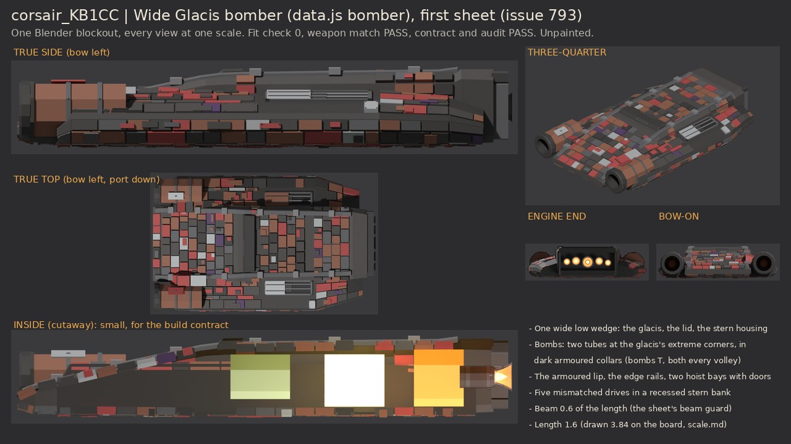
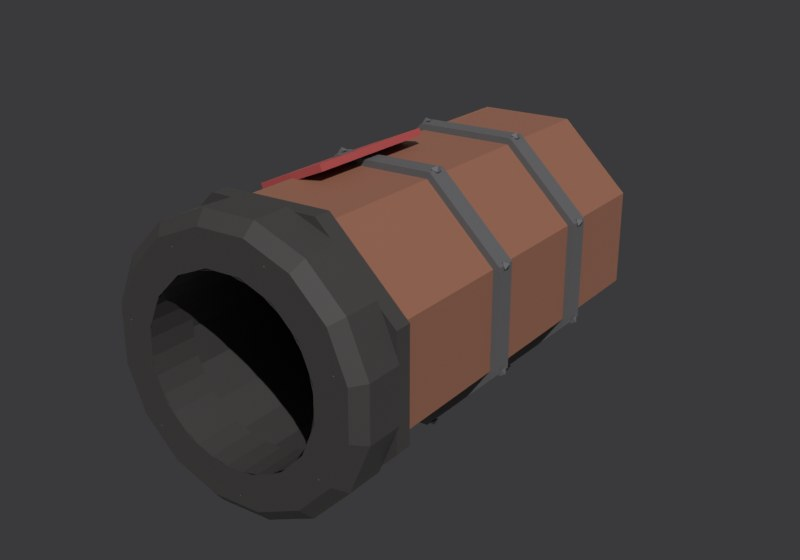

# corsair_KB1CC build sheet: the Wide Glacis, the Ashfall Hullbreaker bomber wing craft (first sheet)

Issue 793. Hullbreaker bomber, data.js `bomber` (cls Squadron, `bombs` T: Bomb payload, 2 shots; hp 28, sp 5; the Hullbreakers
launch bombers, data.js FACTIONS corsair sq 'bomber'). Concept of record: KB1C-C, the Wide Glacis
(contrib/muse/design/squadron_concepts_2026_11/hullbreakers/round_3/KB1CC.jpg; R259, Ryan, Nov 15: "the best by far", still a space
bomber, never a boat, barge, platform or ground vehicle). His ruling keeps KB1C-C's written terms: the mouths at the glacis's
extreme corners in dark collars, the armoured lip, the beam guard (60 to 65 percent of the length). Where the render drifts from
the written sheet (design_notes_785_round3.md), the written sheet governs. Designer of record: the Opus builder; the Board is the
final designer and KB1C-C is a base (R233, R236). Rendered in the issue 793 sandbox (Blender 5.3, Cycles CPU). No paint stack
(the Hullbreaker stack applies later) and no PC recipe run in this job.

Start here: [the overview](corsair_KB1CC_sheet_overview.jpg), [the whole concept beside the build](corsair_KB1CC_compare.jpg)
(R229), [the three issue 793 craft beside their flagships at true game scale](../hegemony_HF1D/issue793_craft_true_scale.jpg),
[the three at the battle camera, game size](../hegemony_HF1D/issue793_craft_battle_cam.jpg), [the weapon review](weapon_review.jpg)
(R241), then the full [sheet](sheet.jpg), [side_by_side.jpg](side_by_side.jpg), [fit_view.jpg](fit_view.jpg) and
[cells.jpg](cells.jpg) (the concept is one three-quarter picture with no true views, so cells.jpg shows it in place of the top
and side views).

Files: design `tools/blender/build_sheets/ships/corsair_KB1CC.py`, inventory `corsair_KB1CC_inv.py`, beauty camera
`corsair_KB1CC_camera.json`, recipe entry `tools/recipe/ships/corsair_KB1CC.json` (bake none), the craft parts in
`tools/blender/kits/hullbreakers/craft.py` (the kit's README, "Squadron craft": a module of its own, because the kit's parts.py is
hashed into the A16 fixture), the sandbox helpers in `contrib/opus/tools/issue793/`.

## Size (scale.md wins)

LENGTH 1.6, the hull table's CLS_LEN['Squadron']; the board draws a craft at 1.6 x SHIP_K 1.6 x SQUADRON_K 1.5 = 3.84
(docs/playbooks/scale.md, Squadron rows, binding). Every station in the design file is a share of LENGTH. Measured off the views:
1.60 long, 0.98 across the corner pods (0.61 of the length: inside the sheet's beam guard), 0.27 tall.

## The design, in short

1. **The central body**: its top one continuous shallow glacis from the bow toe up to an armoured lip, the flat lid behind it, a
   step up to the stern housing; a flat belly with chines. Armoured edge rails with bolted clamps frame the glacis and the lid.
2. **The armoured lip** across the top of the glacis ends the slope (so it reads as armour on a hull, never a ramp) and carries
   the crew's vision slit (no canopy).
3. **Two bomb tubes** (bombs T) at the glacis's extreme corners, the widest-separated pair in the field: each a dark armoured
   collar with welded bolts round a dark bore, the next salvaged bomb's nose seated deep inside, on an eight-sided armoured drum
   that runs back into the flank. Fixed forward: the bomber turns onto its target. Both fire every volley.
4. **Two shoulders** behind the pods, their tops sloping down and out to a thin edge (a flattened six-sided section, never a box on
   two track-like sponsons), each holding a bomb row; the starboard one a touch lower and shorter (lopsided). In each shoulder's
   slope a **hoist bay**: a heavy frame, pipes and the hoist block, an armoured door in a second tone.
5. **The thruster bank**: five mismatched salvaged bells, the centre one the largest, in a recess (a hood, cheeks and a sill) in
   the stern housing's aft face.
6. **Plating**: the Hullbreaker courses (scrap brick at the craft's own plate size, patches over joints, terraced tops), rust and
   dried blood the main tones with soot and iron between and a few big trophy patches (R240, R252).
7. **INSIDE** (small, for the build contract only): the two magazine rows in the shoulders, the crew cell under the lip, the
   reactor, the drive room; one seam (B-1) at a weld ahead of the stern housing. The game shows a craft's death as a spark
   (godot/fx/fx_death.gd `_wing_death`), so nothing breaks open.

## Weapons (R221, R241)

| Weapon | Mounts | data.js and lore | Built as |
|---|---|---|---|
|  Bomb payload (bombs) | BT1, BT2 | 2 shots, 9 damage, range 1 (k sq), pierce 0.6; battle look `bombs` | one bomb tube in each corner pod: a dark armoured collar with welded bolts, a bore with a bomb nose seated deep inside, an eight-sided drum with two riveted bands and a welded patch |

Weapon match (`weapon_match.json`): **PASS**, 0 problems. Slot 0 bombs T, 2 shots: BT1 and BT2, one muzzle each, the same type,
mount and size; both fire every volley. The table already allows bombs on a fixed bomb-tube launcher (FITS `bombs`); no new row.

## Checks (sandbox, Nov 15 2026)

| Check | Result |
|---|---|
| Fit check (clash.py) | 0 of every kind; 107 objects, 10 parts, 76 rays, 5 exhaust cones, 3 apertures, 4 lanes ([fit_report.md](fit_report.md)); the first layout's bells touched (fixed, see the report) |
| Weapon match and `weapon_match_selftest.py` | PASS; self-test PASS (36 planted faults, 7 of them craft faults) |
| Build contract (`sheet_contract_selftest.py`) | PASS: length 1.6, 1 transverse seam, 2 muzzles in slot 0, 5 engines, 5 inside objects, the skins; its three broken inputs refused |
| Stage 4 audit (`audit.py` on the sheet_hull build) and `audit_selftest.py` | PASS: 61 parts, none across the seam; self-test PASS (BT1 moved onto the seam is refused, W1 the slit allowed as structure) |
| Inventory (R218, R221) | 0 failing; every built part has a job ([inventory.md](inventory.md)) |
| Outline overlap at the camera set to KB1C-C's view | 51.4 percent (reported, not a bar; [outline_check.jpg](outline_check.jpg)): the render draws the craft far wider than the sheet's beam guard, and a free fit turns the craft side-on, so the view angles are set by eye and the whole craft framed (see `corsair_KB1CC_camera.json`) |
| Detail density, mesh (R224) | nothing flagged: the tubes 1.08 of the hull's triangles per square unit, the bays 1.5, the drives 13.7 ([density_mesh.json](density_mesh.json)) |

## Budget (the stage 4 sheet_hull build)

30,828 triangles outside, 140 inside; 13 outside materials (soot, soot2, rust, blood, iron, steel, pale, violet, dark, ember,
glow, warhead, brass), so about 13 draw calls a craft once joined by material, against 5 surfaces for today's code-built craft. A
wing of four: about 123,300 triangles. Against the Sunward pair: SF3 18,606 outside and 7 materials, SB4 20,516 and 6. The courses
plating is most of the triangles (the hull 21,192 of them) and the trophy and patch tones most of the materials; the paint stack
would fold the plate tones into one textured surface. Reported, not capped; the scene gate is not measured here.

## Changed from KB1C-C (every change, with its reason)

The full list is in [feature_table.md](feature_table.md), "Changed from the picture"; the same list is on the sheet. In short: the
beam held at 0.61 of the length (the render draws it far wider); the corner mouths are dark bomb tubes, not lit like engines, and
fixed forward; an armoured lip with a vision slit ends the glacis; the side bays are the bomb hoists in the shoulders' slopes; the
shoulders slope to a thin edge and the pods sit at mid-height on the corners, so nothing hangs under the hull and nothing reads as
track or roller; the stern row is five mismatched bells in a recess; no dishes, claws, antennas or lamps at this size.

## Open

- The colours are schematic zones; the Hullbreaker paint stack (rust, soot, trophy colours, the red running lights) paints the
  craft later.
- The render reads wider than the beam guard allows; if Ryan wants the render's width, it is a one-line change in the design
  file (the shoulders' reach), but it breaks the guard he kept.
- How a sheet craft reaches the game: the game builds every craft in code today (godot/render/squadron_craft.gd), so no stage 7
  export or install here.
