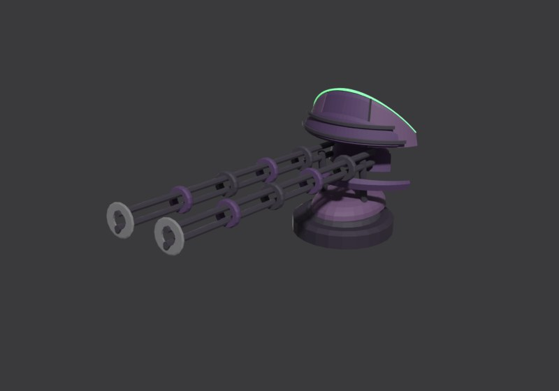
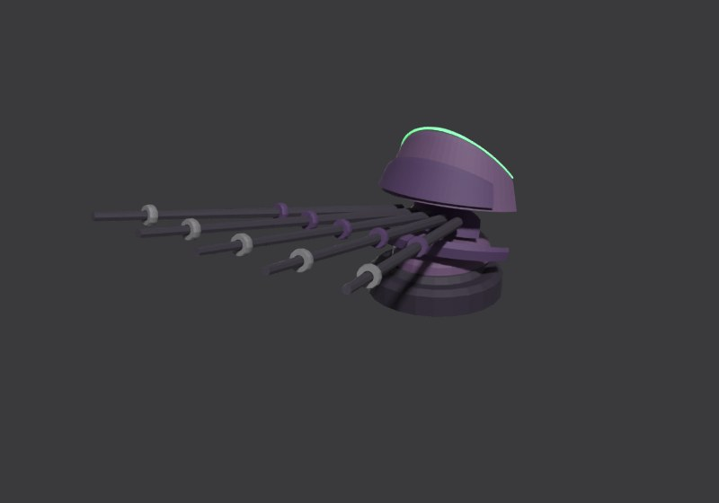
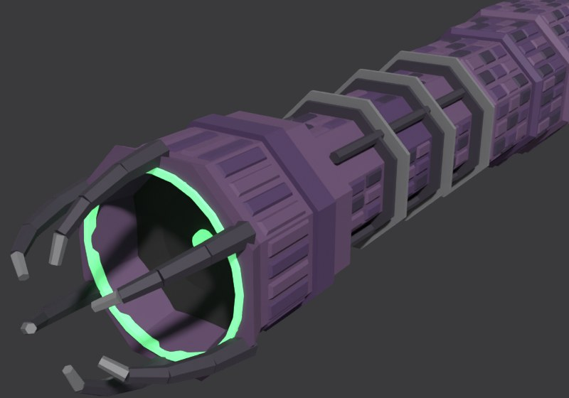

# deathless_E11 build sheet: The Unsetting, the Eclipse flagship (third sheet: R221 weapons, pass 2)

Eclipse flagship, class Tomb-ark, **28.0 world units** (godot/render/hull_table.gd CLS_LEN['Tomb-ark']; data.js `d_boss`:
gauss T, gauss T, doom F, flak T; ability nova, the spinal shell). Accepted picture:
contrib/muse/design/concept_round8c_2026_11/deathless_E11_beauty.jpg and _sheet.jpg (R206). Designer of record: Opus (R205,
R207). Issue 532. Rendered on Ryan's PC (Blender 4.5, GPU), blockout
`C:\Users\rcbai\Downloads\voidsworn_test\opus532e\w\w3\deathless_E11\deathless_E11_blockout.blend`; the model is 28.04 long.
Second and third sheets (R221): the weapons rebuilt from the lore, then (pass 2) in the hull's own curved, layered, banded
language; the barbettes slimmed to the turret feet; the hull, crescent, engines and camera are unchanged from the first.

## Through the recipe (issue 618)

Recipe entry `tools/recipe/ships/deathless_E11.json`: data.js `d_boss`, game folder `D22_23` (the Eclipse Tomb-ark), length 28.0
read from this sheet, `bake: none` (unpainted until the Eclipse paint stack). Pictures beside the WHOLE concept at the same camera
(R229): [whole ship](../../../shots/issue_618/e11_whole_compare.jpg), [plan against the sheet's top view](../../../shots/issue_618/e11_plan_compare.jpg),
[side against the sheet's side view](../../../shots/issue_618/e11_side_compare.jpg), the [stern](../../../shots/issue_618/e11_stern_compare.jpg)
and the [bow](../../../shots/issue_618/e11_bow_compare.jpg); the same before the massing round are in [before/](../../../shots/issue_618/before/).
Views and the sheet re-rendered in the sandbox (Blender 5.3, Cycles CPU, 12 samples).

Changes for the build (each is in "Changed from the picture" in [feature_table.md](feature_table.md)):
- **The Board's massing round, judged against the whole concept.** The crescent is one thick tiered band: the broad outer band
  flush with a thick outer wall, the inner layer stepped down close inside it, the root layer on the band (it read as two thin
  blades with a wide gap). The stern carries three big nozzles stacked one over another, each a third of the stern's height,
  standing 2.3 clear behind the body (it was a diamond of four hidden behind the feathers): the body ends 0.6 sooner and the
  last feather row ends with it.
- **Seams round machines (R226).** B-1 kinks aft round the projector's breech collars; B-2 runs aft of the collar thrusters.
- **Two peel seams.** B-3 (dorsal tiers) about 1.7, so its torn edge clears the upper deck; B-4 (crescent layers) a level plane
  at 0.9 over the projector, because the game's peel seam is one level plane per compartment.
- **Detail density (R224).** The kit lays plate courses at the hull's plate size on the projector and stiffener rings on the
  engine bells. Lowest part type against the hull: the projector, 0.89 (was 0.44 / 0.33 before this job).
- **Hard points.** Two boarding origins on the flanks; the projector's hard point is its lens (the horns' meeting point is open space).

Outline overlap at the camera of record: 74.9 percent with this job's mask (luminance over 28, closed, filled, largest shape;
75.6 before the massing round and on the sheet geometry). Reported, not a bar.

Start here: **[side_by_side.jpg](side_by_side.jpg)** (concept left, blockout right, same camera, full view then bow, midships
and stern at the same windows), then [fit_view.jpg](fit_view.jpg) and [cells.jpg](cells.jpg).

## Weapons (R221): each built from what it is

Ryan, Nov 12 (R221): "their turrets look the same as hullbreakers. We should have those be more unique per fsctions and fit the
actual weapons they use per lore Bible and faction rules." The concept draws generic box turrets with round twin barrels; the
build follows the lore instead (RULEBOOK 4.11, ships.md 2c; the design lines are in `tools/blender/kits/eclipse/README.md`).
None is a breech-and-barrel cannon. The sheet's weapon row shows each beside its lore line.

Pass 2 (Ryan, 07:40 and 07:41 CST: the turrets "read chunky" and "look super blocky in comparison to the rest of the ship"):
every weapon is rebuilt in the hull's own language and detail level (RULEBOOK 5.16): thin curved crescent shades of seamed,
bevelled, layered plates with plate courses, slim round rails and needles banded like the hull's collars, small oval shells
and round feet; no boxes, square frames or hex drums. Judged at the beauty camera beside the hull.

| Weapon | Mounts | Lore and rules | Built as |
|---|---|---|---|
|  Null cannon (gauss) | T1, T2 | 3 shots, 6 damage, ignores half of armour; the effect lights coils breech to muzzle, a near invisible slug, a shock ring | a rail gun: two slim round rail pairs with banded collars stepping down, reaching well past a thin arched crescent shade (three seamed bevelled plates, a stepped layer, plate courses, a corona crest), crescent capacitor fins behind on a small oval shell |
|  Null shredder (flak) | F1, F2 | 3 shots, 3 damage, range 2, point defence; the effect is instant streaks to a spread of airbursts | a fan of five thin round needle rails with banded collars, splayed side to side, out of a small layered crescent shade on an oval shell, two crescent capacitor fins |
|  Corona arc (doom) | A1 | one heavy blow every other turn; arcs crawl on the emitter, then a re-striking arc; the crest is a black disc in a thin ring | an arc emitter: a capacitor column (disc banks, feed conduits) ending in the crest, a black shade disc in a thin corona ring with a small lens, under a crown of six electrode horns |

## Proportions and structure (measured the same way on the concept and the build)

| | Hull length:beam | Hull length:height | Envelope length:beam | Envelope length:height |
|---|---:|---:|---:|---:|
| Concept (8c sheet, true top and side views) | 5.72 | 7.00 | 2.49 | 4.49 |
| **Build** | **5.59** | **6.54** | 2.59 | 4.11 |

Hull: length over the median beam or height across the middle 60 percent. The crescent is 10.85 across (concept 10.8), its
back at 39.6 percent (concept 39.6). Structure per cell (concept by eye / build): bow top 6/7, bow side 5/7, mid top 8/9,
mid side 8/9, stern top 8/17, stern side 8/12; every cell at or above the concept's count ([inventory.md](inventory.md)).
Outline overlap at the camera fitted to the beauty: 82.9 percent on the first sheet (reported, not a bar; [outline_check.jpg](outline_check.jpg); the
camera and hull are unchanged, only the turrets' outline moved, so it was not refitted).

## The design, in short

1. **The crescent shade**: three stacked layers (a broad lower blade, an upper layer stepped in from the rim, a short root
   layer), thick at the inner wall round the projector and knife-thin at the rim, falling 1.6 from the root to the horns, with
   a thin green-white corona line on every rim (factions.md: "a thin, cold green-white line along the rim of every shade
   plate"). Its root rides over the body's nose, as the plan shows. Dense plates over every face.
2. **The corona arc emitter** (doom F) on the axis through the crescent: stepped octagonal breech collars out of the
   crescent's inner wall, a capacitor column (segments, stacked disc banks, feed conduits), and the emitter head: a black shade
   disc in a thin corona ring with a small lens, under a crown of six electrode horns (R221; see Weapons above).
3. **The body**: a long oval section (flatter over the deck, round in the flanks and belly), widest behind the crescent,
   waisted at the band collar (77 percent), flaring at the stern; a layered plate tier along the spine; a flank belt of armour
   boxes; a skirt of tall narrow plates; the heavy band collar; three rows of twelve swept shade blades round the stern.
4. **Batteries by data.js slot**: T1 and T2, the null cannons (gauss T, gauss T: rail pairs through crescent shades), on the
   centreline on low round drums, T2 superfiring; F1 a null shredder aft (flak T, the concept's small turret: a needle fan)
   and F2 its twin on the belly.
5. **Engines**: a diamond of four eclipse engines (ribbed faceted drums, vanes, a short bell, a pale corona ring round a
   black shade disc; no flame).
6. **INSIDE**: three decks, eight frames, the capacitor bank behind the projector, two archive vaults, dark decks, magazines,
   the core (its light shows through the hex core port on the deck), shade machinery, the engine room. Four break lines by the
   Eclipse rule (in layers): the crescent's layers peel band by band (B-4), the dorsal tiers peel off with the batteries (B-3),
   the crescent root tears from the neck (B-1), the stern tears at the band collar (B-2); eight breach anchors on the shade
   bands (Tomb-ark base 8, Eclipse +0).

## Fit and inventory

- **Fit check: zero** (clash, mount, arc, sweep, exhaust, exit and the new LANE: no gun in a weapon's firing lane or
  backblast) on the PC run (w3) and in the sandbox; 243 objects, 29 parts, 475 rays, 4 turrets each turned through 73
  bearings and free to turn all the way round, one firing lane (the corona arc's, forward of the horns). The rebuilt weapons
  checked at zero on their first full run, in both passes. The first full layout had 3 findings (the aft flak twin through the
  deck housing; T1's aft fire blocked by T2's plinth); [fit_report.md](fit_report.md) lists them and every fix.
- **Inventory**: 21 lines written from the concept before modelling (commit 884ae8b8), each now naming its job (R221: what it
  does on the ship); the weapon lines carry their own types (nullcannon, shredder, corona_arc) and sub-parts; every line
  present, shaped and detailed in every cell; every built part has a job; 0 failing.
- Turrets are pivoted parts (R219): `<id>_turret` empties with turret, slot, weapon, arc_lo, arc_hi, arc_deg, rest_yaw,
  rest_pitch; the projector is fixed (`gun_fixed=1`). See [manifest.json](manifest.json).

## Changed from the picture (R207), and why

Every change, with its reason, is in [feature_table.md](feature_table.md) ("Changed from the picture"). New on this sheet: the
weapons are built from the lore, not the picture's generic turrets (R221, above). The others: the
engine cluster is a diamond of four (the side view and the beauty stack three, the plan shows two: a diamond reads as all
three); eclipse-ring engines, not flame; the green hexagon on the deck is the core port, not a gun (the flak slot is the
small twin); the crescent is three layers with a corona line on each rim; low drums under both batteries (the fit check found
T1 firing aft into T2's barrels); the crescent band is 1.65 wide at its sides, between the plan's 1.3 and the beauty's
broader read.

## What still differs from the concept, and why

- **Surface**: the concept is many small weathered plates in rows (horizontal plate courses along the body) in mixed mauve,
  violet and grey-green; the blockout has the plates and steps at a coarser size in flat schematic colour. Texture, wear and
  the plate courses are the paint stage (recipe 4 and 5).
- **The crescent** reads a little narrower and less domed than the beauty's fat brim, and the horns sweep a little less far
  round; the plan of record (the sheet's top view) is held.
- **The weapons** differ from the picture on purpose (R221): the picture's turrets are boxes with round twin barrels, ours
  are slim banded rail pairs behind thin crescent shades; its projector ends in a plain bore with a green dot, ours in the
  crest disc under a crown of horns. At the beauty camera the shades read as smooth curved hoods with a green crest (their
  seams and plate courses are fine at that distance, and flat colour hides them; the paint stage carries plate contrast),
  the rails as long thin banded lines reaching forward, as the concept's barrels do.
- **The projector** in the beauty is longer and heavier, with more collar steps; ours has three collars and three segments.
- **The stern**: the concept's three big stacked drums dominate the stern; our diamond of four is a little smaller, and the
  feathers lie flatter.

## Files

[sheet.jpg](sheet.jpg) (beauty and blockout, true side, top, underside, bow-on, engine end, INSIDE cutaway, feature table,
changes, fit view, nine cells), [feature_table.md](feature_table.md), [inventory.md](inventory.md), [cells.jpg](cells.jpg),
[cells.json](cells.json), [fit_report.md](fit_report.md), [fit_view.jpg](fit_view.jpg), [fit.json](fit.json),
[manifest.json](manifest.json), [checks.json](checks.json), views: [side](side.jpg), [top](top.jpg),
[underside](underside.jpg), [bow-on](bow.jpg), [engine end](stern.jpg), [cutaway](cutaway.jpg),
[three-quarter](threequarter.jpg), [outline overlay](outline_check.jpg), [beauty against blockout](beauty_vs_blockout.jpg);
weapons alone: [null cannon](weapon_gauss.jpg), [null shredder](weapon_flak.jpg), [corona arc](weapon_doom.jpg).
Design source: `tools/blender/build_sheets/ships/deathless_E11.py`; inventory `ships/deathless_E11_inv.py`; part shapes
`tools/blender/kits/eclipse/parts.py`.

Third sheet rendered on the PC as `opus532e\w\w3` (Blender 4.5, GPU; `w\run.bat`), the sheet text included.
