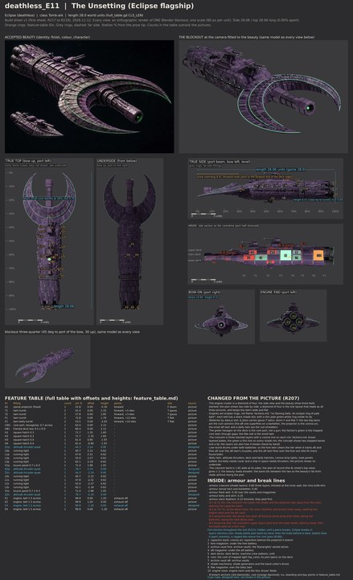

# deathless_E11 build sheet: The Unsetting, the Eclipse flagship (first sheet)

Eclipse flagship, class Tomb-ark, **28.0 world units** (godot/render/hull_table.gd CLS_LEN['Tomb-ark']; data.js `d_boss`:
gauss T, gauss T, doom F, flak T; ability nova, the spinal shell). Accepted picture:
contrib/muse/design/concept_round8c_2026_11/deathless_E11_beauty.jpg and _sheet.jpg (R206). Designer of record: Opus (R205,
R207). Issue 532. Rendered on Ryan's PC (Blender 4.5, GPU), blockout
`C:\Users\rcbai\Downloads\voidsworn_test\opus532e\e6\deathless_E11\deathless_E11_blockout.blend`; the model is 28.04 long.

Start here: **[side_by_side.jpg](side_by_side.jpg)** (concept left, blockout right, same camera, full view then bow, midships
and stern at the same windows), then [fit_view.jpg](fit_view.jpg) and [cells.jpg](cells.jpg).

## Proportions and structure (measured the same way on the concept and the build)

| | Hull length:beam | Hull length:height | Envelope length:beam | Envelope length:height |
|---|---:|---:|---:|---:|
| Concept (8c sheet, true top and side views) | 5.72 | 7.00 | 2.49 | 4.49 |
| **Build** | **5.59** | **6.47** | 2.59 | 4.32 |

Hull: length over the median beam or height across the middle 60 percent. The crescent is 10.85 across (concept 10.8), its
back at 39.6 percent (concept 39.6). Structure per cell (concept by eye / build): bow top 6/7, bow side 5/7, mid top 8/9,
mid side 8/9, stern top 8/17, stern side 8/12; every cell at or above the concept's count ([inventory.md](inventory.md)).
Outline overlap at the camera fitted to the beauty: 82.9 percent (reported, not a bar; [outline_check.jpg](outline_check.jpg)).

## The design, in short

1. **The crescent shade**: three stacked layers (a broad lower blade, an upper layer stepped in from the rim, a short root
   layer), thick at the inner wall round the projector and knife-thin at the rim, falling 1.6 from the root to the horns, with
   a thin green-white corona line on every rim (factions.md: "a thin, cold green-white line along the rim of every shade
   plate"). Its root rides over the body's nose, as the plan shows. Dense plates over every face.
2. **The corona arc projector** (doom F) on the axis through the crescent: stepped octagonal breech collars out of the
   crescent's inner wall, shaft segments with bands and rails, an octagonal muzzle block, a small green lens in a dark bore.
3. **The body**: a long oval section (flatter over the deck, round in the flanks and belly), widest behind the crescent,
   waisted at the band collar (77 percent), flaring at the stern; a layered plate tier along the spine; a flank belt of armour
   boxes; a skirt of tall narrow plates; the heavy band collar; three rows of twelve swept shade blades round the stern.
4. **Batteries by data.js slot**: T1 and T2, the null cannon twins (gauss T, gauss T), on the centreline on low round drums,
   T2 superfiring; F1 a small null shredder twin aft (flak T, the concept's small turret) and F2 its twin on the belly.
5. **Engines**: a diamond of four eclipse engines (ribbed faceted drums, vanes, a short bell, a pale corona ring round a
   black shade disc; no flame).
6. **INSIDE**: three decks, eight frames, the capacitor bank behind the projector, two archive vaults, dark decks, magazines,
   the core (its light shows through the hex core port on the deck), shade machinery, the engine room. Four break lines by the
   Eclipse rule (in layers): the crescent's layers peel band by band (B-4), the dorsal tiers peel off with the batteries (B-3),
   the crescent root tears from the neck (B-1), the stern tears at the band collar (B-2); eight breach anchors on the shade
   bands (Tomb-ark base 8, Eclipse +0).

## Fit and inventory

- **Fit check: zero** (clash, mount, arc, sweep, exhaust, exit) on the PC run and in the sandbox; 241 objects, 29 parts,
  474 rays, 4 turrets each turned through 73 bearings. The first full layout had 3 findings (the aft flak twin through the
  deck housing; T1's aft fire blocked by T2's plinth); [fit_report.md](fit_report.md) lists them and every fix.
- **Inventory**: 21 lines written from the concept before modelling (commit 884ae8b8), every line present, shaped and
  detailed in every cell; 0 failing.
- Turrets are pivoted parts (R219): `<id>_turret` empties with turret, slot, weapon, arc_lo, arc_hi, arc_deg, rest_yaw,
  rest_pitch; the projector is fixed (`gun_fixed=1`). See [manifest.json](manifest.json).

## Changed from the picture (R207), and why

Every change, with its reason, is in [feature_table.md](feature_table.md) ("Changed from the picture"). The main ones: the
engine cluster is a diamond of four (the side view and the beauty stack three, the plan shows two: a diamond reads as all
three); eclipse-ring engines, not flame; the green hexagon on the deck is the core port, not a gun (the flak slot is the
small twin); the crescent is three layers with a corona line on each rim; low drums under both batteries (the fit check found
T1 firing aft into T2's barrels); the crescent band is 1.65 wide at its sides, between the plan's 1.3 and the beauty's
broader read.

## What still differs from the concept, and why

- **Surface**: the concept is many small weathered plates in rows (horizontal plate courses along the body) in mixed mauve,
  violet and grey-green; the blockout has the plates and steps at a coarser size in flat schematic colour. Texture, wear and
  the plate courses are the paint stage (recipe 4 and 5).
- **The crescent** reads a little narrower and less domed than the beauty's fat brim, and the horns sweep a little less far
  round; the plan of record (the sheet's top view) is held.
- **The projector** in the beauty is longer and heavier, with more collar steps; ours has three collars and three segments.
- **The stern**: the concept's three big stacked drums dominate the stern; our diamond of four is a little smaller, and the
  feathers lie flatter.

## Files

[sheet.jpg](sheet.jpg) (beauty and blockout, true side, top, underside, bow-on, engine end, INSIDE cutaway, feature table,
changes, fit view, nine cells), [feature_table.md](feature_table.md), [inventory.md](inventory.md), [cells.jpg](cells.jpg),
[cells.json](cells.json), [fit_report.md](fit_report.md), [fit_view.jpg](fit_view.jpg), [fit.json](fit.json),
[manifest.json](manifest.json), [checks.json](checks.json), views: [side](side.jpg), [top](top.jpg),
[underside](underside.jpg), [bow-on](bow.jpg), [engine end](stern.jpg), [cutaway](cutaway.jpg),
[three-quarter](threequarter.jpg), [outline overlay](outline_check.jpg), [beauty against blockout](beauty_vs_blockout.jpg).
Design source: `tools/blender/build_sheets/ships/deathless_E11.py`; inventory `ships/deathless_E11_inv.py`; part shapes
`tools/blender/kits/eclipse/parts.py`.

The model and fit files were rendered on the PC; the "Changed from the picture" text and the fit report's fix column were
added to the ship file after that render (text only, no geometry) and merged into model and fit json from a sandbox run of
the same file, which gives the same zero.
