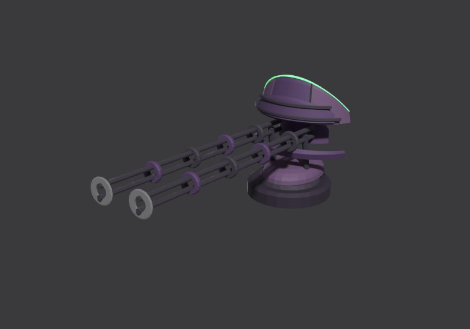
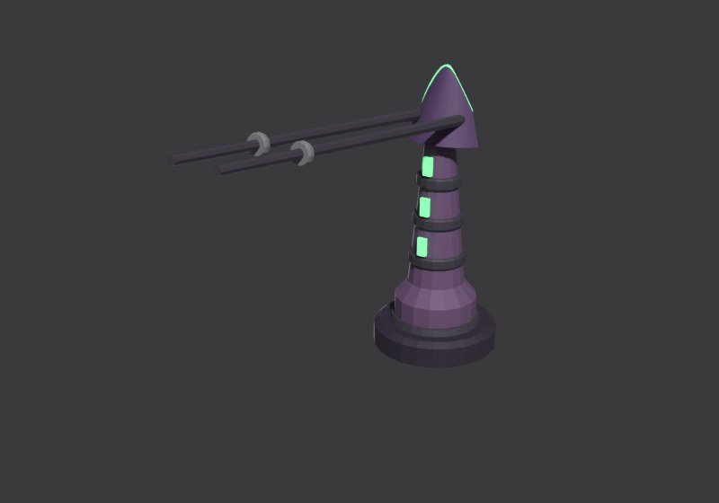
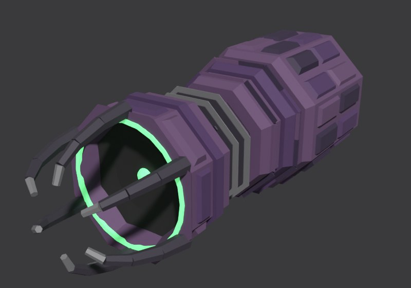

# deathless_E12 build sheet: Eclipse zenith, the ring cruiser (fourth sheet: R221 weapons, pass 2)

Eclipse cruiser, class Cruiser, **14.5 world units** (godot/render/hull_table.gd CLS_LEN['Cruiser']; data.js `d_harvester`:
gauss T, gauss T, doom F, gsentry T). Accepted picture: contrib/muse/design/concept_round8c_2026_11/deathless_E12_beauty.jpg
and _sheet.jpg (R206). Designer of record: Opus (R205, R207). Issue 532. Rendered on Ryan's PC (Blender 4.5, GPU), blockout
`C:\Users\rcbai\Downloads\voidsworn_test\opus532e\w\w3\deathless_E12\deathless_E12_blockout.blend`; the model is 14.56 long.
Third and fourth sheets (R221): the weapons rebuilt from the lore, a size up so they read, then (pass 2) in the hull's
own curved, layered, banded language; the hull, ring,
engines and both cameras are unchanged from the second.

## Through the recipe (issue 618)

Recipe entry `tools/recipe/ships/deathless_E12.json`: data.js `d_harvester`, game folder `D21_23` (the Eclipse Cruiser), length
14.5 read from this sheet, `bake: none` (unpainted until the Eclipse paint stack). Pictures beside the WHOLE concept at the same
camera (R229): [whole ship, both cameras](../../../shots/issue_618/e12_whole_compare.jpg), [plan against the sheet's top view](../../../shots/issue_618/e12_plan_compare.jpg),
[side against the sheet's side view](../../../shots/issue_618/e12_side_compare.jpg), the [stern](../../../shots/issue_618/e12_stern_compare.jpg)
and the [bow](../../../shots/issue_618/e12_bow_compare.jpg); the same before the massing round are in [before/](../../../shots/issue_618/before/).
Views and the sheet re-rendered in the sandbox (Blender 5.3, Cycles CPU, 12 samples).

Changes for the build (each is in "Changed from the picture" in [feature_table.md](feature_table.md)):
- **The stern block** (the Board's R224 pick, then its massing round): the concept's faceted box, chamfered long edges, a stepped
  neck face with green light panels on its wedge, now 1.44 across in plan (was 3.0; the concept's pod is about a third of the
  ring's half-height across), its side height kept; three big nozzles stacked one over another on its aft face, each about a
  third of the stern's height (they were three across and read small).
- **The core** is a whole sphere 1.26 across in a frame 1.63 across (was 1.11 and 1.44), and the ring plane sits on the spine's
  axis (was 0.25 below), so the sphere and frame show above and below the ring as in the concept's side view.
- **Bulkier saddles** (the Board's R224 pick): a long hexagonal plinth 1.7 by 1.04 under a stepped upper deck.
- **Seams round machines (R226)**: the block thrusters sit on the roof and belly chamfers at 4.3, off B-2.
- **Hard points**: two boarding origins on the centre arcs' outer walls; the emitter's hard point is its lens.

Outline overlap with this job's mask (luminance over 28, closed, filled, every ring piece but the escort): 38.8 percent at the
camera of record, 45.0 at the second camera (before the massing round 38.9 and 45.7; the sheet geometry 39.0 and 46.1).
Reported, not a bar.

Start here: **[side_by_side.jpg](side_by_side.jpg)**, then [fit_view.jpg](fit_view.jpg) and [cells.jpg](cells.jpg).

## Paint (issue 642, Nov 13 2026)

`"bake": "stack"`: stage 5 paints this ship with the Eclipse kit's paint stack (`tools/blender/kits/eclipse/stack.py` on
`tools/blender/kits/shared/paint_stack.py`; RECIPE.md "The paint stack for sheet ships", ships.md section 0 item 2 "The Eclipse
paint"). Masks from the ship's own geometry, a drawn trim sheet and decals, colours sampled from the concepts, never projected.
Pictures (sandbox, Blender 5.3 CPU, 1024 atlases; game light, battle lift 2.2): [beside the concept](paint/E12_paint_full.jpg),
[bow](paint/E12_paint_bow.jpg), [midships](paint/E12_paint_midships.jpg), [stern](paint/E12_paint_stern.jpg),
[six views](paint/E12_paint_views.jpg), [engines](paint/E12_paint_engines.jpg), [corona line and core close](paint/E12_paint_close.jpg);
[surface check](paint/surface_check.json), [R224 density](paint/density_sandbox.json). The game shots at camera 170 and 60
come from the PC run (`tools/pc/jobs/E11_E12_PAINT_642.bat`).

**Colour, judged at the battle lift.** The game lifts an Eclipse hull's albedo by 2.2 (R227, `godot/render/look.gd`; Ryan: "a bit
darker for eclipse"); unpainted, this ship rendered glowing white in the game. The stack's colours are the tones the plates must
show at that lift, divided by it (read from look.gd), so the ship reads dark violet-black, never lavender or grey. Plate tones
sampled from both Eclipse concepts, held to their lower half (E11's lit lilac-grey plates are the lavender Ryan ruled out);
the hue held a little stronger than the tone because AgX and the warm key take colour out of dark tones (`SAT`).

**Changed from the picture, paint (the builder's calls, R207, R233):**
- **No added running lamps** (`RUNNING_LIGHTS = None`). The red lamps are a Hullbreaker rule (R228 item 4); a row of coloured
  points along the flanks reads as a navy's or a pirate's ship. The Eclipse are machines in a system they made dark (lore 7.1):
  their only lights are the corona (the thin green-white line on every shade rim, which already marks the outline and heading
  at the battle camera), the core, the pale engine rings and the sheet's own corona strip lights over the belts. No
  `lights.json` is written; the standing light check passes with nothing to hold.
- **The green is whitened**: the corona line and the core take the concepts' rim hue whitened toward a cold white (factions.md:
  "a thin, cold green-white line"; the concepts' saturated green reads as a toxic glow). The corona line sits just over the
  game's 0.8 glow threshold, a faint edge of fire and no fat halo; the core is the one bright point.
- **The engine ring is the game's Eclipse engine colour** (`godot/fx/faction_looks.json` deathless `engine`, a pale violet, the
  colour the game's plume is drawn in) paled toward white with a touch of its white-gold `accent`, not the sheet's green: each
  ring its own brightness and tint, hot spots and dim gaps round it, the shade disc black. No flame.
- **Decals the concept does not show at its scale**: the eclipse sigil (a black disc in a broken thin ring) on the deck, a line
  of archive glyphs (this ship's own, seeded by its game code) on each flank, band ticks aft; all a dulled paler violet.
- **No rust and no soot**: machined plate, dulled and ancient; contrast from black seams and recesses and pale violet worn edges.

## Weapons (R221): each built from what it is

Ryan, Nov 12 (R221): "their turrets look the same as hullbreakers. We should have those be more unique per fsctions and fit the
actual weapons they use per lore Bible and faction rules." The concept draws generic box turrets with round twin barrels; the
build follows the lore instead (RULEBOOK 4.11, ships.md 2c; the design lines are in `tools/blender/kits/eclipse/README.md`).
None is a breech-and-barrel cannon. The sheet's weapon row shows each beside its lore line.

Pass 2 (Ryan, 07:40 and 07:41 CST: the turrets "read chunky" and "look super blocky in comparison to the rest of the ship"):
every weapon is rebuilt in the hull's own language and detail level (RULEBOOK 5.16): thin curved crescent shades of seamed,
bevelled, layered plates with plate courses, slim round rails and needles banded like the hull's collars, small oval shells
and round feet; no boxes, square frames or hex drums. Judged at the beauty camera beside the hull.

| Weapon | Mounts | Lore and rules | Built as |
|---|---|---|---|
|  Null cannon (gauss) | T1, T2 | 3 shots, 6 damage, ignores half of armour; the effect lights coils breech to muzzle, a near invisible slug, a shock ring | a rail gun: two slim round rail pairs with banded collars stepping down, reaching well past a thin arched crescent shade (three seamed bevelled plates, a stepped layer, plate courses, a corona crest), crescent capacitor fins behind on a small oval shell |
|  Null spire (gsentry) | G1 | 2 shots, 4 damage, range 3, point defence against craft; instant streaks | a sentry post: a tall slim round spire with banded collars and green sight slits, an oval head pod, two thin needle rails through a layered crescent fin, standing high to see over the block |
|  Corona arc (doom) | A1 | one heavy blow every other turn; arcs crawl on the emitter, then a re-striking arc; the crest is a black disc in a thin ring | an arc emitter: a capacitor column (disc banks, feed conduits) ending in the crest, a black shade disc in a thin corona ring with a small lens, under a crown of six electrode horns |

## Second sheet: what the Board asked, and what changed

The Board on the first sheet: (1) refit the camera to the beauty's aft three-quarter angle; (2) the spine is a thin rod in the
concept, slim it; (3) the stern block is compact with three large dark bells facing aft, the stern's most prominent feature;
(4) check the arcs against the refit view. Done:

1. **Camera of record: the beauty's aft three-quarter angle** (azimuth -122, 32 degrees aft of the starboard beam, elevation
   58), held there while only the framing was fitted (`ships/deathless_E12_camera.json`). Outline overlap 45.5 percent. The
   beauty is not one consistent camera: its bells face the viewer (an aft view) while its stern sits higher in the frame than
   its bow (a view from forward of the beam). At a true aft angle the stern is the near end, so the block lands low and large in
   the frame and the crop windows do not line up with the picture's. The side-by-side therefore adds a last row at the
   **second camera** (`ships/deathless_E12_camera_fwd.json`, forward of the starboard beam, 53.8 percent), where the ring
   layout lines up but the bells cannot show. Judge the stern on the first, the ring on the last.
2. **The spine is a rod**: 0.36 across and 0.32 deep (was 0.6 by 0.48), its collars and the turret saddles slimmed with it.
3. **The stern block is compact and low**: 1.4 tall (was 1.9), 2.95 wide, its aft face filled by three 0.92 bells standing
   out 0.95 behind it.
4. **The arcs** are unchanged (one ellipse, eight arcs). In the concept they sit at slightly different radii; on the aft view
   ours read as one ring. Left as designed: a matched oval is the sense of a built ring, and the plan shows one ellipse.

## Proportions and structure (measured the same way on the concept and the build)

| | Hull length:beam | Hull length:height | Envelope length:beam | Envelope length:height |
|---|---:|---:|---:|---:|
| Concept (8c sheet, plan and side view) | 1.94 | 15.57 | 1.77 | 5.94 |
| **Build** | **1.89** | **10.41** | 1.72 | 5.86 |

The ring is 13.0 long and 8.1 wide, centred at 43 percent, as the plan. Hull length to height is lower than the concept's
because the arcs are real box sections 0.42 deep, where the side view draws the ring as a line. Envelope length to height is
5.86 against the concept's 5.94 (the null spire now stands a little above the block, as the concept's sentry does).
Structure per cell (concept by eye / build): bow top 5/9, bow side 4/7, mid top 5/7, mid side 4/5, stern top 6/7, stern side
5/5.

## The design, in short

1. **The broken shade ring**: eight flat box-section arcs on an oval round the spine, open at the bow (the emitter fires
   through the gap) and at the stern (the engine block); each arc an armoured outer wall and top plate with plates, its inner
   bay open on frames, tanks and conduits, a thin green-white corona line on its outer rim.
2. **Every arc on its own trusses (R207)**: eight truss struts (two rails, a zigzag web, end lugs); the centre arcs get two
   each, set clear of the core cage; the stern arcs sit into the engine block.
3. **The caged core** at the ring's centre: a green sphere in two gimbal rings and four meridian bars, the spine entering its
   hub collars.
4. **Weapons by data.js slot** (R221, Weapons above): T1 and T2 null cannons on oval saddles either side of the core
   (gauss T, gauss T: rail pairs through crescent shades); the bow emitter (doom F, the corona arc: the crest disc under a crown
   of electrode horns); G1 the null spire on the block roof (gsentry T: a tall turning spire with green sights).
5. **The stern block**: compact and low, round-shouldered, a roof step and flank cheeks, three large eclipse engines side by
   side filling its aft face, green light panels, heat slot panels, hatches, four attitude thrusters on its edges.
6. **INSIDE**: block decks and frames, the archive vault in the block's taper, dark decks, the sentry magazine, the engine
   room, conduits along the spine, the core in the open. Two break lines (Cruiser): the spine parts at the core (B-1) and the
   block tears from the spine (B-2); by the Eclipse rule the arcs peel away first as their struts snap. Four breach anchors on
   the arcs (Cruiser base 4, Eclipse +0).

## Fit and inventory

- **Fit check: zero**, LANE included, on the PC run (w3) and in the sandbox; 457 objects, 30 parts, 360 rays, 3 turrets each
  turned through 73 bearings and free to turn all the way round, one firing lane (the emitter's, out through the bow gap). The
  rebuilt weapons checked at zero on their first full run, in both passes. The first full layout had 15 findings (9 clash, 6 exhaust: the bells inside the block, struts into the emitter
  collar and the core's hubs, spine-head thrusters into the collar and firing into the arcs); [fit_report.md](fit_report.md)
  lists them and every fix.
- **Inventory**: 16 lines written before modelling (commit 884ae8b8), each now naming its job (R221); the weapon lines carry
  their own types (nullcannon, spire, corona_arc); all present, shaped and detailed; every built part has a job; 0 failing.

## Changed from the picture (R207), and why

In [feature_table.md](feature_table.md). New on this sheet: the weapons are built from the lore, not the picture's generic
turrets (R221, above). The others: every arc has its own struts (the picture leaves four of seven
floating); eight arcs, the stern pair matched (the picture has one stern arc, starboard only); three engines in one row (the
plan and the beauty show three across, the side view stacks them); eclipse-ring engines; the arcs are 0.42-deep box sections.

## What still differs from the concept, and why

- **Surface and colour**: the concept's arcs are heavily plated deep indigo with a strong lit green rim; ours carry the plates
  at a coarser size in flat schematic colour (paint stage).
- **The engine block** at the aft camera is the near end, so it reads larger in the frame than the beauty's far, high block,
  and its bells are seen at an angle rather than head-on (the beauty's inconsistency, above).
- **The weapons** differ from the picture on purpose (R221): its turrets are boxes with round twin barrels, ours rail guns
  behind crescent shades. Seen from the high aft camera the null cannons read as a thin green crescent hook with long thin
  banded rails reaching forward along the spine; the null spire is a slim banded post on the block roof. The saddles under
  the cannons are still the larger mass there.
- **The struts** run straight across; the concept's lean diagonally.
- **The ring** is the plan's size; the beauty draws it a little larger relative to the block, and its arcs at slightly
  different radii.

## Files

As deathless_E11: [sheet.jpg](sheet.jpg), [feature_table.md](feature_table.md), [inventory.md](inventory.md),
[cells.jpg](cells.jpg), [cells.json](cells.json), [fit_report.md](fit_report.md), [fit_view.jpg](fit_view.jpg),
[fit.json](fit.json), [manifest.json](manifest.json), [checks.json](checks.json), the views and
[outline_check.jpg](outline_check.jpg). Design source: `tools/blender/build_sheets/ships/deathless_E12.py`; inventory
`ships/deathless_E12_inv.py`; part shapes `tools/blender/kits/eclipse/parts.py`. Fourth sheet rendered on the PC as
`opus532e\w\w3` (`w\run.bat`: both ships, then E12's second camera with `build.py ... beauty`); weapons alone:
[null cannon](weapon_gauss.jpg), [null spire](weapon_gsentry.jpg), [corona arc](weapon_doom.jpg).
