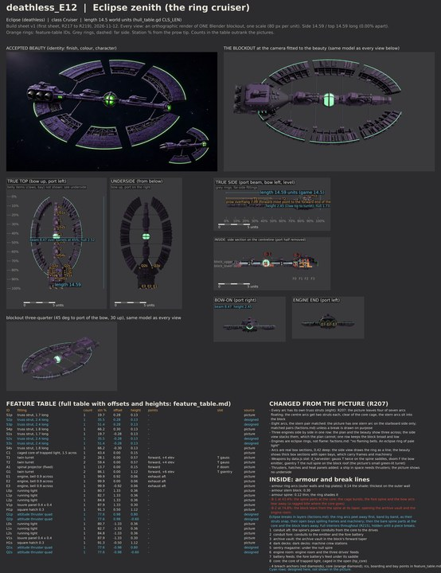

# deathless_E12 build sheet: Eclipse zenith, the ring cruiser (first sheet)

Eclipse cruiser, class Cruiser, **14.5 world units** (godot/render/hull_table.gd CLS_LEN['Cruiser']; data.js `d_harvester`:
gauss T, gauss T, doom F, gsentry T). Accepted picture: contrib/muse/design/concept_round8c_2026_11/deathless_E12_beauty.jpg
and _sheet.jpg (R206). Designer of record: Opus (R205, R207). Issue 532. Rendered on Ryan's PC (Blender 4.5, GPU), blockout
`C:\Users\rcbai\Downloads\voidsworn_test\opus532e\e6\deathless_E12\deathless_E12_blockout.blend`; the model is 14.56 long.

Start here: **[side_by_side.jpg](side_by_side.jpg)**, then [fit_view.jpg](fit_view.jpg) and [cells.jpg](cells.jpg).

## Proportions and structure (measured the same way on the concept and the build)

| | Hull length:beam | Hull length:height | Envelope length:beam | Envelope length:height |
|---|---:|---:|---:|---:|
| Concept (8c sheet, plan and side view) | 1.94 | 15.57 | 1.77 | 5.94 |
| **Build** | **1.89** | **11.21** | 1.72 | 5.98 |

The ring is 13.0 long and 8.1 wide, centred at 43 percent, as the plan. Hull length to height is lower than the concept's
because the arcs are real box sections 0.42 deep, where the side view draws the ring as a line (a listed change). Structure
per cell (concept by eye / build): bow top 5/9, bow side 4/7, mid top 5/8, mid side 4/6, stern top 6/7, stern side 5/5.
Outline overlap at the camera fitted to the beauty: 53.9 percent (reported, not a bar): the beauty draws the ring a little
larger and nearer the engine block than its own plan does, and sees the block from aft; the plan wins for placement
(standard.md), so the side-by-side windows line up less well than on E11.

## The design, in short

1. **The broken shade ring**: eight flat box-section arcs on an oval round the spine, open at the bow (the emitter fires
   through the gap) and at the stern (the engine block); each arc an armoured outer wall and top plate with plates, its inner
   bay open on frames, tanks and conduits, a thin green-white corona line on its outer rim.
2. **Every arc on its own trusses (R207)**: eight truss struts (two rails, a zigzag web, end lugs); the centre arcs get two
   each, set clear of the core cage; the stern arcs sit into the engine block.
3. **The caged core** at the ring's centre: a green sphere in two gimbal rings and four meridian bars, the spine entering its
   hub collars.
4. **Weapons by data.js slot**: T1 and T2 null cannon twins on oval saddles either side of the core (gauss T, gauss T); the
   bow emitter (doom F, the corona arc) with a small lens in a dark bore; G1 the null spire, a small sentry twin with green
   sights on the block roof (gsentry T).
5. **The stern block**: round-shouldered, a roof step and flank cheeks, three eclipse engines side by side, green light
   panels, heat slot panels, hatches, four attitude thrusters on its edges.
6. **INSIDE**: block decks and frames, the archive vault in the block's taper, dark decks, the sentry magazine, the engine
   room, conduits along the spine, the core in the open. Two break lines (Cruiser): the spine parts at the core (B-1) and the
   block tears from the spine (B-2); by the Eclipse rule the arcs peel away first as their struts snap. Four breach anchors on
   the arcs (Cruiser base 4, Eclipse +0).

## Fit and inventory

- **Fit check: zero** on the PC run and in the sandbox; 452 objects, 30 parts, 372 rays, 3 turrets each turned through 73
  bearings. The first full layout had 15 findings (9 clash, 6 exhaust: the bells inside the block, struts into the emitter
  collar and the core's hubs, spine-head thrusters into the collar and firing into the arcs); [fit_report.md](fit_report.md)
  lists them and every fix.
- **Inventory**: 16 lines written before modelling (commit 884ae8b8), all present, shaped and detailed; 0 failing.

## Changed from the picture (R207), and why

In [feature_table.md](feature_table.md). The main ones: every arc has its own struts (the picture leaves four of seven
floating); eight arcs, the stern pair matched (the picture has one stern arc, starboard only); three engines in one row (the
plan and the beauty show three across, the side view stacks them); eclipse-ring engines; the arcs are 0.42-deep box sections.

## What still differs from the concept, and why

- **Surface and colour**: the concept's arcs are heavily plated deep indigo with a strong lit green rim; ours carry the plates
  at a coarser size in flat schematic colour (paint stage).
- **The engine block** reads plainer from above than the beauty's; the beauty sees it from aft, bells first.
- **The struts** run straight across; the concept's lean diagonally.
- **The ring** is the plan's size; the beauty draws it a little larger relative to the block.

## Files

As deathless_E11: [sheet.jpg](sheet.jpg), [feature_table.md](feature_table.md), [inventory.md](inventory.md),
[cells.jpg](cells.jpg), [cells.json](cells.json), [fit_report.md](fit_report.md), [fit_view.jpg](fit_view.jpg),
[fit.json](fit.json), [manifest.json](manifest.json), [checks.json](checks.json), the views and
[outline_check.jpg](outline_check.jpg). Design source: `tools/blender/build_sheets/ships/deathless_E12.py`; inventory
`ships/deathless_E12_inv.py`; part shapes `tools/blender/kits/eclipse/parts.py`. The changes text and the fit report's fix
column were merged from a sandbox run of the same file after the PC render (text only, the same zero).
