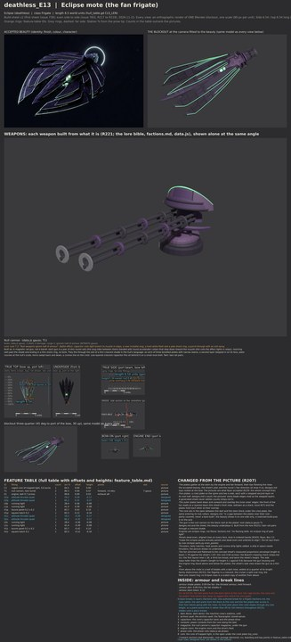

# deathless_E13 build sheet: the Eclipse mote, the fan frigate (first sheet, issue 739)

Eclipse frigate, class Frigate, **6.5 world units** (godot/render/hull_table.gd CLS_LEN['Frigate']; data.js `d_scythe`: gauss T;
ability phase, regen 2, reanimate; speed 4, evasion 14). Accepted picture: contrib/muse/design/class_family_deathless_2026_11/
deathless_E13_mote.jpg and _sheet.jpg (Ryan, Nov 12, issue 627: the round 1 Fan direction). Designer of record: Opus (R205,
R207); the Board is the final designer (R233, R236). The model is 6.52 long. Built and rendered in the cloud sandbox with
Blender 5.3 (the bpy module), Cycles CPU, 16 samples; no PC run in this job (the Board launches stage 1 to 7 after it looks).

Start here: **[whole_compare.jpg](whole_compare.jpg)** (the whole beauty, the plan and the side view beside the blockout, R229),
then [side_by_side.jpg](side_by_side.jpg), [fit_view.jpg](fit_view.jpg), [cells.jpg](cells.jpg) and
[weapon_review.jpg](weapon_review.jpg).

## Even side to side (issue 783, R256)

Ryan, Nov 15 07:02 CST: "let's make sure that the paint actually is even on each side, it's not consistent now". Measured on a
top view with the port half mirrored onto the starboard ([even_side_to_side.json](even_side_to_side.json),
`tools/blender/build_sheets/studies/mirror_check.py`):

| Top view | Mean difference (of 255) | Pixels over 24 | Corona light with no twin |
|---|---:|---:|---:|
| Painted (Eclipse stack), before | 13.0 | 11.3% | 30.6% |
| Painted (Eclipse stack), after | 2.8 | 0.8% | 6.6% |
| Blockout (sheet colours), before | 7.5 | 4.5% | 19.8% |
| Blockout (sheet colours), after | 2.2 | 0.9% | 1.3% |

Pictures: [even_top_before.jpg](even_top_before.jpg), [even_top_after.jpg](even_top_after.jpg),
[even_battle_cam.jpg](even_battle_cam.jpg). What made the sides differ, and the fix at each cause:

1. **The layer corona lines** (this sheet): each plate's stepped layer took its green line from ring point 2 on port (the top
   outer edge) and point 1 on starboard (the bottom edge, half buried), so the starboard lines sat low and broken; the crest's
   layer had a line on its starboard edge only. Now point 2 on both sides, and the crest's layer carries both top edges.
2. **The panel rows** (this sheet): the row pitch was read off ring point 0, the inner edge on port and the outer edge on
   starboard, so the inner plates got rows of 0.48 (port) and 0.32 (starboard). Now read off the inner edge on both.
3. **The fasteners** (Eclipse kit, `plate_slab`): the long axis came from one edge, which on a tapered plate depends on which
   corner a twin lists first. Now from both pairs of opposite edges.
4. **The engine housing plates** (Eclipse kit, `panels`): tone and thickness went round the drum by face number. Now a plate and
   its mirror twin share them.
5. **The paint** (Eclipse stack, every Eclipse ship): every pattern read the true position and each plate its own island random,
   so a plate and its twin took unrelated tones, and the corona arcs and breaks differed. The stack now asks for a mirrored paint
   (`LAYERS mirror`): patterns read (x, |y|, z), twins share one plate random (`paint_stack.mirror_islands`), the starboard marks
   copy the port ones (the starboard band ticks were missing) and the top sigil sits on the centre line. Colours, shares and
   the corona's look are unchanged (R237, R243); the engine rings keep their own pattern each.

Left: the four attitude thrusters turn by a different angle on each side (kit.py `thruster` builds its frame from
`normal.orthogonal()`, which is not mirrored; shared by every faction and hashed into the A16 fixture, so not changed here), and
the core's cage bars twist 0.0075 units differently per side. Both are a few pixels at the dart's flanks and the core.

## Checks (sandbox, this sheet)

| Check | Result |
|---|---|
| Weapon match (R241, `weapon_match.py`) | PASS, 0 problems: slot 0 gauss T, 3 shots, mount T1 (twin, 2 muzzles), every mount fires every volley ([record](weapon_match.json)) |
| Fit check (`clash.py`, R217 to R219, R240) | CLASH 0, MOUNT 0, ARC 0, SENSOR 0, SWEEP 0, EXHAUST 0, EXIT 0, LANE 0; T1 turns all round ([fit_report.md](fit_report.md)) |
| Machines on a seam (R226) | 0: the stage 4 audit passes (`audit.py`), the core is structure across B-1 |
| Build contract (`sheet_contract_selftest.py`) | PASS: length, seams, muzzles and slots, turret pivot, engine, insides and hull thickness reach the recipe unchanged; three broken inputs refused |
| Audit self-test | PASS: every broken copy refused for its own reason |
| Stage 7 unbaked export and readback (`export7.py unbaked=1`, `check_export.py`, self-test) | PASS: every hard point on the mesh (2 gun muzzles, 1 engine, 2 breach, core, 2 braking, 2 boarding), the breach count is the class and faction's, the turret node and its turning mesh are written; the self-test refuses every broken copy |
| Density (R224, the mesh half; `studies/mesh_density.py`) | 0 flags; every part kind at or over the hull's triangles and edge features per square unit ([mesh_density.json](mesh_density.json)); the paint half is measured at stage 5 |
| Rule 12 (R244): openings with depth, shaped flanks | the engine bell has a throat, an inner shade disc and stiffener rings; the thrusters' slot nozzles and the heat panels' slats are recessed; no flat disc anywhere. The dart and the block are chamfered octagon sections, the block carries a stepped roof and the root collar's stepped band; no flat-sided box |
| Inventory (R218, R221) | 14 lines, all present, shaped and detailed; every part has a job ([inventory.md](inventory.md)) |
| Manifest (`build_manifest_tests.js`) | PASS |

Outline overlap with the beauty at the camera of record: 51.1 percent (mass outline 49.9). Reported, not a bar (RULEBOOK 5.8).
The cut-out leaves out the engine's light ring and its glow (the game draws that light). A free camera fit after the massing round
swings round to a bow view (54.3 percent) that no longer shows the beauty's broad fan, so the angles of the first fit are held
and only the framing is fitted (`ships/deathless_E13_camera.json`).

## Budget (sandbox unbaked export, the same route for all four Eclipse sheets; reported, never capped, R111)

| Ship | Triangles (readback) | Ship mesh surfaces | Turret triangles | Insides |
|---|---:|---:|---:|---|
| **E13 mote** | **20,036** (20,288 before issue 783) | **10** | 4,604 (1 turret) | 624 triangles, 7 surfaces |
| E12 zenith | 51,502 | 9 | 10,938 (3 turrets) | 488 triangles, 7 surfaces |
| E11 The Unsetting | 115,530 | 10 | 12,590 (3 turrets) | 1,768 triangles, 8 surfaces |

Draw calls: one per surface, plus one per turret node. The scene gate (RULEBOOK 3.9) is measured on the PC after the paint bake.

## The design, in short

1. **The fan**: five shade plates (a crest plate on the spine with a low ridge, two a side) gathered at the stern by the engine's
   root collar and fanning forward over the dart; their tips step back from the nose outward, the outer pair hooking out level
   with the nose's flanks. Each plate is a slab with straight machined edges, a stepped second layer on its root half and a thin
   green-white corona line on its outer rim (and on its layer's rim); the side plates bank down outward and each sits under the
   edge of the one inside it, so the front reads as a layered stack. Even, aligned panels on every face (R243).
2. **The dart**: a short chamfered body under the fan, its nose ahead of the plate tips.
3. **The core**: in the open between the dart and the stern block, the spine entering its hub collars, under the crest plate and
   seen through the gaps beside it.
4. **The gun** (data.js gauss T): the null cannon on the stern block's stepped roof at the fan's root, twin rail pairs through a
   crescent shade, firing forward over the plates and turning all round.
5. **The stern block and engine**: a chamfered block, the root collar where the plates gather, heat slot panels, belly hatches,
   attitude thrusters on its lower chamfers; one eclipse-ring engine, no flame.
6. **INSIDE**: dark decks, the archive vault and the capacitor bank in the dart, conduits along its keel; the gun's magazine, the
   phase coils and the engine room in the block. One authored break (Frigate, the class table): B-1, the dart parts from the block
   at the core and the five plates tear across it, their fore halves going with the nose. No level peel plane: the crest slopes
   through any one height, so a plane would slice it rather than lift it. Two breach anchors on the shade plates (Frigate base 2,
   Eclipse +0).

## Changed from the picture and from designs.md (R207, R233, R236), and why

All in [feature_table.md](feature_table.md); the design calls the Board should look at first:

- **The plates gather at the stern and fan forward.** The beauty, the sheet's plan and the round 1 Fan direction all draw it so;
  designs.md says rooted at the bow. The build follows the pictures Ryan accepted.
- **Five plates**, designs.md's count; the pictures' extra blade edges read as the stepped layers.
- **The fan slimmed and flattened** to the concept sheet's measured proportions: envelope length to beam 1.79 (the sheet 1.87;
  the first layout 1.38). The side stays taller than the sheet's (length to height 5.1 against 9.6): the gun housing and the
  engine ring stand above and below the plates, where the sheet draws the gun as a thin fin.
- **The core on the axis**, under the crest plate; the beauty shows it on one side only.
- **Panels dead even and aligned** (R243), laid by size by the Eclipse kit (`even_panels`, new in tools/blender/kits/eclipse/parts.py).
- **From above, a leaf of blades with a dart nose**: no Eclipse class is a scaled copy of another (R233).
- **The gun fires over the plates, not through a gap behind a shade rim.** factions.md puts Eclipse guns behind the shade's rim
  firing through gaps; the mote's one gun turns all round (gauss T), so it stands on the block roof at the plates' root and fires
  over them, as the zenith's guns fire over its ring. The plates still face the enemy edge-on, a shield held forward.

## What still differs from the concept, and why

- **Surface and colour**: the concept's plates are heavily detailed deep indigo with lit green rims; the blockout is flat schematic
  colour (the paint stack does the finish at stage 5).
- **The engine block** reads larger than the concept's slim tail: it holds the engine room and the gun's magazine and seats the
  eclipse-ring engine; the concept's big pale halo is the game's engine light.
- **The concept's front view** (a tall pinwheel) does not agree with its own plan and side view; the build follows the plan, the
  side view and the beauty.

## Files

[sheet.jpg](sheet.jpg) (tall: open it whole), [feature_table.md](feature_table.md), [inventory.md](inventory.md),
[cells.jpg](cells.jpg), [cells.json](cells.json), [fit_report.md](fit_report.md), [fit_view.jpg](fit_view.jpg),
[fit.json](fit.json), [manifest.json](manifest.json), [checks.json](checks.json), [outline_check.jpg](outline_check.jpg), the views,
the weapon picture [weapon_gauss.jpg](weapon_gauss.jpg). Design source: `tools/blender/build_sheets/ships/deathless_E13.py`; inventory
`ships/deathless_E13_inv.py`; camera `ships/deathless_E13_camera.json`; recipe entry `tools/recipe/ships/deathless_E13.json` (game
folder D9_23, `"bake": "stack"`, the Eclipse stack (its paint mirrored side to side since issue 783): every (part kind, zone) pair is one the stack already paints on
E11 and E12). Pictures not made by the sheet tools: `tools/blender/build_sheets/studies/whole_compare.py` (whole_compare.jpg) and
`studies/mesh_density.py` (mesh_density.json).
