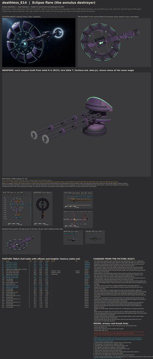

# deathless_E14 build sheet: the Eclipse flare, the glass cannon (redesign, issue 782)

Eclipse destroyer, class Destroyer, **9.5 world units** (godot/render/hull_table.gd CLS_LEN['Destroyer']). data.js `d_jackal`
after issue 784 (PR 797, the rules half of R256): **one null lance, `nlance` F** (a gauss kind, forward only); ability phase,
regen 2, reanimate; speed 3. Accepted picture: contrib/muse/design/class_family_deathless_2026_11/deathless_E14_flare.jpg and
_sheet.jpg (Ryan, Nov 12, issue 627: "The flare is what I was thinking of for the annulus"). Binding rulings: one closed ring
(R233); **R256** (Ryan, Nov 15 07:02, on the first sheet's flat ring): "it's changing the core structure which I don't love. Now
the ring is horizontal instead of vertical, which changes the entire ship", then "Can we find a way to make it built around one
larger gun and that's the center of the ring? Like a glass cannon basically". Designer of record: Opus (R205, R207); the Board
is the final designer (R233, R236). The model is 9.54 long. Built and rendered in the cloud sandbox with Blender 5.3 (the bpy
module), Cycles CPU, 16 samples; no PC run in this job.

Start here: **[whole_compare.jpg](whole_compare.jpg)** (the whole beauty, the sheet's plan and middle view beside the build,
R229), then **[ring_study.jpg](ring_study.jpg)** (the upright ring at the battle camera from the bow quarter, the beam and the
stern quarter, enlarged and at the game's size), [weapon_review.jpg](weapon_review.jpg), [threequarter.jpg](threequarter.jpg),
[side_by_side.jpg](side_by_side.jpg), [fit_view.jpg](fit_view.jpg) and [cells.jpg](cells.jpg).

## The ring at the battle camera (R256; the Board, issue 782)

The ring stands upright across the bow and faces forward, as the concept's beauty and its middle and right views draw it. From
the beam an upright ring is exactly edge-on at any camera height, so its depth along the ship is the whole band the camera sees.
It is built deep: 0.8 at its inner edge, 0.9 at its rim (the front is a shallow dish), with a chamfer on the rim's front and back
edges and a green-white corona line along each, so edge-on it reads as a band between two bright lines.
`tools/blender/build_sheets/studies/e14_ring_study.py` renders the built blockout at the game's battle camera (34 degrees above
the board, range 170, fov 45, the ship drawn 1.6 times its length: 12.3 px per model unit on a 1080 px screen) and measures the
ring by projecting its rim through that camera ([ring_study.jpg](ring_study.jpg)):

| Battle camera heading | The ring on screen at the game's size |
|---|---|
| Bow quarter (35 off the bow) | 68 px across, 72 px tall, the rim 8 px deep; the lance's green focus ring at its centre |
| Beam (90) | edge-on: a band **11 px wide** and 74 px tall, a corona line down each edge |
| Stern quarter (145) | 66 px across, 69 px tall, the rim 8 px deep |

The first sheet's study (plain primitives, flat chosen) is withdrawn by R256; its camera also sat 56 degrees up, not 34 (issue
756 found the pitch read the wrong way). This study replaces it.

## Weapons (R221, R241)

| Weapon | Mount | data.js and lore | Built as |
|---|---|---|---|
|  Null lance (nlance) | L1 (slot 0, F) | issue 784's numbers (PR 797, under tuning); the gauss kind, half of armour ignored (lore 7.5) | a fixed spinal rail gun on the gun heart's face, firing forward through the ring's centre: a seat ring, an eight-sided armoured housing with a layer sleeve and panels, capacitor discs at the breech, four accelerator rails on yokes with banded collars, a steel muzzle lip with a thin green focus ring, and a recessed bore 0.5 deep to a black shade disc with a glowing lens at its heart (designs.md's "recessed aperture and a thin green focus ring", never a protruding tube). Its muzzle (hp_w0) is the lens; its lip is the ship's bow |

Weapon match ([weapon_match.json](weapon_match.json)): **PASS**, 0 problems; slot 0 nlance F, 3 shots, L1 (one bore). No turret:
the first sheet's two null cannon turrets are gone with issue 784. `weapon_match.py` gains the FITS row `nlance`: a null cannon
on a fixed mount, byte for byte the row PR 797 adds; `weapon_match_selftest.py` is 797's with one more fault (the lance aimed
along the beam, ARC): PASS, 33 planted faults, 16 sheet ships. The Eclipse kit gains the lance as `spinal(kind='lance')`
(tools/blender/kits/eclipse/parts.py `_null_lance`); the corona arc stays the default, and E11, E12 and E13 build to the same
triangles as before.

## Checks (sandbox, Nov 15 2026, against 784's data.js)

Rows marked * use the helper scripts in `contrib/opus/tools/issue782/` or `issue738/` (sandbox only, not standing checks).

| Check | Result |
|---|---|
| Fit check (`clash.py`, R217 to R219, R240) | CLASH 0, MOUNT 0, ARC 0, SENSOR 0, SWEEP 0, EXHAUST 0, EXIT 0, LANE 0; 222 objects, 27 parts, 1 gun with its firing lane, 5 exhaust cones, 12 openings; no sensor on the ship, so 0 gun and sensor pairs ([fit_report.md](fit_report.md): the first layout's 5 findings and their fixes) |
| Weapon match (R241) and its self-test | PASS; self-test PASS (33 planted faults) |
| Build contract (`sheet_contract_selftest.py`) | PASS: length 9.5, 2 transverse seams, 1 muzzle in slot 0 nlance F, the engine, 17 inside objects, the skin; the broken inputs refused |
| Stage 4 audit (`audit.py` on the sheet_hull build) and `audit_selftest.py` | PASS: 94 parts, no machine across a seam, 1 gun, none into the ship (the core C1 is structure on seam B-1: the bite where the core goes); self-test PASS |
| Stage 7 unbaked export and readback (`export7.py unbaked=1`, `check_export.py`, `check_export_selftest.py`) | PASS: 1 gun point (slot 0), 1 engine, 3 breach anchors (Destroyer 3, Eclipse +0), core, 2 braking, 2 boarding; every point on the mesh; the self-test refuses every broken copy |
| Inventory (R218, R221) | 20 lines, 0 failing; every part has a job ([inventory.md](inventory.md)) |
| * Detail density, mesh (R224) | 0 flags; lowest: the lance 1.34, the spokes 2.09 of the hull's triangles per square unit ([mesh_density.json](mesh_density.json)) |
| `build_manifest_tests.js` | PASS, 16 sheets |
| A16 fixture (`sheet_fixture_hash.py --check`) | PASS (kit.py untouched) |

Outline overlap with the beauty at the refitted camera of record: **67.7 percent** (mass outline 67.8; the first sheet's flat ring
59.3). Reported, not a bar (RULEBOOK 5.8). The cut-out (`contrib/opus/tools/issue782/mask_e14.py`) leaves out the engine's light
ring and glow, the nebula, and the sky seen through the ring's open middle, which the build leaves open too.

## Budget (sandbox unbaked export readback, the same measure as the first sheet; reported, never capped, R111)

| Ship | Triangles (readback) | Ship mesh surfaces | Turret triangles | Insides |
|---|---:|---:|---:|---|
| **E14 flare, this sheet** | **36,424** | **9** | 0 (no turret) | 728 triangles, 7 surfaces |
| E14 flare, first sheet | 34,128 | 9 | 9,208 (2 turrets) | 728 triangles, 7 surfaces |
| E13 mote | 20,288 | 10 | 4,604 (1 turret) | 624 triangles, 7 surfaces |
| E12 zenith | 51,502 | 9 | 10,938 (3 turrets) | 488 triangles, 7 surfaces |

The readback counts the whole file, turrets included: 2,296 more than the first sheet (6.7 percent). By the export's own count
the ship mesh went from 25,648 to 37,152 and the turrets from 9,208 to 0: the ring's deep plates carry panels on their fronts,
backs and rims (the first sheet's flat plates had them on one face). Both measured the same way in this sandbox (the first sheet
rebuilt from main). Draw calls: one per surface, no turret nodes. The scene gate is measured on the PC.

## The design, in short

1. **The ring**: twelve deep curved shade plates on one closed box-section hoop, standing upright across the bow and facing the
   enemy (the shade held forward, factions.md), 6.0 across, its plane 3.0 to 3.9 from the middle; narrow even gaps; each plate's
   front a shallow dish with a stepped second layer and a corona line on the layer's rim; the rim chamfered fore and aft with a
   corona line on each edge; even panels on the front, the back and the rim. It is the lance's focusing ring.
2. **The gun heart and the null lance**: a faceted breech casing from the core forward through the ring's centre (regular
   octagons, so from ahead it reads round, never a box), a capacitor band and a focus collar round it; four truss spokes in an X
   carry the hoop to the focus collar. The lance stands on its face and reaches 0.9 ahead of the ring; its muzzle is the bow.
3. **The core**: the green-white core just aft of the ring, in its broken cage of six small shade plates, the gun heart and the
   spar entering its hub collars.
4. **The spar and the capacitor housing**: a layered beam running 6 aft of the core; on its back a stepped capacitor housing with
   three ribs, which stores the core's charge for the lance (where the first sheet's aft turret stood).
5. **The stern block and engine**: a faceted block with corona strip lights, heat panels, belly hatches and attitude thrusters;
   one broad eclipse-ring engine, no flame.
6. **The repair drones**: four cradles docked on the hoop's front face between the spokes, each with a green work light.
7. **INSIDE**: the lance's capacitors and slug magazine in the gun heart; dark decks, the charge store and the conduits along the
   spar; the archive vault, the repair bay and the engine room in the block. Two break lines (Destroyer): **B-1**, the spar parts
   at the core and the gun heart, the lance and the ring tear away forward; **B-2**, the block tears from the spar. Three breach
   anchors: the ring's port and starboard beam plates on their rims, and the block's roof.

## Changed from the picture and from designs.md, and why (R207, R233, R236, R256)

All in [feature_table.md](feature_table.md); the design calls the Board should look at first:

- **The ring stands upright and faces forward** (R256). The first sheet laid it flat; Ryan withdrew that.
- **The ring is 0.8 deep (0.9 at the rim)**, deeper than the concept's middle view draws it (about 0.6 of this size), so it reads
  as a bold band edge-on: 11 px from the beam at the game's size.
- **One big fixed gun at the ring's centre** (R256, issue 784): designs.md's fixed forward housing with a recessed aperture and a
  focus ring comes back as the null lance; the first sheet's two turrets are gone.
- **The muzzle stands 0.9 ahead of the ring's front face** (the beauty's heart reaches about that far); from ahead the muzzle is
  at the ring's centre, from the beam the gun reads as part of the ring's heart, not a long nose.
- **The core sits just aft of the ring**, not in its plane: the gun heart runs through the ring's centre, so the core's light
  shows round the lance through the ring from ahead and through the cage from the side.
- **The capacitor housing replaces the aft turret** on the spar's back (the beauty's low dorsal housing).
- **The forward thrusters sit under the spar behind the core**: on the gun heart they would fire into the ring's lower plates.
- **Kept from the first sheet**: twelve plates on one closed hoop (R233), the ring 6.0 across (0.63 of the length), the drones
  docked, the spar 0.72 across, the stern block, the engine, the panels (R243), the third breach anchor on the block.

## Design calls for the Board (and Ryan)

- **The ring reaches 3.0 below the ship's axis** (4.8 drawn): ships sit at y 0 in the game and the footprint markers at -0.25,
  so the ring's lower plates may cut into the board or the markers. Not shrunk here; the Board checks it in the game (the
  first sheet's flat ring reached 0.76 below).
- **factions.md "Never: a spire through the centre of a disc"**: the lance runs through the ring's centre on its side, not
  upright. It is the R256 exception (factions.md names E14 as being redesigned round one gun at the ring's centre), and the
  ring's middle stays open round the gun heart.
- **The hull variant `d_jackal_h`** (PR 797: "Archive guard flare", gauss T twice and gsentry T): if it shares this model it has
  no hard points for those three slots. That variant needs its own sheet or a decision before 797 and this merge.
- **Merge order**: this branch merges opus/issue-784 (its data.js gives d_jackal the null lance). On main's data.js before 797
  the sheet fails the weapon match (COUNT: gauss T and gauss F have no mount), so 782 and 797 merge together.

## What still differs from the concept, and why

- **Surface and colour**: the concept's plates are thick heavily panelled blocks; the blockout is flat schematic colour (stage 5).
- **The core's light**: the beauty shows the core glowing inside the heart right behind the muzzle; here the lance's lens glows
  in the bore and the core sits behind the ring in its cage.
- **The spar is shorter** than the beauty's, which runs farther aft; the class length holds it.
- **Proportions**: the concept sheet's left view draws the ring face-on across the spar and its middle view is an edge-on view
  of a shorter ship, so the length to beam and height table in inventory.md does not compare like with like.

## Files

[sheet.jpg](sheet.jpg) (tall: open it whole), [feature_table.md](feature_table.md), [inventory.md](inventory.md),
[cells.jpg](cells.jpg), [cells.json](cells.json), [fit_report.md](fit_report.md), [fit_view.jpg](fit_view.jpg),
[fit.json](fit.json), [manifest.json](manifest.json), [checks.json](checks.json), [outline_check.jpg](outline_check.jpg), the views,
the weapon picture [weapon_nlance.jpg](weapon_nlance.jpg). Design source: `tools/blender/build_sheets/ships/deathless_E14.py`;
inventory `ships/deathless_E14_inv.py` (rewritten for the redesign); camera `ships/deathless_E14_camera.json` (refitted); recipe
entry `tools/recipe/ships/deathless_E14.json` (game folder D20_23, `"bake": "stack"`, the Eclipse stack unchanged: the lance is
a spinal part in the zones E11's corona arc already carries). Pictures not made by the sheet tools: `studies/e14_ring_study.py`
(ring_study.jpg), `studies/whole_compare.py` (whole_compare.jpg), `studies/mesh_density.py`. `build.py` gains one optional
SHEET key, `tq_zoom` (the three-quarter view's frame; the upright ring is taller than the default frame), default 1, so every
other sheet renders as before.
