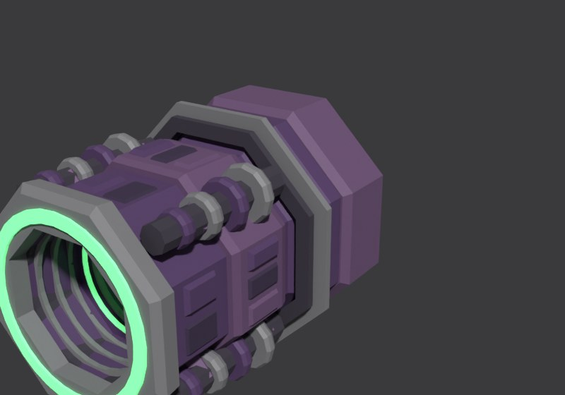

# deathless_E14 build sheet: the Eclipse flare, the glass cannon (redesign, issue 782, with Ryan's R266 changes)

Eclipse destroyer, class Destroyer, **9.5 world units** (godot/render/hull_table.gd CLS_LEN['Destroyer']). data.js `d_jackal`
after issue 784 (PR 797, the rules half of R256): **one null lance, `nlance` F** (a gauss kind, forward only); ability phase,
regen 2, reanimate; speed 3. Accepted picture: contrib/muse/design/class_family_deathless_2026_11/deathless_E14_flare.jpg and
_sheet.jpg (Ryan, Nov 12, issue 627: "The flare is what I was thinking of for the annulus"). Binding rulings: one closed ring
(R233); **R256** (Ryan, Nov 15 07:02, on the first sheet's flat ring): "it's changing the core structure which I don't love. Now
the ring is horizontal instead of vertical, which changes the entire ship", then "Can we find a way to make it built around one
larger gun and that's the center of the ring? Like a glass cannon basically". **R266** (Ryan, Nov 15 12:50, on the first
redesign: "Close, needs changes"): "Body too thin, Bow ring missing, Ring too plain, Glow inside the ring, all of the above but
also the inside of the lance/gun looks pretty plain. the body being too thin with it just looking like a stick is a big one";
"Lift the ship"; and the Archive guard flare variant (d_jackal_h) is a lance ship too, so this model serves both. Designer of record: Opus (R205, R207); the Board
is the final designer (R233, R236). The model is 9.54 long. Built and rendered in the cloud sandbox with Blender 5.3 (the bpy
module), Cycles CPU, 16 samples; no PC run in this job.

Start here: **[whole_compare.jpg](whole_compare.jpg)** (the whole beauty, the sheet's plan and middle view beside the build,
R229), then **[ring_study.jpg](ring_study.jpg)** (the upright ring at the battle camera from the bow quarter, the beam and the
stern quarter, enlarged and at the game's size), [weapon_review.jpg](weapon_review.jpg), [threequarter.jpg](threequarter.jpg),
[side_by_side.jpg](side_by_side.jpg), [fit_view.jpg](fit_view.jpg) and [cells.jpg](cells.jpg).

## What R266 changed

| Ryan's note | What the build does now |
|---|---|
| "Body too thin ... just looking like a stick" | a chunky faceted body in two steps: 1.0 across behind the core, 1.12 from midships, the stern block 1.44 (was 0.72 and 1.1), with layered armour slabs down both flanks (each stepped again), a keel along the belly and collars at the steps. Body width to ring diameter 0.19 (the beauty measures about 0.15 to 0.2 across its plated body); body length to width 6.0 (core to engine, 6.75 over 1.12) |
| "Bow ring missing" | the concept's big glowing ring at the far end of the body: a free halo ring of pale light 2.2 across standing round the engine on four arms, part of the engine (the stack paints it as the engine's eclipse ring of light) |
| "Ring too plain" | twelve chunky plates with 5 degree gaps (was 3), each with its own relief: an inner and an outer armour block on its face, the outer stepped again, a raised band round its rim; corona lines on the rim's front and back edges and down both sides of each plate's face, so from ahead every plate is outlined in light as the concept draws it. The same on every plate (ordered, R243) |
| "Glow inside the ring" | twelve small lights on the hoop's inner face and a light strip round it, shining across the open middle; four core windows on the gun heart's forward shoulder, so the core's glow shows from ahead; the engine halo shows through the middle from ahead too ([bow.jpg](bow.jpg)) |
| "The inside of the lance/gun looks pretty plain" | the bore is 0.94 deep (was 0.5): a liner stepping in three stages toward the throat, steel coil bands round each stage, two thin green focusing bands that glow, and a lit throat ring round the lens ([weapon_nlance.jpg](weapon_nlance.jpg)) |
| "Lift the ship" | not done in the model: the game centres every hull on its own bounding box (godot/render/ship_view.gd `_fit`: `hull.position = -(basis * box centre)`), so any offset built into the model is undone. The lift is a game-side change; see the design calls |

## The ring at the battle camera (R256; the Board, issue 782)

The ring stands upright across the bow and faces forward, as the concept's beauty and its middle and right views draw it. From
the beam an upright ring is exactly edge-on at any camera height, so its depth along the ship is the whole band the camera sees.
It is built deep: 0.8 at its inner edge, 0.9 at its rim (the front is a shallow dish), with a chamfer on the rim's front and back
edges and a green-white corona line along each, so edge-on it reads as a band between two bright lines.
`tools/blender/build_sheets/studies/e14_ring_study.py` renders the built blockout at the game's battle camera (34 degrees above
the board, range 170, fov 45, the ship drawn 1.6 times its length: 12.3 px per model unit on a 1080 px screen) and measures the
ring by projecting its rim through that camera ([ring_study.jpg](ring_study.jpg)):

The rim is unchanged by R266, so the band is the same size (re-run on the R266 build):

| Battle camera heading | The ring on screen at the game's size |
|---|---|
| Bow quarter (35 off the bow) | 68 px across, 72 px tall, the rim 8 px deep; the lance's green focus ring at its centre |
| Beam (90) | edge-on: a band **11 px wide** and 74 px tall, a corona line down each edge |
| Stern quarter (145) | 66 px across, 69 px tall, the rim 8 px deep |

The first sheet's study (plain primitives, flat chosen) is withdrawn by R256; its camera also sat 56 degrees up, not 34 (issue
756 found the pitch read the wrong way). This study replaces it.

## Weapons (R221, R241)

| Weapon | Mount | data.js and lore | Built as |
|---|---|---|---|
|  Null lance (nlance) | L1 (slot 0, F) | 3 shots of 15, range 6, F only (issue 784, PR 797; Ryan R265); the gauss kind, half of armour ignored (lore 7.5) | a fixed spinal rail gun on the gun heart's face, firing forward through the ring's centre: a seat ring, an eight-sided armoured housing with a layer sleeve and panels, capacitor discs at the breech, four accelerator rails on yokes with banded collars, a steel muzzle lip with a thin green focus ring, and a recessed bore 0.94 deep, its liner stepping in three stages with coil bands and two green focusing bands, to a lit throat and a glowing lens at its heart (designs.md's "recessed aperture and a thin green focus ring", never a protruding tube; R266). Its muzzle (hp_w0) is the lens; its lip is the ship's bow |

Weapon match ([weapon_match.json](weapon_match.json)): **PASS**, 0 problems; slot 0 nlance F, 3 shots, L1 (one bore). No turret:
the first sheet's two null cannon turrets are gone with issue 784. `weapon_match.py` gains the FITS row `nlance`: a null cannon
on a fixed mount, byte for byte the row PR 797 adds; `weapon_match_selftest.py` is 797's with one more fault (the lance aimed
along the beam, ARC): PASS, 33 planted faults, 16 sheet ships. The Eclipse kit gains the lance as `spinal(kind='lance')`
(tools/blender/kits/eclipse/parts.py `_null_lance`); the corona arc stays the default, and E11, E12 and E13 build to the same
triangles as before.

## Checks (sandbox, Nov 15 2026, against 784's data.js)

Rows marked * use the helper scripts in `contrib/opus/tools/issue782/` or `issue738/` (sandbox only, not standing checks).

| Check | Result |
|---|---|
| Fit check (`clash.py`, R217 to R219, R240) | CLASH 0, MOUNT 0, ARC 0, SENSOR 0, SWEEP 0, EXHAUST 0, EXIT 0, LANE 0; 315 objects, 43 parts, 1 gun with its firing lane, 5 exhaust cones, 28 openings; no sensor on the ship, so 0 gun and sensor pairs ([fit_report.md](fit_report.md): every finding and its fix) |
| Weapon match (R241) and its self-test | PASS; self-test PASS (33 planted faults) |
| Build contract (`sheet_contract_selftest.py`) | PASS: length 9.5, 2 transverse seams, 1 muzzle in slot 0 nlance F, the engine, 17 inside objects, the skin; the broken inputs refused |
| Stage 4 audit (`audit.py` on the sheet_hull build) and `audit_selftest.py` | PASS: 130 parts, no machine across a seam, 1 gun, none into the ship (the core C1 is structure on seam B-1: the bite where the core goes); self-test PASS |
| Stage 7 unbaked export and readback (`export7.py unbaked=1`, `check_export.py`, `check_export_selftest.py`) | PASS: 1 gun point (slot 0), 1 engine, 3 breach anchors (Destroyer 3, Eclipse +0), core, 2 braking, 2 boarding; every point on the mesh; the self-test refuses every broken copy (the engine halo stands forward of the exit plane, so the open-bell probe never meets it) |
| Inventory (R218, R221) | 23 lines, 0 failing; every part has a job ([inventory.md](inventory.md)) |
| * Detail density, mesh (R224) | 0 flags; lowest: the engine 1.53, the lance 1.89 of the hull's triangles per square unit ([mesh_density.json](mesh_density.json)) |
| `build_manifest_tests.js` | PASS, 16 sheets |
| A16 fixture (`sheet_fixture_hash.py --check`) | PASS (kit.py untouched) |

Outline overlap with the beauty at the refitted camera of record: **65.1 percent** (mass outline 65.2; the first redesign 67.7,
the first sheet's flat ring 59.3: the wider plate gaps and the chunkier body trade a little outline for the concept's look). Reported, not a bar (RULEBOOK 5.8). The cut-out (`contrib/opus/tools/issue782/mask_e14.py`) leaves out the engine's light
ring and glow, the nebula, and the sky seen through the ring's open middle, which the build leaves open too.

## Budget (sandbox unbaked export readback, the same measure as the first sheet; reported, never capped, R111)

| Ship | Triangles (readback) | Ship mesh surfaces | Turret triangles | Insides |
|---|---:|---:|---:|---|
| **E14 flare, this sheet (R266)** | **47,376** | **9** | 0 (no turret) | 776 triangles, 7 surfaces |
| E14 flare, first redesign | 36,424 | 9 | 0 (no turret) | 728 triangles, 7 surfaces |
| E14 flare, first sheet | 34,128 | 9 | 9,208 (2 turrets) | 728 triangles, 7 surfaces |
| E13 mote | 20,288 | 10 | 4,604 (1 turret) | 624 triangles, 7 surfaces |
| E12 zenith | 51,502 | 9 | 10,938 (3 turrets) | 488 triangles, 7 surfaces |

The readback counts the whole file, turrets included: 13,248 more than the first sheet (39 percent), 10,952 more than the first
redesign. By the export's own count the ship mesh is 48,152 (the first sheet 25,648 plus 9,208 in its turrets): the ring's deep
plates carry panels on their fronts, backs and rims and now their relief, the body its armour layers, the lance its bore, and the
engine its halo. All measured the same way in this sandbox (the first sheet rebuilt from main). Draw calls: one per surface, no turret nodes. The scene gate is measured on the PC.

## The design, in short

1. **The ring**: twelve chunky curved shade plates on one closed box-section hoop, standing upright across the bow and facing the
   enemy (the shade held forward, factions.md), 6.0 across, its plane 3.0 to 3.9 from the middle, 5 degree gaps; each plate's
   front a shallow dish carrying an inner and an outer armour block (the outer stepped again), a raised band round its rim, the
   rim chamfered fore and aft with a corona line on each edge and a corona line down each side of its face; even panels on the
   front, the back and the rim. It is the lance's focusing ring. Twelve small lights and a light strip on the hoop's inner face
   light the open middle.
2. **The gun heart and the null lance**: a faceted breech casing from the core forward through the ring's centre (regular
   octagons, so from ahead it reads round, never a box), a forward shoulder with four core windows and a focus collar behind it;
   four truss spokes in an X run from the focus collar out to the hoop. The lance stands on the heart's face and reaches 0.9 ahead
   of the ring; its muzzle is the bow, its bore stepped, coiled and lit.
3. **The core**: the green-white core just aft of the ring, in its broken cage of six small shade plates, the gun heart and the
   body entering its hub collars.
4. **The body and the capacitor housing**: a chunky faceted body in two steps running 6.75 aft of the core, layered flank armour,
   a keel and collars; on its back a stepped capacitor housing with three ribs, which stores the core's charge for the lance.
5. **The stern block and engine**: a faceted block 1.44 across with corona strip lights, heat panels, belly hatches and attitude
   thrusters; one broad eclipse-ring engine, no flame, and round it a free halo ring of pale light 2.2 across on four arms.
6. **The repair drones**: four cradles docked on the hoop's front face between the spokes, each with a green work light.
7. **INSIDE**: the lance's capacitors and slug magazine in the gun heart; dark decks, the charge store and the conduits along the
   spar; the archive vault, the repair bay and the engine room in the block. Two break lines (Destroyer): **B-1**, the spar parts
   at the core and the gun heart, the lance and the ring tear away forward; **B-2**, the block tears from the spar. Three breach
   anchors: the ring's port and starboard beam plates on their rims, and the block's roof.

## Changed from the picture and from designs.md, and why (R207, R233, R236, R256)

All in [feature_table.md](feature_table.md); the design calls the Board should look at first:

- **The ring stands upright and faces forward** (R256). The first sheet laid it flat; Ryan withdrew that.
- **The ring is 0.8 deep (0.9 at the rim)**, deeper than the concept's middle view draws it (about 0.6 of this size), so it reads
  as a bold band edge-on: 11 px from the beam at the game's size.
- **One big fixed gun at the ring's centre** (R256, issue 784): designs.md's fixed forward housing with a recessed aperture and a
  focus ring comes back as the null lance; the first sheet's two turrets are gone.
- **The muzzle stands 0.9 ahead of the ring's front face** (the beauty's heart reaches about that far); from ahead the muzzle is
  at the ring's centre, from the beam the gun reads as part of the ring's heart, not a long nose.
- **The core sits just aft of the ring**, not in its plane: the gun heart runs through the ring's centre. Its light shows through
  the cage from the beam and the quarters, and from ahead through four core windows on the heart's shoulder ([bow.jpg](bow.jpg)).
- **R266's five changes** (the table above): the chunky stepped body, the engine halo, the plates' relief and outlines, the lights
  in the ring's middle and the core windows, the lance's bore.
- **The capacitor housing replaces the aft turret** on the spar's back (the beauty's low dorsal housing).
- **The forward thrusters sit under the spar behind the core**: on the gun heart they would fire into the ring's lower plates.
- **Kept from the first sheet**: twelve plates on one closed hoop (R233), the ring 6.0 across (0.63 of the length), the drones
  docked, the engine, the panels (R243), the third breach anchor on the block.

## Design calls for the Board (and Ryan)

- **Lifting the ship (Ryan's R266 pick) needs a game-side offset.** The ring reaches 3.05 below the axis, 4.9 drawn. The game
  scales and centres every hull on its own bounding box (ship_view.gd `_fit`), so an offset built into the model is undone; the
  sheet keeps its origin on the axis. What would lift it: a per-hull height in godot/render/hull_table.gd (for example
  `HULL_LIFT := {"D20_23": 5.15}`, game units: the ring's 4.9 plus 0.25 clear of y 0) added to `hull_base` in `_fit`. Hard
  points are children of the hull node and ride with it (ship_view.gd reads them through `hull.position - hull_base`), so the
  contract and the export need no change; the camera's target and anything aimed at the ship's position (y 0) rather than a
  hard point would need checking. A Godot change, not in this PR.
- **Blue-white or green**: Ryan asked for "glow inside the ring"; the beauty's middle is teal-blue. The lights here are the
  faction's green-white (R204 conforms the beauty's teal to green; factions.md). A blue-white light would need a new zone in the
  Eclipse stack; the Board's call.
- **factions.md "Never: a spire through the centre of a disc"**: the lance runs through the ring's centre on its side, not
  upright. It is the R256 exception (factions.md names E14 as being redesigned round one gun at the ring's centre), and the
  ring's middle stays open round the gun heart.
- **Open item: the Archive guard flare's spire** (`d_jackal_h`, PR 797 at f2b43a8a0: `nlance` F plus `gsentry` T, hull 85). It
  shares this model, and the pipeline has no per-variant part: a sheet, its weapon match, its build contract and its export are
  keyed to one data.js ship (`GAME`, d_jackal), and data.js HULL_VARIANTS entries only change the weapon list. The sheets so far
  build the base ship alone (E13 mote has no spire for `d_scythe_s`, E12 zenith no turreted arc for `d_harvester_t`). In the
  game a variant slot with no authored point falls back (godot/fx/fx_hull.gd `_gun_points`: that weapon's points on any slot,
  else that slot's, else rays off the plating), so the variant's spire fires from the hull's surface with no visible spire. So
  this sheet builds the base flare as briefed and leaves the spire out. Closing it needs a pipeline feature (a per-variant part
  list in the sheet, a variant weapon match, a variant hard point in the export and a variant hull in the game) for every
  sheet with variants, not only E14.
- **Merge order**: this branch merges opus/issue-784 (its data.js gives d_jackal the null lance). On main's data.js before 797
  the sheet fails the weapon match (COUNT: gauss T and gauss F have no mount), so 782 and 797 merge together.

## What still differs from the concept, and why

- **Surface and colour**: the concept's plates are thick heavily panelled blocks; the blockout is flat schematic colour (stage 5).
- **The core's light from ahead**: the beauty shows the core glowing in a big window of the heart right behind the muzzle; here
  four small core windows on the heart's shoulder and the lens in the bore carry it, and the engine halo glows through the middle.
- **The plan pair in whole_compare.jpg** does not compare: the concept sheet's left view draws the ring face-on across the spar,
  which contradicts the upright ring of the beauty and of the sheet's other two views; the build's plan shows the ring edge-on.
- **The body is shorter** than the beauty's, which runs farther aft; the class length holds it.
- **Proportions**: the concept sheet's left view draws the ring face-on across the spar and its middle view is an edge-on view
  of a shorter ship, so the length to beam and height table in inventory.md does not compare like with like.

## Files

[sheet.jpg](sheet.jpg) (tall: open it whole), [feature_table.md](feature_table.md), [inventory.md](inventory.md),
[cells.jpg](cells.jpg), [cells.json](cells.json), [fit_report.md](fit_report.md), [fit_view.jpg](fit_view.jpg),
[fit.json](fit.json), [manifest.json](manifest.json), [checks.json](checks.json), [outline_check.jpg](outline_check.jpg), the views,
the weapon picture [weapon_nlance.jpg](weapon_nlance.jpg). Design source: `tools/blender/build_sheets/ships/deathless_E14.py`;
inventory `ships/deathless_E14_inv.py` (rewritten for the redesign); camera `ships/deathless_E14_camera.json` (refitted); recipe
entry `tools/recipe/ships/deathless_E14.json` (game folder D20_23, `"bake": "stack"`, the Eclipse stack unchanged: the lance is
a spinal part in the zones E11's corona arc already carries). Pictures not made by the sheet tools: `studies/e14_ring_study.py`
(ring_study.jpg), `studies/whole_compare.py` (whole_compare.jpg), `studies/mesh_density.py`. `build.py` gains one optional
SHEET key, `tq_zoom` (the three-quarter view's frame; the upright ring is taller than the default frame), default 1, so every
other sheet renders as before. The Eclipse kit's `engine_bell` gains `halo` (default 0: E11, E12 and E13 build to identical
triangles).
