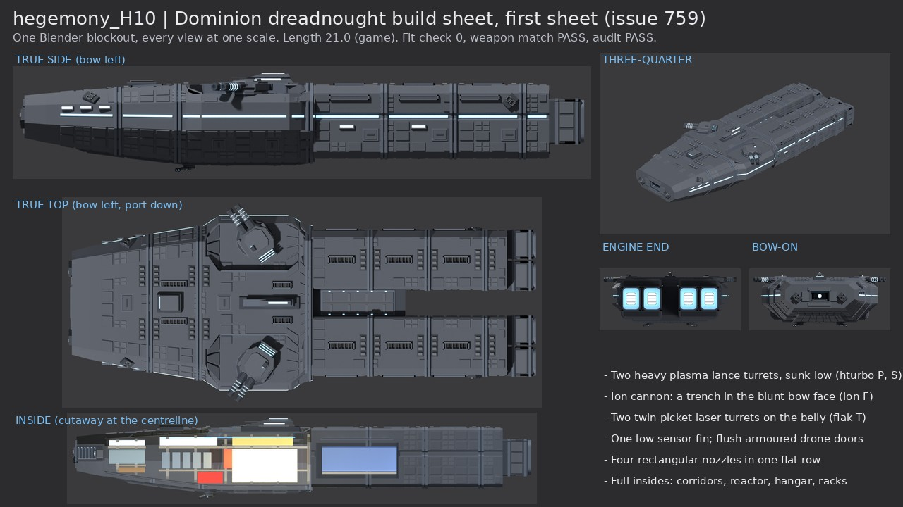
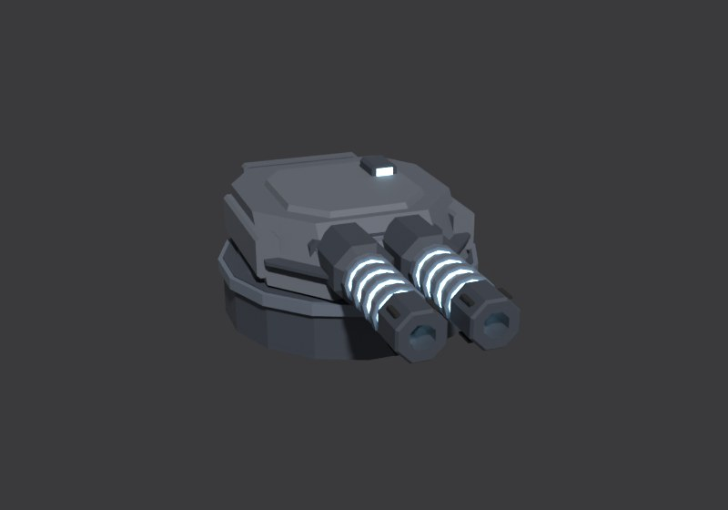
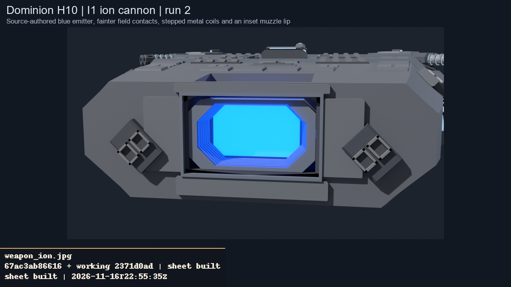
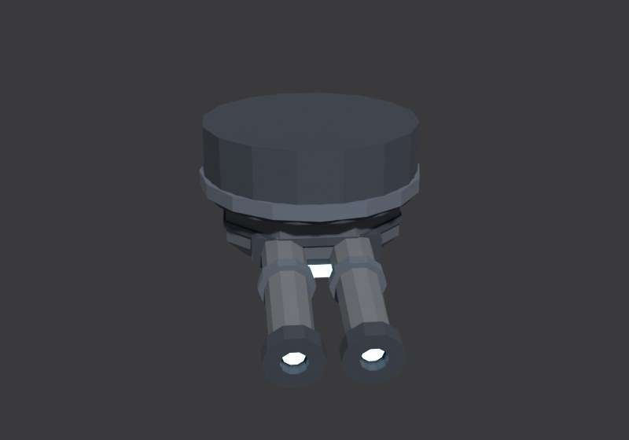

# hegemony_H10 build sheet: the Dominion-class dreadnought, the Hegemony Navy line flagship (first sheet)

Issue 759. Hegemony dreadnought, class Battleship, **21.0 world units** (godot/render/hull_table.gd CLS_LEN['Battleship'];
data.js `h_dominion`: hturbo P, hturbo S, ion F, flak T; ability launch, hangar 1). Shape of record: H10
(contrib/muse/design/concept_round7_2026_11/hegemony_H10_sheet.jpg and _beauty.jpg; picked and settled, R198), dressed in the
realistic detailed style (R197, R204 (3)). Designer of record: the Opus builder; the Board is the final designer and H10 is a
base, not a trace (R205, R207, R233, R236). Rendered in the issue 759 sandbox (Blender 5.3, Cycles CPU, 32 samples); the
blockout .blend is not on the PC (`build.py hegemony_H10 <out> render` rebuilds it from the design file). No paint stack and no
PC recipe run in this job: the Board reviews the pictures, then Ryan, before either. Pack section 9.3: Ryan judges this sheet
beside contrib/muse/design/concept_directions_2026_11/corsair_A.jpg (R198 (3)); the pictures here are unpainted, so the style
comparison is of shape and detail, the paint is the Hegemony stack's job.

Start here: [the overview](hegemony_H10_sheet_overview.jpg), [the whole concept beside the build](hegemony_H10_compare_H10.jpg)
(R229), [the weapon review](weapon_review.jpg) (R241), [the battle camera](hegemony_H10_battle_cam.jpg), then the full
[sheet](sheet.jpg), [side_by_side.jpg](side_by_side.jpg), [fit_view.jpg](fit_view.jpg) and [cells.jpg](cells.jpg).

Files: design `tools/blender/build_sheets/ships/hegemony_H10.py`, inventory `hegemony_H10_inv.py`, beauty camera
`hegemony_H10_camera.json`, battle camera `hegemony_H10_camera_battle.json`, recipe entry `tools/recipe/ships/hegemony_H10.json`
(bake none until the Hegemony paint stack), the new faction kit `tools/blender/kits/hegemony/` (its README says what each part is).

## The design, in short

1. **The wedge** (the forward half): a flat deck, chamfered deck edges, upper facets out to the knuckle, a vertical flank band
   carrying the blue line, lower facets, a chine, a flat worked belly with an armour step (never a flat wall, R244). 4.7 wide at
   the blunt bow face, 7.0 at a quarter, 7.9 across the shoulder bays; 1.6 deep at the bow face, 2.9 at the shoulders.
2. **The shoulder terraces**: at 38 to 46 percent the deck steps down 0.34 into an octagonal terrace each side (H10's turret bays)
   and the knuckle swells out over it. The two heavy plasma lance turrets sit low in them: their roofs stand 0.1 over the deck,
   their barrels at deck level (R185 (4)).
3. **The ion trench** (ion F): a 1.3 by 0.7 trench recessed 1.2 deep in the blunt bow face, coil-lined, a blue lens on the emitter
   block at its back (R183 (1): never prongs or a barrel on the nose). Retro thrusters on the bow face either side.
4. **The twin rails** (the aft half): two chamfered blocks 2.66 wide in two module tiers (a recessed band at mid height carries the
   blue line), a gap 1.24 wide between them; the drone bay block between their roots with flush armoured doors in its roof (R232).
5. **Four rectangular nozzle pods in one flat row**, two a rail: thick lips, blue-white throats, guide vanes (factions.md).
6. **One low sensor fin** on the centreline between the turrets, 0.4 tall and 2.4 long (factions.md: never a tower).
7. **Two twin picket laser turrets** (flak T) on the belly armour step.
8. **Modules**: module bands (raised trim rings with a deep double seam) at 7.0 and 4.75 on the wedge, at its aft end, and at 3.0,
   5.6 and 8.2 aft on the rails; rows of four latch clamps beside each band (H10's rows of four blocks); flush panels in an even
   grid of two module sizes, no rivets (paint direction hegemony.md, R243: "rigid and clean").
9. **INSIDE**: white corridors and crew decks, a blue emergency light strip, racks of identical equipment on the lower deck, the
   command deck under the fin, the lance capacitor rooms under the turrets, the reactor, the ion capacitor banks behind the trench,
   the picket store, the drone hangar between the rails, the rails' crew decks and plant rooms, the engine rooms; decks, 8 wedge
   frames and 14 rail frames. Breaks by the Hegemony rule (factions.md "How it breaks": in modules, at the bulkhead rings): **B-1**
   the bow module at the 7.0 band, **B-2** the wedge from the rails at the junction ring, **B-3** the rails at their middle band;
   every path kinks between the flanks and runs on straight past them. Six breach anchors on the module joints (Battleship base 6,
   Hegemony +0), three a side, prow, mid and engine sections. hp_bay_0 on the drone doors, launching up.

## Weapons (R221, R241)

| Weapon | Mounts | data.js and lore | Built as |
|---|---|---|---|
|  Heavy plasma lance (hturbo) | HP (slot P), HS (slot S) | 3 shots, 9 damage, range 6, plasma; lore 3.8, light blue; look plasma (slow fat bolts with a corona) | a low wide mount sunk in the shoulder terrace: a flush ring, a faceted housing with a sloped glacis, armoured cheeks, a capacitor bustle with a blue charge strip, a deep mantlet, two short thick containment barrels (breech sleeve, four coil rings with blue glow, a vented muzzle shroud, a blue-lit bore). Each turns through its own broadside arc, 30 to 150 off the bow |
|  Ion cannon (ion) | I1 (slot F) | 1 shot, 12 damage, range 6, strips shields; lore 3.1 (Vyre's ion tech); look ion | the emitter trench in the bow face: wall liners, six field coil frames, an emitter block with a blue lens (the muzzle), feed conduits |
|  Picket lasers (flak) | F1, F2 (slot T) | 3 shots, 3 damage, range 2, point defence | small low eight-sided turrets on the belly, a sensor eye, two short emitters with coil collars and lens tips, elevating to 60 |

Weapon match (`weapon_match.json`): **PASS**, 0 problems. Slot 0 hturbo P, 3 shots: HP (2 barrels). Slot 1 hturbo S, 3 shots:
HS (2). Slot 2 ion F, 1 shot: I1 (1). Slot 3 flak T, 3 shots: F1 (2), F2 (2). Every mount fires on every volley. The sensor
fin is a sensor for R240 (kind antenna) and a machine (R226): 30 gun and sensor pairs tested, 0 hits (the lances fire outboard,
the pickets below the belly, the trench forward).

`tools/blender/build_sheets/weapon_match.py` gained two FITS rows for this ship: `hturbo` (a gun, turret or casemate) and `ion`
(an `ion_trench`, fixed).

## Checks (sandbox, Nov 15 2026)

Rows marked * use the helper scripts in `contrib/opus/tools/issue759/` or `issue738/` (sandbox only, not standing checks); the rest
are the repo's own tools.

| Check | Result |
|---|---|
| Fit check (clash.py): clash, mount, arc, sensor, sweep, exhaust, exit, lane | 0 of each; 355 objects, 80 parts, 398 rays, 5 guns, 4 turrets swept, 30 sensor pairs ([fit_report.md](fit_report.md)) |
| Weapon match (R241) and `weapon_match_selftest.py` | PASS; self-test PASS (21 planted faults, 13 sheet ships) |
| Build contract (`tools/recipe/sheet_contract_selftest.py`) | PASS: length 21.0, 3 transverse seams, 9 muzzles in their slots, 4 turret pivots, 4 engines, 60 inside objects, the skin on 4 masses |
| Stage 4 audit (`audit.py` on the sheet_hull build) and `audit_selftest.py` | PASS: 282 parts, no machine across a seam, no structure across one, 5 guns, none into the ship; self-test PASS |
| `build_manifest_tests.js` | PASS, 13 sheets including hegemony_H10 |
| A16 fixture (`sheet_fixture_hash.py --check`) | PASS (kit.py untouched: the Hegemony materials live in the faction kit) |
| Inventory (R218, R221) | 0 failing; every built part has a job ([inventory.md](inventory.md)) |
| * Insides inside the skin (every inside vertex against the inner skin of the wedge, a rail or the bay block) and one compartment each | 3,528 vertices, 60 objects, 0 outside; 0 inside objects within 0.1 of any seam path (nearest 0.04 to 0.06 beyond that band; see Open risk) |
| * The export's open-bell test (check_export.py) on the four rectangular nozzles | 4 PASS, rim 12 of 12 sectors, a throat, a clear exhaust |
| * Detail density, mesh (R224) | no flags; lowest: hatchbox 0.93 and antenna 0.94 triangles of the hull's per square unit ([density_mesh.json](density_mesh.json)) |
| Outline overlap at the camera fitted to the H10 beauty | 93.5 percent, mass outline 93.6 (reported, not a bar; [outline_check.jpg](outline_check.jpg)) |

## Budget (the stage 4 sheet_hull build, before the export)

53,556 triangles outside, 5,432 inside (58,988 in all; * budget.py); 11 outside materials, 12 inside; 355 outside objects. For
comparison, the S8 sheet's stage 4 scene (the same stage, measured the same way): 99,690 outside, 15,508 inside, 8 outside
materials. The E11 figures are its stage 7 export, a different stage: 117,298 triangles, 13 surfaces, 7,677 inside. The Dominion
is a Battleship (21.0) against S8's Dreadnought (27.0), and its flush panels carry no rivets, so it costs about half of S8. Costs
are reported, never capped; the scene gate is not measured here.

## Proportions (the same measure on H10's sheet and the build)

| | Hull length:beam | Hull length:height | Envelope length:beam | Envelope length:height |
|---|---:|---:|---:|---:|
| H10 sheet | 3.09 | 7.02 | 2.64 | 5.43 |
| **Build** | **3.14** | **7.16** | 2.35 | 5.70 |

The envelope is wider than H10's because the lance barrels reach 0.6 past the shoulder bays at rest (H10's barrels are shorter
and point forward). Structure per cell (H10 by eye / build): bow top 2/3, bow side 2/3, mid top 5/5, mid side 4/4, stern top
3/3, stern side 3/2.

## Open risks (for the PC run)

- **Seam clearance:** every inside stops 0.14 to 0.16 short of its seam path's furthest kink. The game tears a transverse seam
  along its plan path with the waves of godot/fx/fx_death.gd; if death_seam_check counts inside triangles outside their piece,
  pull the insides back from the seams. Not run here: it needs the stage 7 export on the PC.
  Board note (Nov 15 2026, opus_check_767 condition 1): the E11 and S8 checks found the peel needs about 0.5 of clearance,
  so the Board expects death_seam_check to fail here, not just possibly. It runs on the stage 7 export before any paint or
  recipe stage builds on these room positions; the fix is pulling the insides back from the seams, never moving the outside.
- **Rectangular nozzles:** the export's open-bell test was written for round bells; the sandbox run of the same function passes
  all four, but the export has not run.
- **The model is 21.2 long** (the retro thrusters and bow plates stand 0.18 proud of the bow face); the contract scales it to
  the class length 21.0, so the build is 0.9 percent smaller than drawn.

## Changed from H10 (every change, with its reason)

The full list is in [feature_table.md](feature_table.md), "Changed from the picture"; the same list is on the sheet.
