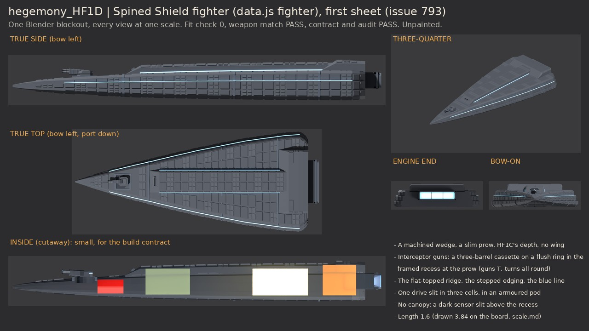
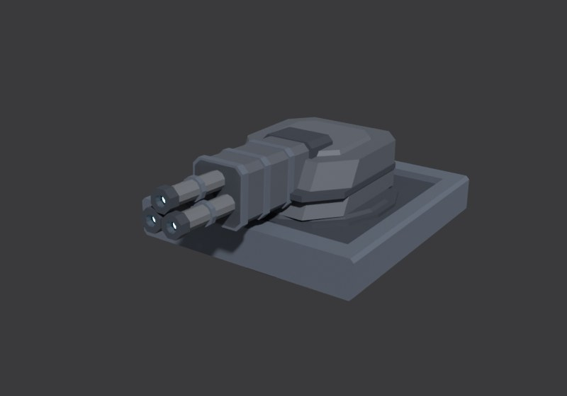

# hegemony_HF1D build sheet: the Spined Shield, the Hegemony Navy fighter wing craft (first sheet)

Issue 793. Hegemony fighter, data.js `fighter` (cls Squadron, `guns` T: Interceptor guns, 3 shots; hp 18, sp 6; the Hegemony
launches fighters, data.js FACTIONS hegemony sq 'fighter'). Concept of record: HF1D, the slimmed render
(contrib/muse/design/squadron_concepts_2026_11/hegemony/round_3/HF1D.jpg; R259, Ryan, Nov 15: "HF1D with the slimmed prow is good to
go", HF1C's sleekness with HF1B's bow detail, the front slimmed so the whole reads more of a wedge). Where the render drifts from
the written sheet (design_notes_785_round3.md), the written sheet governs. Designer of record: the Opus builder; the Board is the
final designer and HF1D is a base (R233, R236). Rendered in the issue 793 sandbox (Blender 5.3, Cycles CPU). No paint stack (the
Hegemony stack, issue 780, applies later) and no PC recipe run in this job.

Start here: [the overview](hegemony_HF1D_sheet_overview.jpg), [the whole concept beside the build](hegemony_HF1D_compare.jpg)
(R229), [the three issue 793 craft beside their flagships at true game scale](issue793_craft_true_scale.jpg), [the
three at the battle camera, game size](issue793_craft_battle_cam.jpg), [the weapon review](weapon_review.jpg)
(R241), then the full [sheet](sheet.jpg), [side_by_side.jpg](side_by_side.jpg), [fit_view.jpg](fit_view.jpg) and
[cells.jpg](cells.jpg) (the concept is one three-quarter picture with no true views, so cells.jpg shows it in place of the top
and side views).

Files: design `tools/blender/build_sheets/ships/hegemony_HF1D.py`, inventory `hegemony_HF1D_inv.py`, beauty camera
`hegemony_HF1D_camera.json`, recipe entry `tools/recipe/ships/hegemony_HF1D.json` (bake none), the Hegemony kit's craft parts in
`tools/blender/kits/hegemony/` (its README, "Squadron craft"), the sandbox helpers in `contrib/opus/tools/issue793/`.

## Size (scale.md wins)

LENGTH 1.6, the hull table's CLS_LEN['Squadron']; the board draws a craft at 1.6 x SHIP_K 1.6 x SQUADRON_K 1.5 = 3.84
(docs/playbooks/scale.md, Squadron rows, binding). Every station in the design file is a share of LENGTH. Measured off the views:
1.60 long, 0.66 beam, 0.18 tall (with the ridge and the gun); the hull alone 0.13 deep, length to beam 2.4.

## The design, in short

1. **The machined wedge**: one sleek wedge from a slim point to the stern, widest in the stern third, the stern corners cut. A flat
   deck, a small deck chamfer, the flank in three stepped layers (HF1B's stepped plate edging, each step 0.015, flush and shallow,
   never a ledge or a wing), a flat belly. It keeps HF1C's depth, so it reads as a hull, never a flat delta wing.
2. **The ridge**: HF1C's low broad flat-topped ridge, squared in section, from the bow block (its sloped front face is the single
   bevel) to the stern block, no taller than it.
3. **The gun cassette** (guns T): three short containment barrels grouped tight in one machined box, on a low flat housing over a
   flush ring sunk in a framed recess at the prow (the concept's framed recess). It turns all round and elevates to 45; at rest it
   faces forward out of its frame.
4. **The sensor slit** in its own slot in the ridge's sloped front face, above the recess: dark glass, no canopy.
5. **The stern block** across the stern holds the reactor and the drive; **one drive slit** stands out of its aft face in an
   armoured pod: one wide rectangular mouth split by upright guide vanes into three cells (the faction's flat row of nozzles).
6. **The blue line**: implant-blue strips along the upper edging step and the ridge's foot; **three module bands** cross the hull
   (bow block, midships, stern block): the Hegemony breaks in modules.
7. **INSIDE** (small, for the build contract only): the gun feed, the pilot's cell, the reactor, the drive room; one seam (B-1)
   at the midships band. The game shows a craft's death as a spark (godot/fx/fx_death.gd `_wing_death`), so nothing breaks
   open; the build contract (tools/blender/build_sheets/contract.py) refuses a sheet with no inside and no seam.

## Weapons (R221, R241)

| Weapon | Mount | data.js and lore | Built as |
|---|---|---|---|
|  Interceptor guns (guns) | G1 | 3 shots, 4 damage, range 1 (k sq), x2.2 against squadrons; battle look `guns` | three containment barrels with coil rings and blue lenses grouped in one machined cassette box with coil bands and a trim mouth, a mantlet, a low flat housing with a roof plate and a blue strip, a flush ring in a framed recess |

Weapon match (`weapon_match.json`): **PASS**, 0 problems. Slot 0 guns T, 3 shots: G1, three muzzles, every barrel fires every
volley. The weapon-match table already allows a fighter's guns on a turret (FITS `guns`); no new row for this craft. No dish,
antenna or mast (0 sensor pairs).

## Checks (sandbox, Nov 15 2026)

| Check | Result |
|---|---|
| Fit check (clash.py) | 0 of every kind; 38 objects, 3 parts, 97 rays, 1 turret swept all round ([fit_report.md](fit_report.md)) |
| Weapon match and `weapon_match_selftest.py` | PASS; self-test PASS (36 planted faults, 7 of them craft faults) |
| Build contract (`sheet_contract_selftest.py`) | PASS: length 1.6, 1 transverse seam, 3 muzzles in slot 0, 1 turret pivot, 1 engine, 4 inside objects, the skin; its three broken inputs refused |
| Stage 4 audit (`audit.py` on the sheet_hull build) and `audit_selftest.py` | PASS: 18 parts, none across the seam, the gun not into the craft; self-test PASS (E1 moved onto the seam is refused, W1 the slit allowed as structure) |
| Inventory (R218, R221) | 0 failing; every built part has a job ([inventory.md](inventory.md)) |
| Outline overlap at the camera fitted to HF1D | 88.7 percent, mass outline 88.8 (reported, not a bar; [outline_check.jpg](outline_check.jpg)) |
| Detail density, mesh (R224, `contrib/opus/tools/issue738/density_mesh.py`) | flagged: the drive 0.60 of the hull's triangles per square unit and 0.56 of its edges (its big flat lining and throat plate); the gun 3.6, the slit 9.6 ([density_mesh.json](density_mesh.json)) |

## Budget (the stage 4 sheet_hull build)

16,466 triangles outside, 112 inside; 10 outside materials (hgrey, hgrey2, hpanel, htrim, hmetal, hblue, hlens, hlining, hnozzle,
dark), so about 10 draw calls a craft once joined by material, against 5 surfaces for today's code-built craft. A wing of four:
about 66,300 triangles. Against the Sunward pair: SF3 18,606 outside and 7 materials, SB4 20,516 and 6. The panel grid is most of
the triangles. Reported, not capped; the scene gate is not measured here.

## Changed from HF1D (every change, with its reason)

The full list is in [feature_table.md](feature_table.md), "Changed from the picture"; the same list is on the sheet. In short: the
cassette turns on a flush ring (data.js guns fire all round); the recess is a flat framed well in the prow deck, not a vertical
bow face (the slim prow is too thin for one); the ridge starts behind the recess so the turning barrels clear it; the slit stays
dark and the hull keeps HF1C's depth (the round 3 notes); the drive slit is split into three cells in an armoured pod; three
module bands; no hatches, thrusters, bays or antennas at this size.

## Open

- The colours are schematic zones; the Hegemony paint stack (issue 780) paints the craft later. The paint stack keys its module
  band on `*_bandseam_*` objects: the sheet carries three.
- How a sheet craft reaches the game: the game builds every craft in code today (godot/render/squadron_craft.gd), so no stage 7
  export or install here.
