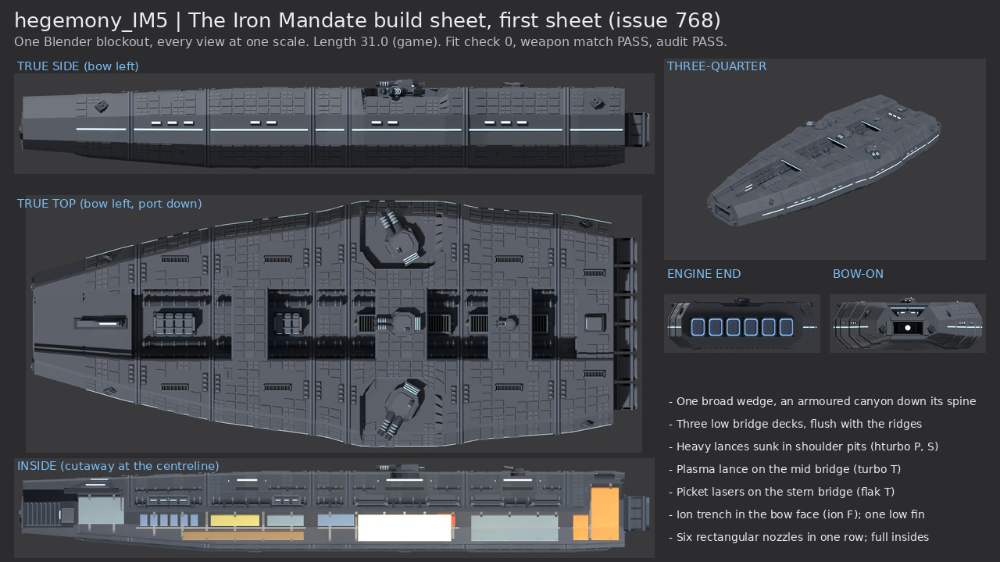
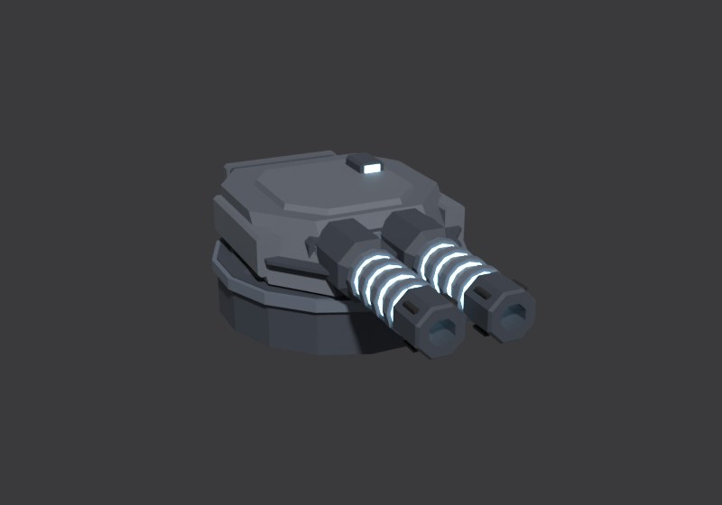
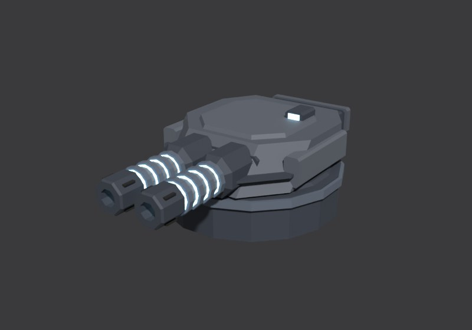
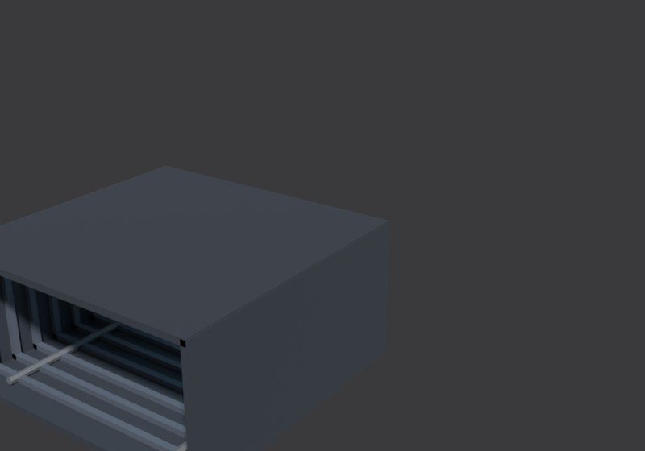
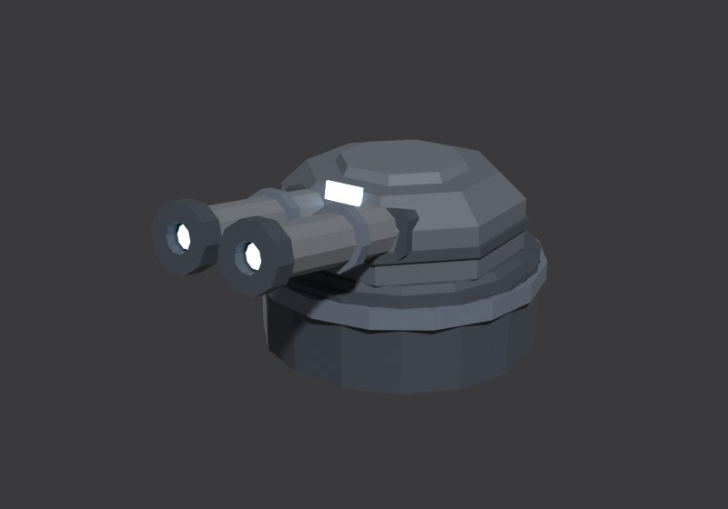

# hegemony_IM5 build sheet: The Iron Mandate, the Hegemony Navy super-dreadnought (the boss, first sheet)

Issue 768. Hegemony super-dreadnought, class Super-dreadnought, **31.0 world units** (godot/render/hull_table.gd
CLS_LEN['Super-dreadnought']; data.js `h_boss`: hturbo P, hturbo S, turbo T, ion F, flak T; ability nova, no mount; no hangar).
Shape of record: IM5 (contrib/muse/design/iron_mandate_2026_11/round_2/IM5.jpg and IM5_top.jpg; Ryan, Nov 14 2026: "Im5 is my
preference", R255, the IM2 and IM3 mix he asked for, R254; design_notes_758.md section IM5). Designer of record: the Opus builder;
the Board is the final designer and IM5 is a base, not a trace (R205, R207, R233, R236). Built with the Hegemony kit of the
Dominion sheet (hegemony_H10, PR 767) plus this sheet's additions. Rendered in the issue 768 sandbox (Blender 5.3, Cycles CPU,
32 samples); the blockout .blend is not on the PC (`build.py hegemony_IM5 <out> render` rebuilds it from the design file). No
paint stack and no PC recipe run in this job: the Board reviews the pictures, then Ryan, before either. IM5 has a three-quarter
and a top view only: no side, front or underside view, so the heights and the underside are designed here.

Start here: [the overview](hegemony_IM5_sheet_overview.jpg), [the whole concept beside the build](hegemony_IM5_compare_IM5.jpg)
(R229), [the weapon review](weapon_review.jpg) (R241), [the battle camera](hegemony_IM5_battle_cam.jpg), then the full
[sheet](sheet.jpg), [side_by_side.jpg](side_by_side.jpg), [fit_view.jpg](fit_view.jpg) and [cells.jpg](cells.jpg).

Files: design `tools/blender/build_sheets/ships/hegemony_IM5.py`, inventory `hegemony_IM5_inv.py`, beauty camera
`hegemony_IM5_camera.json`, battle camera `hegemony_IM5_camera_battle.json`, recipe entry `tools/recipe/ships/hegemony_IM5.json`
(bake none until the Hegemony paint stack; game_code H4_11, the hull table's Super-dreadnought folder). The concept's top view,
turned so the bow is on the left for the sheet tools (they crop and flip only): [concept_IM5_top_bow_left.jpg](concept_IM5_top_bow_left.jpg).

## The design, in short

1. **One broad wedge hull** (R255: one vessel, never two hulls): two raised armoured ridges, each a flat deck with a chamfered
   deck edge, an upper facet out to the knuckle, a vertical flank band carrying the blue line, a lower facet, a chine and a flat
   worked belly (never a flat wall, R244). 31.0 long, 12.0 across the knuckles (12.6 over the shoulder swells), 10.3 at the stern,
   5.2 at the blunt bow face; 3.8 deep, 2.6 at the bow face.
2. **The armoured canyon down the spine**: 3.1 across its floor, 3.8 across its lips, 1.7 deep, its walls stepped by a ledge
   halfway down; from the bow deck (10.5) to the stern deck (-12.4). It is open space (never filled) carrying the plant.
3. **Three low bridge decks** across the canyon (bow 4.4, midships -3.4, stern -9.0), their tops flush with the ridge decks (never
   above them: no naval read), chamfered undersides, two girders under each, a crossing corridor inside, a trim band and a blue
   strip on each face.
4. **The canyon plant** (the issue: machinery on the canyon floor is real machinery with a job): two capacitor banks for the ion
   cannon forward, four heat exchangers for the reactor and the drives, two armoured power trunks along the floor, coolant lines
   on both ledges, the engine room's control windows at the canyon's aft end. The banks and exchangers are machines and sit whole
   in one module; the trunks and lines are structure and stop at flanged couplings short of every module band.
5. **The ion trench** (ion F): a 2.6 by 1.25 emitter trench recessed 2.5 deep in the blunt bow face at the canyon's mouth, under
   the low bow deck, coil-lined, a blue lens on the emitter block at its back (R183 (1)). Retro thrusters either side of it.
6. **The heavy plasma lances** (hturbo P and S): low twin turrets sunk in shoulder pits on the ridges' outer shoulders at -3.4,
   abreast of the midships bridge; roofs 0.06 over the deck, barrels at deck level (R185 (4)); each turns through its own
   broadside arc.
7. **The plasma lance** (turbo T) on the midships bridge (the same mount at a smaller size), and **the picket lasers** (flak T)
   on the stern bridge, both turning all round.
8. **One low sensor fin** on the bow deck ahead of the canyon, 0.5 tall (factions.md: never a tower). The bow deck sits 0.45 to
   0.6 below the ridge tops so the bridge lance fires over the fin (R240).
9. **Six rectangular nozzle pods in one flat row** across the whole stern on one datum (factions.md).
10. **Modules**: six module bands (raised trim rings with a deep double seam, round the whole section, canyon included) at 10.2,
    6.4, 1.2, -0.6, -6.4 and -11.4; latch rows on the ridge decks at each band; flush panels in an even grid of two module sizes
    on every face, the canyon and the bridges included, no rivets (paint direction hegemony.md, R243).
11. **INSIDE**: white corridors and crew decks in the ridges, a blue emergency light strip, racks of identical equipment on the
    lower deck, the command deck, the ion cannon's field drivers and feed, the reactor (hp_core) under the canyon floor amidships,
    the lance capacitor rooms under the pits, the bridge lance's feed, the drive plant, the picket store, the engine room, the
    crossing corridors in the bridges; decks in every compartment and 20 frames that follow the hull's U round the open canyon.
    Breaks by the Hegemony rule (factions.md "How it breaks": in modules, at the bulkhead rings): **B-1** the bow module at
    10.2, **B-2** at 1.2, **B-3** at -6.4 behind the shoulder pits, **B-4** the stern module and the nozzles at -11.4; every path
    kinks between the flanks and runs on straight past them. Eight breach anchors on the module joints (Super-dreadnought base 8,
    Hegemony +0): prow 3, mid 3, engine 2, sides alternating as hardpoints.py breach_layout lays them.

## Weapons (R221, R241)

| Weapon | Mounts | data.js and lore | Built as |
|---|---|---|---|
|  Heavy plasma lance (hturbo) | HP (slot P), HS (slot S) | 3 shots, 9 damage, range 6, plasma; lore 3.8 | the Hegemony lance turret (size 1.15), sunk in a shoulder pit: flush ring, faceted housing, sloped glacis, cheeks, capacitor bustle, two short thick coil barrels; each turns 30 to 150 off the bow |
|  Plasma lance (turbo) | T1 (slot T) | 2 shots, 9 damage, range 5, plasma; lore 3.8 | the same lance mount at size 0.95 on the midships bridge, two barrels, all round |
|  Ion cannon (ion) | I1 (slot F) | 1 shot, 12 damage, range 6, strips shields; lore 3.1 | the emitter trench in the bow face at the canyon's mouth: liners, eight coil frames, an emitter block with a blue lens (the muzzle), feed conduits |
|  Picket lasers (flak) | F1 (slot T) | 3 shots, 3 damage, range 2, point defence | a small low eight-sided turret on the stern bridge, a sensor eye, two short emitters, elevating to 60 |

Weapon match (`weapon_match.json`): **PASS**, 0 problems. Slot 0 hturbo P, 3 shots: HP (2 barrels). Slot 1 hturbo S, 3 shots:
HS (2). Slot 2 turbo T, 2 shots: T1 (2). Slot 3 ion F, 1 shot: I1 (1). Slot 4 flak T, 3 shots: F1 (2). Every mount fires on
every volley. The sensor fin is a sensor for R240 and a machine (R226): 30 gun and sensor pairs tested, 0 hits.

`tools/blender/build_sheets/weapon_match.py` gained one FITS row for this ship: `turbo` (a gun, turret or casemate).

## Checks (sandbox, Nov 15 2026)

Rows marked * use the helper scripts in `contrib/opus/tools/issue768/`, `issue759/` or `issue738/` (sandbox only, not standing
checks); the rest are the repo's own tools.

| Check | Result |
|---|---|
| Fit check (clash.py): clash, mount, arc, sensor, sweep, exhaust, exit, lane | 0 of each; 488 objects, 114 parts, 427 rays, 5 guns, 4 turrets swept, 30 sensor pairs ([fit_report.md](fit_report.md)) |
| Weapon match (R241) and `weapon_match_selftest.py` | PASS; self-test PASS (21 planted faults, 14 sheet ships) |
| Build contract (`tools/recipe/sheet_contract_selftest.py`) | PASS: length 31.0, 4 transverse seams, 9 muzzles in their slots, 4 turret pivots, 6 engines, 70 inside objects, the skin on the hull |
| Stage 4 audit (`audit.py` on the sheet_hull build) and `audit_selftest.py` | PASS: 404 parts, no machine across a seam, no structure across one, 5 guns, none into the ship; self-test PASS |
| `build_manifest_tests.js` | PASS, 14 sheets including hegemony_IM5 |
| A16 fixture (`sheet_fixture_hash.py --check`) | PASS (kit.py untouched) |
| Inventory (R218, R221) | 0 failing; every built part has a job ([inventory.md](inventory.md)) |
| * Insides inside the skin (every inside vertex against the hull's inner skin, the canyon outside it, or a bridge's) and one compartment each | 5,192 vertices, 70 objects, 0 outside; 0 inside objects within 0.1 of any seam path (nearest 0.08 to 0.10 beyond that band). Planted points: a point in the canyon is outside (0.95), one in a ridge inside (-0.75) |
| * The export's open-bell test (check_export.py) on the six rectangular nozzles | 6 PASS, rim 12 of 12 sectors, a throat, a clear exhaust |
| * Detail density, mesh (R224) | no flags; lowest: antenna 0.98, spinal 1.11 and hatchbox 1.11 of the hull's triangles per square unit ([density_mesh.json](density_mesh.json)) |
| Outline overlap at the camera fitted to the IM5 three-quarter | 91.9 percent, mass outline 91.9 (reported, not a bar; [outline_check.jpg](outline_check.jpg)) |
| H10 unchanged by the kit additions | `build.py hegemony_H10 <out> fit`: 355 objects, 80 parts, 0 clashes, weapon match PASS, as committed |

## Budget (the stage 4 sheet_hull build, before the export)

104,912 triangles outside, 7,944 inside (112,856 in all; * budget.py); 11 outside materials, 11 inside; 488 outside objects. The
same measure on the other sheets: hegemony_H10 (Battleship, 21.0) 53,556 outside, 5,432 inside, 11 materials, 355 objects;
voidsworn_S8 (Dreadnought, 27.0) 99,690 outside, 15,508 inside, 8 materials. E11's figures are a stage 7 export, a different stage
(117,298 triangles, 13 surfaces, 7,677 inside). What the extra size costs: the Mandate has about 2.4 times H10's plan area and
costs 1.96 times its triangles (the same panel pitch in world units, so the panel count grows with the area; the canyon adds two
wall faces and a floor of panels and the plant, about 15,000 triangles of trunks, lines, banks and exchangers), and about 5
percent more than S8. Draw calls go by material: 11 outside, as H10. Costs are reported, never capped; the scene gate is not
measured here. It is one hull on the board (the boss), not a line ship repeated.

## Proportions (the same measure on IM5's top view and the build)

| | Hull length:beam | Hull length:height | Envelope length:beam | Envelope length:height |
|---|---:|---:|---:|---:|
| IM5 top view | 2.33 | no side view | 2.33 | no side view |
| **Build** | **2.66** | **7.88** | 2.45 | 6.97 |

IM5_top.jpg's own "IM5 TOP" label sits over the bow, so the tool's concept length reads short; by hand the picture is 706 px long
and 279 px across at the widest, 2.53. The build's 2.46 over the shoulder swells (2.58 off them) is within that. Structure per
cell (IM5 top view by eye / build masses): bow top 3/4, mid top 6/4, stern top 5/3 (the build counts registered masses only;
the turrets, ridges and nozzle row it shows are parts or faces of the one hull, by design: one vessel).

## Design calls for the Board (and Ryan)

- **Length to beam 2.46 (2.58 off the swells)**, broader than the faction's "about 3 : 1": IM5's top view is about 2.5 and the boss
  should read as one broad wedge.
- **Two ridges stand in for the faction's twin rails**: the canyon between them is the rails' gap made into one hull (R255).
- **Six nozzles across the whole stern**, not only between the ridge roots as the notes say: IM5's three-quarter shows plumes
  across the whole stern.
- **Twin barrels on every turret**: IM5 shows twins; its notes say three-barrel lances and a flak "cluster". Two barrels fire every
  volley on every slot (weapon_match SPLIT) and the kit's mantlets are sized for two.
- **The lowered bow deck**: the fin's deck sits 0.45 to 0.6 under the ridge tops so the midships bridge lance fires over the fin
  (R240); raising the bridges or the turret instead would read naval.
- **The canyon is about 0.3 of the beam** (IM5's top view about 0.4): DeepSeek's adopted refinement, so the ridges never read as
  separate hulls. Its floor shows from the battle camera between the bridges.
- **The fitted camera sits low** (14 degrees above the bow quarter): it gives the best outline overlap (91.9) with IM5's strong
  perspective; a higher start converged to 78.8. The build's standard three-quarter shows the deck more as IM5 does.
- **Shared-tool edits**: `inventory.py` and `sheet_extras.py` now leave a concept's side cells and length to height blank when it
  has no side view (they indexed it unguarded); `layout.py` counts `capbank` and `exchanger` as kit builders.

## Open risks (for the PC run)

- **Seam clearance:** every inside stops 0.08 to 0.10 beyond each seam path's band. If death_seam_check counts inside triangles
  outside their piece, pull them back. Not run here: it needs the stage 7 export on the PC.
- **Rectangular nozzles:** the sandbox run of the export's open-bell test passes all six; the export has not run.
- **The model is 31.2 long** (the bow plates and retro thrusters stand proud of the bow face); the contract scales it to 31.0.
- **The canyon plant on the board:** the battle camera shows it as dark slots between the bridges; paint (the Hegemony stack)
  carries the rest.

## Changed from IM5 (every change, with its reason)

The full list is in [feature_table.md](feature_table.md), "Changed from the picture"; the same list is on the sheet.
