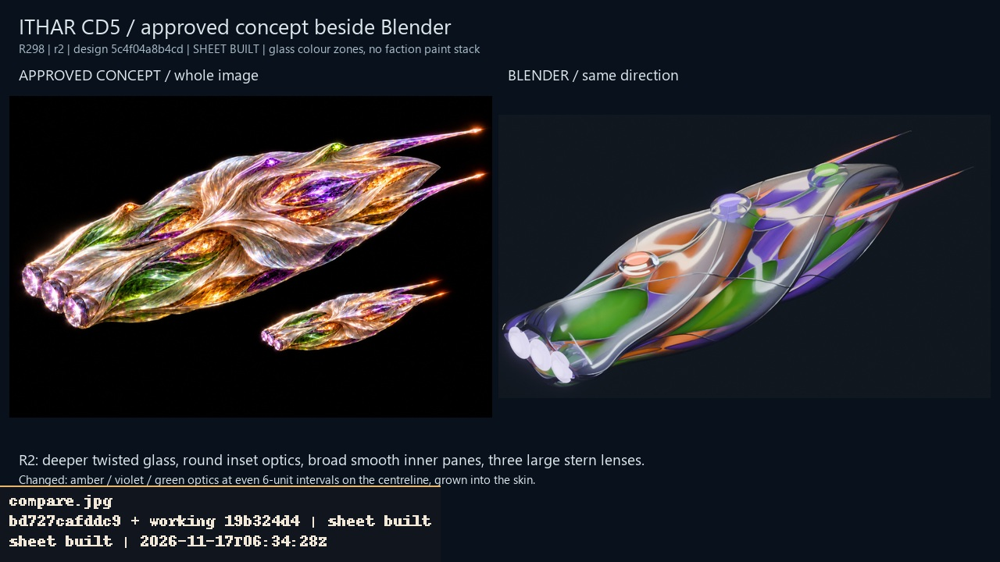

# Glasswright flagship CD5: The Unfinished

Issue 912, R298, run 2. Stage: **sheet built**, revision **r2**. This revises the
run 1 design from commit `1727b82f`: round lenses in gentle glass swells, a deeper
rounded body with twisting poured ridges, large stern drive lenses and smooth
coloured panes under the glass. Both forward lances are preserved exactly.

Review: [top](top.jpg), [side](side.jpg), [camera 170 at original pixel size](camera170.jpg),
[true views at one scale](sheet.jpg), [inside](inside.jpg), [fit](fit_view.jpg).
All seven review pictures are 1280 by 720, with revision, stage and provenance.
[concept.jpg](concept.jpg) is the complete approved reference at 1536 pixels wide,
including its inset. The comparison retains that reference and the run 1 concept camera.

## Method and run 2 changes

Design: [ithar_CD5.py](../../../../tools/blender/build_sheets/ships/ithar_CD5.py).
[Manifest](manifest.json), [feature table](feature_table.md), [inventory](inventory.md).
All shapes are hand-built in the design. Blender 4.5.14 LTS, Cycles CPU, 48 samples,
eight render threads. The shared kit supplies records, transforms, turret hierarchy
and contract plumbing. No Glasswright kit or paint stack exists yet; these are sheet
materials describing the glass, silver and lit colour zones.

- The three secondary optics remain at x=-6, 0, +6, on the centreline. Each is now a
  round 1.20-wide internal lens inside a low clear envelope, supported by a broad
  0.24-high swell in the continuous skin. There are no pointed tent roots or ring mounts.
- The rounded body has broad ridges winding around its flanks and belly. The actual
  skin depth is 6.037 units, versus 4.245 including the old peaks. The side view shows
  the extra volume. Whole-model dimensions are 25.992 by 9.140 by 6.565 units.
- Three 1.72-wide drive lenses fill the stern at 1.90-unit spacing, with curved violet
  glass and white inner light. These are propulsion optics with a soft bloom, no flame.
- Twenty-four smooth internal colour panes replace the noisy full-length striped
  streams. Amber, violet and green light varies continuously across each pane.
  Silver veins divide them; broad pearly streams fade smoothly into clear glass.
- Both run 1 forward lances are unchanged, including their materials, world vertices,
  faces, feature and fit records. [Lance preservation proof](lance_preservation.json)
  records matching hashes for L1 and L2 against the run 1 commit.
- The generator now emits the shared feature, mass and break-line tables. Hull
  compartments live in `break_pieces`; the eight intact optical machine groups live
  separately in `whole_optics`. Every layout run invokes the real standing manifest check.

## Game and optic match

`data.js i_boss`, **The Unfinished**, faction `ithar`, class **Ark**, size 1.26.
[Game match](game_match.json) checks the committed Godot rules twin as well.
`godot/render/hull_table.gd` gives Ark length 26.0; SHIP_K 1.6 draws it at **41.6**.

| Slot | Game weapon | Built optic | Placement and arc |
|---|---|---|---|
| 0 | `pulsar F`, Prism lance | L1 | Port forward waveguide; +/-60 degrees |
| 1 | `pulsar F`, Prism lance | L2 | Starboard forward waveguide; +/-60 degrees |
| 2 | `pulsar T`, Prism lance | O1, amber | x=-6, centreline; 360-degree bearing |
| 3 | `turret T`, Needle beam | O2, violet | x=0, centreline; 360-degree bearing |
| 4 | `flak T`, Mirror veil | O3, green | x=+6, centreline; 360-degree bearing |
| Drive | No weapon slot | E1, E2, E3 | Three stern optics, aft drive exits |

This follows the Board's reading of the three small points as secondary weapons,
with the stern cluster separate as propulsion. Five muzzles match five game slots;
three turning internal lenses retain their own pivots. Every muzzle belongs to its
actual optical mesh. The full-turn fit samples use 5-degree bearings and record the
clear elevation at each bearing, rather than claiming horizontal fire through another
optic. The static clear envelope transmits the beam. Both forward lances rest forward.
The shared Prism-lance validation support from run 1 is retained with its self-tests.

## Inside and breaks

Two shaped glass decks, 15 annealed frames, three full-length braided light cores
and three reservoirs remain actual geometry. The shell is 0.065 units thick.
[inside.jpg](inside.jpg) hides the outer skin to show that construction.

Five jagged transverse paths bracket the lens bays; the fore bay has an upper peel
at z=1.66, clear of both long forward lances. B1 moves from x=-11.35 to -10.95 to
clear the larger stern shoulders. The audit finds zero machines crossing any path.
The shared schema names seven hull pieces with their full interiors. `whole_optics`
separately retains each intact lance, secondary lens and drive group.
Seven breach anchors follow Ark base 8 minus the Glasswright adjustment of 1;
one core, two RCS and two boarding origins are retained. No game shatter installation
is claimed by these authored sheet records.

## Checks and budget

[checks.json](checks.json) records the actual checks and commands. The full standing
suite finished with exit 0: **61 PASS, 2 existing KNOWN baselines, zero FAIL or SKIP**.
The known rows are the seven listed findings and twelve constant differences in the
standing baseline; they are not CD5 failures.
[build_manifest_check.json](build_manifest_check.json) is the **real standing**
`node contrib/opus/tools/build_manifest_tests.js` run, including CD5, all other sheets,
the broken fixture and single-fault mutations. [manifest_check.json](manifest_check.json)
is only the **local model consistency** check of mesh groups, routes, breaches and
design digest; it does not stand in for the shared validator.

[Fit](fit.json), [fit report](fit_report.md), [weapon match](weapon_match.json),
[contract](contract.json), [contract self-test](contract_selftest.json),
[seam audit](audit.json) and [mesh density](density_mesh.json) are regenerated for r2.
The fit has zero findings in all eight categories. The contract retains all five slots,
three pivots, drive exits, points, shell and interiors, and refuses its three broken inputs.

The model has **349,870 outside triangles and 37,312 inside triangles**, **387,182 total**.
There are **145 outside and 23 inside material surfaces**, **168 unjoined material draw
submissions**. The outside uses 12 materials; the complete ship uses 13 unique materials.
These are measured sheet costs, without a cap. No Godot draw-call or frame-time
measurement is claimed.

## Limits and reproduction

The sheet still has fewer and broader glass folds than the concept. Its panes and
silver paths are simpler and the review light gives a cooler, softer glow. These are
visible differences for the Board's comparison. Technical checks do not confer visual
acceptance. Paint, texture baking, game export, installation, game capture and scene
frame measurements remain outside this sheet job. Other ships are untouched.

Reproduce with Blender on the CPU: run the design with `-- review TEMP_OUT`, then
`python docs/ship_pipeline/build_sheets/ithar_CD5/review_layout.py TEMP_OUT`.
This writes the blockout and normalized contract blends, a review blend with camera
and lighting, renders, tables and the real manifest result. Keep scratch in TEMP;
review pages and records belong beside this README, with matching copies and the
Blender artifacts in the issue's requested shots folder.
