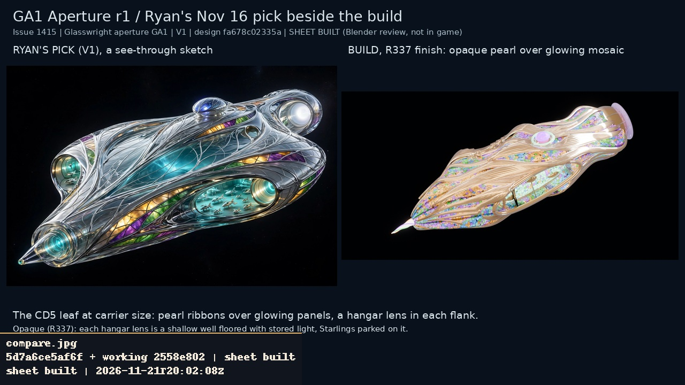

# GA1 Aperture: Glasswright aperture GA1

Issue 1415 (R368). Stage: **sheet built** (Blender review renders, not in the game), revision **r1**, design fa678c02335a.
Built from Ryan's Nov 16 pick V1 (contrib/muse/design/glasswright_family_2026_11/, PR 942) in the R337 finish on the
shared Glasswright kit: opaque pearl ribbons with silver edges over glowing amber, violet and green mosaic; nothing see-through.

Review: [close](close.jpg), [side](side.jpg), [battle camera stand-in](camera170.jpg), [true views](sheet.jpg),
[inside](inside.jpg), [fit](fit_view.jpg). [Feature table](feature_table.md), [manifest](manifest.json).

Design: [ithar_GA1.py](../../../../tools/blender/build_sheets/ships/ithar_GA1.py) on [hull.py](../../../../tools/blender/kits/ithar/hull.py).
Recipe ship file: tools/recipe/ships/ithar_GA1.json (game code I16_11).

Budget (Blender, before the recipe): outside 376388 triangles, inside 4808; 13 material surfaces outside.
Weapon match and fit: PASS (weapon_match.json, fit.json). Contract: contract.json.

## Changed from the picture

- Opaque pearl ribbons over a glowing mosaic core instead of the sketch's clear glass. R337 (Ryan, Nov 19): the Glasswright finish is opaque reflective pearl with glowing stained-glass panels; nothing see-through.
- Each hangar lens is a shallow well in the mosaic skin with a pearl lip and a stored-light floor, three Starlings parked on it. carrier.md: lenses grown into the skin, not cut openings or pods; Starlings visible; opaque, so the floor is light, not a window.
- The sketch's extra stern and flank lens rings are left out; one large stern optic carries the bloom. Weapon match (R241): only data.js weapons show as lenses (one pulsar F, one turret T); the rings read as more guns.
- Ribbons slide above and below each hangar lens. So the lens stays clear and reads as grown into the skin.
