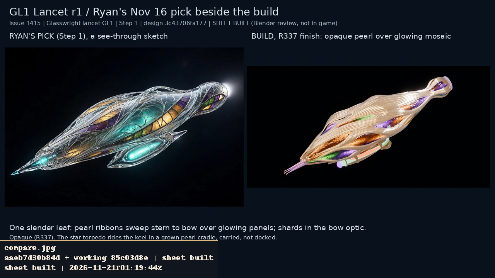

# GL1 Lancet: Glasswright lancet GL1

Issue 1415 (R368). Stage: **sheet built** (Blender review renders, not in the game), revision **r1**, design 3c43706fa177.
Built from Ryan's Nov 16 pick Step 1 (contrib/muse/design/glasswright_family_2026_11/, PR 942) in the R337 finish on the
shared Glasswright kit: opaque pearl ribbons with silver edges over glowing amber, violet and green mosaic; nothing see-through.

Review: [close](close.jpg), [side](side.jpg), [battle camera stand-in](camera170.jpg), [true views](sheet.jpg),
[inside](inside.jpg), [fit](fit_view.jpg). [Feature table](feature_table.md), [manifest](manifest.json).

Design: [ithar_GL1.py](../../../../tools/blender/build_sheets/ships/ithar_GL1.py) on [hull.py](../../../../tools/blender/kits/ithar/hull.py).
Recipe ship file: tools/recipe/ships/ithar_GL1.json (game code I11_37).

Budget (Blender, before the recipe): outside 256270 triangles, inside 8916; 12 material surfaces outside.
Weapon match and fit: PASS (weapon_match.json, fit.json). Contract: contract.json.

## Changed from the picture

- Opaque pearl ribbons over a glowing mosaic core instead of the sketch's clear glass. R337 (Ryan, Nov 19): the Glasswright finish is opaque reflective pearl with glowing stained-glass panels; nothing see-through.
- The bow optic is three short drawn needles on the centreline, not an open glass tube. data.js shard F fires three shots, one per needle; the sketch habit of tube optics is written against (README).
- The star torpedo hangs under the forward body in a pearl cradle of two hoops and four arms grown into the belly. destroyer.md: the cradle must read as carried, not docked. The sketch's pod becomes the weapon itself.
- A waist before a round stern bulb; one stern optic with a white bloom and a rose-cut face. The sketch's bottle-neck stern; family drive language from CD5; no flame.
