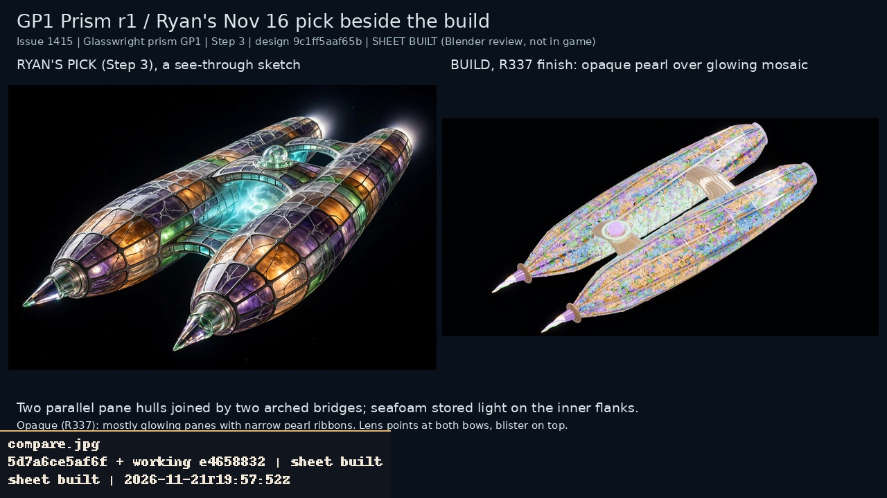

# GP1 Prism: Glasswright prism GP1

Issue 1415 (R368). Stage: **sheet built** (Blender review renders, not in the game), revision **r1**, design 9c1ff5aaf65b.
Built from Ryan's Nov 16 pick Step 3 (contrib/muse/design/glasswright_family_2026_11/, PR 942) in the R337 finish on the
shared Glasswright kit: opaque pearl ribbons with silver edges over glowing amber, violet and green mosaic; nothing see-through.

Review: [close](close.jpg), [side](side.jpg), [battle camera stand-in](camera170.jpg), [true views](sheet.jpg),
[inside](inside.jpg), [fit](fit_view.jpg). [Feature table](feature_table.md), [manifest](manifest.json).

Design: [ithar_GP1.py](../../../../tools/blender/build_sheets/ships/ithar_GP1.py) on [hull.py](../../../../tools/blender/kits/ithar/hull.py).
Recipe ship file: tools/recipe/ships/ithar_GP1.json (game code I15_11).

Budget (Blender, before the recipe): outside 383514 triangles, inside 20280; 13 material surfaces outside.
Weapon match and fit: PASS (weapon_match.json, fit.json). Contract: contract.json.

## Changed from the picture

- Opaque panes and pearl instead of the sketch's clear glass. R337 (Ryan, Nov 19): nothing see-through.
- Two arched bridges, the turret blister on the crown of the forward one. The sketch's curved bridges; a blister on the bridge crown clears both hulls through a full turn (turret T, 360).
- Stored light on the hulls' inner flanks and under the bridges, not a pool in open space. The cleft is open space between two hulls; the glow sits on the glass that faces it.
- Each bow lens point is a short drawn-glass lance with a glowing tip on the hull's axis. cruiser.md: keep them points, never tubes; one pulsar per hull.
