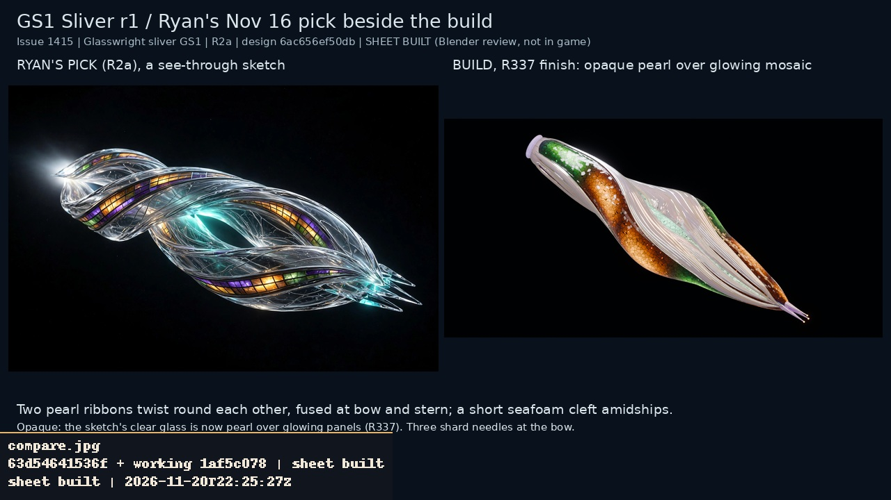

# GS1 Sliver: Glasswright sliver GS1

Issue 1415 (R368). Stage: **sheet built** (Blender review renders, not in the game), revision **r1**, design 6ac656ef50db.
Built from Ryan's Nov 16 pick R2a (contrib/muse/design/glasswright_family_2026_11/, PR 942) in the R337 finish on the
shared Glasswright kit: opaque pearl ribbons with silver edges over glowing amber, violet and green mosaic; nothing see-through.

Review: [close](close.jpg), [side](side.jpg), [battle camera stand-in](camera170.jpg), [true views](sheet.jpg),
[inside](inside.jpg), [fit](fit_view.jpg). [Feature table](feature_table.md), [manifest](manifest.json).

Design: [ithar_GS1.py](../../../../tools/blender/build_sheets/ships/ithar_GS1.py) on [hull.py](../../../../tools/blender/kits/ithar/hull.py).
Recipe ship file: tools/recipe/ships/ithar_GS1.json (game code I14_23).

Budget (Blender, before the recipe): outside 174058 triangles, inside 7496; 8 material surfaces outside.
Weapon match and fit: PASS (weapon_match.json, fit.json). Contract: contract.json.

## Changed from the picture

- Opaque pearl ribbons over a glowing mosaic core instead of the sketch's clear glass. R337 (Ryan, Nov 19): the Glasswright finish is opaque reflective pearl with glowing stained-glass panels; nothing see-through.
- The cleft is a short deep groove over a core of seafoam stored light, not an opening through the ship. Nothing see-through; the pick asks for a short glowing cleft with the ribbons pressed together elsewhere.
- The lobes stay level amidships and turn about 77 degrees each way toward bow and stern. Keeps one clear long axis and a leaf outline from above at the battle camera (the small-hull habit, frigate.md).
- Shard F is three short drawn needles grown from the bow on the centreline. The sketch's bow spikes; data.js shard fires three shots, one per needle; grown, never a tube or a crystal.
- One stern drive optic with a white bloom and a rose-cut face. Family language (CD5); no flame.
