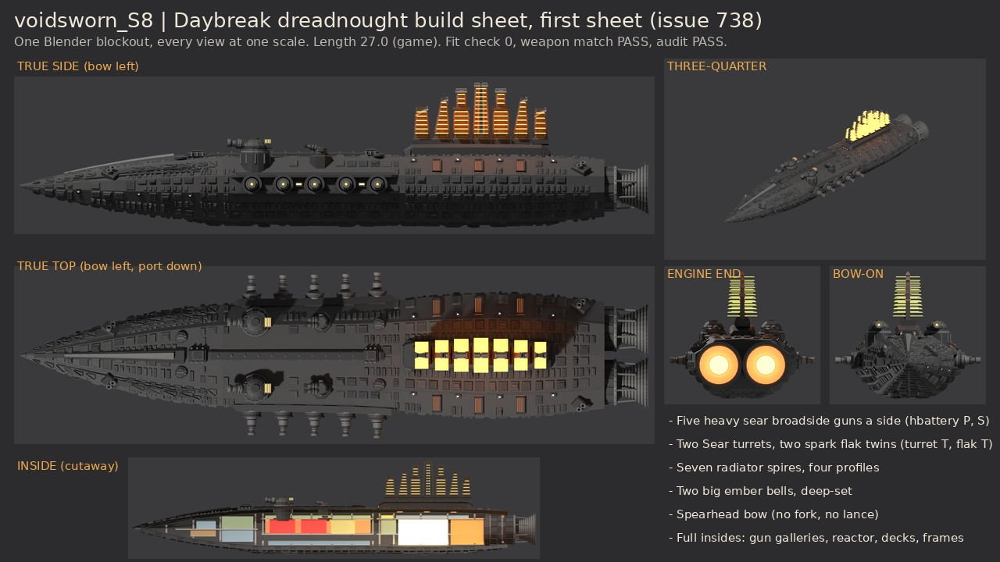
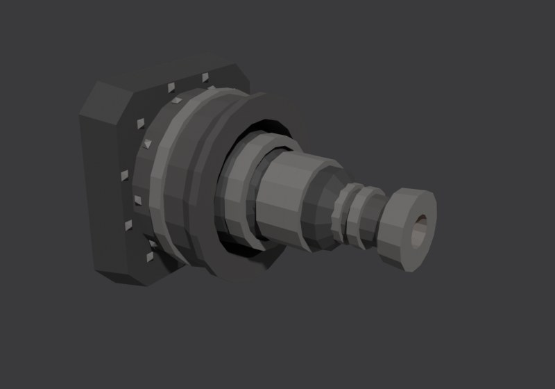
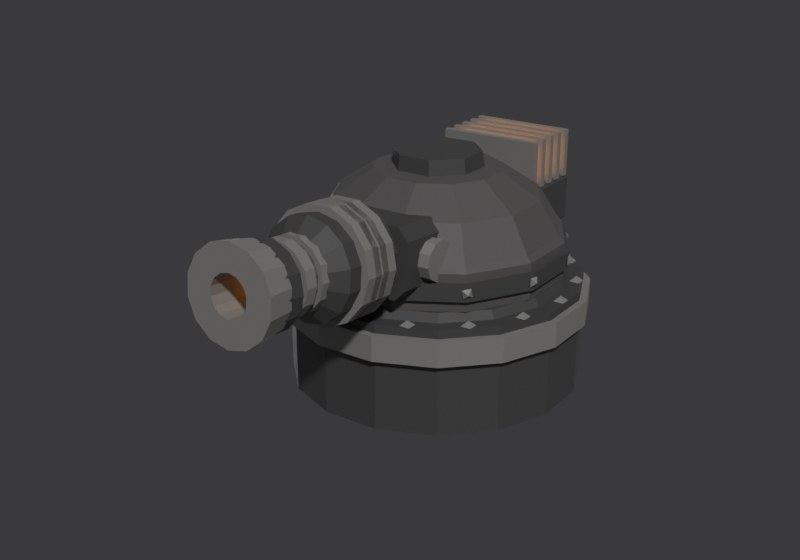
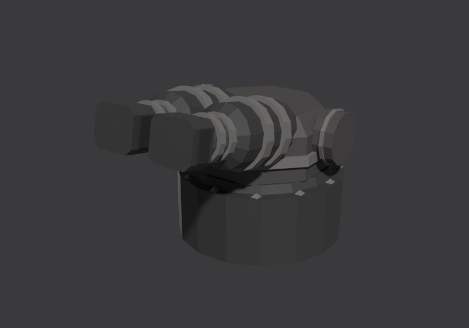

# voidsworn_S8 build sheet: the Daybreak-class dreadnought, the Sunward Crusade flagship

Issue 738. Sunward flagship, class Dreadnought, **27.0 world units** (godot/render/hull_table.gd CLS_LEN['Dreadnought'];
data.js `ascendant`: hbattery P, hbattery S, turret T, flak T; ability nova; no hangar, no lance). Shape of record: S8
(contrib/codex/design/concept_round5_2026_11/voidsworn_S8_sheet.jpg and _beauty.jpg; settled in direction, R185), dressed in
the realistic detailed style (R197, R206 (2)). Designer of record: the Opus builder; the Board is the final designer and S8 is
a base, not a trace (R205, R207, R233, R236). The original sheet pictures show the R254-approved build from the issue 738
sandbox (Blender 5.3, Cycles CPU, 32 samples). `build.py voidsworn_S8 <out> render` rebuilds the sheet from its design file.
Issue 1059 moves the shell rooms and hoists into the gun galleries and sets the decks, frames and liner clear of the wreck tears.

**Change of Nov 19 2026 (issue 1158, R331).** Ryan, on the Sunward concepts: "can we scale down the giant radiator/orange towers
on each ship a bit too?", and "Yes" to the same on S8. Only the spire rows R1 to R7 change: each spire at 70 percent of its
height (tallest 2.6 to 1.8), the same seven, the same stations, lengths and profiles, and the ember in the fin slats (three to
five glowing fins at least 0.26 apart, reaching 60 percent as far, over the dark iron core) instead of a whole lit tower. The
fit check is still all zero and the weapon match PASS. The views, the overview and the battle camera picture on this sheet
are still the Nov 15 build; the before and after is [docs/shots/ships/S8/](../../../shots/ships/S8/) (blockout revision 2,
then the painted run).

Start here: [the overview](voidsworn_S8_sheet_overview.jpg), [the whole concept beside the build](voidsworn_S8_compare_S8.jpg)
(R229), [the weapon review](weapon_review.jpg) (R241), [the battle camera](voidsworn_S8_battle_cam.jpg), then the full
[sheet](sheet.jpg), [side_by_side.jpg](side_by_side.jpg), [fit_view.jpg](fit_view.jpg) and [cells.jpg](cells.jpg).

Files: design `tools/blender/build_sheets/ships/voidsworn_S8.py`, inventory `voidsworn_S8_inv.py`, beauty camera
`voidsworn_S8_camera.json`, battle camera `voidsworn_S8_camera_battle.json`, recipe entry `tools/recipe/ships/voidsworn_S8.json`
(bake stack since issue 756: the Sunward paint stack, pictures in [paint/](paint/README.md)), the new faction kit `tools/blender/kits/voidsworn/` (its README says what each part is).

## The design, in short

1. **The spearhead** (replaces S8's fork, R232): one point at mid height, diamond in section, the hull's facets running to the
   tip; a raised centre ridge and two forged layers of cheek plates along its upper facets; sleek triangle plates (R243).
2. **The blade**: a crowned deck, big upper facets sloping out to the knuckle, the vertical broadside band, lower facets, a flat
   worked belly with an armour step (never a flat wall, R244); 2.75 deep; widest (5.3) at the stern third over the reactor.
3. **The gun deck**: five heavy sear broadside guns a side (hbattery P and S) in deep round ports between armoured lips, the
   gun crews' galleries behind them; ember slits between two pairs of ports.
4. **S8's four deck turrets in its grid**, on low forged tubs at the deck edges: the two Sear turrets forward (turret T: one
   heavy emitter each), the two spark flak twins aft (flak T). Each pair is one data.js slot and every mount fires every volley.
5. **The spire line**: seven radiator spires on a forged spine block, tallest at the middle of the row, four profiles (blade,
   raked, stepped, twin): a few glowing radiator fins standing apart between iron posts, the dark iron core between them
   (the ember in the fin slats, the shared Sunward option `radiator(..., glow='slats')`; R331, issue 1158). The command deck looks out through ember slits
   in the spine block's face. A dorsal power trunk runs forward from it along the centreline (S8's centre strip).
6. **Two big ember bells**, 2.1 across, on riveted drums running 1.55 deep into the stern; bell rings, ember lining, glowing plug.
7. **INSIDE**: iron decks (the bow deck; the gun deck and the upper deck forward; the main and upper decks aft), 16 frames (split
   above and below the gun deck peel), the gun galleries, the shell rooms, the Sear cells, the flak magazine, the plotting room,
   crew decks, the command deck, the Roll, the reactor under the spires with its coolant rooms and heat plenum, the engine room.
   Breaks by the Sunward rule (factions.md "How it breaks"): B-1 tears the spearhead off at its root, B-2 the gun deck from the
   reactor section, **B-3 peels the lower hull away under the galleries, shell rooms and turrets**, and **B-4 snaps the spire
   line off as one piece** at its root. Eight breach anchors are spread across the flanks (Dreadnought base 8, Sunward +0).
   The three midship markers sit on the lower flank, where the stage 7 surface check found clearance from the casemates.

## Weapons (R221, R241)

| Weapon | Mounts | data.js and lore | Built as |
|---|---|---|---|
|  Heavy sear broadside (hbattery) | P1 to P5, S1 to S5 | 5 shots, 7 damage, range 5, las; lore 2.5: heavy broadside decks, old manual gun decks; look macro | a heavy short gun in a deep round armoured port (square riveted surround, a forged collar with a rolled lip), a ball mantlet set back in the port, a heat jacket with three cooling rings, a banded barrel, a flared muzzle, an ember-hot bore |
|  Sear turret (turret) | T1, T2 | 2 shots, 8 damage, range 5, las; look a beam | a low faceted forged dome on a flush riveted ring, one short heavy focusing emitter (jacket, cooling rings, lens collar, ember lens), a radiator bustle with ember fins |
|  Spark flak (flak) | F1, F2 | 3 shots, 3 damage, range 2, point defence; look flak | a squat forged drum, two short barrels in cooling sleeves with squared brakes, an ammunition drum on each cheek, elevating to 60 |

Weapon match (`weapon_match.json`): **PASS**, 0 problems. Slot 0 hbattery P, 5 shots: P1 to P5, one muzzle each. Slot 1 hbattery
S, 5 shots: S1 to S5. Slot 2 turret T, 2 shots: T1, T2. Slot 3 flak T, 3 shots: F1 (2), F2 (2). No dish, antenna or mast on the
ship, so the R240 sensor test has nothing to clear (0 sensor pairs).

## Checks (sandbox, Nov 15 2026)

Rows marked * use the issue 738 helper scripts in `contrib/opus/tools/issue738/` (sandbox only, not standing checks); the rest are
the repo's own tools.

| Check | Result |
|---|---|
| Fit check (clash.py): clash, mount, arc, sensor, sweep, exhaust, exit, lane | 0 of each; 401 objects, 64 parts, 741 rays, 14 guns, 4 turrets swept all round ([fit_report.md](fit_report.md)) |
| Weapon match (R241) and `weapon_match_selftest.py` | PASS; self-test PASS (21 planted faults) |
| Build contract (`tools/recipe/sheet_contract_selftest.py`) | PASS: length 27.0, 2 transverse and 2 longitudinal seams, 16 muzzles in their slots, 4 turret pivots, 2 engines, 47 inside objects, the skin |
| Stage 4 audit (`audit.py` on the sheet_hull build) and `audit_selftest.py` | PASS: 322 parts, no machine across a seam, no structure across one, 14 guns, none into the ship; self-test PASS |
| `build_manifest_tests.js` | PASS, 10 sheets including voidsworn_S8 |
| Inventory (R218, R221) | 0 failing; every built part has a job ([inventory.md](inventory.md)) |
| * Insides inside the skin (every inside vertex against the hull's inner skin at its own station and height) and the clear band at each peel | Original sheet had 10,252 vertices, 47 objects, 0 outside and none straddling a peel plane. See B-3 below for the room move. |
| * Detail density, mesh (R224; tools/recipe/density.py's mesh half) | no flags; lowest: radiator 0.93 triangles and 0.83 edges, engine 0.95 edges of the hull's per square unit ([density_mesh.json](density_mesh.json)) |
| Outline overlap at the camera fitted to the S8 beauty | 86.2 percent, mass outline 87.7 (reported, not a bar; [outline_check.jpg](outline_check.jpg)) |

## Budget (the stage 4 sheet_hull build, before the export)

99,690 triangles outside, 15,508 inside (115,198 in all; * budget.py); 8 outside materials (black iron, darker iron, worked iron, dark, ember
glow, bell lining, throat glow, frost), 10 inside. These are the stage 4 scene's numbers; for comparison, the stage 7 exports (a different stage): A16 151,844 triangles, 21 surfaces, 18,072
inside; E11 117,298, 13 surfaces, 7,677 inside. Costs are reported, never capped; the scene gate is not measured here.

## Proportions (the same measure on S8's sheet and the build)

| | Hull length:beam | Hull length:height | Envelope length:beam | Envelope length:height |
|---|---:|---:|---:|---:|
| S8 sheet | 6.38 | 12.11 | 4.95 | 6.73 |
| **Build** | **5.22** | **8.03** | 3.79 | 4.30 |

The build is deeper and wider than S8 by design (listed below): the gun deck and shell rooms need the depth, the faction sheet
puts the widest point at the stern third. (Since issue 1158 the spires stand at about S8's bank height: the tallest 1.8.) Structure per cell (S8 by eye / build):
bow top 4/6, bow side 2/5, mid top 8/14, mid side 5/10, stern top 7/9, stern side 6/9.

## B-3 clearance (issue 1059)

B-3 runs at z -0.72 from 2.5 units aft to 4.7 units forward. The original shell rooms and their central hoist drive
sat 0.35 units below that plane. The game adds a V kink and three waves when it tears the plating, so that gap could
leave room triangles protruding past the wreck. The Board chose the gallery move in the Nov 15 outside check for PR 748.
Each gallery now houses its shell room and hoist drive along its inboard edge. That puts the shell rooms 0.76 units above
the seam and the hoist drives 0.57 units above it. The fit check measures all of the interior against the skin. The Godot
death-seam check measures the room triangles against the actual broken plating.

Run 1 found 46 protruding triangles from the gun deck and inner liner. In run 2 the bow deck and frame stop short of B-1,
the gun deck is raised and narrowed above B-3, and the aft gun deck, adjacent frame and Roll hall are set back from B-2.
The liner has relief along both lower flanks and across the two transverse joints where they meet B-3. The exterior plating
continues across those joints. ShipView's wreck test on the installed satin export found zero protruding triangles and zero
split machines in both the standard and scene 207 Daybreak seeds. [PC review](../../../shots/swap_sunward_s8_1118/README.md)

## Changed from S8 (every change, with its reason)

The full list is in [feature_table.md](feature_table.md), "Changed from the picture"; the same list is on the sheet.
