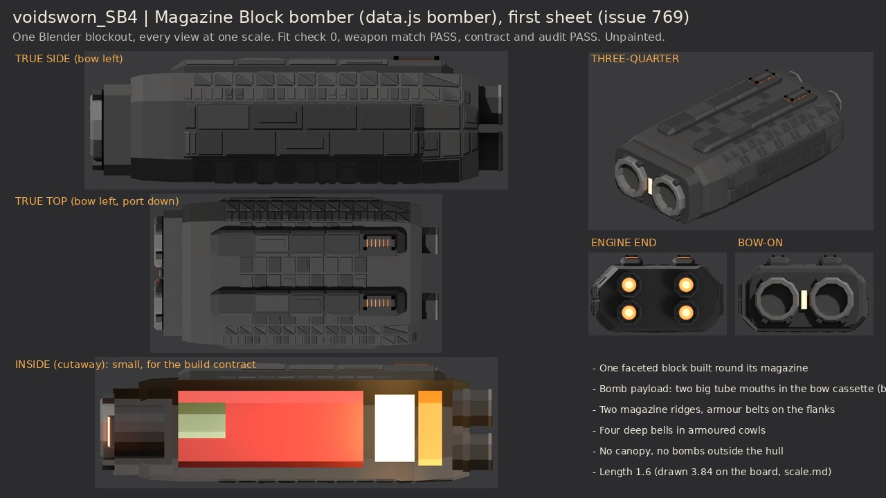
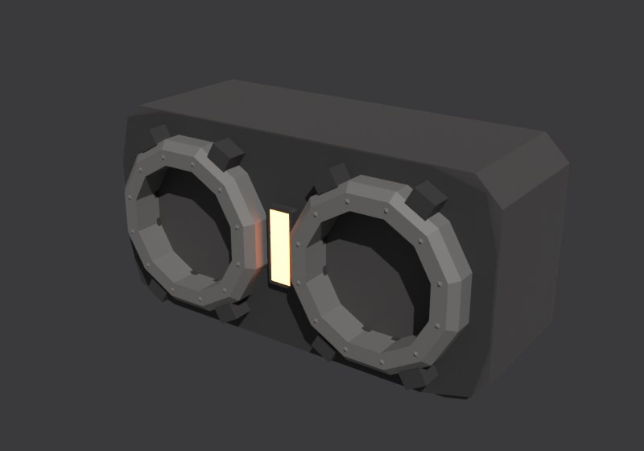

# voidsworn_SB4 build sheet: the Magazine Block, the Sunward Crusade bomber wing craft (first sheet)

Issue 769. Sunward bomber, data.js `bomber` (cls Squadron, `bombs` T: Bomb payload, 2 shots; hp 28, sp 5). Concept of record:
SB4 (contrib/muse/design/squadron_concepts_2026_11/sunward/round_2/SB4.jpg; Ryan, Nov 14 23:57 CST, R255: "Agree on sf3 and
sb4"; design_notes_757.md: "the hull IS the magazine"). Designer of record: the Opus builder; the Board is the final designer and
SB4 is a base (R233, R236). Rendered in the issue 769 sandbox (Blender 5.3, Cycles CPU, 16 samples). No paint stack (issue 756
applies the Sunward stack later) and no PC recipe run in this job. Its partner sheet is [voidsworn_SF3](../voidsworn_SF3/README.md).

Start here: [the overview](voidsworn_SB4_sheet_overview.jpg), [the whole concept beside the build](voidsworn_SB4_compare_SB4.jpg)
(R229), [both craft beside the S8 flagship at true game scale](../voidsworn_SF3/voidsworn_SF3_SB4_true_scale.jpg), [both craft at the
battle camera, game size](../voidsworn_SF3/voidsworn_SF3_SB4_battle_cam.jpg), [the weapon review](weapon_review.jpg) (R241) and
[the bomb cassette alone](weapon_bombs.jpg), then the full [sheet](sheet.jpg), [side_by_side.jpg](side_by_side.jpg),
[fit_view.jpg](fit_view.jpg) and [cells.jpg](cells.jpg) (the concept is one three-quarter picture with no true views).

Files: design `tools/blender/build_sheets/ships/voidsworn_SB4.py`, inventory `voidsworn_SB4_inv.py`, beauty camera
`voidsworn_SB4_camera.json` (fitted from the bow-port side: the block's outline also fits back to front), recipe entry
`tools/recipe/ships/voidsworn_SB4.json` (bake none), the Sunward kit's craft parts in `tools/blender/kits/voidsworn/`, the sandbox
helpers in `contrib/opus/tools/issue769/` (`launcher_shot.py` made weapon_bombs.jpg: build.py's weapon close-ups cover guns only).

## Size (scale.md wins)

LENGTH 1.6 (CLS_LEN['Squadron']), drawn 3.84 on the board, the same as the fighter (scale.md: "same wing frame as a fighter, only
its load differs"); the design notes' 4.2 units is overruled. The bomber reads apart by its mass: beam 0.86 and depth 0.50
against the fighter's 0.37 and 0.37 (hull alone 0.80 by 0.43), length to beam 2.0.

## The design, in short

1. **The magazine block**: one massive faceted body, eight-sided in section (deck, chamfers, the vertical flank band, lower
   chamfers, a flat belly), so the flanks are angled planes round a band, never a flat wall (R244).
2. **The bomb cassette** (bombs T) is the bow face: two big round mouths with worked-iron twelve-sided rims and forged lugs, dark
   bores 0.22 deep with the next bomb's nose seated in each, the bombardier's sight slit glowing between them. Fixed forward:
   the bomber turns to aim.
3. **Two magazine ridges** on the deck, one over each bomb row (each row feeds one tube); heat louvres on their aft ends.
4. **Two magazine belts**: a second forged layer over each flank band.
5. **Four drives**: two pairs of deep bells sunk in eight-sided armoured cowls in the stern face.
6. **INSIDE** (small): two magazine rows with eight bombs racked nose forward, the bombardier's cell, the reactor, the drive
   room; one seam (B-1) between the magazine and the reactor. The game shows a craft's death as a spark (fx_death.gd
   `_wing_death`); the inside is there for the build contract and because the magazine is the bomber's story.

## Weapons (R221, R241)

| Weapon | Mount | data.js and lore | Built as |
|---|---|---|---|
|  Bomb payload (bombs) | BT | 2 shots, 9 damage, range 1 (k sq), pierce 0.6, crit 10; battle look `bombs` | a deep armoured cassette of two tubes forming the bow face, heavy rims, the next bomb in each bore, the sight slit between |

Weapon match (`weapon_match.json`): **PASS**, 0 problems. Slot 0 bombs T, 2 shots: BT, two muzzles, both fire every volley. The
weapon-match table now has a row for `bombs`: a bomb-tube launcher, fixed, may show an all-round (T) weapon on a craft, because the
craft turns onto its target (weapon_match.py FITS; ships.md rule 11; the Board's reading, not Ryan's words).

## Checks (sandbox, Nov 15 2026)

| Check | Result |
|---|---|
| Fit check (clash.py) | 0 of every kind; 75 objects, 7 parts, 4 exhaust cones, 4 launch apertures, 2 lanes ([fit_report.md](fit_report.md)) |
| Weapon match and `weapon_match_selftest.py` | PASS; self-test PASS (25 planted faults, 4 of them craft faults) |
| Build contract (`sheet_contract_selftest.py`) | PASS: length 1.6, 1 transverse seam, 2 muzzles in slot 0, 4 engines, 6 inside objects, the skin |
| Stage 4 audit (`audit.py` on the sheet_hull build) and `audit_selftest.py` | PASS: 43 parts, none across the seam; self-test PASS (BT moved onto the seam is refused) |
| Inventory (R218, R221) | 0 failing; every built part has a job ([inventory.md](inventory.md)) |
| Outline overlap at the camera fitted to SB4 | 90.5 percent, mass outline 90.9 (reported, not a bar; [outline_check.jpg](outline_check.jpg)) |
| Detail density, mesh (R224) | flagged: the cassette 0.45 and 0.31 of the hull (its big flat front plate and housing) ([density_mesh.json](density_mesh.json)) |

## Budget (the stage 4 sheet_hull build)

20,516 triangles outside, 908 inside; 6 outside materials, so about 6 draw calls a craft once joined by material (today's
code-built craft: 5 surfaces). A wing of four: about 85,700 triangles. Reported, not capped; the scene gate is not measured here.

## What the battle camera shows

At game size (about 30 px long) the bomber reads as a broad dark block with four ember drives aft, the fighter as a slim dart with
one ember point; they read apart at every heading tried. The two bow mouths read only when the bomber faces the camera, and then
as two grey rings round the glowing sight slit ([the battle picture](../voidsworn_SF3/voidsworn_SF3_SB4_battle_cam.jpg)).

## Changed from SB4 (every change, with its reason)

The full list is in [feature_table.md](feature_table.md), "Changed from the picture"; the same list is on the sheet.
