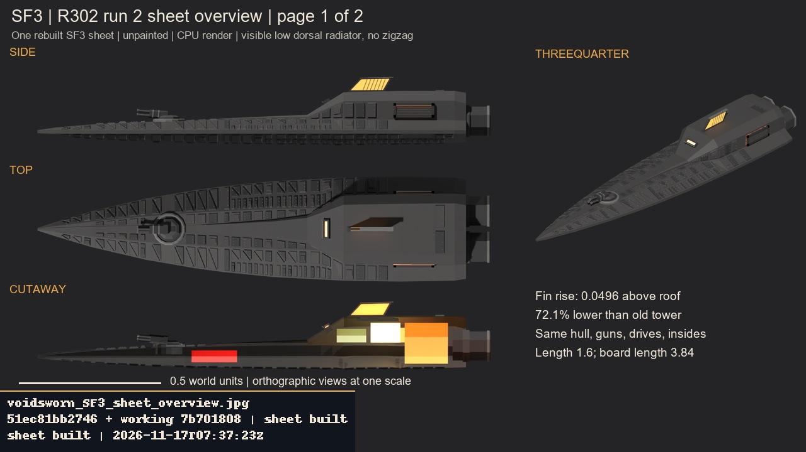
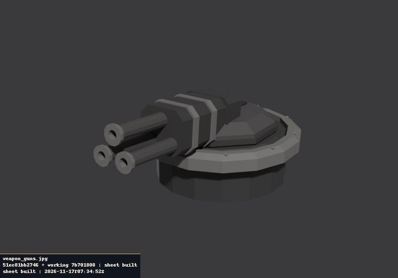

# voidsworn_SF3 build sheet: Spire Dart, R302 raised low fin, run 2

Issue 769. Sunward fighter, data.js `fighter` (cls Squadron, `guns` T: Interceptor guns, 3 shots; hp 18, sp 6). Concept of
record: SF3 (contrib/muse/design/squadron_concepts_2026_11/sunward/round_2/SF3.jpg; Ryan, Nov 14 23:57 CST, R255: "Agree on sf3
and sb4"). The notes' own ruling block (design_notes_757.md) names SF4 at 23:51; R255 and the issue name SF3 six minutes later,
so SF3 is built. Designer of record: the Opus builder; the Board is the final designer and SF3 is a base (R233, R236).
Issue 920 revises only radiator R1, following Ryan's R302 call to shrink the tower into a low swept fin and remove the
zigzag. Run 2 raises the fin above the roof again: a swept panel with lit side slats, 0.0496 units above the bare roof,
28 percent of the original tower's exposed height. Rebuilt on Ryan's PC with Blender 4.5.14, Cycles CPU, 16 samples. Sheet built, unpainted; no recipe export or game
install. Its partner sheet is [voidsworn_SB4](../voidsworn_SB4/README.md).

Start here: [concept / main before / after](voidsworn_SF3_compare_SF3.jpg), [side profile](SF3_R302_side.jpg),
[camera 170](SF3_R302_camera170.jpg), [the overview](voidsworn_SF3_sheet_overview.jpg), [the weapon review](weapon_review.jpg), then the full
[sheet page 1](sheet.jpg), [sheet page 2](sheet_02.jpg), [side_by_side.jpg](side_by_side.jpg), [fit_view.jpg](fit_view.jpg) and [cells.jpg](cells.jpg) (the concept is
one three-quarter picture with no true views, so cells.jpg shows it in place of the top and side views).

Separate proof frames: [accepted concept](SF3_R302_concept.jpg), [main before](SF3_R302_before_concept.jpg),
[R302 after](SF3_R302_after_concept.jpg). Before is main `3bdea48f56dc`; after carries its working source digest.
Both sheet pages are 1280 x 720; page 1 keeps side, top and cutaway at one scale. No tall sheet is reduced to a narrow strip.
Every current picture carries its revision and stage and is at most 720 pixels high. The old issue 769
`voidsworn_SF3_SB4_true_scale.jpg` and `voidsworn_SF3_SB4_battle_cam.jpg` remain historical, before R302.

Files: design `tools/blender/build_sheets/ships/voidsworn_SF3.py`, inventory `voidsworn_SF3_inv.py`, beauty camera
`voidsworn_SF3_camera.json`, recipe entry `tools/recipe/ships/voidsworn_SF3.json` (bake none), the Sunward kit's craft parts in
`tools/blender/kits/voidsworn/` (unchanged). [proof_920.py](proof_920.py) reproduces the review images and records.
R1's swept panel is authored in the SF3 design file, using the Sunward materials and socket, so its manifest route is
hand-built. The other fittings keep their kit routes. [model.json](model.json) is the rebuilt model record.

## Size (scale.md wins)

LENGTH 1.6, the hull table's CLS_LEN['Squadron']; the board draws a craft at 1.6 x SHIP_K 1.6 x SQUADRON_K 1.5 = 3.84
(docs/playbooks/scale.md, Squadron rows, binding). The design notes' 3.2 units for the fighter is overruled by scale.md: fighter
and bomber are the same length, and the fighter reads apart by its slim outline. Every station in the design file is a share of
LENGTH, so the length is one line. Measured on the true-scale picture: the S8 flagship 43.2 long, each craft 3.9 (3.84 plus the
lit edge), so a craft is about a twelfth of the flagship.

## The design, in short

1. **The forged blade**: one narrow body from the point to the stern, a low spine strip, the deck, upper facets out to a thin
   knife edge, lower facets, a flat belly; widest (0.37) at the stern third. No wing, no sweep, no aerofoil.
2. **The stern block**: the blade thickens into a raised armoured block with a sloping forward face; it holds the pilot, the
   reactor and the drives.
3. **The interceptor guns** (guns T): three short barrels in one emitter cluster on a shallow traverse ring, sunk in an armoured
   well on the blade's back near the bow (the concept's dorsal recess). They turn all round and elevate to 45.
4. **One raised low swept radiator**: a small panel on the stern roof, with orange side slats and a thin swept cap.
   Peak z 0.19520, 0.04960 above the bare stern roof's 0.14560. This is 28 percent of the old tower's exposed height,
   and far shorter than the stern roof's 0.432 length. The reactor socket stays in place. No tower or zigzag.
   The fin reads more flush with the roof than the concept, especially at its high camera; the exposing side view shows it.
5. **Two drives**: deep bells sunk in eight-sided armoured cowls in the stern face, smaller and dimmer than the concept's.
6. **No canopy**: the pilot looks out through one armoured ember slit in the block's sloping face. Heat louvres on the block's
   flanks (the concept's glowing slats).
7. **INSIDE** (small, for the build contract only): the gun feed, the pilot's cell, the reactor under the spire, the drive room;
   one seam (B-1) at the block's toe. The game shows a craft's death as a spark and hides it (godot/fx/fx_death.gd
   `_wing_death`), so nothing breaks open; the build contract (tools/blender/build_sheets/contract.py) refuses a sheet with no
   inside and no seam.

## Weapons (R221, R241)

| Weapon | Mount | data.js and lore | Built as |
|---|---|---|---|
|  Interceptor guns (guns) | G1 | 3 shots, 4 damage, range 1 (k sq), x2.2 against squadrons; battle look `guns` | three barrels in one banded emitter jacket on a block mantlet, a low faceted housing on a traverse ring in a riveted well; flared muzzles, dark bores |

Weapon match (`weapon_match.json`): **PASS**, 0 problems. Slot 0 guns T, 3 shots: G1, three muzzles, every barrel fires every
volley. No dish, antenna or mast (0 sensor pairs).

## Checks (Ryan's PC, Nov 17 2026, issue 920 run 2)

| Check | Result |
|---|---|
| Fit check (clash.py) | 0 of every kind; 56 objects, 7 parts, 110 rays, 1 turret swept all round ([fit_report.md](fit_report.md)) |
| Weapon match | PASS, 0 problems ([weapon_match.json](weapon_match.json)) |
| Build contract (`sheet_contract_selftest.py`) | PASS: length 1.6, 1 transverse seam, 3 muzzles in slot 0, 1 turret pivot, 2 engines, 4 inside objects, the skin |
| Build manifest | PASS; R1 hand-built, all other fitting routes unchanged ([manifest.json](manifest.json)) |
| Standing checks (`node contrib/opus/tools/run_all_checks.js`) | PASS, exit 0; existing findings and oracle-drift baseline exceptions only |
| Geometry preservation | PASS: all 54 objects outside R1 unchanged, including hull plates, guns, engines and insides; exposed fin height reduced 72.1 percent ([geometry_920.json](geometry_920.json)) |
| Inventory (R218, R221) | 0 failing; every built part has a job ([inventory.md](inventory.md)) |
| Outline overlap at the unchanged SF3 camera | 91.2 percent, mass outline 91.3; rescored, camera never refitted ([outline_check.jpg](outline_check.jpg)) |
| Detail density, mesh (R224) | flagged: radiator triangles 0.65 and edges 0.57 of hull, drive edges 0.59, louvres triangles 0.50 and edges 0.41 ([density_mesh.json](density_mesh.json)); reported, other parts unchanged |

## Budget (rebuilt sheet)

18,606 triangles outside, 112 inside, 18,718 total. Seven outside materials, seven surfaces and about seven draw calls per
craft once joined by material. Main before: 18,606 outside and 112 inside. All 12,462 plating triangles remain unchanged.
Reported, not capped. No scene gate, paint bake, recipe export, stage 4 audit or game install was run for this sheet-only
revision. Camera 170 uses the game's projection, formation and craft scale with sheet materials; it is not an installed-game capture.

## Changed from SF3 (every change, with its reason)

The full list is in [feature_table.md](feature_table.md), "Changed from the picture"; the same list is on the sheet.
