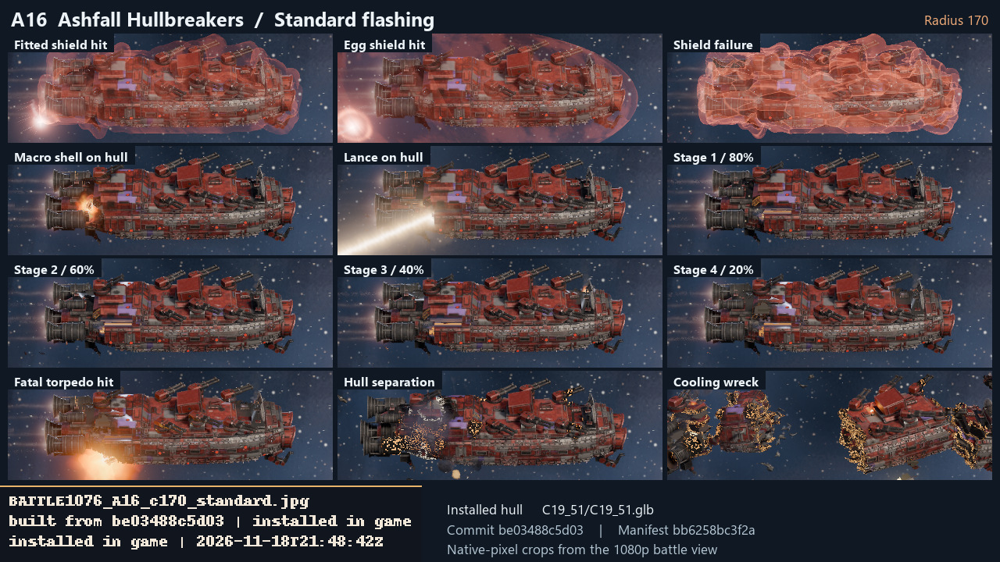
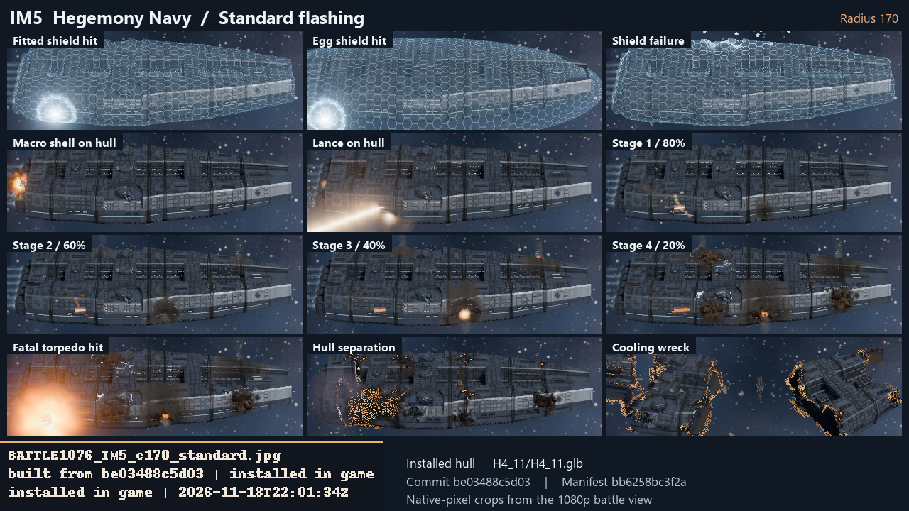
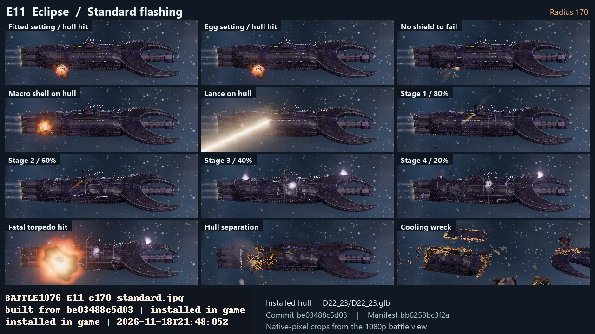

# Battle damage baseline · Nov 18, 2026

A16 and IM5 show clear shield hits. E11 has no shield in either setting. Hull damage between the first impacts and the fatal blow reads less clearly. A16 keeps much the same shape through stage 4. IM5 shows larger vents and dark wounds by then. The clips show the moments between the stills, including power loss, the core flash and the fully cooled wreck.

| Installed ship | Battle camera, radius 170 | Close camera, radius 26 |
|---|---|---|
| A16 · Ashfall Hullbreakers | [Standard sheet](BATTLE1076_A16_c170_standard.jpg) · [Reduced sheet](BATTLE1076_A16_c170_reduced.jpg) · [Clip](BATTLE1076_A16_c170.mp4) | [Standard sheet](BATTLE1076_A16_c26_standard.jpg) · [Reduced sheet](BATTLE1076_A16_c26_reduced.jpg) · [Clip](BATTLE1076_A16_c26.mp4) |
| IM5 · Hegemony Navy | [Standard sheet](BATTLE1076_IM5_c170_standard.jpg) · [Reduced sheet](BATTLE1076_IM5_c170_reduced.jpg) · [Clip](BATTLE1076_IM5_c170.mp4) | [Standard sheet](BATTLE1076_IM5_c26_standard.jpg) · [Reduced sheet](BATTLE1076_IM5_c26_reduced.jpg) · [Clip](BATTLE1076_IM5_c26.mp4) |
| E11 · Eclipse | [Standard sheet](BATTLE1076_E11_c170_standard.jpg) · [Reduced sheet](BATTLE1076_E11_c170_reduced.jpg) · [Clip](BATTLE1076_E11_c170.mp4) | [Standard sheet](BATTLE1076_E11_c26_standard.jpg) · [Reduced sheet](BATTLE1076_E11_c26_reduced.jpg) · [Clip](BATTLE1076_E11_c26.mp4) |

Each clip plays the standard and reduced-flashing passes in that order. The battle-camera sheets crop the 1080p render at original pixel size. The close sheets scale down center crops, and the clips retain a wider view. The Navy close camera is aimed aft to keep the impacts in frame. The bench uses the ships' combat weights and a Sunward Vigil as the firing ship. The same opening shot tests both shield settings. On A16 and IM5, the fitted pass then drains the shield and carries both weapon marks through the hull stages. The bench moves all three sections through the same thresholds in each pass. In combat, individual sections can reach different stages. The clips cut from the glowing wreck to the end of cooling. The fixed close view shows the torn faces early, then some of the largest pieces drift out of frame.

The Nov 19 close clips were recorded from a scratch copy of main at `1b79ebf1e3c1e4ce8326c11585fd4385af424a04` with the shared installation’s hulls. The installed ship manifest SHA256 was `956408a2c73e54d4f6769459e64c6767ce65bb64ab715c97e79b841c3de8eee1`. All three packed hull scenes matched the Nov 18 capture.

| Ship | Close-view changes since the Nov 18 sheets |
|---|---|
| A16 | The reduced-flashing torpedo hit glows a deeper orange, and the cooling sections sit a little farther apart. |
| IM5 | The large cooling module and the loose debris in the gap sit at slightly different angles. |
| E11 | The standard macro-shell hit has a darker center and a more distinct orange rim. |

The stage 4 check casts rays through each opening from the two recorded cameras and checks whether the first visible surface is authored interior. These are sightlines through geometry. Lighting, smoke and the opening's size still affect whether the player can recognize the decks.

## A16 · Ashfall Hullbreakers

| Moment | What the player sees |
|---|---|
| Fitted shield hit | The red-orange skin hugs the armour and turrets. The small white-orange contact flares low at the stern. |
| Egg shield hit | The same hit lights a broad curved rim outside the blocky outline, clearest at battle radius. |
| Shield failure | Orange sheets light up around the hull and break into uneven sputters and sparks before the barrier goes dark. |
| Macro shell | A compact orange punch throws sparks and a dark fragment from the lower stern plating. |
| Lance | A sustained bright line lights the stern edge. A narrow orange mark survives the beam. |
| Stage 1 · 80% | The earlier burn still stands out. New darkening is easy to miss among the patch plates. |
| Stage 2 · 60% | The aft side takes on a thin hot streak and darker edges. The silhouette stays intact. |
| Stage 3 · 40% | More of the scar is dark. Small intermittent orange vents read before the underlying dent. |
| Stage 4 · 20% | Aft cuts and vent trails read at close range. Geometry rays reach authored interior through both engine-section openings at both cameras. The four midship and prow openings have no clear line of sight to the interior from this view. Deck detail is hard to make out at battle radius. |
| Fatal torpedo | A large orange-white detonation arrives at the low stern. The engines cut and fire walks along the hull before it opens. |
| Separation | The aft assembly tears away through a shower of white and gold debris. Uneven torn edges and smaller chips read at battle radius. |
| Cooling wreck | The widening gap exposes gold-lit framework. The close view shows torn fingers of metal before they cool to dark drifting pieces. |
| Reduced flashing | The contact and fatal flash have less white glare. The shield shape, visible scars, debris and opening gap remain readable. |

## IM5 · Hegemony Navy

| Moment | What the player sees |
|---|---|
| Fitted shield hit | A pale blue hex grid follows the wedge, with a bright circular impact near the aft lower edge. |
| Egg shield hit | The grid curves around the ship and extends clear of the pointed bow and aft corners. |
| Shield failure | The grid lights across the ship and blue-white cell fragments peel loose above the edge. |
| Macro shell | A short orange blow and dark spray show against the grey stern. |
| Lance | The bright beam rakes the aft side and leaves a narrow orange diagonal scar. |
| Stage 1 · 80% | Soot and a small orange fleck stand out against the light hull stripe. |
| Stage 2 · 60% | The aft streak remains. A darker midship spot begins to interrupt the stripe. |
| Stage 3 · 40% | A hot midship vent and dimmer spots toward the bow make a clear step up in the clip. |
| Stage 4 · 20% | Multiple dark wounds show on the deck and side. Smoke obscures parts of the cut edges. Geometry rays reach the authored interior through both engine-section openings at both cameras. The other four openings have no clear sightline to the interior from this view. |
| Fatal torpedo | A white-orange bloom lights a wide area aft, followed by darkened lights and a line of bursts. |
| Separation | Broad modules pull apart with an orange spray between them. The wedge reads as separate pieces within the frame. |
| Cooling wreck | Orange spark-like points trace the rims. Dark internal plates and bays are easier to see after the flash falls away. |
| Reduced flashing | The fatal bloom keeps its outline but has a much dimmer white center. The hex grid, bright lance and small hot vents stay visible. |

## E11 · Eclipse

| Moment | What the player sees |
|---|---|
| Fitted setting | E11 has no shield. The shell hits the black-violet plating and throws orange sparks. |
| Egg setting | The same direct hit lands on the same plating. There is no change in shield response. |
| Shield failure | There is no collapse beat. Hot chips trail away from the direct hit. |
| Macro shell | A compact orange burst on the aft side shows strongly against the dark finish. |
| Lance | The bright beam reaches the upper aft plates and leaves a short diagonal streak. |
| Stage 1 · 80% | An orange streak and small rising wisps mark the aft and middle plates. The outer shape holds. |
| Stage 2 · 60% | Silver-violet lines and scuffs spread across the center panel seams. |
| Stage 3 · 40% | White-violet vent puffs above the center and crescent edge become the strongest damage cue. |
| Stage 4 · 20% | Dark breaks interrupt the plated center while white-violet vents still outline the hull. The battle camera has a sightline into one engine opening and one midship opening. The close view also reveals the second engine opening. Both prow openings stay occluded from these views. |
| Fatal torpedo | The hit produces a large orange-white burst. Lights dim and the aft joint begins to tear. |
| Separation | A slice of dark hull slips away through a cloud of bright chips. The crescent remains recognizable after the first split. |
| Cooling wreck | Drifting pieces show amber torn edges and a bright green fitting on the separated crescent. The edge glow fades while the pieces stay apart. |
| Reduced flashing | The orange-white fatal core is softer. Purple-white vents and the dark silhouette still track the same beats. |

The fatal torpedo also logged a zero-length normal while sampling a fragment's paint in `fx_fragments.gd`. The hit and breakup completed.

## Dense ion storm

[12-hex patch](BATTLE1076_storm_01.jpg) · [19-hex patch](BATTLE1076_storm_02.jpg)

Seed `4103`, 31 storm hexes and 28 nebula hexes, matches issue 1070’s dense case. The rules expose one ion-storm terrain kind. This board’s four storm placements resolve to two connected clouds. The shots compare four presentation states on each cloud: calm, ambient lightning, the shield-drain flare, and reduced ambient lightning. A16 is parked at a storm hex as a scale and visibility reference. Both clouds retain the same steel-blue body against the more violet nebula. Normal lightning adds a pale branched bolt and a local wash. The positioned shield-drain event lifts the gas without a bolt. Reduced lightning is dimmer while retaining the branch and cloud shape.

## Installed hull contract

The 36 manifest entries and 259 listed files were checked against the synced snapshot and the shared installation. All listed hashes matched. Eleven hulls carry authored interior material slots, seams with paths or spans, and machine bounds. The headless wreck check returned zero split machines and zero new protruding interior triangles on all eleven. IM5 already had **14 interior triangles outside the whole hull** by the check’s pre-break test. The other ten had zero. This is a build-sheet finding for `H4_11`.

| Family | Installed hulls with the authored contract | Installed hulls lacking it |
|---|---|---|
| Ashfall Hullbreakers | `C13s_23`, `C14s_23`, `C15s_23`, `C16s_23`, `C19_51` | None |
| Hegemony Navy | `H10_23`, `H4_11` | `H7_23`, `H8_23`, `H9_23` |
| Eclipse | `D9_23`, `D20_23`, `D21_23`, `D22_23` | None |
| Sunward Crusade | None | `V14_23`, `V15_37`, `V16_37`, `V17_37`, `V18_51`, `V1b_r_23` |
| The Chorus | None | `B16_23`, `B19_11`, `B20_11`, `B21_11`, `B22_11` |
| The Glasswrights | None | `I11_37`, `I14_23`, `I15_11`, `I16_11`, `I8_37` |
| Wings and objectives | None | `B23_51`, `S1_51`, `S2_23`, `O1_37`, `O2_37`, `O3_11` |

Sunward’s S8 replacement remains pending after its wreck and scene checks. The Chorus and Glasswright replacement finishes and installs are also pending. Those families have no new-build sheet in this baseline.

## Source and checks

- **Nov 18 source commit** `be03488c5d03aabb0aec3480e949461c1c4f067e`. **Installed ship manifest SHA256** `bb6258bc3f2a8c9e530776c4fd9a228957462beee10a37db73a37da0dc6ff2d1`. Both match issue 1070. The live shared folder still carried the egg-default script, so capture used issue 1070’s synced snapshot for presentation code. A16 and IM5 packed scenes matched the shared installation byte for byte. E11 loaded the current installed packed scene from the shared cache after its paint refresh. The [ship list](../../../contrib/codex/battle_baseline_1118/ships.json) records those packed-scene hashes.
- **Reproduce the Nov 18 capture** Run the [capture adapter](../../../contrib/codex/battle_baseline_1118/capture.gd) with the issue 1070 synced Godot project, Forward+, 1920×1080 and `--fixed-fps 60` through `tools/pc/tmo.bat`. Pass `ships.json`, a scratch folder, `26`, and optionally a ship ID or `storm` after `--`. The [sheet and clip script](../../../contrib/codex/battle_baseline_1118/compose.py) takes the scratch, picture and clip folders. The [inventory script](../../../contrib/codex/battle_baseline_1118/inventory.py) takes the synced and shared Godot project folders.
- **Nov 18 checks** Standing checks returned 67 passes and two known baselines after the GPU watchdog fixture passed an unrestricted rerun. The first run's sandbox denied the fixture's temporary hardlink. All 11 installed-hull seam checks and the storm lightning check passed. The sheets passed provenance verification, and the clips decoded end to end.
